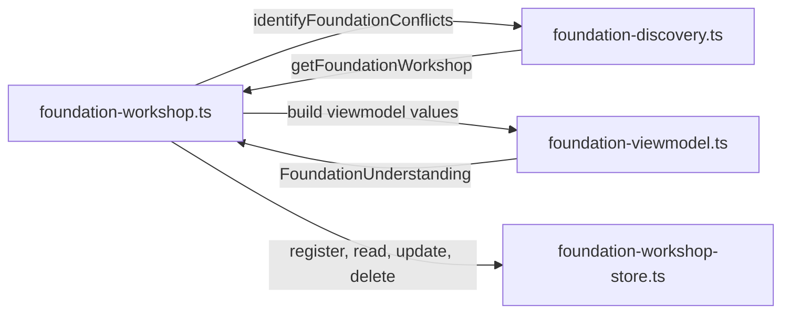
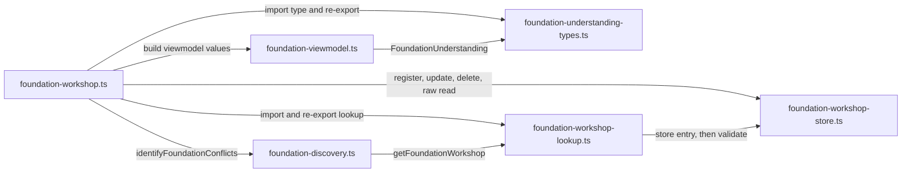
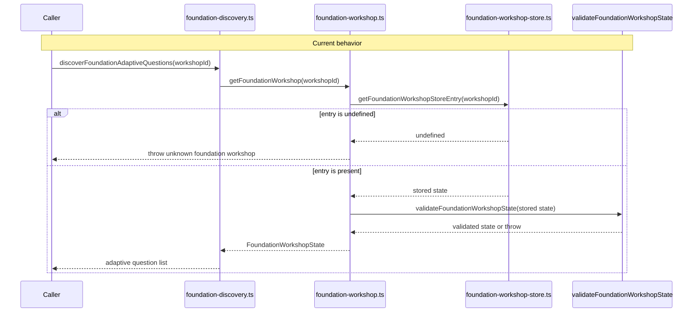

# P1G.3 Foundation workshop dependency cycle

Status: **proposed**. This document is a Design First review artifact. It
does not implement P1G.3, and it does not authorize implementation until a
maintainer approves it.

Baseline: `main` at `6bbfb988ee6f4f4b686d60e7ffd3a26ecc2b3103` (PR #588,
P1G.2). Design First policy is already on that baseline (PR #589 and
PR #590).

## Problem and goals

`packages/application/src/foundation-workshop.ts`,
`foundation-discovery.ts`, and `foundation-viewmodel.ts` form one
strongly connected component. The workshop module owns session
operations and the `FoundationUnderstanding` type, then calls discovery
and viewmodel helpers. Discovery calls back into the workshop for
session lookup. The viewmodel imports `FoundationUnderstanding` from the
workshop. Each reverse edge closes a cycle, so the three files are one
component in both the import-only graph and the re-export-inclusive
graph.

The cycle is structural. None of the three modules call each other while
the module is still evaluating, so this is not a live temporal-dead-zone
failure. The packages stabilization plan still treats the component as
debt that later slices must remove without changing Foundation behavior.

Success for a later implementation PR:

- The three files are no longer in any strongly connected component.
- Session lookup still throws the same error for an unknown id, and still
  validates stored state before discovery reads it.
- Public names, signatures, result shapes, package export paths, and
  error text stay the same.
- The Approved Apply component and the recorded Neutron mutation
  component stay as they are. The component that contains `index.ts`
  does not gain files. The P1G.1 and P1G.2 cycles do not return.

Non-goals: workshop persistence, discovery question rules, viewmodel
schema URNs, CLI, daemon, Desktop, TUI, Neutron, Approved Apply, Undo
U4, and Desktop Undo U5.

## Consulted canon

- `docs/governance/DESIGN_FIRST_POLICY.md`
- `docs/governance/AI_AGENT_WORKFLOW.md`
- `docs/governance/ENGINEERING_PRINCIPLES.md`
- `docs/governance/CODE_QUALITY_STANDARDS.md`
- `docs/governance/DOMAIN_MODELING.md`
- `docs/architecture/ARCHITECTURE.md`
- `docs/architecture/PACKAGES_STABILIZATION_PLAN.md`
- `docs/decisions/ADR-0007-private-application-operation-boundary.md`
- `docs/roadmap/FOUNDATION_WORKSHOP_IMPLEMENTATION_PLAN.md` (historical
  operation names only)

ADR-0007 keeps project operations in `@intentloom/application` and keeps
that package independent of the CLI. This design stays inside that
package. It does not add a bounded context, an Entity, an Aggregate, a
Repository, a Domain Service, or a Domain Event. Foundation Workshop is
an application use-case family already owned by these modules. Domain
modeling says not to create a context because a folder exists.

No new ADR is required. The change relocates an existing type and an
existing function. It does not change a durable architecture rule.
Maintainer approval of this design is still required.

## Verified current architecture

Measured on this baseline with `tests/application-source-cycles.ts`
through `tests/application-foundation-scaffold-cycle.test.ts` (4 tests
passed). Import-only components are three, each of size 3. Re-export
components are four, with sizes 4, 29, 3, and 3 in the order that test
locks. The historical size set 29, 4, 3, 3 matches. Membership:

| Graph       | Component                                                  | Files                                                                                                                                         |
| ----------- | ---------------------------------------------------------- | --------------------------------------------------------------------------------------------------------------------------------------------- |
| Import-only | Approved Apply                                             | `approved-apply-baseline.ts`, `generated-file-sync-declared.ts`, `index.ts`                                                                   |
| Import-only | Foundation workshop                                        | `foundation-discovery.ts`, `foundation-viewmodel.ts`, `foundation-workshop.ts`                                                                |
| Import-only | Recorded Neutron mutation                                  | `neutron-mutation-apply-durable-record.ts`, `neutron-mutation-apply-store.ts`, `neutron-mutation-verification-retry-eligibility.ts`           |
| Re-export   | Extension update                                           | `apply-extension-update.ts`, `discover-and-apply-extension-update.ts`, `extension-update-files.ts`, `propose-and-apply-extension-adoption.ts` |
| Re-export   | Barrel                                                     | 29 files, including `index.ts`, `inception-flow.ts`, and `foundation-flow.ts`. The workshop trio is not in this list.                         |
| Re-export   | Same Foundation and Neutron components as the import graph |                                                                                                                                               |

`tests/application-source-cycles.ts` counts every `import` and
`import type` whose specifier resolves to another application source
file. A type-only import from `foundation-workshop.ts` is still an edge.
`export … from` counts only in the re-export-inclusive graph.

### Module ownership today

| Module                              | Owns                                                                                                                                                        | Imports from the other two                                                                                                                                                                                                                                                                             |
| ----------------------------------- | ----------------------------------------------------------------------------------------------------------------------------------------------------------- | ------------------------------------------------------------------------------------------------------------------------------------------------------------------------------------------------------------------------------------------------------------------------------------------------------ |
| `foundation-workshop.ts` (245/266)  | `CreateFoundationWorkshopParams`, `FoundationUnderstanding`, session create/read/update/delete, understanding summary, conflict and readiness orchestration | `identifyFoundationConflicts`; viewmodel builders `buildFoundationConflictList`, `buildFoundationQuestionList`, `buildFoundationReadinessViewmodel`, `buildFoundationUnderstandingSummary`, `buildFoundationWorkshopDeleteResult`, `buildFoundationWorkshopExport`, `buildFoundationWorkshopViewmodel` |
| `foundation-discovery.ts` (171/187) | Conflict detection, adaptive questions, completeness, and the two session-id wrappers                                                                       | `getFoundationWorkshop`                                                                                                                                                                                                                                                                                |
| `foundation-viewmodel.ts` (138/147) | Versioned workshop, understanding summary, readiness, question, conflict, export, and delete viewmodels                                                     | type `FoundationUnderstanding`                                                                                                                                                                                                                                                                         |

Line counts are the stabilization-plan effective/physical figures.
Physical lengths still match `wc -l` on this baseline.

Other imports, none of which close this component:

- Workshop also imports `@intentloom/protocol`, `@intentloom/validator`,
  `foundation/foundation-workshop-store.ts`,
  `foundation/foundation-readiness.ts`, and
  `foundation/foundation-workshop-defaults.ts`.
- Discovery also imports protocol types and schema URNs, plus
  `validateFoundationConflict`, `validateFoundationQuestion`,
  `validateFoundationDiscoveryAdaptiveQuestionList`, and
  `validateFoundationDiscoveryCompleteness`.
- Viewmodel also imports protocol types and schema URNs, plus the
  matching validator builders and `createFoundationRetentionState`.

The store is a process-local `Map`. `registerFoundationWorkshop` and
`updateFoundationWorkshopStoreEntry` validate before writing.
`getFoundationWorkshopStoreEntry` returns the stored object or
`undefined`. It does not throw, and it does not validate.
`getFoundationWorkshop` is the read used by session operations:

1. Read the store entry.
2. If it is `undefined`, throw `unknown foundation workshop '<id>'`.
3. Otherwise return `validateFoundationWorkshopState(entry)`.

The validator builds a new object. The raw store getter returns the Map
value itself. Those two results are not the same object, and they do not
fail the same way.

### Current dependency graph

Editable source:
[`current-dependencies.mmd`](current-dependencies.mmd).



Public export path, unchanged by this proposal:

`index.ts` re-exports `inception-flow.ts`, which re-exports
`foundation-flow.ts`, which re-exports `foundation-workshop.ts` and
`foundation/foundation-w3.ts`. `foundation-w3.ts` re-exports
`foundation-discovery.ts`. `foundation/foundation-w2.ts` re-exports
`foundation-viewmodel.ts` and `foundation-workshop-store.ts`. The package
export map key `"."` points at `src/index.ts`. No subpath key names these
three files.

In-package callers of `getFoundationWorkshop` from
`foundation-workshop.ts` are `foundation-blueprint.ts`,
`foundation-scaffold.ts`, `foundation-scaffold-apply-revalidation.ts`,
and `foundation-discovery-turn.ts`. `foundation-cli.ts` imports workshop
view operations and imports `discoverFoundationAdaptiveQuestions` from
discovery. Daemon handlers and tests import the public functions from
`@intentloom/application`. `FoundationUnderstanding` has one production
importer besides its declaration: `foundation-viewmodel.ts`. Protocol
owns the separate type `FoundationUnderstandingSummary`.

## Proposed architecture

Cut both edges that point back at the workshop. Leave the workshop's
forward edges in place. That is the same shape as P1G.1 and P1G.2: move
the shared declaration to a leaf, and keep the existing caller direction.

1. Move the `FoundationUnderstanding` interface, unchanged, to
   `packages/application/src/foundation/foundation-understanding-types.ts`.
   The file imports nothing. `foundation-viewmodel.ts` imports the type
   from that file. `foundation-workshop.ts` imports it and re-exports it
   with `export type`.
2. Move the body of `getFoundationWorkshop`, unchanged, to
   `packages/application/src/foundation/foundation-workshop-lookup.ts`.
   That file imports `getFoundationWorkshopStoreEntry` and
   `validateFoundationWorkshopState` only. Discovery's two session-id
   functions import `getFoundationWorkshop` from the lookup module.
   `foundation-workshop.ts` imports the same function and re-exports it
   with `export { getFoundationWorkshop }`.

Do not add either new file to `foundation-w2.ts`, `foundation-w3.ts`, or
`foundation-flow.ts`. `foundation-flow.ts` already star-exports both
`foundation-workshop.ts` and `foundation-w2.ts`, and `foundation-w2.ts`
star-exports the store. A second star export of `getFoundationWorkshop`
or `FoundationUnderstanding` would make the public name ambiguous.

### Proposed dependency graph

Editable source:
[`proposed-dependencies.mmd`](proposed-dependencies.mmd).



Resulting direction:

- Types depend on nothing in this package.
- The lookup depends on the store and the validator.
- Discovery depends on the lookup, not on the workshop.
- The viewmodel depends on the types module, not on the workshop.
- The workshop depends on discovery, the viewmodel, the lookup, the
  types module, and the store.

No path returns to the workshop. Loading discovery evaluates the lookup
and the store, and does not evaluate the workshop. The store Map remains
the one process-local workshop collection. There is no second store and
no new initialization step.

`identifyFoundationConflicts`, `generateAdaptiveFoundationQuestions`,
`evaluateFoundationDiscoveryCompleteness`, and
`buildFoundationDiscoveryAdaptiveQuestionList` stay pure readers of a
workshop value already in hand. They do not look up a session.
`discoverFoundationAdaptiveQuestions` and
`evaluateFoundationDiscoveryCompletenessForWorkshop` stay the only
discovery functions that take a workshop id.

## Workshop state access

`getFoundationWorkshop` is not a pure function. It reads the module Map
and validates. Moving that function is a relocation of the existing read,
not a new service.

Direct use of `getFoundationWorkshopStoreEntry` from discovery does not
preserve the read:

|                      | `getFoundationWorkshop`                     | `getFoundationWorkshopStoreEntry` |
| -------------------- | ------------------------------------------- | --------------------------------- |
| Missing id           | throws `unknown foundation workshop '<id>'` | returns `undefined`               |
| Present id           | validates, then returns a new object        | returns the live Map value        |
| Invalid stored value | throws the validator error                  | returns the invalid value         |

Session-id discovery must keep calling `getFoundationWorkshop` so unknown
ids still throw before question generation or completeness, and so a
stored value still passes `validateFoundationWorkshopState` before either
pure function reads it. The lookup module is that function. Discovery
does not gain write access to the Map.

### Retrieval sequence

Current source:
[`workshop-retrieval-current.mmd`](workshop-retrieval-current.mmd).



Proposed source:
[`workshop-retrieval-proposed.mmd`](workshop-retrieval-proposed.mmd).


`evaluateFoundationDiscoveryCompletenessForWorkshop` uses the same lookup
and then calls `evaluateFoundationDiscoveryCompleteness`. The workshop
module's own session operations (`listFoundationQuestions`,
`recordFoundationWorkshopAnswer`, conflict identification, readiness,
viewmodel, and export) keep calling the same `getFoundationWorkshop`
binding.

Persistence stays the in-memory Map in `foundation-workshop-store.ts`.
This design does not add disk storage, a cache, or a copy of workshop
state. Create, answer recording, readiness updates, and delete stay in
`foundation-workshop.ts` and keep using `registerFoundationWorkshop`,
`updateFoundationWorkshopStoreEntry`, and
`deleteFoundationWorkshopStoreEntry`.

## Public API compatibility

These names stay exported from `@intentloom/application` through the
existing barrel. Signatures and result objects stay as they are.

| Name                                                                                                                                                                                                | Stays declared or re-exported from                | Callers that must keep compiling                                                         |
| --------------------------------------------------------------------------------------------------------------------------------------------------------------------------------------------------- | ------------------------------------------------- | ---------------------------------------------------------------------------------------- |
| `getFoundationWorkshop`                                                                                                                                                                             | `foundation-workshop.ts`, re-exporting the lookup | blueprint, scaffold, scaffold revalidation, discovery turn, daemon tests, package barrel |
| `FoundationUnderstanding`                                                                                                                                                                           | `foundation-workshop.ts`, type re-export          | viewmodel, package type imports                                                          |
| `discoverFoundationAdaptiveQuestions`                                                                                                                                                               | `foundation-discovery.ts`                         | `foundation-cli.ts`, daemon, Desktop/TUI tests                                           |
| `evaluateFoundationDiscoveryCompletenessForWorkshop`                                                                                                                                                | `foundation-discovery.ts`                         | foundation discovery tests                                                               |
| `identifyFoundationConflicts` and the other pure discovery functions                                                                                                                                | `foundation-discovery.ts`                         | workshop conflict orchestration, discovery turn                                          |
| Viewmodel builders, including `buildFoundationUnderstandingSummary`                                                                                                                                 | `foundation-viewmodel.ts`                         | workshop session operations                                                              |
| Workshop session operations (`createFoundationWorkshop`, `recordFoundationAnswer`, `summarizeFoundationUnderstandingState`, `summarizeFoundationUnderstandingViewmodel`, and the rest of that file) | `foundation-workshop.ts`                          | CLI, daemon, client viewmodel                                                            |

`FoundationUnderstanding` is an erased type. The runtime package object
does not gain a value with that name. `FoundationUnderstandingSummary`
remains the protocol type that
`validateFoundationUnderstandingSummary` returns. The summary builder
still spreads the same fields and sets
`FOUNDATION_UNDERSTANDING_SUMMARY_SCHEMA_URN`.

No package export-map key is added or removed. Daemon RPC method names
and protocol request types stay where they are.

## DDD and module ownership

| Responsibility                                                          | Owner after the move                |
| ----------------------------------------------------------------------- | ----------------------------------- |
| Workshop session transitions, answers, readiness writes, export, delete | `foundation-workshop.ts`            |
| Conflict, adaptive-question, and completeness rules                     | `foundation-discovery.ts`           |
| Versioned read models and schema-bearing summaries                      | `foundation-viewmodel.ts`           |
| Unversioned understanding counts                                        | `foundation-understanding-types.ts` |
| Validated session read                                                  | `foundation-workshop-lookup.ts`     |
| Map authority: register, raw read, update, delete, seed, clear          | `foundation-workshop-store.ts`      |

The types file is a shared application contract, as
`foundation-scaffold-file-row-types.ts` and
`inception-summary-types.ts` already are. The lookup file exists because
the validated read cannot live on the store module without a second
public export of the same function name. It is not a new domain layer.

## Security and mutation

The moved read does not change who may write workshop state.

- The store module remains the only owner of the Map.
- The lookup function does not register, update, delete, seed, or clear.
- Discovery's session-id functions stay read-only. They already do not
  write the workshop.
- Project-root checks, filesystem ports, Approved Apply, transactions,
  and rollback are not on this path.
- Neutron permissions and `mutationAllowed` are not on this path.
- Validation stays on every public session read. The design does not
  skip `validateFoundationWorkshopState` for discovery.
- ADR-0007 is unchanged: application operations stay out of the CLI, and
  this slice adds no network, telemetry, or credential use.

Readiness evaluation still updates the store from `foundation-workshop.ts`
after `getFoundationWorkshop`. That write is outside the cycle break.

## Error handling

Current and proposed behavior for `getFoundationWorkshop` are the same
function body. The diagram applies to both. Source:
[`workshop-error-path.mmd`](workshop-error-path.mmd).

```mermaid
flowchart TD
  call["getFoundationWorkshop(workshopId)"]
  read["getFoundationWorkshopStoreEntry(workshopId)"]
  missing{"entry is undefined?"}
  unknown["throw Error: unknown foundation workshop id"]
  validate["validateFoundationWorkshopState(entry)"]
  bad{"validator throws?"}
  invalid["propagate that Error unchanged"]
  ok["return validated FoundationWorkshopState"]
  call --> read --> missing
  missing -->|yes| unknown
  missing -->|no| validate --> bad
  bad -->|yes| invalid
  bad -->|no| ok
```

| Case                                      | Current                                                                                                                                                                                                                                     | Proposed                                        |
| ----------------------------------------- | ------------------------------------------------------------------------------------------------------------------------------------------------------------------------------------------------------------------------------------------- | ----------------------------------------------- |
| Unknown workshop id                       | `getFoundationWorkshop` throws `unknown foundation workshop '<id>'`. Discovery wrappers throw that error before building questions or completeness.                                                                                         | Same function body, so the same throw.          |
| Missing store entry                       | The same path. A missing Map entry is the unknown-id case.                                                                                                                                                                                  | Same path.                                      |
| Invalid stored workshop                   | `validateFoundationWorkshopState` throws, including `Invalid foundation workshop state: expected object`, `Invalid workshop status '…'`, and `Invalid readiness status '…'`.                                                                | Same call. The error is not caught or replaced. |
| Invalid discovery input                   | An unknown id fails as an unknown workshop. `effort` other than `high` or `medium` selects no adaptive questions only after a successful lookup. Question and completeness validators still throw on values those pure functions construct. | Unchanged. No new input coercion.               |
| Validation failure inside discovery rules | `validateFoundationConflict`, `validateFoundationQuestion`, `validateFoundationDiscoveryAdaptiveQuestionList`, and `validateFoundationDiscoveryCompleteness` throw as they do today.                                                        | Those calls stay in discovery.                  |

The store's update and delete helpers throw the same unknown-id string for
their own operations. Discovery does not start calling them.

There is no silent fallback. A missing workshop does not become an empty
question list, an incomplete result, or `undefined`.

The rejected direct store read diverges on both failure and success.
Source: [`rejected-direct-store-read.mmd`](rejected-direct-store-read.mmd).

```mermaid
flowchart TD
  call["discovery reads getFoundationWorkshopStoreEntry directly"]
  missing{"entry is undefined?"}
  diverge["return undefined and do not throw"]
  live["return the live Map value"]
  skip["do not call validateFoundationWorkshopState"]
  call --> missing
  missing -->|yes| diverge
  missing -->|no| live --> skip
```

The public store API cannot plant an invalid entry: `register` and
`seed` validate before insert. The implementation PR must not add a
backdoor that writes past validation just to test the invalid path. The
guarantee is that discovery calls the one function which still contains
the throw and the validator call.

Retries, idempotency, and timeouts do not apply. The read has no I/O and
no retry loop. Repeating it for the same stored state returns an equal
validated object. Discovery question generation does not modify the
workshop, which existing discovery tests already lock.

## Alternatives

### 1. Shared type plus direct store access

Move `FoundationUnderstanding`, and change discovery to call
`getFoundationWorkshopStoreEntry`. This removes both cycle edges and adds
no file for the lookup. It is rejected. The store read does not throw on a
missing id, does not validate, and returns the live Map object. Matching
the errors would mean copying the body of `getFoundationWorkshop` into
discovery, which is a second implementation of the same read.

### 2. Shared type plus the existing validated read

This is the proposal above. The type move matches P1G.1 and P1G.2. The
function move keeps one implementation of the read. A new eight-line
module is the smallest home that is not star-exported beside the
workshop.

Colocating `getFoundationWorkshop` on `foundation-workshop-store.ts` was
considered and rejected for a mechanical reason: `foundation-w2.ts`
star-exports the store, and `foundation-flow.ts` star-exports both that
barrel and `foundation-workshop.ts`. Two star exports of the same
function name collide. Keeping the function only on the store, and
deleting it from the workshop module, would also break every relative
import of `getFoundationWorkshop` from `foundation-workshop.ts`.

Moving only the two session-id wrappers into the workshop module would
remove the discovery-to-workshop edge, but the viewmodel would still
import `FoundationUnderstanding` from the workshop. The component would
remain. The type move is still required.

### 3. Injected lookup

A parameter or setter for the session read would preserve behavior only
if the default implementation is still `getFoundationWorkshop`. Putting
that default inside discovery imports the workshop again unless the
default is the extracted function, which is alternative 2. Adding a
parameter to `discoverFoundationAdaptiveQuestions` or
`evaluateFoundationDiscoveryCompletenessForWorkshop` changes a public
signature. This design does not inject a dependency.

## Testing strategy

This design PR does not change tests and does not claim the
implementation suite passed.

The implementation PR should:

- Keep existing Foundation discovery, session URN, CLI, daemon, scaffold,
  and blueprint tests as behavioral locks. They already cover adaptive
  questions, completeness, unknown-id throws after delete
  (`/unknown foundation workshop/` in `tests/daemon-foundation.test.ts`),
  and discovery that does not mutate workshop state.
- Add source assertions, in the style of
  `tests/application-foundation-scaffold-cycle.test.ts`, that:
  - `foundation-understanding-types.ts` has no relative specifiers;
  - `foundation-workshop-lookup.ts` imports only the store module;
  - discovery does not import `foundation-workshop.ts`;
  - the viewmodel does not import `foundation-workshop.ts`;
  - the workshop module still imports `identifyFoundationConflicts` and
    the viewmodel builders;
  - the lookup source still contains `unknown foundation workshop` and
    `validateFoundationWorkshopState`.
- Update the locked cycle arrays in that existing test. A second test
  with a contradictory graph would fail. Expected membership after the
  implementation is in the acceptance section. Do not edit the arrays in
  the design PR.
- Run `pnpm verify` before the implementation PR is opened.

No new end-to-end Desktop flow is required, because no client behavior
changes. Contract coverage is the existing package-barrel imports plus
the type re-export.

## Migration and rollback

Implementation files, and only these, when the design is approved:

| File                                                                    | Change                                                                        |
| ----------------------------------------------------------------------- | ----------------------------------------------------------------------------- |
| `packages/application/src/foundation/foundation-understanding-types.ts` | New. The interface only.                                                      |
| `packages/application/src/foundation/foundation-workshop-lookup.ts`     | New. The current `getFoundationWorkshop` body.                                |
| `packages/application/src/foundation-workshop.ts`                       | Import and re-export both. Delete the local interface and function body.      |
| `packages/application/src/foundation-discovery.ts`                      | Import `getFoundationWorkshop` from the lookup module.                        |
| `packages/application/src/foundation-viewmodel.ts`                      | Import the type from the types module.                                        |
| `tests/application-foundation-scaffold-cycle.test.ts`                   | Point the locked graph at the post-move components, and assert the new edges. |

No CLI, daemon, Desktop, TUI, protocol, validator, or Neutron file needs
an edit for compatibility. Relative imports of `getFoundationWorkshop`
from `foundation-workshop.ts` keep working through the re-export.

Rollback is reverting that implementation commit. Workshop state is not
on disk, and the stored object shape does not change. There is no data
migration.

Risks:

- Leaving `import type { FoundationUnderstanding } from "./foundation-workshop.js"`
  keeps the viewmodel edge, because the cycle scanner counts type imports.
- Star-exporting the lookup or the types file from `foundation-w2.ts`
  duplicates public names.
- Replacing the lookup call with the raw store getter changes errors and
  object identity.
- Updating the cycle test inside the design PR would pretend the
  implementation had landed.

Both new files are far below the 250-line preference. The workshop file
shrinks. It is within the 400-line production ceiling today (266 physical
lines) and this move does not grow it.

## Acceptance criteria

A future implementation PR meets P1G.3 only when all of the following are
true. They are not claims about this design PR.

- Import-only strongly connected components are two, each of size 3:
  Approved Apply, and the recorded Neutron mutation cycle.
- Re-export-inclusive components are three: the extension-update
  component (size 4), the existing 29-file component that contains
  `index.ts` and `inception-flow.ts`, and the Neutron component (size 3).
- The 29-file component's membership is unchanged. No new component
  appears. Neither the P1G.1 pair nor the P1G.2 pair returns.
- `foundation-discovery.ts`, `foundation-viewmodel.ts`, and
  `foundation-workshop.ts` are in no component.
- `getFoundationWorkshop` still throws `unknown foundation workshop '<id>'`
  when the store has no entry, and still calls
  `validateFoundationWorkshopState` when an entry exists.
- Discovery session-id functions use that function.
- Public names, signatures, schema URNs, and the `"."` export path are
  unchanged.
- `pnpm verify` passes on the implementation branch.
- P1H, P1I, P1J, Undo U4, and Desktop Undo U5 remain unstarted.

## Open questions

None that require a new ADR. Approval of this document chooses
alternative 2. A reviewer who wants the validated read to live somewhere
other than `foundation-workshop-lookup.ts` can reject that filename, but
the store module is not an available substitute while `foundation-w2.ts`
star-exports it.

## What this design PR does not do

- No edit under `packages/`, `apps/`, or `tests/`.
- No change to SCC expectations.
- No claim that P1G.3 is implemented or merged.
- No Excalidraw or draw.io source. Mermaid is enough for these dependency
  and sequence diagrams. SVG previews are optional for Mermaid under the
  Design First policy.
