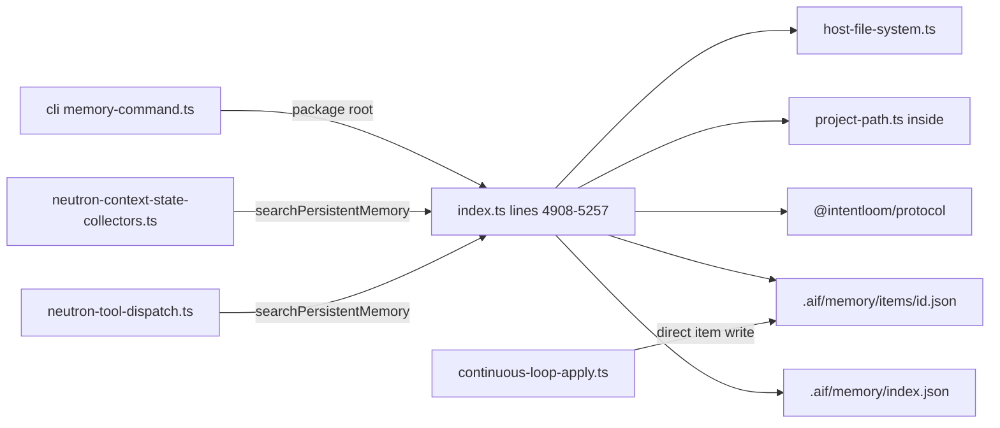
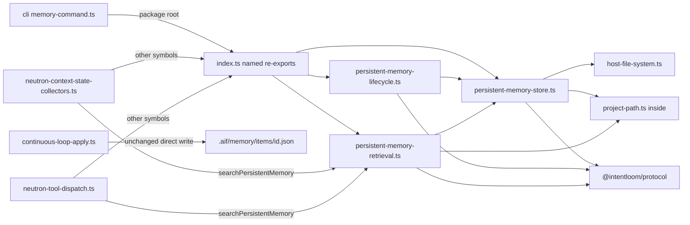
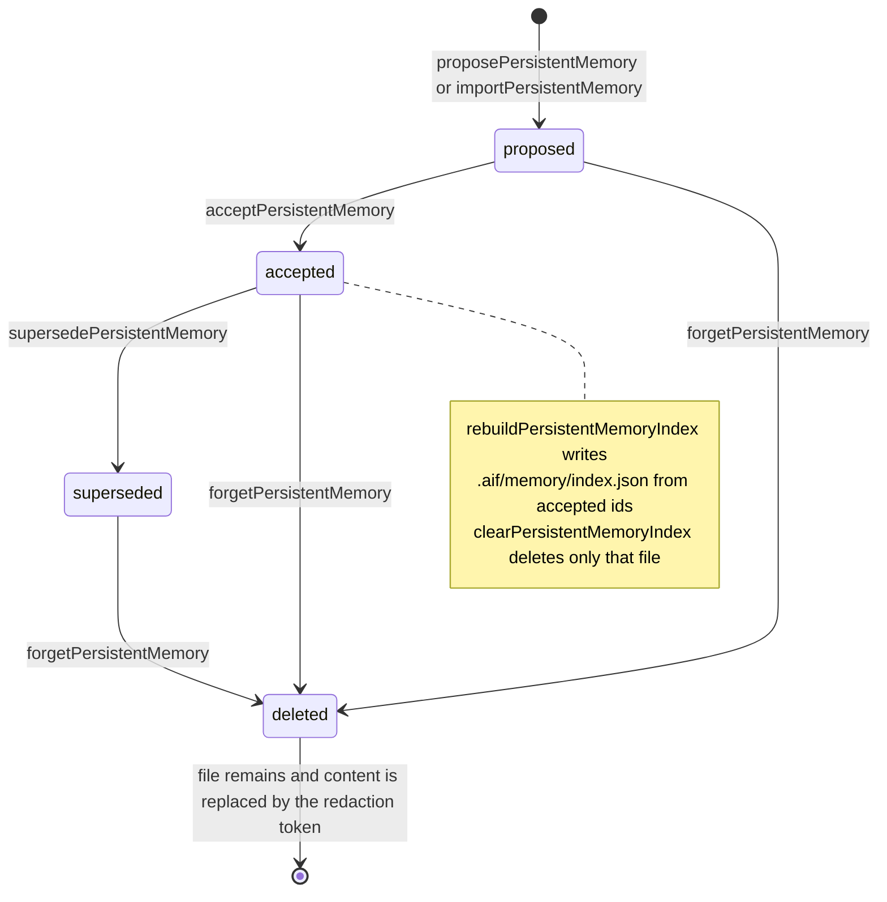
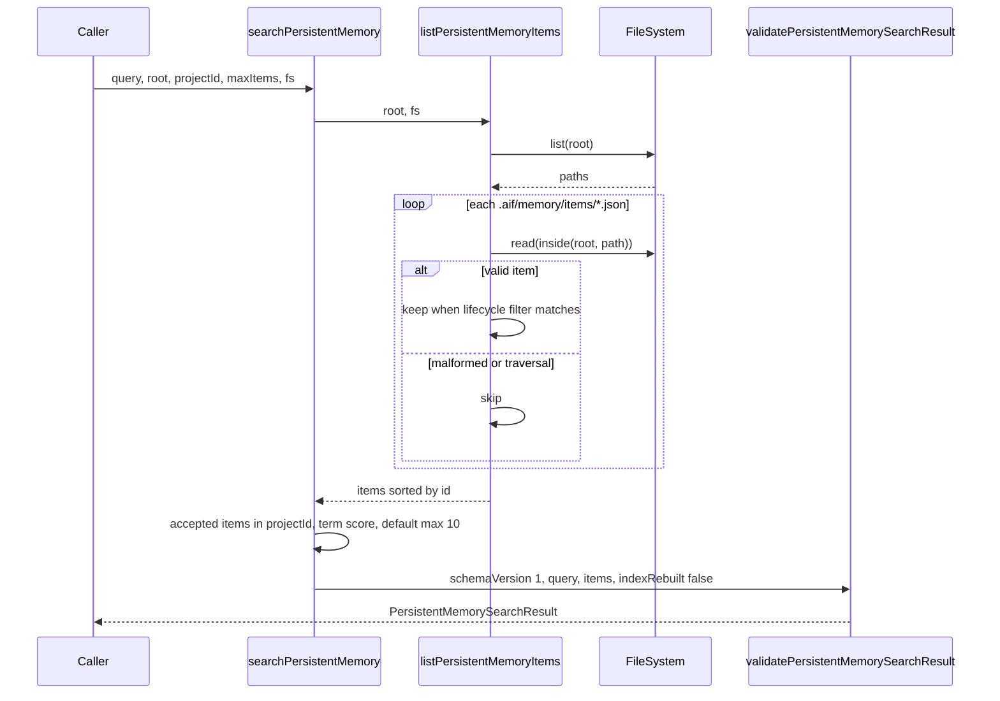
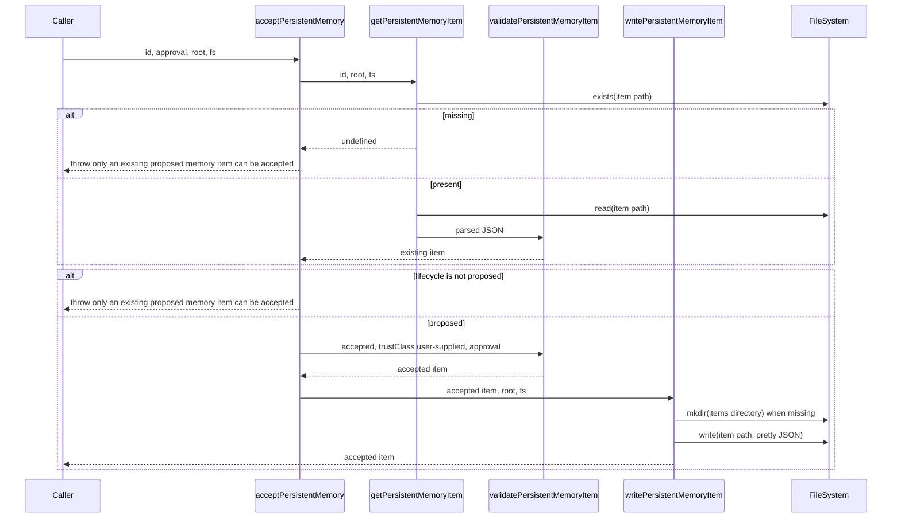
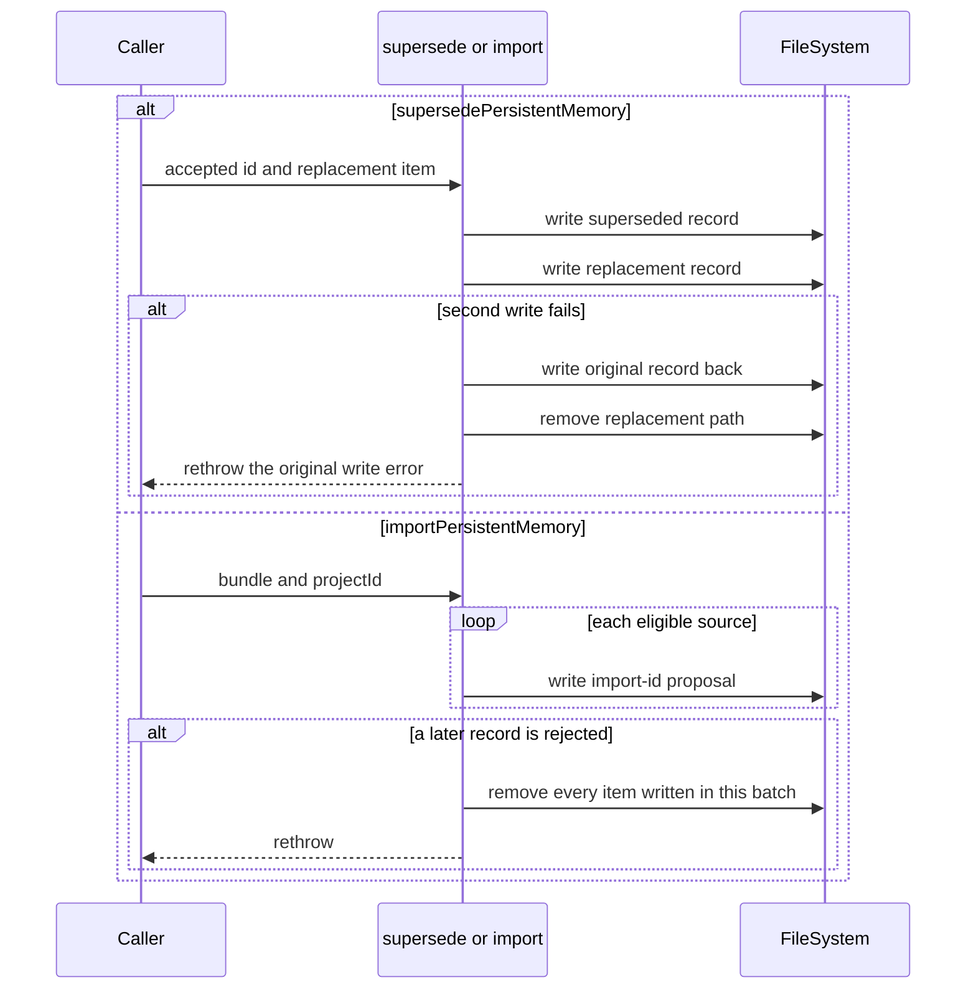

# P1H.1 Persistent memory extraction

Status: **proposed**. This document is a Design First review artifact. It
does not implement P1H.1, and it does not authorize implementation until a
maintainer approves it. A green CI result is not approval.

Baseline: `main` at `488067af1d39a614e718660944c7f3ae030b1be7` (PR #596,
P1G.3 implementation). P1G is complete. P1H.2 and later slices are not
part of this design.

## Problem and goals

`packages/application/src/index.ts` still owns the Persistent Memory
operation family. On this baseline the file measures **6,562 effective
lines** and **6,937 physical lines** (`measureProductionSource`). The
family is one contiguous block at lines **4908–5257** (336 effective,
350 physical). The packages stabilization plan schedules it as the
first P1H group: a leaf module that imports `host-file-system.ts` and
the protocol validators, with the public names still exported from
`index.ts`.

Success for a later implementation PR:

- The twelve public operations and their three private helpers move
  unchanged into `packages/application/src/memory/`.
- `index.ts` re-exports the twelve public names and does not re-export
  the helpers.
- Signatures, default parameters, return types, error text, storage
  paths, JSON formatting, redaction, retention, and validation stay the
  same.
- No extracted file imports `index.ts`.
- Import-only and re-export strongly connected components keep today's
  membership and sizes.
- The Application package export map does not gain a key.
- Approved Apply and the recorded Neutron mutation component stay as
  they are.

Non-goals: Agent Session, Task Checkpoint, Skill Catalog and proposals,
procedural memory, semantic ranking configuration, bounded project
context, security findings, interactive workspace, `applyWorkspaceProposal`,
`applyProjectAdoption`, `adoptProject`, `doctorProject`,
`synchronizeGeneratedFiles`, `applyContinuousLoopMemory`, Undo U4,
Desktop Undo U5, and every later P1H group.

## Consulted canon

- `docs/governance/DESIGN_FIRST_POLICY.md`
- `docs/governance/AI_AGENT_WORKFLOW.md`
- `docs/governance/ENGINEERING_PRINCIPLES.md`
- `docs/governance/CODE_QUALITY_STANDARDS.md`
- `docs/governance/DOMAIN_MODELING.md`
- `docs/architecture/ARCHITECTURE.md`
- `docs/architecture/PACKAGES_STABILIZATION_PLAN.md`
- `docs/decisions/ADR-0007-private-application-operation-boundary.md`
- `docs/decisions/ADR-0024-accepted-persistent-memory.md`
- `docs/decisions/ADR-0025-semantic-memory-retrieval.md`
- `docs/concepts/PERSISTENT_AGENT_MEMORY.md` (product language; the
  operations below are the implemented subset)
- `docs/roadmap/MEMORY_AND_SECURITY_ROADMAP.md` (M2 and M3 are already
  implemented)

ADR-0007 keeps these operations in `@intentloom/application` and keeps
that package independent of the CLI. ADR-0024 and ADR-0025 already
decide the lifecycle and the derived index. This design relocates that
implementation. It does not add a bounded context, an Entity, an
Aggregate, a Repository, a Domain Service, or a Domain Event. Domain
modeling says not to create a context because a folder exists. Agent
Memory is already a context candidate. No new ADR is required.
Maintainer approval of this design is still required.

The P1A inventory table in the stabilization plan lists Persistent
Memory at lines 5102–5452. That table is the P1A baseline and is not
restated here as the current span. The span measured on this baseline
is 4908–5257.

## Operation inventory

Every name below is defined in `packages/application/src/index.ts`.
Nothing in this family calls a function that lives elsewhere in that
file. The family can move without importing `index.ts`.

### Public operations

| Operation                       | Signature                                                                                                                                                | Lines     |
| ------------------------------- | -------------------------------------------------------------------------------------------------------------------------------------------------------- | --------- |
| `getPersistentMemoryItem`       | `(id: string, options: { root: string }, fs?: FileSystem) => Promise<PersistentMemoryItem \| undefined>`                                                 | 4938–4946 |
| `listPersistentMemoryItems`     | `(options: { root: string; lifecycleState?: MemoryLifecycleState }, fs?: FileSystem) => Promise<readonly PersistentMemoryItem[]>`                        | 4948–4981 |
| `proposePersistentMemory`       | `(input: ProposeInput, options: { root: string }, fs?: FileSystem) => Promise<PersistentMemoryItem>`                                                     | 4983–5021 |
| `acceptPersistentMemory`        | `(id: string, approval: { approvedBy: string; evidence: string }, options: { root: string }, fs?: FileSystem) => Promise<PersistentMemoryItem>`          | 5023–5042 |
| `supersedePersistentMemory`     | `(id: string, replacement: PersistentMemoryItem, options: { root: string }, fs?: FileSystem) => Promise<PersistentMemoryItem>`                           | 5044–5081 |
| `forgetPersistentMemory`        | `(id: string, options: { root: string }, fs?: FileSystem) => Promise<PersistentMemoryItem>`                                                              | 5083–5103 |
| `exportPersistentMemory`        | `(options: { root: string; projectId: string }, fs?: FileSystem) => Promise<PersistentMemoryExport>`                                                     | 5105–5121 |
| `importPersistentMemory`        | `(bundleInput: unknown, options: { root: string; projectId: string }, fs?: FileSystem) => Promise<readonly PersistentMemoryItem[]>`                      | 5123–5170 |
| `searchPersistentMemory`        | `(query: string, options: { root: string; projectId: string; maxItems?: number }, fs?: FileSystem) => Promise<PersistentMemorySearchResult>`             | 5172–5202 |
| `rebuildPersistentMemoryIndex`  | `(options: { root: string; projectId: string }, fs?: FileSystem) => Promise<{ schemaVersion: "1"; projectId: string; itemIds: readonly string[] }>`      | 5204–5229 |
| `clearPersistentMemoryIndex`    | `(options: { root: string }, fs?: FileSystem) => Promise<void>`                                                                                          | 5231–5237 |
| `renderPersistentMemoryContext` | `(target: MemoryRenderTarget, query: string, options: { root: string; projectId: string; maxItems?: number }, fs?: FileSystem) => Promise<RenderResult>` | 5239–5257 |

`ProposeInput` is `{ id, projectId, classification: MemoryClassification, content, provenance, trustClass?: TrustClass, retentionState?: RetentionState }`.
`RenderResult` is `{ target: MemoryRenderTarget; content: string; itemIds: readonly string[] }`.
Every `fs` parameter defaults to `nodeFileSystem`. That default stays.

`importPersistentMemory` is 48 physical lines. The 40-line preference
is already exceeded. The 80-line hard limit is not. The move keeps the
function intact.

### Private helpers in the same block

| Helper                          | Role                                                                                    | Lines     |
| ------------------------------- | --------------------------------------------------------------------------------------- | --------- |
| `redactPersistentMemoryContent` | Replaces credential-like assignments and PEM private keys in content                    | 4908–4918 |
| `persistentMemoryPath`          | Rejects an unsafe id, then returns `inside(root, ".aif/memory/items/${id}.json")`       | 4920–4924 |
| `writePersistentMemoryItem`     | Creates the items directory when missing and writes pretty JSON plus a trailing newline | 4926–4936 |

These three are not imported anywhere else today. The implementation
exports them from the store module so the lifecycle module can call
them. `index.ts` must not re-export them. `export *` is the wrong
re-export form for that reason.

### Direct and transitive dependencies

| Dependency                        | Used for                                                                                                           |
| --------------------------------- | ------------------------------------------------------------------------------------------------------------------ |
| `node:path` `dirname`, `relative` | Parent directory of a write; normalizing `fs.list` results that already include `root`                             |
| `host-file-system.ts`             | `FileSystem` and `nodeFileSystem`                                                                                  |
| `project-path.ts` `inside`        | Root containment. `inside` uses `node:path` and `project-scan-exclusions.ts` only for `projectRelativePaths`       |
| `@intentloom/protocol`            | Types and `validatePersistentMemoryItem`, `validatePersistentMemoryExport`, `validatePersistentMemorySearchResult` |

`host-file-system.ts` imports only `node:fs/promises`, `node:path`, and
`project-scan-exclusions.ts`. `project-scan-exclusions.ts` has no
imports. None of these files import `index.ts`.

Protocol types and validators stay defined in
`packages/protocol/src/index.ts` (`PersistentMemoryItem` at line 2643,
validators at 2667, 2747, and 2782). `@intentloom/validator` has no
persistent-memory validator. `index.ts` already re-exports the protocol
types and validators. That re-export stays. The memory modules import
the same symbols from `@intentloom/protocol` and do not re-export them.

Filesystem port methods used: `exists`, `read`, `write`, `mkdir`,
`list`, `remove`. `realpath` and `isSymbolicLink` are not called.
`nodeFileSystem.list` skips symbolic links, ignored scan directories,
binary extensions, depth past 32, and the 10,000-file cap. The memory
file-system test double does not. Both behaviors stay.

### Families that share `.aif/memory/` and are not this slice

| Family                         | Public operations that stay in `index.ts`                                                                                                                                                                                     | Storage                                                                                     |
| ------------------------------ | ----------------------------------------------------------------------------------------------------------------------------------------------------------------------------------------------------------------------------- | ------------------------------------------------------------------------------------------- |
| Task and session summaries     | `recordTaskSummary`, `listTaskSummaries`, `getTaskSummary`, `recordSessionSummary`, `listSessionSummaries`                                                                                                                    | `.aif/memory/tasks/`, summary files under `.aif/memory/sessions/`                           |
| Skill catalog and proposals    | `discoverSkills`, `createSkillProposal`, `listSkillProposals`, `getSkillProposal`, `updateSkillProposalState`, `rollbackSkill`, evaluations, `listProceduralMemorySummary`, `inspectProceduralMemory`, `rankProceduralMemory` | `.aif/memory/proposals/`, `evaluations/`, `lock.json`, `mutations/`, `semantic_config.json` |
| Task checkpoints               | `createTaskCheckpoint`, `getTaskCheckpoint`, `listTaskCheckpoints`, `pauseTask`, `cancelTask`, `redirectTask`, `resumeTask`, `deleteTaskCheckpoint`                                                                           | `.aif/memory/checkpoints/`                                                                  |
| Profiles and delegation        | `createProfile`, `getProfile`, `listProfiles`, `delegateTaskRole`                                                                                                                                                             | `.aif/memory/profiles/`, `delegations/`                                                     |
| Agent Session (next P1H group) | `startAgentSession`, `getAgentSession`, `listAgentSessions`, `closeAgentSession`, `deleteAgentSession`, `exportAgentSession`                                                                                                  | `.aif/memory/sessions/<sessionId>.json`                                                     |
| Bounded project context        | `getBoundedProjectContext`                                                                                                                                                                                                    | Reads project files and skips `.aif/memory/` as a source. It does not call this family      |
| Continuous loop W12            | `applyContinuousLoopMemory` in `continuous-loop-apply.ts`                                                                                                                                                                     | Writes `.aif/memory/items/<id>.json` with `join`, not through these operations              |

`applyContinuousLoopMemory` validates a `PersistentMemoryItem` and
writes it after the `approved:w12-memory` token. It does not call
`proposePersistentMemory` or `acceptPersistentMemory`. Moving it would
mix a second family into this PR and would replace `join` with `inside`
only if someone also "cleaned up" the path helper. This design leaves
that writer where it is.

## Callers

### Public package root

CLI `packages/cli/src/memory-command.ts` imports the twelve names except
`supersedePersistentMemory`. Subcommands `list`, `review`, `propose`,
`accept`, `forget`, `export`, `import`, `search`, `render`, and `index`
call this family. Subcommands `summary` and `inspect` call procedural
memory and stay on `index.ts`.

No production caller outside Application imports `supersedePersistentMemory`.
`tests/memory-security-m2.test.ts` does. The operation stays public.

### Neutron

| Caller                                                 | Import today                                                                                                                                                                         | Call                                                                                                                                                      |
| ------------------------------------------------------ | ------------------------------------------------------------------------------------------------------------------------------------------------------------------------------------ | --------------------------------------------------------------------------------------------------------------------------------------------------------- |
| `neutron/context/neutron-context-state-collectors.ts`  | `searchPersistentMemory` from `../../index.js`, together with `getProfile`, `getTaskSummary`, `listTaskCheckpoints`, and `FileSystem`                                                | `collectMemory` passes `maxItems: N3_COLLECTOR_MAX_ITEMS` (10,000)                                                                                        |
| `neutron/tools/neutron-tool-dispatch.ts`               | `searchPersistentMemory` from `../../index.js`, together with `diffProject`, `doctorProject`, `evaluateProjectEngineeringConformance`, `listSecurityFindings`, and `timelineProject` | `memorySearch` passes the parsed `maxItems`                                                                                                               |
| `neutron/tools/neutron-tool-definitions-governance.ts` | Does not import the operation                                                                                                                                                        | Parses `memorySearch`, rejects mutation flags, forces `projectId` to the session project, and defaults `maxItems` to `NEUTRON_TOOL_MAX_MEMORY_ITEMS` (20) |
| `neutron/session/neutron-session-turn.ts`              | Does not import the operation                                                                                                                                                        | Allows the tool name `memorySearch`                                                                                                                       |

The application default `maxItems ?? 10` applies only when the caller
omits `maxItems`. Neutron N3 and N4 pass their own limits. Those
limits stay in the Neutron modules.

### Daemon, MCP, and Desktop

`packages/daemon/src/index.ts` accepts an optional `memorySearch`
callback for `intentloom.memory.search.v1`. `packages/daemon/src/bin.ts`
does not pass that callback, so a production daemon reports the method
unsupported unless a host injects it. `tests/daemon.test.ts` injects a
stub. This slice must not start wiring the binary.

`packages/mcp-server` does not reference these operations.
`apps/desktop` does not call them. Desktop continuous-loop UI talks to
the W12 workspace operation, which is out of scope.

### Tests that already cover this family

- `tests/memory-security-m2.test.ts`
- `tests/memory-security-m3.test.ts` (the semantic-ranking assertion in
  that file is not this family and is not edited)
- `tests/cli-memory.test.ts`
- `tests/neutron-n4-memory-tool.test.ts`
- `tests/neutron-n3-context-state.test.ts` (assembly over accepted items)
- `tests/application-foundation-scaffold-cycle.test.ts`
- `tests/application-inception-cycle.test.ts`

The implementation adds no assertion edits. Cycle expectations stay
byte-for-byte.

## Current dependency graph

Measured with `applicationCycles` from `tests/application-source-cycles.ts`
on this baseline.

Import-only components, both size 3:

| Component        | Files                                                                                                                                                                                                           |
| ---------------- | --------------------------------------------------------------------------------------------------------------------------------------------------------------------------------------------------------------- |
| Approved Apply   | `approved-apply-baseline.ts`, `generated-file-sync-declared.ts`, `index.ts`                                                                                                                                     |
| Neutron mutation | `neutron/mutation/apply/neutron-mutation-apply-durable-record.ts`, `neutron/mutation/apply/neutron-mutation-apply-store.ts`, `neutron/mutation/verification/neutron-mutation-verification-retry-eligibility.ts` |

Re-export-inclusive components, sizes 4, 29, and 3:

| Component        | Files                                                                                                                                                                                                                                             |
| ---------------- | ------------------------------------------------------------------------------------------------------------------------------------------------------------------------------------------------------------------------------------------------- |
| Extension update | `apply-extension-update.ts`, `discover-and-apply-extension-update.ts`, `extension-update-files.ts`, `propose-and-apply-extension-adoption.ts`                                                                                                     |
| Barrel           | 29 files. Membership is the `indexReexportComponent` list in `tests/application-foundation-scaffold-cycle.test.ts`. It includes `index.ts` and `inception-flow.ts`. It does not include the memory block, because that block is inside `index.ts` |
| Neutron mutation | Same three files as the import graph                                                                                                                                                                                                              |

`host-file-system.ts` is not in a component. The two Neutron callers
import `index.ts` and `index.ts` does not import them, so that edge is
one-way.

Editable source: [`current-dependencies.mmd`](current-dependencies.mmd).



## Proposed module

One directory, three files, no `memory/index.ts`, and no new
`package.json` export. A single moved file formats to **351 effective
lines** and **366 physical lines**. That is under the 400/700 hard
limit and over the 300-line review line. The split below keeps each
new file under the 250-line preference. Counts are
`measureProductionSource` on Prettier output of the moved text plus the
imports that text needs.

| File                                    | Owns                                               | Effective | Physical | Imports                                                                                              |
| --------------------------------------- | -------------------------------------------------- | --------: | -------: | ---------------------------------------------------------------------------------------------------- |
| `memory/persistent-memory-store.ts`     | redaction, path, write, get, list                  |        77 |       82 | `node:path`, protocol item validator, `host-file-system.ts`, `inside`                                |
| `memory/persistent-memory-lifecycle.ts` | propose, accept, supersede, forget, export, import |       200 |      206 | protocol item and export validators, `host-file-system.ts`, store helpers                            |
| `memory/persistent-memory-retrieval.ts` | search, render, rebuild index, clear index         |        92 |       96 | `node:path`, protocol search validator, `host-file-system.ts`, `inside`, `listPersistentMemoryItems` |

Direction is retrieval to store, and lifecycle to store. Store imports
neither sibling. None import `index.ts`.

`index.ts` replaces lines 4908–5257 with named re-exports:

```ts
export {
  getPersistentMemoryItem,
  listPersistentMemoryItems,
} from "./memory/persistent-memory-store.js";
export {
  acceptPersistentMemory,
  exportPersistentMemory,
  forgetPersistentMemory,
  importPersistentMemory,
  proposePersistentMemory,
  supersedePersistentMemory,
} from "./memory/persistent-memory-lifecycle.js";
export {
  clearPersistentMemoryIndex,
  rebuildPersistentMemoryIndex,
  renderPersistentMemoryContext,
  searchPersistentMemory,
} from "./memory/persistent-memory-retrieval.js";
```

That block is 18 effective lines. The protocol type re-exports already
in `index.ts` stay. Imports of `dirname`, `relative`, `inside`,
`FileSystem`, and the protocol validators also stay, because the rest
of the barrel still uses them.

The two Neutron files change only the `searchPersistentMemory` specifier,
from `../../index.js` to the retrieval module. Their other barrel
imports stay. CLI, daemon, MCP, and Desktop import paths stay on the
package root.

Editable source: [`proposed-dependencies.mmd`](proposed-dependencies.mmd).



## Public API and compatibility

| Consumer                             | Today                                                              | After the move                                                 |
| ------------------------------------ | ------------------------------------------------------------------ | -------------------------------------------------------------- |
| `@intentloom/application` root       | Twelve functions plus protocol types and validators                | Same names, same signatures, same defaults                     |
| CLI `memory` command                 | Imports the package root                                           | Unchanged source                                               |
| Neutron N3 collector and N4 dispatch | Import `searchPersistentMemory` from `index.ts`                    | Import it from the retrieval module. Other barrel imports stay |
| Neutron tool parser                  | Session project, mutation-flag rejection, max 20                   | Unchanged module                                               |
| Daemon `intentloom.memory.search.v1` | Optional injected callback. Production `bin.ts` does not inject it | Unchanged                                                      |
| MCP server                           | No call                                                            | No call                                                        |
| Desktop                              | No call to this family                                             | No call                                                        |
| Package export map                   | Twelve keys, root is `./src/index.ts`                              | No key added or removed                                        |
| On-disk items and `index.json`       | See storage below                                                  | Same paths, same JSON                                          |

`supersedePersistentMemory` remains a package-root function without a
CLI subcommand. This design does not add one.

## Data flow, storage, and file lifecycle

Canonical records are pretty-printed JSON files at
`.aif/memory/items/<id>.json`. The id must match
`/^[a-zA-Z0-9][a-zA-Z0-9_-]{0,127}$/u` (1–128 characters, alphanumeric
first). `persistentMemoryPath` throws `memory id must be a safe identifier`
before any filesystem call when the id fails that test. `inside` then
rejects a resolved path outside `root` with `path traversal: ${path}`.

`listPersistentMemoryItems` calls `fs.list(root)` on the project root,
not on the items directory. It keeps paths whose normalized form starts
with `.aif/memory/items/` and ends with `.json`, reads each through
`inside`, and sorts by `id`. A lifecycle filter is optional. This scan
shape stays. Narrowing it would be a behavior change for a `FileSystem`
whose `list` is not a full tree walk.

`.aif/memory/index.json` is derived state from ADR-0025. Rebuild writes
`{ schemaVersion: "1", projectId, itemIds }` for accepted items in that
project, sorted. Clear removes that file when it exists and never
removes items. Search does not read the index. It always returns
`indexRebuilt: false`.

Export returns a validated bundle. It does not write a file. Deleted
items and other projects are omitted. Import requires
`bundle.projectId === options.projectId`, rejects `canonical-intent` and
`verified-evidence`, and creates a new proposal whose id is
`import-${source.id}`, whose trust class is `agent-generated`, and whose
provenance is `import:${source.provenance}`. Content passes through
propose, so redaction runs again.

Propose defaults: `lifecycleState: "proposed"`, `trustClass: "agent-generated"`,
`retentionState: "active"`, `audit: ["proposed"]`, timestamps from
`new Date().toISOString()`. It rejects `canonical-intent` and
`verified-evidence` with `canonical and verified records must remain source-derived`
before validation. An existing id throws `memory item already exists: ${id}`.

Accept requires an existing `proposed` item, sets `lifecycleState: "accepted"`,
`trustClass: "user-supplied"`, copies `approval` with `approvedAt` set to
the same timestamp as `updatedAt`, and appends `"accepted"` to `audit`.
The validator rejects an accepted item without approval evidence. Empty
evidence fails as `approval.evidence must be a non-empty string`.

Supersede requires an existing `accepted` item, the same `projectId`, and
a different replacement id. The old record becomes `superseded` with
retention `superseded` and audit `superseded-by:<id>`. The replacement
keeps its own lifecycle and gains `supersedesId` plus audit
`supersedes:<id>`.

Forget requires an item that exists and is not already `deleted`. It
sets lifecycle and retention to `deleted`, replaces `content` with
`[REDACTED]`, appends `"forgotten"`, and leaves the file in place.

Writes use `JSON.stringify(value, null, 2)` plus a trailing newline.
`nodeFileSystem.write` is `writeFile`. There is no temp-file rename.

Editable source: [`storage-lifecycle.mmd`](storage-lifecycle.mmd).



## Sequences

### Read: search

Editable source: [`search-sequence.mmd`](search-sequence.mmd).



Search lowercases the query, splits on whitespace, and scores an
accepted item by how many terms occur in `content`. Score 0 is dropped.
Sort is score descending, then `id` ascending. `renderPersistentMemoryContext`
calls search and joins matches as `- [<classification>] <content>`.
The target string is not revalidated in the application function.

`getPersistentMemoryItem` returns `undefined` when the file is absent.
Malformed JSON and validator failures propagate. List catches those and
skips the record. The catch comment in the source is `corrupted records are not trusted`.

### Write: accept

Editable source: [`accept-sequence.mmd`](accept-sequence.mmd).



The second `alt` describes the same throw as a missing item. The
implementation uses one condition: `!existing || existing.lifecycleState !== "proposed"`.

## Errors, failed writes, and recovery

| Condition                                                      | Result                                                             |
| -------------------------------------------------------------- | ------------------------------------------------------------------ |
| Unsafe id                                                      | `Error: memory id must be a safe identifier`                       |
| Path escapes root                                              | `Error: path traversal: <path>` from `inside`                      |
| Propose of canonical or verified classification                | `Error: canonical and verified records must remain source-derived` |
| Propose or import of an id that already exists                 | `Error: memory item already exists: <id>`                          |
| Accept when missing or not proposed                            | `Error: only an existing proposed memory item can be accepted`     |
| Supersede when missing or not accepted                         | `Error: only accepted memory can be superseded`                    |
| Supersede with the same id or another project                  | `Error: replacement must have a distinct id in the same project`   |
| Forget when missing or already deleted                         | `Error: eligible memory item not found`                            |
| Import project mismatch                                        | `Error: memory import project identity mismatch`                   |
| Import of canonical or verified classification                 | `Error: canonical sources cannot be imported as persistent memory` |
| Validator failure                                              | `ProtocolValidationError` code `-32602` with the existing message  |
| Get of malformed JSON                                          | The `JSON.parse` or validator error propagates                     |
| List of a malformed record, or `inside` throwing while listing | Caught and skipped                                                 |
| Missing items directory on list via `nodeFileSystem`           | `list` returns `[]`                                                |
| Clear when `index.json` is absent                              | No-op                                                              |
| Rebuild when the memory directory is absent                    | `mkdir` the parent, then write                                     |

Supersede writes the superseded record, then the replacement. On a
thrown write it tries to write the original record back and to remove
the replacement path. Each compensation failure is swallowed. The
original error is rethrown. A crash between the two writes is not
repaired. Import writes proposals in bundle order. On a later failure
it `Promise.all`s `fs.remove` for the ids written in that call, then
rethrows. A remove failure becomes the rejection. Neither path uses the
Approved Apply transaction.

Editable source: [`failure-recovery.mmd`](failure-recovery.mmd).



There is no retry loop, no timeout, and no new observability channel.
Timestamps remain `new Date().toISOString()`.

## Trust boundaries and filesystem authorization

The caller supplies `root` and `FileSystem`. The operation does not open
a network connection, start a process, or widen Approved Apply.
`nodeFileSystem` is the default only when the caller omits `fs`.

Containment is `inside` plus the id grammar. The id grammar rejects
`..`, separators, and an empty string before `inside` runs. List still
passes every candidate through `inside`, so a hostile `FileSystem` that
returns a path outside the items prefix is skipped, and a path that
escapes the root throws inside the list `catch` and is skipped too.

Redaction is the existing content replacement. It is not `secretLikePath`.
Secret-like paths are a different check used by other families. Propose
redacts before validation. Import redacts because it calls propose.
Forget replaces the whole content with `[REDACTED]`. Records are
plaintext JSON. ADR-0024 declines encryption. This move does not add it.

Classification `canonical-intent` and `verified-evidence` cannot be
proposed or imported. Accept rewrites trust to `user-supplied` and
requires approval evidence. Import forces `agent-generated` and
`proposed` even when the bundle item was accepted. Search returns only
`accepted` items for the requested `projectId`. Neutron's extra rule,
that `memorySearch` `projectId` must match the session, stays in
`neutron-tool-definitions-governance.ts`.

`nodeFileSystem.list` does not follow symbolic links. A symlink planted
under `.aif/memory/items/` is invisible to list on that adapter. The
in-memory test double has no symlink model. Do not add one in the move.

The W12 writer remains a second writer of the items directory. It is
authorized by `approved:w12-memory`, not by `acceptPersistentMemory`.
Leaving it in place preserves that separate gate.

No new mutation or security authority is introduced. Daemon production
startup stays unwired. MCP and Desktop gain no tool.

## DDD and ubiquitous language

Use the existing terms: Persistent Memory item, classification
(`canonical-intent`, `verified-evidence`, `accepted-decision`,
`working-context`, `untrusted-observation`), lifecycle (`proposed`,
`accepted`, `superseded`, `deleted`), trust class, retention state,
provenance, approval evidence, audit, export bundle, derived index,
and render target.

Procedural memory, an agent session, a task checkpoint, and a skill
proposal are not Persistent Memory items, even where their files sit
under `.aif/memory/`. The directory name `memory/` in Application is
the persistent-memory family only. Later P1H groups get their own
directories when their designs are approved.

## Alternatives

| Alternative                                            | Why it is not the recommendation                                                                                                                                                                 |
| ------------------------------------------------------ | ------------------------------------------------------------------------------------------------------------------------------------------------------------------------------------------------ |
| One file, `memory/persistent-memory.ts`                | Faithful move, and 351 effective lines is legal, but it opens a new file above the 300-line review line. The three files are 77, 200, and 92                                                     |
| `memory/index.ts` barrel re-exported with `export *`   | Hides helper exports on the package root, and a barrel is the pattern the stabilization plan says not to use to hide a cycle                                                                     |
| Leave Neutron imports on `index.ts`                    | Also cycle-free, because the leaf still would not import the barrel. Retargeting only `searchPersistentMemory` makes the leaf the real dependency and leaves the unrelated symbols on the barrel |
| Move `applyContinuousLoopMemory` into the store        | Mixes W12 with this family and invites a path-helper change from `join` to `inside`                                                                                                              |
| Make search read `index.json`                          | Changes ADR-0025's current behavior. Search ignores the index today                                                                                                                              |
| Add atomic rename, crash-safe supersede, or encryption | New failure and security behavior. Out of a move                                                                                                                                                 |
| Extract Agent Session in the same PR                   | The plan is one group per PR. Session starts at line 5259                                                                                                                                        |
| New package subpath `@intentloom/application/memory`   | The export-map ratchet says the twelve keys stay                                                                                                                                                 |

## SCC expectation

Before, measured by `applicationCycles` on this baseline:

| Graph               | Components | Sizes    |
| ------------------- | ---------- | -------- |
| Import-only         | 2          | 3, 3     |
| Re-export-inclusive | 3          | 4, 29, 3 |

Membership is the tables in "Current dependency graph".

After the move the same components and the same files are expected.
The three new files stay out of every component. Edges added are
`index.ts` to each new file, lifecycle and retrieval to the store, and
the two Neutron files to the retrieval module. None of those targets
import `index.ts`, Approved Apply, the extension-update files, or the
Neutron mutation files. `host-file-system.ts` stays out of every
component.

The implementation must not edit
`tests/application-foundation-scaffold-cycle.test.ts` or
`tests/application-inception-cycle.test.ts`. A new or larger component
fails those tests.

## Index size

| Measurement                                                        | Effective | Physical |
| ------------------------------------------------------------------ | --------: | -------: |
| `index.ts` on this baseline                                        |     6,562 |    6,937 |
| Moved block, lines 4908–5257                                       |       336 |      350 |
| Named re-export that replaces it                                   |        18 |       18 |
| Projected `index.ts` after Prettier on that replacement            |     6,244 |    6,605 |
| Reduction                                                          |       318 |      332 |
| Grandfathered ceiling in `docs/governance/quality-exceptions.json` |     6,764 |    7,151 |

The projection splices the 18-line re-export in place of lines 4908–5257
and formats `index.ts` with the repository Prettier config. It is the
analyzed candidate, not a test assertion. The implementation remeasures
and records the actual numbers. The result must be strictly below
6,562 effective and 6,937 physical, and below the grandfathered ceiling.
Do not edit the ceiling in the move PR. The stabilization plan already
says a move PR does not tighten grandfathered baselines.

The barrel must not grow. Adding the re-export without deleting the
block would grow it. The deletion is the whole point of the slice.

## Implementation plan

1. Add the three files by moving the existing function text. Add the
   imports listed above. Export the three helpers from the store module
   only.
2. Replace the block in `index.ts` with the named re-exports. Do not
   use `export *`.
3. Point `searchPersistentMemory` in the two Neutron callers at
   `memory/persistent-memory-retrieval.ts`. Leave every other import
   from `index.ts` in those files.
4. Do not edit production behavior, tests, SCC expectations,
   `quality-exceptions.json`, `packages/application/package.json`
   exports, `continuous-loop-apply.ts`, or any other P1H family.
5. Remeasure the three files and `index.ts`. Run the memory, CLI memory,
   Neutron memory, and both cycle tests, then the repository verify
   gate.

Rollback is reverting that PR. The on-disk format does not change, so
there is no data migration. Projects written before the move remain
readable because the path, schema, and validators do not change.

## Tests and acceptance

The implementation is acceptable only when all of the following hold:

- The twelve public signatures, defaults, and error strings match this
  inventory.
- `getPersistentMemoryItem`, `listPersistentMemoryItems`,
  `proposePersistentMemory`, `acceptPersistentMemory`,
  `supersedePersistentMemory`, `forgetPersistentMemory`,
  `exportPersistentMemory`, `importPersistentMemory`,
  `searchPersistentMemory`, `rebuildPersistentMemoryIndex`,
  `clearPersistentMemoryIndex`, and `renderPersistentMemoryContext`
  are still functions on the package root.
- `writePersistentMemoryItem`, `persistentMemoryPath`, and
  `redactPersistentMemoryContent` are not properties of that namespace.
- The three new files are at or below 250 effective lines and 700
  physical lines. The analyzed candidate is 77/82, 200/206, and 92/96.
- `index.ts` effective and physical lines are below 6,562 and 6,937,
  and below 6,764 and 7,151.
- `applicationCycles(false)` is still the two size-3 components, and
  `applicationCycles(true)` is still sizes 4, 29, and 3, with the same
  membership.
- The tests listed under Callers pass without assertion edits.
- `pnpm verify` passes.
- No package export key, daemon wire-up, MCP tool, or Desktop call is
  added.
- `applyContinuousLoopMemory` still writes items itself.

## Migration

No schema version change. No filename change. No dual-write. No backfill.
Existing `.aif/memory/items/*.json` and `.aif/memory/index.json` files
stay valid. Rollback does not rewrite them.

## Open questions

1. **File split.** The recommendation is the three files above. The
   single-file alternative is a legal 351-line module. Approval of this
   design accepts the three-file split.
2. **Neutron import retarget.** The recommendation is to retarget only
   `searchPersistentMemory` in the same implementation PR. Leaving those
   two imports on `index.ts` is also cycle-free.
3. **W12 writer.** The recommendation is to leave
   `applyContinuousLoopMemory` untouched. Folding it into this module
   is a different slice because it is a different approval gate and a
   different path join.

None of these block the design. Extraction is not blocked on a callee
inside `index.ts`: the family does not call one.

## What this design does not do

- No production source move.
- No test, SCC expectation, or grandfathered-baseline edit.
- No claim that P1H.1 is implemented.
- No start of P1H.2, P1I, P1J, Undo U4, or Desktop Undo U5.
