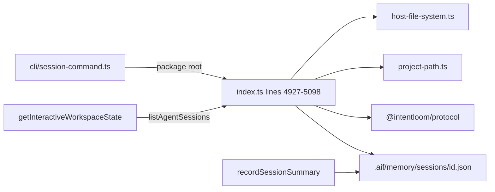
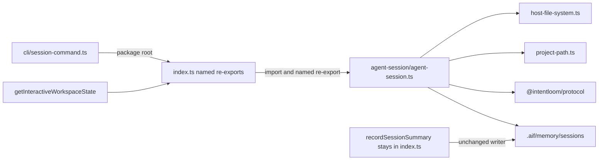
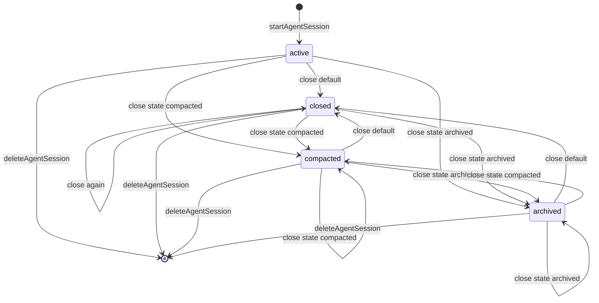
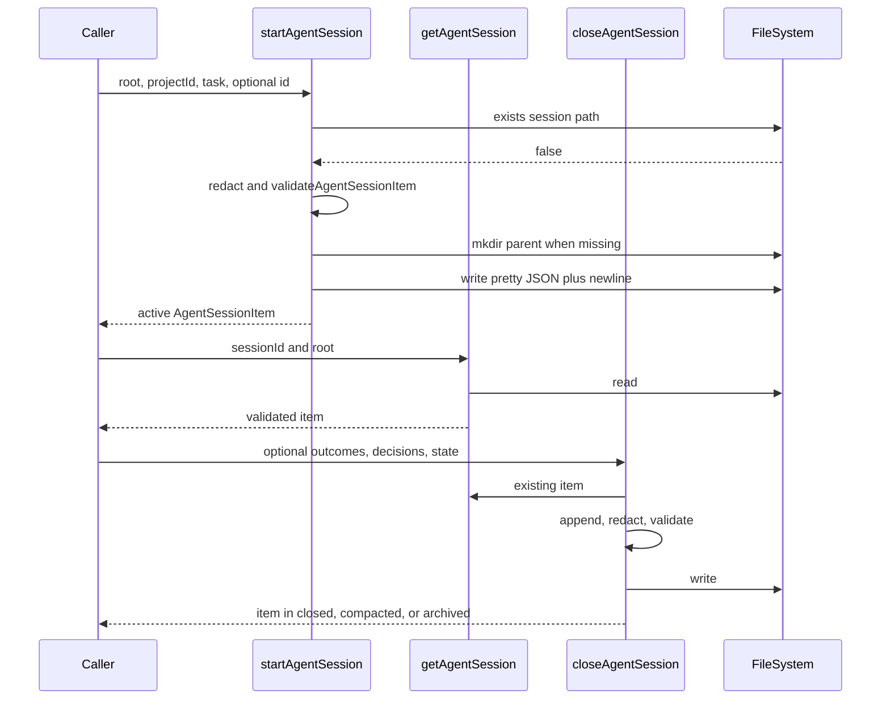
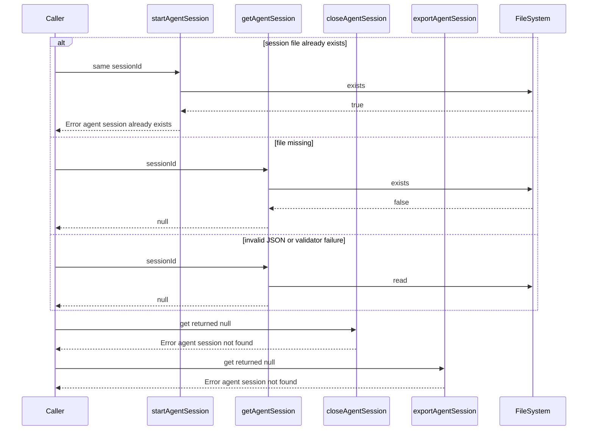
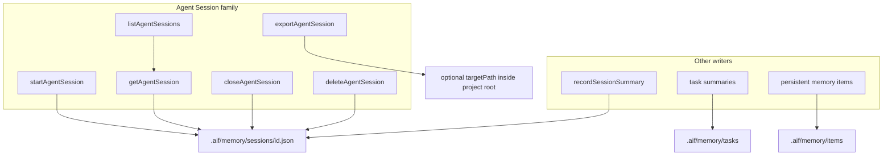

# P1H.2 Agent Session extraction

Status: **proposed**. This document is a Design First review artifact. It
does not implement P1H.2, and it does not authorize implementation until a
maintainer approves it. A green CI result is not approval.

Baseline: `main` at `5f7917c1cef0997f6947932aa2f8f4186ac2decc` (PR #598,
P1H.1 implementation). P1H.1 design is PR #597
(`eeda24d7bfba504d5ea6c7a781a6a054117a8a15`). P1G is complete. P1H.3 and
later slices are not part of this design.

## 1. Problem statement and goals

`packages/application/src/index.ts` still owns the Agent Session
operation family. On this baseline the file measures **6,244 effective
lines** and **6,605 physical lines** (`measureProductionSource`). The
family is one contiguous block at lines **4927–5098** (165 effective,
172 physical), immediately after the P1H.1 persistent-memory
re-exports. The packages stabilization plan schedules Agent Session as
the second P1H group: a leaf that imports `host-file-system.ts` and the
protocol validators, with the public names still exported from
`index.ts`.

Success for a later implementation PR:

- The six public operations and the private `sessionFilePath` helper
  move unchanged into one Application module.
- `index.ts` keeps the six public names as named re-exports and does
  not re-export the helper.
- Signatures, defaults, return types, error text, null behavior,
  storage paths, JSON formatting, redaction, trust and retention
  defaults, and validation stay the same.
- No extracted file imports `index.ts`, the CLI, the daemon, the MCP
  server, or Desktop.
- Import-only and re-export strongly connected components keep today's
  membership and sizes.
- The Application package export map does not gain a key.
- Approved Apply, the recorded Neutron mutation component, and the
  extension-update component stay as they are.
- `host-file-system.ts` stays outside every component.

This slice relocates code. It does not redesign session identity,
persistence, authorization, or redaction.

## 2. Current architecture

The family lives in the Application barrel. It depends on the canonical
filesystem port and path helpers that P1C and P1D already extracted:

- `nodeFileSystem` and `FileSystem` from
  `packages/application/src/host-file-system.ts`
- `inside` and `secretLikePath` from
  `packages/application/src/project-path.ts`
- `AgentSessionItem`, `AgentSessionState`, `AgentSessionExportResult`,
  `TrustClass`, `RetentionState`, `validateAgentSessionItem`, and
  `validateAgentSessionExportResult` from `@intentloom/protocol`

`dirname` and `relative` come from `node:path`. The family does not
call `realpath`.

Nothing in the six operations calls another function defined in
`index.ts`. `listAgentSessions`, `closeAgentSession`, and
`exportAgentSession` call `getAgentSession`. All three call
`sessionFilePath`. The family can move without importing `index.ts`.

One later function in the same file does call the family.
`getInteractiveWorkspaceState` (line 6196) calls `listAgentSessions`
and turns a rejection into an empty array. That function stays in
`index.ts`. After the move, a named `export { ... } from` does not
create a local binding, so `index.ts` must import `listAgentSessions`
from the new module and re-export it. That edge points from the barrel
to the leaf.

The P1A inventory table lists Agent Session at lines 5453–5625. That
table is the P1A baseline and is not the current span. The span
measured on this baseline is 4927–5098.

## 3. Exact operation inventory

Every name below is defined in `packages/application/src/index.ts`.
`fs` defaults to `nodeFileSystem` on every operation.

### Public operations

| Operation            | Signature                                                                                                                                      | Lines     |
| -------------------- | ---------------------------------------------------------------------------------------------------------------------------------------------- | --------- |
| `startAgentSession`  | `(options: StartOptions, fs?: FileSystem) => Promise<AgentSessionItem>`                                                                        | 4931–4978 |
| `getAgentSession`    | `(sessionId: string, options: { root: string }, fs?: FileSystem) => Promise<AgentSessionItem \| null>`                                         | 4980–4993 |
| `listAgentSessions`  | `(options: { root: string; state?: AgentSessionState }, fs?: FileSystem) => Promise<readonly AgentSessionItem[]>`                              | 4995–5022 |
| `closeAgentSession`  | `(sessionId: string, options: CloseOptions, fs?: FileSystem) => Promise<AgentSessionItem>`                                                     | 5024–5062 |
| `deleteAgentSession` | `(sessionId: string, options: { root: string }, fs?: FileSystem) => Promise<void>`                                                             | 5064–5073 |
| `exportAgentSession` | `(sessionId: string, options: { root: string; projectId: string; targetPath?: string }, fs?: FileSystem) => Promise<AgentSessionExportResult>` | 5075–5098 |

`StartOptions` is `{ root: string; projectId: string; sessionId?: string; activeTask: string; unresolvedQuestions?: readonly string[]; decisions?: readonly string[]; trustClass?: TrustClass; retentionPolicy?: RetentionState; metadata?: Record<string, unknown> }`.

`CloseOptions` is `{ root: string; outcomes?: readonly string[]; decisions?: readonly string[]; state?: "closed" \| "compacted" \| "archived" }`.

`startAgentSession` is 47 effective lines. The 40-line preference is
already exceeded. The 80-line hard limit is not. The move keeps the
function intact. `closeAgentSession` is 39 effective lines.

### Private helper

| Helper            | Role                                                             | Lines     |
| ----------------- | ---------------------------------------------------------------- | --------- |
| `sessionFilePath` | Returns `inside(root, ".aif/memory/sessions/${sessionId}.json")` | 4927–4929 |

The helper is not imported anywhere else today. It stays module-private.
`index.ts` must not re-export it. `export *` is the wrong re-export
form for that reason.

### Per-operation behavior that the move must keep

**Start.** `sessionId` defaults to `` `session-${Date.now()}` ``. When
`fs.exists` is true for the computed path, throw
`agent session already exists: ${sessionId}`. That check does not
parse the file, so a corrupt file at the path also blocks creation.
The written item is the object returned by `validateAgentSessionItem`,
not the caller's raw object. Initial `state` is `"active"`.
`outcomes` is `[]`. `trustClass` defaults to `"user-supplied"`.
`retentionPolicy` defaults to `"project"`. `createdAt` and `updatedAt`
are the same `new Date().toISOString()` value. `closedAt` is omitted.
`metadata` is copied only when `options.metadata` is truthy.
`unresolvedQuestions` and `decisions` default to `[]`. Each task,
question, and decision string is replaced with `"[REDACTED]"` when
`secretLikePath` is true for that whole string. The parent directory
is created when `fs.exists(dirname(path))` is false. The write is
`` `${JSON.stringify(session, null, 2)}\n` ``.

**Get.** A missing file returns `null`. `JSON.parse` failures and
`validateAgentSessionItem` failures return `null`. The function does
not rewrite the file. A valid file returns the validator's object,
which drops unknown fields for the caller without deleting them from
disk.

**List.** `fs.list(options.root)` supplies the paths. A path that
starts with `options.root` is passed through `relative`; any other
path is used as given. Backslashes become slashes. Entries that do
not start with `.aif/memory/sessions/` or do not end with `.json` are
skipped. The session id is that relative path with the directory
prefix and the `.json` suffix removed, so a nested file becomes an id
that contains slashes. Each id is loaded with `getAgentSession`.
`null` results are skipped. When `options.state` is set, items with a
different `session.state` are skipped. The array is sorted with
`localeCompare` on `sessionId` and the default locale.

**Close.** `getAgentSession` returning `null` throws
`agent session not found: ${sessionId}`. Allowed typed states are
`"closed"`, `"compacted"`, and `"archived"`. The default is
`"closed"`. New outcomes and decisions are appended after the stored
arrays, and each new string is redacted the same way as start.
Existing strings are not redacted again. `updatedAt` and `closedAt`
become one new timestamp. `createdAt` stays the stored value. The
result is validated before write. The write uses the same pretty JSON
plus trailing newline. Close does not create the parent directory.

**Delete.** When the computed path exists, `fs.remove` is called.
When it does not exist, the function returns. There is no parse and
no error for a missing file. The id is not checked against another
family's schema before removal.

**Export.** `getAgentSession` returning `null` throws
`agent session not found: ${sessionId}`. The envelope is
`validateAgentSessionExportResult` of `{ schemaVersion: "1", projectId: options.projectId, exportedAt, session }`.
`projectId` is the argument, not `session.projectId`. When
`targetPath` is omitted, nothing is written and the object is
returned. When it is present, the destination is
`inside(options.root, options.targetPath)`. The parent directory is
created when missing, and the write uses the same pretty JSON plus
trailing newline.

## 4. Current and proposed module ownership

| Concern                                     | Today                                                        | Proposed                                                             |
| ------------------------------------------- | ------------------------------------------------------------ | -------------------------------------------------------------------- |
| Six public operations and `sessionFilePath` | `packages/application/src/index.ts`                          | `packages/application/src/agent-session/agent-session.ts`            |
| Public names                                | Direct exports from `index.ts`                               | Named re-exports from `index.ts`                                     |
| `getInteractiveWorkspaceState`              | Same file, calls `listAgentSessions`                         | Stays in `index.ts`, imports `listAgentSessions` from the new module |
| Session summaries                           | `recordSessionSummary`, `listSessionSummaries` in `index.ts` | Stay in `index.ts`                                                   |
| Task summaries                              | `index.ts`                                                   | Stay in `index.ts`                                                   |
| Persistent memory                           | `memory/persistent-memory-*.ts`                              | Unchanged                                                            |
| Filesystem port and path containment        | `host-file-system.ts`, `project-path.ts`                     | Unchanged; the new module imports them                               |
| Protocol types and validators               | `@intentloom/protocol`                                       | Unchanged; the new module imports them                               |

There is no `agent-session/index.ts`. There is no new `package.json`
export key. The twelve existing Application export keys stay.

`sessionFilePath` is not exported from the module. Close and export
call it from the same file, so it does not need to be public to the
package or to the barrel.

## 5. DDD and ubiquitous language boundaries

Consulted canon:

- `docs/governance/DESIGN_FIRST_POLICY.md`
- `docs/governance/AI_AGENT_WORKFLOW.md`
- `docs/governance/ENGINEERING_PRINCIPLES.md`
- `docs/governance/CODE_QUALITY_STANDARDS.md`
- `docs/governance/DOMAIN_MODELING.md`
- `docs/architecture/ARCHITECTURE.md`
- `docs/architecture/PACKAGES_STABILIZATION_PLAN.md`
- `docs/decisions/ADR-0007-private-application-operation-boundary.md`
- `docs/decisions/ADR-0026-agent-session-lifecycle.md`
- `docs/concepts/AGENT_SESSION_HISTORY_AND_MEMORY_EXPERIENCE.md`
- `docs/security/THREAT_MODEL.md` invariant 24

ADR-0007 keeps these operations in `@intentloom/application` and keeps
that package independent of the CLI. ADR-0026 already decides local
JSON session records, the state names, secret-path redaction, and the
rule that session operations do not silently mutate canonical intent.
This design relocates that implementation. It does not add a bounded
context, an Entity, an Aggregate, a Repository, a Domain Service, or a
Domain Event. Domain modeling says not to create a context because a
folder exists. Agent Memory is already a context candidate. No new ADR
is required. Maintainer approval of this design is still required.

The word "session" names four different records. This slice owns only
the first.

| Term                    | Record                                                          | Storage                                  |
| ----------------------- | --------------------------------------------------------------- | ---------------------------------------- |
| Agent Session           | `AgentSessionItem`: task, questions, decisions, outcomes, state | `.aif/memory/sessions/<sessionId>.json`  |
| Session summary         | `SessionSummary`: profile, adapters, completed task ids         | `.aif/memory/sessions/<summary.id>.json` |
| Neutron runtime session | In-memory Neutron session and durable mutation state            | Neutron session modules, not this family |
| Inception session       | Workshop answers and blueprint state                            | `inception/inception-session-store.ts`   |
| Workspace conversation  | Chat messages and workspace mode                                | `.aif/workspace/conversations/<id>.json` |

Task summaries use `.aif/memory/tasks/<id>.json`. Persistent memory
uses `.aif/memory/items/<id>.json` and `.aif/memory/index.json`. Those
paths are not this family's.

ADR-0026 describes transitions as `active` to `closed`, `compacted`,
or `archived`. The code and `tests/cli-session.test.ts` also allow
closing a session that is already closed, and the typed close options
allow any of those three states from any item `getAgentSession` can
read. The move preserves the code and the test. It does not tighten
the ADR sentence into a new guard.

## 6. Public API and caller compatibility matrix

The package root `@intentloom/application` (`"."`) keeps these value
exports, with the same signatures and the same `fs` default:

- `startAgentSession`
- `getAgentSession`
- `listAgentSessions`
- `closeAgentSession`
- `deleteAgentSession`
- `exportAgentSession`

The existing type re-exports stay: `AgentSessionState`,
`AgentSessionItem`, `AgentSessionExportResult`, `TrustClass`, and
`RetentionState`. `validateAgentSessionItem` and
`validateAgentSessionExportResult` are imported by `index.ts` today
and are not re-exported. After the move only the new module imports
them. Callers that want the validators keep importing them from
`@intentloom/protocol`, which is what `tests/memory-security-m4.test.ts`
already does.

| Caller                                    | Uses this family?                 | After the move                                                                |
| ----------------------------------------- | --------------------------------- | ----------------------------------------------------------------------------- |
| `packages/cli/src/session-command.ts`     | Yes, all six                      | Still imports the package root. CLI defaults and exit codes stay in the CLI.  |
| `getInteractiveWorkspaceState`            | `listAgentSessions` only          | Stays in `index.ts` and imports the leaf. The public function stays.          |
| `packages/cli/src/ui-command.ts`          | Indirect, through workspace state | Package-root import stays.                                                    |
| `packages/daemon`                         | No                                | No Agent Session RPC is added. Neutron session handlers are a different type. |
| `packages/mcp-server`                     | No                                | No new tool.                                                                  |
| `apps/desktop`                            | No                                | Neutron session UI is a different type.                                       |
| Tests importing `@intentloom/application` | Yes                               | Import path stays.                                                            |

CLI defaults that are not application defaults stay in
`session-command.ts`: `projectId` `"project-local"`, `activeTask`
`"unspecified-task"`, and close with no outcomes, decisions, or state.
The CLI maps application `Error` messages to exit code 2. That mapping
is not moved.

## 7. Current and proposed dependency graphs

Measured with `applicationCycles` from `tests/application-source-cycles.ts`
on this baseline. Section 16 records component membership. This section
is the family edge, not the whole Application graph.

Today the six operations are text inside `index.ts`. Their callees are
`host-file-system.ts`, `project-path.ts`, and `@intentloom/protocol`.
The CLI reaches them through the package root. Session summaries write
the same directory through separate functions that stay in the barrel.

Editable source: [`current-dependencies.mmd`](current-dependencies.mmd).

The proposed module imports the filesystem port, `inside`,
`secretLikePath`, and the protocol validators. It does not import
`index.ts`. The barrel imports the module so
`getInteractiveWorkspaceState` can call `listAgentSessions`, and it
re-exports the six names. Session summaries stay on their current
functions.

Editable source: [`proposed-dependencies.mmd`](proposed-dependencies.mmd).

`host-file-system.ts` imports only `project-scan-exclusions.ts`.
`project-path.ts` imports only that same exclusions module. Neither
imports `index.ts`. The new edge is one-way.

## 8. Session lifecycle state diagram

`AgentSessionState` is `"active" | "closed" | "compacted" | "archived"`.
Start always writes `"active"`. Export does not change state. Delete
removes the file from any state and is also a no-op when the file is
already absent. Close rewrites any readable valid item into the
requested close state.

Editable source: [`session-lifecycle.mmd`](session-lifecycle.mmd).

There is no operation that sets `state` back to `"active"`. The close
parameter's TypeScript type does not include `"active"`. The protocol
validator would accept `"active"` if a caller bypassed that parameter
type, because it checks membership in all four states and does not know
which operation is writing. The move does not add a second guard.

## 9. Successful create, read, and close sequence

Editable source:
[`create-read-close-sequence.mmd`](create-read-close-sequence.mmd).

List is the same read, repeated for every `.json` path under
`.aif/memory/sessions/`, then filtered and sorted. Delete is
`exists` plus `remove`. Export is the get step, then an envelope
validation, then an optional contained write.

## 10. Failure and malformed-session sequence

Editable source:
[`failure-malformed-sequence.mmd`](failure-malformed-sequence.mmd).

`inside` throws `path traversal: ${path}` when the resolved path
escapes the project root. Start, get, list, close, delete, and export
do not catch that throw. Get catches only the read, parse, and
validator failures.

A corrupt file is `null` to get, skipped by list, "not found" to close
and export, and "already exists" to start. That split is current
behavior. The move must not collapse it into one error.

`getInteractiveWorkspaceState` keeps `.catch(() => [])` around
`listAgentSessions`. A thrown list failure still becomes an empty
session array there. Other callers do not get that swallow.

## 11. Data flow and storage ownership

Editable source: [`storage-ownership.mmd`](storage-ownership.mmd).

Agent Session owns reads and writes of files it addresses as
`.aif/memory/sessions/<sessionId>.json`. It does not own every file in
that directory. `recordSessionSummary` and `listSessionSummaries` use
the same directory and the same `<id>.json` shape for `SessionSummary`.

The two validators disagree on required fields, so a normal summary
fails `validateAgentSessionItem` and a normal agent session fails
`validateSessionSummary`. List therefore skips the other family's
files. The skip is an outcome of validation, not a directory partition.
The same id is one file. The later write wins, and delete removes that
file without checking which schema it holds.

`nodeFileSystem.list` walks from the project root, skips symbolic
links, ignored scan directories, and binary extensions, and stops at
depth 32 or 10,000 files. `.aif` is not an ignored directory. The
in-memory test double returns keys that start with the root string.
The normalization in list exists so both shapes can yield
`.aif/memory/sessions/<id>.json`.

`nodeFileSystem.mkdir` is recursive. The in-memory double's `mkdir` is
a no-op, and its `write` stores the full path key. Tests depend on
that. The move keeps both ports behind the existing `FileSystem`
parameter.

## 12. Trust boundaries and security analysis

Preserved runtime behavior:

- Paths are resolved with `inside(root, relativePath)`. A destination
  that escapes the project root throws `path traversal`.
- The caller supplies `FileSystem`. Production CLI uses
  `nodeFileSystem` unless a test or caller injects another port.
- Task text, questions, and decisions are redacted only by
  `secretLikePath` on the whole string. A matching string becomes
  `"[REDACTED]"`.
- `secretLikePath` is true when any `/`-separated segment is `.env`,
  starts with `.env.`, or ends in `.key`, `.pem`, `.p12`, or `.pfx`.
  The extension test is case-insensitive. The `.env` comparisons are
  case-sensitive.
- Default trust class is `"user-supplied"`. Default retention value
  stored on create is the string `"project"`.
- Close appends redacted outcomes and decisions and validates before
  writing.
- Export destinations go through `inside`.
- The operations do not call the network, a shell, or the adoption,
  doctor, or generated-file sync entrypoints.
- Threat-model invariant 24 remains the product statement: typed
  application operations, local files under `.aif/memory/sessions/`,
  secret-path redaction, and no silent canonical-intent mutation.

Existing limitations. They are not fixed in this slice:

- `sessionId` is interpolated into the relative path before `inside`.
  `inside` rejects escape from the project root. A session id whose
  resolved path stays inside the root can still leave
  `.aif/memory/sessions/`. An id such as `../../note` addresses
  `<root>/note.json`. Get, delete, and export will use that path.
  List will not show it, because the written path no longer has the
  sessions prefix. Start can therefore overwrite an in-root file when
  the caller chooses that id.
- `validateAgentSessionItem` checks that `trustClass` and
  `retentionPolicy` are non-empty strings and then casts them. It does
  not apply the unions that `validateTaskSummary` applies. The create
  default `"project"` is not a member of `RetentionState`
  (`"active" | "archived" | "superseded" | "deleted"`). The stored
  JSON still contains `"project"`. Changing the default or the
  validator would change bytes and types. That is a separate fix.
- `metadata` is stored when it is a plain object and is not redacted.
- Redaction does not scan tokens, PEM bodies, or prose that merely
  mentions a secret. It does not rewrite strings already stored.
- Export writes `options.projectId` even when it differs from
  `session.projectId`. The CLI tests lock the CLI default
  `"project-local"` and an explicit `--project-id`. Adding an equality
  check would be new authorization.
- Export's `targetPath` may name any path `inside` accepts, including
  an existing project file. There is no separate overwrite confirm.
- Delete and the exists-check on start do not require the file to be
  an `AgentSessionItem`. A shared id with a session summary deletes or
  blocks that summary.
- `inside` uses lexical `resolve`, not `realpath`. A symlink inside
  the root can still point elsewhere. That is the current path helper,
  shared with the rest of Application.
- There is no permission check beyond the caller already holding a
  root and a `FileSystem`. Daemon, MCP, and Desktop do not expose
  these operations today.

Recommended follow-up, outside P1H.2: reject session ids that are not
one path segment, compare export `projectId` only if a later security
slice says to, and decide whether session summaries need a different
directory. Do not take that work in the extraction PR.

## 13. Error handling and recovery

| Condition                                | Result                                                       |
| ---------------------------------------- | ------------------------------------------------------------ |
| Duplicate path on start                  | Throw `agent session already exists: ${sessionId}`           |
| Missing file on get                      | `null`                                                       |
| Corrupt JSON or validator failure on get | `null`; file left in place                                   |
| Missing or unreadable session on close   | Throw `agent session not found: ${sessionId}`                |
| Missing or unreadable session on export  | Throw `agent session not found: ${sessionId}`                |
| Missing file on delete                   | Return; no throw                                             |
| Path escapes the project root            | Throw `path traversal: ${path}` from `inside`                |
| Validator failure while building a write | Throw `ProtocolValidationError`; no write of that new object |
| `fs.list` failure on the Node port       | `nodeFileSystem.list` returns `[]`, so list returns `[]`     |
| List failure inside workspace state      | `getInteractiveWorkspaceState` returns `sessions: []`        |

Writes are a single `fs.write` of the full JSON document. There is no
temp file, lock, or journal in this family. A port that throws during
`write` leaves whatever that port left. The in-memory double can throw
`injected write failure` after a configured number of writes; this
family does not catch it.

Start's exists-then-write check is not atomic. Two creates with the
same id can both pass `exists` before either writes. The move does not
add a lock.

Close and start validate first. A thrown validator error happens
before `fs.write` of the new document. Get's validator error is
swallowed and becomes `null`.

No retry loop exists. Callers that need a different policy already
wrap the operations. The extraction adds none.

## 14. Alternatives and trade-offs

**Recommended: one module, `agent-session/agent-session.ts`.**
Prettier output of the current block plus the imports it needs
measures **177 effective lines** and **185 physical lines**. That is
under the 250-line preference. The six operations share
`sessionFilePath`, and list, close, and export share `getAgentSession`.
One file keeps that helper private and adds no cross-file edge inside
the family. The directory matches `memory/` without adding a barrel.
A new file at `packages/application/src/agent-session.ts` would import
the same modules with one fewer `../` and would add another root
sibling while P1F is moving families out of the root. The directory
avoids that. Behavior is the same either way; the directory is the
proposed path.

**Rejected for this slice: store plus lifecycle files.** A store
module with path, start, get, list, and delete measures about **112
effective / 118 physical**. A lifecycle module with close and export
measures about **73 / 75**, and it must import `getAgentSession` and
an exported `sessionFilePath`. Both files fit the budget. The split
does not remove a cycle, a port dependency, or a function over 80
lines. It publishes the path helper across files for a family that
already fits in one file. P1H.1 needed three files because one moved
file was 351 effective lines. This family is not in that position.

**Rejected: fold the family into `memory/persistent-memory-store.ts`.**
Persistent memory owns `.aif/memory/items/` and `.aif/memory/index.json`,
approval, and supersede. Agent Session does not. Sharing a module
would mix those rules and grow a file that just landed at 77
effective lines.

**Rejected: a shared sessions-directory helper with session summaries.**
The path string is the same shape. Sharing it would couple this slice
to task and session summaries, which are a later group, and it would
not remove the same-id collision. The collision is documented in
section 11 and left in place.

**Rejected: an `agent-session/index.ts` barrel.** A barrel would hide
the one-way import from `index.ts` and would be a second public-shaped
entry. The stabilization plan forbids that kind of cover.

**Rejected: new package subpath.** CLI and tests already use the
package root. A subpath is a new export-map key. The topology notes
say the twelve keys stay.

## 15. File-size calculations

Current figures are `measureProductionSource` on this baseline.
Projected figures are the same function on Prettier output of the
moved text plus the import and re-export lines the move needs. They
are estimates. This design PR does not change production files, so
they are not measured results of an extraction.

| File                                                                                     | Effective | Physical | Status                            |
| ---------------------------------------------------------------------------------------- | --------: | -------: | --------------------------------- |
| `packages/application/src/index.ts`                                                      |     6,244 |    6,605 | Measured                          |
| Family block, lines 4927–5098                                                            |       165 |      172 | Measured                          |
| `agent-session/agent-session.ts`                                                         |       177 |      185 | Estimate, moved text plus imports |
| `index.ts` after import, named re-exports, and dropping the two unused validator imports |     6,093 |    6,447 | Estimate                          |

The estimate removes the 172-line block, removes the two validator
import lines that only the block uses, and inserts the 16-line import
plus named re-export. `AgentSessionItem` stays imported and
re-exported because `InteractiveWorkspaceState.sessions` uses it.

Both the new file and the reduced barrel stay under the grandfathered
`index.ts` ceiling in `docs/governance/quality-exceptions.json`
(6,764 effective, 7,151 physical). The implementation must not edit
that ceiling. The new file is under the 250-line preference, under
the 400-line hard limit, and under the 700-line physical safety line.
No code-quality exception is required for the new file.

`startAgentSession` remains 47 effective lines. That is above the
40-line preference and below the 80-line hard limit. Splitting it
during the move would be a behavior-risk refactor, not a requirement
of the budget.

## 16. SCC baseline and expected results

Measured with `applicationCycles(false)` and `applicationCycles(true)`
from `tests/application-source-cycles.ts` at the baseline SHA.
Components are sorted by the utility. Sizes are 3 and 3 for the
import-only graph, and 4, 29, and 3 for the re-export-inclusive graph.

Import-only:

| Component        | Files                                                                                                                                                                                                           |
| ---------------- | --------------------------------------------------------------------------------------------------------------------------------------------------------------------------------------------------------------- |
| Approved Apply   | `approved-apply-baseline.ts`, `generated-file-sync-declared.ts`, `index.ts`                                                                                                                                     |
| Neutron mutation | `neutron/mutation/apply/neutron-mutation-apply-durable-record.ts`, `neutron/mutation/apply/neutron-mutation-apply-store.ts`, `neutron/mutation/verification/neutron-mutation-verification-retry-eligibility.ts` |

Re-export-inclusive:

| Component        | Files                                                                                                                                           |
| ---------------- | ----------------------------------------------------------------------------------------------------------------------------------------------- |
| Extension update | `apply-extension-update.ts`, `discover-and-apply-extension-update.ts`, `extension-update-files.ts`, `propose-and-apply-extension-adoption.ts`   |
| Barrel           | The 29 files in `indexReexportComponent` in `tests/application-foundation-scaffold-cycle.test.ts`, including `index.ts` and `inception-flow.ts` |
| Neutron mutation | The same three files as the import graph                                                                                                        |

`host-file-system.ts` is outside every component. `project-path.ts` is
outside every component. The three `memory/persistent-memory-*.ts`
files are outside every component.

The 29-file membership measured on this baseline is:

`approved-apply-baseline.ts`, `approved-apply-engine.ts`,
`bounded-execution-apply.ts`, `bounded-execution-w11.ts`,
`bounded-execution-workspace-cli.ts`, `bounded-execution-workspace.ts`,
`engineering-quality-entry.ts`,
`engineering-quality/cli-specialized-packs-external.ts`,
`engineering-quality/index.ts`,
`engineering-quality/specialized-pack-external-apply.ts`,
`engineering-quality/specialized-pack-external-viewmodel.ts`,
`existing-project-adoption-apply-gates.ts`,
`existing-project-adoption-apply-health.ts`,
`existing-project-adoption-apply.ts`,
`existing-project-adoption-approval.ts`,
`existing-project-adoption-decisions.ts`,
`existing-project-adoption-plan.ts`,
`existing-project-adoption-prepared-plan-revalidate.ts`,
`existing-project-adoption-prepared-plan.ts`,
`existing-project-w9.ts`, `existing-project-workspace-cli.ts`,
`existing-project-workspace.ts`, `foundation-flow.ts`,
`generated-file-sync-declared.ts`, `harness/harness-benchmark-sample.ts`,
`harness/harness-benchmark.ts`, `harness/harness.ts`,
`inception-flow.ts`, `index.ts`.

Expected after the implementation, not measured here:

- Import-only components stay the two size-3 components above.
- Re-export components stay sizes 4, 29, and 3, with the same members.
- `agent-session/agent-session.ts` is outside every component.
- `host-file-system.ts` stays outside every component.
- No new component appears, and none of the components above grows.

The cycle tests already lock those arrays. The implementation must not
edit them. This design PR does not edit them either. A future failure
of those tests means the move created or enlarged a cycle and the move
is not acceptable.

## 17. Implementation plan

Do this only after maintainer approval of this document, in a separate
PR. One commit family: the move, the barrel re-exports, the focused
tests in section 18, and the handoff docs.

1. Add `packages/application/src/agent-session/agent-session.ts` with
   the current function text and the imports in section 2. Do not
   export `sessionFilePath`. Do not import `index.ts`.
2. Replace lines 4927–5098 with an import of the six operations and a
   named value re-export of those six. Use the import so
   `getInteractiveWorkspaceState` still calls `listAgentSessions`.
   Do not use `export *`.
3. Remove `validateAgentSessionItem` and
   `validateAgentSessionExportResult` from the barrel's protocol
   import when they are unused. Keep the `AgentSessionItem` type
   import and the existing type re-exports.
4. Leave `recordSessionSummary`, `listSessionSummaries`, task
   checkpoints, skill catalog, security findings, and
   `getInteractiveWorkspaceState` in `index.ts`.
5. Do not edit `packages/application/package.json` exports,
   `docs/governance/quality-exceptions.json`, or the cycle tests.
6. Do not change CLI, daemon, MCP, or Desktop imports.
7. Run `pnpm verify`.

Acceptance for that PR:

- The six signatures and `sessionFilePath` behavior match section 3.
- `index.ts` effective and physical counts are below this baseline's
  6,244 and 6,605.
- The new file is at or under the 250-line preference unless Prettier
  produces a documented difference from the 177 / 185 estimate.
- `applicationCycles` matches section 16.
- Existing assertions in the tests listed in section 18 still pass
  without edits.
- No new package export key, no new SCC, and no change to Approved
  Apply, Neutron mutation, or extension-update membership.

## 18. Testing strategy

This design PR adds no tests and runs no production behavior. The
implementation PR keeps every current assertion and adds focused cases
where a move could drop behavior that is not already locked.

Already locked:

| Behavior                                                           | Where                                                                                    |
| ------------------------------------------------------------------ | ---------------------------------------------------------------------------------------- |
| Create, get, close, append decisions, state filter                 | `tests/memory-security-m4.test.ts`                                                       |
| Redaction of `.env`, `.env.production`, and `server.key` on start  | Same file                                                                                |
| Export to `targetPath` and delete then get `null`                  | Same file                                                                                |
| CLI start, close, list, get, delete, export                        | `tests/cli-session.test.ts` and the CLI case in the M4 file                              |
| Generated id prefix `session-`                                     | `tests/cli-session.test.ts`                                                              |
| Duplicate id error text and exit 2                                 | `tests/cli-session.test.ts`                                                              |
| Close of an already closed session                                 | `tests/cli-session.test.ts`                                                              |
| Invalid `--state` filter returns an empty list                     | `tests/cli-session.test.ts`                                                              |
| Delete of a missing session succeeds                               | `tests/cli-session.test.ts`                                                              |
| Export `projectId` default and explicit value                      | `tests/cli-session.test.ts`                                                              |
| Protocol rejection of state `"unknown-state"`                      | `tests/memory-security-m4.test.ts`                                                       |
| Workspace state exposes `sessions` as an array and does not mutate | `tests/interactive-ui.test.ts`                                                           |
| Workspace state through v1 contracts                               | `tests/v1-client-surface-equivalence.test.ts`, `tests/v1-compatibility-contract.test.ts` |
| SCC membership                                                     | `tests/application-foundation-scaffold-cycle.test.ts`                                    |

Not locked at the application operation, and worth one focused test
each in `tests/memory-security-m4.test.ts` during implementation:

- Get of a missing id returns `null`.
- Get of invalid JSON returns `null`.
- Get of a JSON object that fails `validateAgentSessionItem` returns `null`.
- List sorts by `sessionId`.
- List skips a `SessionSummary` file in `.aif/memory/sessions/`.
- Close with `state: "compacted"` persists that state, `closedAt`, and
  appended redacted outcomes.
- Export without `targetPath` returns the envelope and writes no file.
- `inside` throws `path traversal` for an export `targetPath` that
  escapes the root.
- Create persists `trustClass` `"user-supplied"` and `retentionPolicy`
  `"project"` when those options are omitted, and round-trips
  `metadata`.

Do not add those tests in this design PR. Do not change CLI exit-code
tests to make them pass. Daemon, MCP, and Desktop have no current
Agent Session consumer tests because they do not call this family.
Do not add consumer surfaces in order to test them.

The implementation gate is `pnpm verify`: typecheck, oxlint, Prettier,
Vitest, build, and `git diff --check`.

## 19. Migration and rollback strategy

No on-disk migration. Existing session files stay where they are and
keep their current JSON. Session-summary files stay in the same
directory. Rollback of the implementation is reverting that PR. There
is no feature flag, dual-write, or backup step, because the bytes on
disk do not change format.

Callers do not change import paths. A bad move that fails typecheck or
the cycle tests is rolled back by dropping the new module and restoring
the barrel block. No published npm package changes in the extraction.

## 20. Explicit non-goals and open questions

Not part of P1H.2:

- Persistent memory P1H.1, beyond the baseline it already set.
- Task checkpoint operations.
- Task summaries and session summaries, except the collision note in
  section 11.
- Skill catalog and proposals.
- Procedural memory.
- Security findings and SARIF import.
- Security policy and sandbox.
- Continuous security audit.
- Moving `getInteractiveWorkspaceState` or any other interactive
  workspace read-model operation.
- Continuous Loop W12.
- Approved Apply.
- Neutron mutation, Neutron runtime sessions, and any Neutron import
  retarget.
- `applyWorkspaceProposal`, `applyProjectAdoption`, `adoptProject`,
  `doctorProject`, and `synchronizeGeneratedFiles`.
- P1I transaction and lifecycle.
- P1J legacy Neutron decisions.
- Undo U4 and Desktop Undo U5.
- New session-id rules, new retention values, new redaction, new
  export authorization, and a separate directory for session summaries.
- Editing SCC expectations or grandfathered limits.
- Implementing the extraction in this PR.

Open questions that do not block the structural move:

- A maintainer may prefer the flat file
  `packages/application/src/agent-session.ts`. Dependencies and public
  API stay the same. This design proposes the directory so the family
  is not a new root sibling.
- The security limitations in section 12 need a later, explicit slice
  if they are going to change. This design does not choose new
  authorization rules.
- Whether session summaries should leave `.aif/memory/sessions/` is a
  persistence decision for the summary group's own design, not for
  this move.

No unanswered choice here requires a new ADR before implementation.
Approval of this document is the gate.
