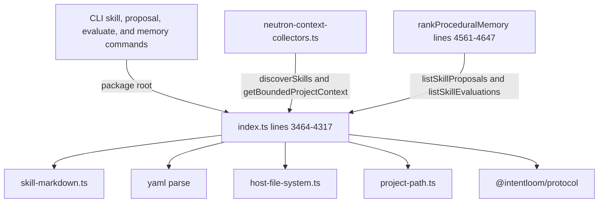
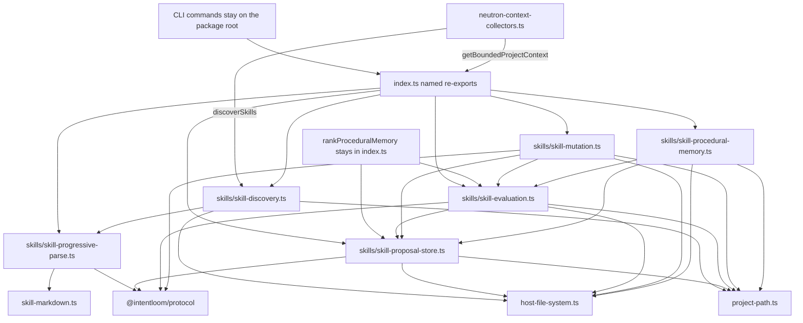
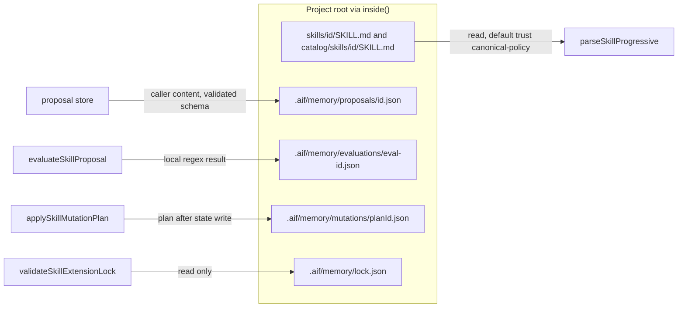
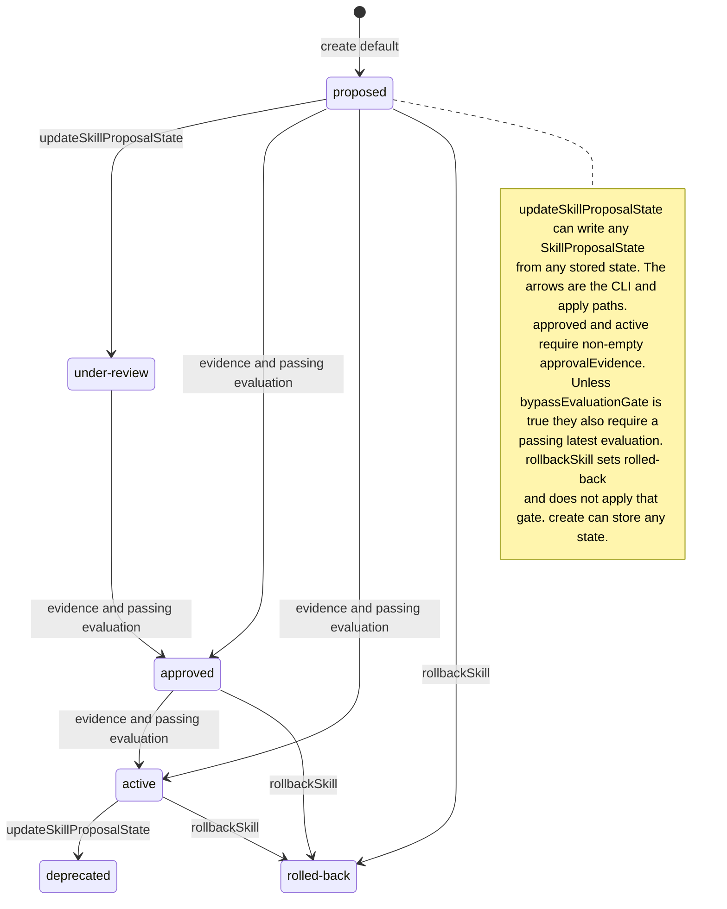
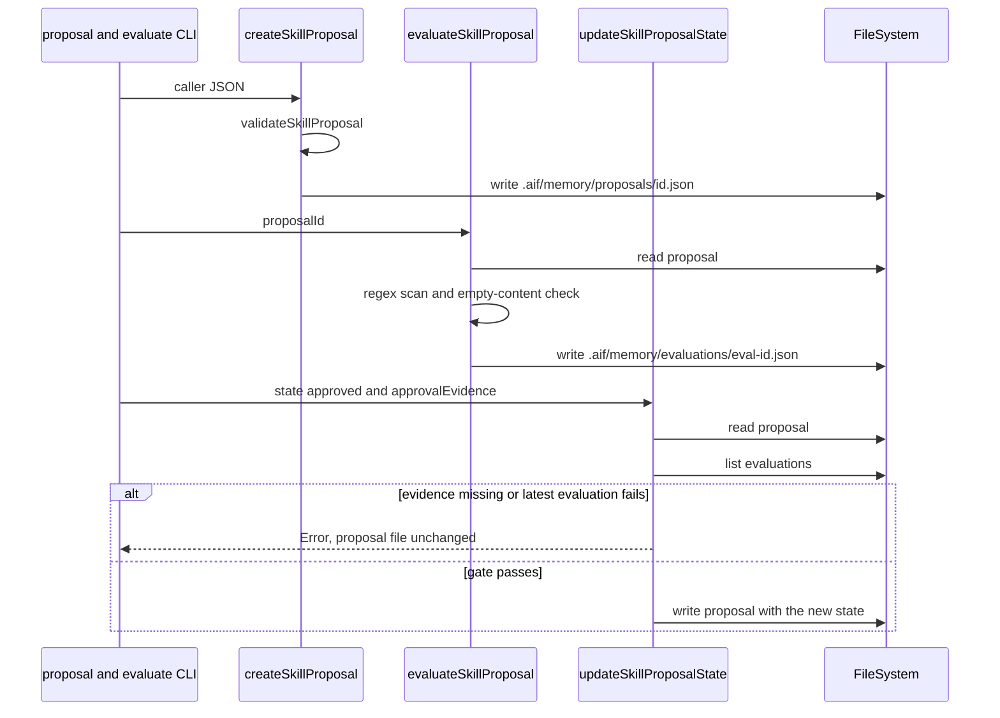
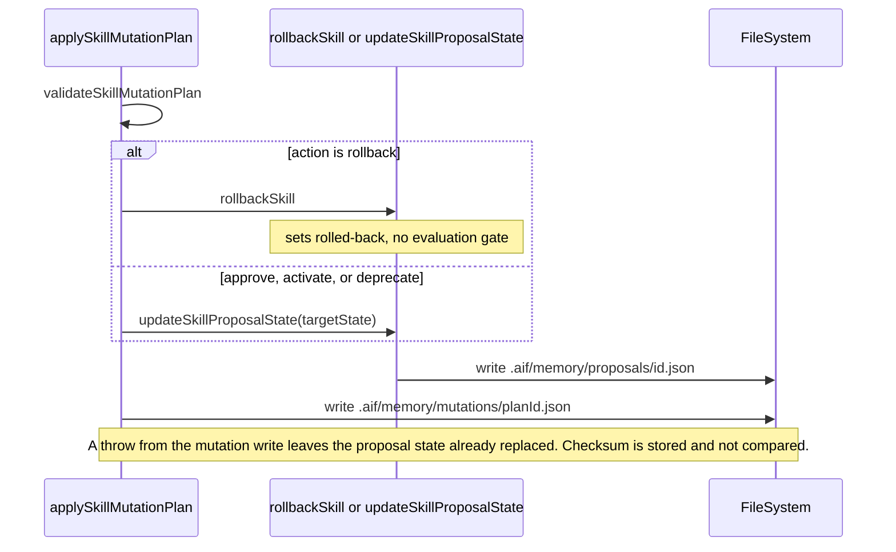
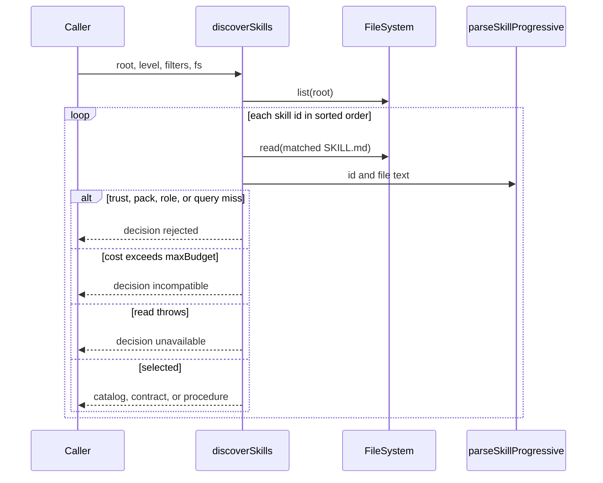

# P1H.3 Skill Catalog and Proposals extraction

Status: **proposed** (PR #601). This document is a Design First review
artifact. It does not implement P1H.3, and it does not authorize
implementation until a maintainer approves it. A green CI result is
not approval.

Baseline: `main` at `efce5db2b40d1f350df43d38b4b97d1ccd5c2736` (PR #600,
P1H.2 implementation). P1H.2 design is PR #599
(`ff7cb79329f403220aa4b369eede4cb8f06e591b`). P1H.1 design is PR #597
(`eeda24d7bfba504d5ea6c7a781a6a054117a8a15`) and its implementation is
PR #598 (`5f7917c1cef0997f6947932aa2f8f4186ac2decc`). P1G is complete.
P1H.4 and later slices are not part of this design.

## 1. Problem statement

`packages/application/src/index.ts` still owns Skill Catalog discovery,
Skill Proposal storage, evaluation, mutation, and the procedural-memory
read model that is computed from those records. On this baseline the
file measures **6,093 effective lines** and **6,448 physical lines**
(`measureProductionSource`). The family is one contiguous block at
lines **3464–4317** (**777 effective**, **854 physical**).

The packages stabilization plan schedules this family as the third P1H
group: leaves that import `host-file-system.ts` and the protocol
validators, with the public names still exported from `index.ts`. The
block is too large for one new production file. The 400 effective-line
hard limit and the 250-line preference both rule out a single module.

Success for the later implementation PRs:

- The sixteen public operations move unchanged into Application modules
  under `packages/application/src/skills/`.
- `index.ts` keeps those sixteen names as named re-exports.
- Signatures, defaults, return values, error text, null behavior,
  storage paths, JSON formatting, sorting, filtering, validation, and
  trust defaults stay the same.
- No extracted file imports `index.ts`, the CLI, the daemon, the MCP
  server, or Desktop.
- Import-only and re-export strongly connected components keep today's
  membership and sizes.
- The Application package export map does not gain a key.
- Approved Apply, the recorded Neutron mutation component, and the
  extension-update component stay as they are.
- `host-file-system.ts`, the P1H.1 memory modules, and the P1H.2 Agent
  Session module stay outside every component.

This slice relocates code. It does not redesign skill discovery, the
proposal schema, evaluation, approval, or rollback.

## 2. Goals and non-goals

Goals:

- Give the family explicit module owners and a dependency direction
  that does not point back at the barrel.
- Keep every new file at or below 250 effective lines.
- Preserve the public `@intentloom/application` surface.
- Record the behavior the move must keep, including the gates and the
  shortcomings that are already in the code.

Non-goals:

- P1H.4 Security Findings and SARIF import, P1H.5 Security Policy and
  Sandbox, P1H.6 Continuous Security Audit, and P1H.7 Interactive
  Workspace read model.
- P1I transaction and lifecycle, P1J legacy Neutron helpers, Undo U4,
  and Desktop Undo U5.
- Changes to Persistent Memory, Agent Session, Approved Apply, Neutron
  mutation, workspace proposal application, project adoption, project
  doctor, or generated-file synchronization.
- A new Skill feature, a new permission, a new filesystem or network
  authority, or a new execution sandbox.
- Splitting `parseSkillProgressive` or `discoverSkills` to satisfy the
  function-length budget. Both already exceed 80 effective lines. The
  move keeps them intact.
- Mixing Skill Proposal approval with Approved Apply or with
  `evaluateProposalAgainstSandbox`.

## 3. Source-code inventory

Every name below is defined in `packages/application/src/index.ts`.
`fs` defaults to `nodeFileSystem` on every operation except
`parseSkillProgressive`, which takes no filesystem argument. There is
no private helper in this block. All sixteen names are public exports.

### A. Operations that belong in P1H.3

| Operation                     | Lines     | Effective | Physical |
| ----------------------------- | --------- | --------: | -------: |
| `parseSkillProgressive`       | 3464–3598 |       124 |      135 |
| `discoverSkills`              | 3600–3761 |       145 |      162 |
| `getSkillAtLevel`             | 3763–3793 |        29 |       31 |
| `createSkillProposal`         | 3795–3846 |        50 |       52 |
| `listSkillProposals`          | 3848–3891 |        40 |       44 |
| `getSkillProposal`            | 3893–3907 |        15 |       15 |
| `updateSkillProposalState`    | 3909–3974 |        62 |       66 |
| `rollbackSkill`               | 3976–3996 |        19 |       21 |
| `evaluateSkillProposal`       | 3998–4072 |        69 |       75 |
| `listSkillEvaluations`        | 4074–4118 |        41 |       45 |
| `getSkillEvaluation`          | 4120–4134 |        15 |       15 |
| `validateSkillExtensionLock`  | 4136–4149 |        14 |       14 |
| `listProceduralMemorySummary` | 4151–4182 |        29 |       32 |
| `inspectProceduralMemory`     | 4184–4222 |        36 |       39 |
| `prepareSkillMutationPlan`    | 4224–4271 |        45 |       48 |
| `applySkillMutationPlan`      | 4273–4317 |        42 |       45 |

Effective and physical counts are `measureProductionSource` on each
function's source slice. The whole block, including the blank lines
between functions, is 777 effective and 854 physical.

### Public signatures

```typescript
function parseSkillProgressive(
  id: string,
  content: string,
): {
  catalog: SkillCatalogMetadata;
  contract: SkillExecutionContract;
  procedure: SkillProcedure;
};

function discoverSkills(
  options: {
    root: string;
    catalogRoot?: string;
    level?: SkillLoadingLevel;
    pack?: string;
    role?: string;
    query?: string;
    trustClass?: TrustClass;
    maxBudget?: number;
  },
  fs?: FileSystem,
): Promise<SkillDiscoveryResult>;

function getSkillAtLevel(
  id: string,
  level: SkillLoadingLevel,
  options: { root: string; catalogRoot?: string },
  fs?: FileSystem,
): Promise<
  SkillCatalogMetadata | SkillExecutionContract | SkillProcedure | null
>;

function createSkillProposal(
  input: Omit<
    SkillProposal,
    "schemaVersion" | "state" | "createdAt" | "updatedAt"
  > & {
    state?: SkillProposalState;
    createdAt?: string;
    updatedAt?: string;
  },
  options: { root: string },
  fs?: FileSystem,
): Promise<SkillProposal>;

function listSkillProposals(
  options: {
    root: string;
    state?: SkillProposalState;
    trustClass?: TrustClass;
  },
  fs?: FileSystem,
): Promise<readonly SkillProposal[]>;

function getSkillProposal(
  id: string,
  options: { root: string },
  fs?: FileSystem,
): Promise<SkillProposal | null>;

function updateSkillProposalState(
  id: string,
  newState: SkillProposalState,
  options: {
    root: string;
    approvalEvidence?: string;
    bypassEvaluationGate?: boolean;
  },
  fs?: FileSystem,
): Promise<SkillProposal>;

function rollbackSkill(
  id: string,
  options: { root: string; approvalEvidence?: string },
  fs?: FileSystem,
): Promise<SkillProposal>;

function evaluateSkillProposal(
  proposalId: string,
  options: { root: string; caseId?: string },
  fs?: FileSystem,
): Promise<SkillEvaluationResult>;

function listSkillEvaluations(
  options: {
    root: string;
    skillId?: string;
    outcome?: EvaluationOutcome;
  },
  fs?: FileSystem,
): Promise<readonly SkillEvaluationResult[]>;

function getSkillEvaluation(
  id: string,
  options: { root: string },
  fs?: FileSystem,
): Promise<SkillEvaluationResult | null>;

function validateSkillExtensionLock(
  options: { root: string },
  fs?: FileSystem,
): Promise<"clean" | "stale" | "unverified" | "corrupted">;

function listProceduralMemorySummary(
  options: { root: string },
  fs?: FileSystem,
): Promise<ProceduralMemorySummary>;

function inspectProceduralMemory(
  options: { root: string },
  fs?: FileSystem,
): Promise<ProceduralMemoryInspection>;

function prepareSkillMutationPlan(
  options: {
    root: string;
    action: "approve" | "activate" | "deprecate" | "rollback";
    proposalId: string;
    approvalEvidence?: string;
  },
  fs?: FileSystem,
): Promise<SkillMutationPlan>;

function applySkillMutationPlan(
  planInput: unknown,
  options: { root: string },
  fs?: FileSystem,
): Promise<SkillProposal>;
```

The `fs` parameter is shown optional because every implementation
except `parseSkillProgressive` defaults it to `nodeFileSystem`. The
move keeps that default.

### Internal calls inside the family

| Caller                        | Callees                                                                     |
| ----------------------------- | --------------------------------------------------------------------------- |
| `discoverSkills`              | `parseSkillProgressive`                                                     |
| `getSkillAtLevel`             | `parseSkillProgressive`                                                     |
| `updateSkillProposalState`    | `getSkillProposal`, `listSkillEvaluations`                                  |
| `rollbackSkill`               | `getSkillProposal`                                                          |
| `evaluateSkillProposal`       | `getSkillProposal`                                                          |
| `listProceduralMemorySummary` | `listSkillProposals`, `listSkillEvaluations`, `validateSkillExtensionLock`  |
| `inspectProceduralMemory`     | `listProceduralMemorySummary`, `listSkillProposals`, `listSkillEvaluations` |
| `prepareSkillMutationPlan`    | `getSkillProposal`                                                          |
| `applySkillMutationPlan`      | `rollbackSkill` or `updateSkillProposalState`                               |

None of these sixteen functions calls another function defined in
`index.ts`. They can move without importing the barrel.

### B. Dependencies that stay where they are

| Dependency                                                                                               | Owner                      | Why it stays                                                                                                                                         |
| -------------------------------------------------------------------------------------------------------- | -------------------------- | ---------------------------------------------------------------------------------------------------------------------------------------------------- |
| `nodeFileSystem`, `FileSystem`, `createMemoryFileSystem`                                                 | `host-file-system.ts`      | Canonical filesystem port from P1C. Callers pass it in.                                                                                              |
| `inside`                                                                                                 | `project-path.ts`          | Path containment. The family does not call `secretLikePath` or `projectRelativePaths`.                                                               |
| `extractMarkdownSection`                                                                                 | `skill-markdown.ts`        | Used only by `parseSkillProgressive`. The import moves with the parser. The module stays at the application root.                                    |
| `parse` from `yaml`                                                                                      | package dependency         | `parseSkillProgressive` parses frontmatter. `index.ts` still uses `parse` and `stringify` for other operations, so the barrel keeps its yaml import. |
| `createHash` from `node:crypto`                                                                          | Node                       | `prepareSkillMutationPlan` hashes the plan payload. Checkpoints in `index.ts` also use `createHash`, so the barrel keeps that import.                |
| Protocol types and `validateSkillProposal`, `validateSkillEvaluationResult`, `validateSkillMutationPlan` | `@intentloom/protocol`     | Existing validators. The family does not call `@intentloom/validator`.                                                                               |
| `rankProceduralMemory`                                                                                   | `index.ts` lines 4561–4647 | Calls `listSkillProposals` and `listSkillEvaluations`, and also `getSemanticRankingConfig`, which stays in the barrel. See section 7.                |

### C. Nearby families that stay out of P1H.3

| Family                                                      | Location                                                  | Storage                                       |
| ----------------------------------------------------------- | --------------------------------------------------------- | --------------------------------------------- |
| Task summaries and session summaries                        | `index.ts` before line 3464                               | `.aif/memory/tasks/`, `.aif/memory/sessions/` |
| Task checkpoints, pause, cancel, redirect, resume           | `index.ts` from line 4319                                 | `.aif/memory/checkpoints/`                    |
| Semantic ranking config                                     | `getSemanticRankingConfig`, `updateSemanticRankingConfig` | `.aif/memory/semantic_config.json`            |
| Profiles and `delegateTaskRole`                             | `index.ts` from line 4649                                 | `.aif/memory/profiles/`                       |
| `getBoundedProjectContext`                                  | `index.ts`                                                | Neutron context, not a skill file             |
| `validateSkillSet`                                          | `@intentloom/validator`, called from doctor               | Catalog document validation, not discovery    |
| `normalizeExternalSkill` and related exports                | `external-skill-import.ts`                                | External import proposal, not `SkillProposal` |
| Security findings, SARIF, policy, sandbox, continuous audit | later P1H slices                                          | `.aif` security paths, not this family        |
| Workspace proposals                                         | `index.ts` workspace block                                | `.aif/workspace/`, not skill proposals        |
| Approved Apply and Neutron mutation                         | existing cycles                                           | Unchanged                                     |

`rankProceduralMemory` is a consumer of proposal and evaluation lists.
It is not part of the move. Section 7 explains why moving it would
import `index.ts`.

### D. Functions that cannot move yet

`rankProceduralMemory` calls `getSemanticRankingConfig` in the same
file and the two list operations in this family. A leaf that contained
`rankProceduralMemory` would have to import `getSemanticRankingConfig`
from `index.ts`, or the semantic-config pair would have to move first.
Semantic ranking config is not part of Skill Catalog and Proposals.
This design leaves both the config pair and `rankProceduralMemory` in
`index.ts`. After the lists move, `index.ts` imports
`listSkillProposals` and `listSkillEvaluations` from the leaves.

No function in section A is in this category.

### Behavior the move must keep

**Parse.** A leading `---\r?\n...\r?\n---\r?\n` block is YAML
frontmatter. A YAML failure, or a value that is not an object, leaves
the field map empty. Missing `name` becomes `id`. Missing
`description` becomes `` `Skill ${id}` ``. Missing `version` becomes
`"1.0.0"`. Missing `packs` becomes `["all"]`. Missing `roles` becomes
`["engineer"]`. Missing or unrecognized `trustClass` becomes
`"canonical-policy"`. Missing `compatibility` becomes `["v1.0"]`.
Missing `capabilities` becomes `[id]`. Missing `permissions` becomes
`[]`. Costs are `Math.ceil((name.length + description.length + id.length + 50) / 4)`,
`catalogCost + Math.ceil(body.length / 8)`, and
`Math.ceil(content.length / 4)`. Inputs come from a markdown section
titled `Inputs`, outputs from `Exact outputs`, and one trigger from
`Trigger`, using `extractMarkdownSection`. `toolRequirements` and
`executionConstraints` are `[]`. The procedure `content` is the
original string, not the body alone. The function does not call
`validateSkillCatalogMetadata`.

**Discover.** `level` defaults to `"catalog"`. `fs.list(options.root)`
supplies paths. A path that starts with `options.root` is passed
through `relative`; any other path is used as given. Backslashes
become slashes. A path matches
`/(?:catalog\/)?skills\/([^/]+)\/SKILL\.md$/u`. The capture is the
skill id. The same id later in the list replaces the earlier path.
Ids are then sorted with the default string sort, not
`localeCompare`. Trust, pack, role, and query filters run in that
order. A pack miss requires that `packs` contain neither the requested
pack nor `"all"`. A role miss requires that `roles` contain neither
the requested role nor `"engineer"`. Query match is a case-folded
`includes` on id, name, description, or any capability. Budget uses
the cost for the requested level. A skill that does not fit is
`incompatible` and does not add to either budget; later skills are
still considered. Selected skills add their level cost to
`accumulatedBudget` and their procedure cost to `eagerBudget`. The
returned object is built inline. `discoverSkills` does not call
`validateSkillDiscoveryResult`. `options.catalogRoot` is accepted and
unused.

**Get at level.** The first path is
`inside(catalogRoot ?? inside(root, "catalog"), "skills/${id}/SKILL.md")`.
The fallback is `inside(root, "skills/${id}/SKILL.md")`. A missing
file returns `null`. A throw from read or parse returns `null`. The
function does not rewrite the file.

**Create.** `state` defaults to `"proposed"`. `createdAt` and
`updatedAt` default to one `new Date().toISOString()` value. The
stored object is the return value of `validateSkillProposal`. The
path is `inside(root, ".aif/memory/proposals/${proposal.id}.json")`.
The parent directory is created when `fs.exists` is false. The write
is `` `${JSON.stringify(proposal, null, 2)}\n` ``. An existing file at
that path is overwritten. The caller may pass `state: "active"` or
`"approved"`; create does not consult evaluations.

**List proposals.** Paths under `.aif/memory/proposals/` ending in
`.json` are parsed and validated. Other paths are skipped. A throw
skips that file. Optional `state` and `trustClass` filters are exact.
The array is sorted with `localeCompare` on `updatedAt`, descending.

**Get proposal.** A missing file returns `null`. `JSON.parse` and
`validateSkillProposal` failures return `null`.

**Update state.** A missing or invalid proposal throws
`Skill proposal not found: ${id}`. For `newState` `"approved"` or
`"active"`, empty or missing `approvalEvidence` throws
`Transitioning proposal ${id} to ${newState} requires non-empty approvalEvidence`.
Unless `bypassEvaluationGate` is true, the same two states require at
least one evaluation whose `proposalId` is `id`, or whose `skillId` is
`existing.id` or `existing.name`. The list comes from
`listSkillEvaluations` with no skill filter, so index 0 after the
descending `evaluatedAt` sort is the candidate called latest. A
missing match throws
`Activation blocked: skill proposal ${id} has no evaluation records`.
A latest row that fails `passed`, fails `securityPass`, or has outcome
`"regressed"` or `"unsafe"` throws
`Activation blocked: skill proposal ${id} evaluation outcome is ${latestEval.outcome}`.
Other outcomes, including `"ambiguous"` and `"unsupported"`, pass
this comparison when `passed` and `securityPass` are true. Any other
`newState` skips both gates. The write uses the same pretty JSON and
does not create the parent directory. There is no allowed-edge table.

**Rollback.** A missing proposal throws the same not-found error. The
written state is `"rolled-back"`. `approvalEvidence` is replaced only
when the option is present. There is no evaluation gate and no
requirement that evidence be non-empty. The function does not read or
write `SKILL.md`, and it does not copy `previousVersion` into
`content`.

**Evaluate.** A missing proposal throws
`Skill proposal not found: ${proposalId}`. `options.caseId` is
accepted and unused. The first matching pattern wins, in this order:
`/ignore previous instructions/iu`, `/bypass approval/iu`,
`/grant all permissions/iu`, `/eval\(/iu`, `/rm -rf/iu`. A match sets
`securityPass` and `passed` false, `outcome` `"unsafe"`, and stops.
Otherwise an empty trimmed `content` sets `outcome` `"unsupported"`.
Otherwise `outcome` is `"improved"` when `previousVersion` is truthy
and `"passed"` when it is not. The id is
`` `eval-${proposal.id}-${Date.now()}` ``. `skillId` is
`proposal.name`. `proposalId` is `proposal.id`. Scores are `1.0` or
`0.0` as the current branches set them. `contextCost` is
`Math.ceil(proposal.content.length / 4)`. Provenance is the fixed
object `runtime: "node-v22"`, `provider: "local-evaluator"`,
`model: "eval-gate-v1"`, `environment: "test-harness"`. The path is
`inside(root, ".aif/memory/evaluations/${evalId}.json")`. The parent
is created when missing. The write is pretty JSON plus a newline.

**List and get evaluations.** The directory prefix is
`.aif/memory/evaluations/`. Corrupt files are skipped on list and
become `null` on get. `skillId` matches `evalRes.skillId` or
`evalRes.proposalId`. Sort is `evaluatedAt` descending via
`localeCompare`.

**Extension lock.** The path is `inside(root, ".aif/memory/lock.json")`.
A missing file returns `"unverified"`. `JSON.parse` success returns
`"clean"`. A throw returns `"corrupted"`. The function never returns
`"stale"` and never writes the file.

**Summary.** Counts come from unfiltered proposal and evaluation
lists. `activeSkillsCount` increments for state `"active"` or
`"approved"`. `evaluationPassRate` is `100` when there are no
evaluations. Otherwise it is
`Math.round((passedAndSecure / evaluations.length) * 100)`. The
summary object is returned without a protocol validator. This family
has no `validateProceduralMemorySummary`.

**Inspect.** Issues use these exact strings:
`Extension lock file .aif/memory/lock.json is corrupted`,
`Extension lock file .aif/memory/lock.json is missing`,
`` `Proposal [${p.id}] (${p.name}) is ${p.state} but has no evaluations` ``,
and
`` `Proposal [${p.id}] (${p.name}) is ${p.state} but latest evaluation failed` ``.
The per-proposal match is `proposalId === p.id` or `skillId === p.name`.
It does not also match `skillId === p.id`. Index 0 of that filtered
array is the row treated as latest. `"stale"` produces neither lock
sentence.

**Prepare.** A missing proposal throws
`Skill proposal not found: ${options.proposalId}`. Actions map to
`approved`, `active`, `deprecated`, and `rolled-back`. The id is
`` `plan-skill-${proposalId}-${Date.now()}` ``. The checksum is
SHA-256 hex of
`` `${planId}:${action}:${proposalId}:${targetState}:${approvalEvidence ?? ""}` ``.
Nothing is written. The return value is `validateSkillMutationPlan`.

**Apply.** `validateSkillMutationPlan(planInput)` runs first. Action
`"rollback"` calls `rollbackSkill`. Every other action calls
`updateSkillProposalState` with `mutationPlan.targetState` and does
not pass `bypassEvaluationGate`. After that call returns, the plan is
written to
`inside(root, ".aif/memory/mutations/${mutationPlan.id}.json")`.
The parent is created when missing. The checksum is not recomputed
and is not compared to the payload. A throw from the mutation-log
write leaves the proposal file already updated.

## 4. Domain ownership

Consulted canon:

- `docs/governance/DESIGN_FIRST_POLICY.md`
- `docs/governance/AI_AGENT_WORKFLOW.md`
- `docs/governance/ENGINEERING_PRINCIPLES.md`
- `docs/governance/CODE_QUALITY_STANDARDS.md`
- `docs/governance/DOMAIN_MODELING.md`
- `docs/architecture/ARCHITECTURE.md`
- `docs/architecture/PACKAGES_STABILIZATION_PLAN.md`
- `docs/decisions/ADR-0007-private-application-operation-boundary.md`
- `docs/decisions/ADR-0051-curated-skill-routing-and-external-method-adaptation.md`
- `docs/concepts/CONTROLLED_AGENT_LEARNING_AND_PROCEDURAL_MEMORY.md`

ADR-0007 keeps these operations in `@intentloom/application` and keeps
that package independent of the CLI. ADR-0051 covers curated routing
and external skill import. `external-skill-import.ts` already owns
that normalization and is not part of this move.

`docs/governance/DOMAIN_MODELING.md` lists Agent Memory as a context
candidate. It says not to create a bounded context because a folder
exists. This design adds Application modules. It does not add an
Entity, an Aggregate, a Repository, a Domain Service, a Domain Event,
or a new bounded context. No new ADR is required. Maintainer approval
of this design is still required.

The concept note describes a desired learning loop. The code is
narrower. The move preserves the code.

| Term                      | In this design                                         | Record                                                              |
| ------------------------- | ------------------------------------------------------ | ------------------------------------------------------------------- |
| Skill                     | One `SKILL.md` discovered or loaded by id              | Markdown plus frontmatter                                           |
| Skill Catalog             | `SkillCatalogMetadata` at level `"catalog"`            | Derived from that markdown                                          |
| Skill Execution Contract  | The same metadata plus inputs, outputs, triggers       | Derived, level `"contract"`                                         |
| Skill Procedure           | The contract plus the original file text               | Derived, level `"procedure"`                                        |
| Skill Proposal            | `SkillProposal` schema version `"1"`                   | `.aif/memory/proposals/<id>.json`                                   |
| Skill Evaluation          | `SkillEvaluationResult` from the local gate            | `.aif/memory/evaluations/<id>.json`                                 |
| Skill mutation plan       | `SkillMutationPlan` for one action                     | Returned by prepare; copied under `.aif/memory/mutations/` by apply |
| Procedural memory summary | Counts over proposals, evaluations, and the lock probe | Computed, not stored                                                |
| Rollback                  | Proposal state `"rolled-back"`                         | The proposal JSON, not a restored `SKILL.md`                        |

Workspace proposals, Approved Apply transactions, and sandbox
evaluation are different records. They stay on their current owners.

## 5. Current architecture

The family lives in the Application barrel. Its imports are:

- `extractMarkdownSection` from `skill-markdown.ts`
- `parse` from `yaml`
- `dirname` and `relative` from `node:path`
- `createHash` from `node:crypto`
- `nodeFileSystem` and `FileSystem` from `host-file-system.ts`
- `inside` from `project-path.ts`
- Skill, evaluation, and mutation types and validators from
  `@intentloom/protocol`

`discoverSkills` and `getSkillAtLevel` call `parseSkillProgressive`.
Proposal reads and writes call `validateSkillProposal`. Evaluation
reads and writes call `validateSkillEvaluationResult`. Prepare and
apply call `validateSkillMutationPlan`. Catalog parse and discovery do
not call `validateSkillCatalogMetadata` or
`validateSkillDiscoveryResult`.

`validateSkillDiscoveryResult` maps every skill entry through
`validateSkillCatalogMetadata` and forces `level: "catalog"`. Calling
it from `discoverSkills` would drop contract and procedure fields.
The move must not add that call.

Editable source: [`current-dependencies.mmd`](current-dependencies.mmd).



The P1A inventory table lists skills, checkpoints, delegation, and
bounded context together at lines 3448–5101. That table is the P1A
baseline and is not the current span. The span measured on this
baseline is 3464–4317. Checkpoints begin at line 4319 and stay.

## 6. Proposed module organization

Chosen layout, no `skills/index.ts`, no new `package.json` export key:

| Module                              | Operations                                                                                        | Estimated size               |
| ----------------------------------- | ------------------------------------------------------------------------------------------------- | ---------------------------- |
| `skills/skill-progressive-parse.ts` | `parseSkillProgressive`                                                                           | 132 effective / 144 physical |
| `skills/skill-discovery.ts`         | `discoverSkills`, `getSkillAtLevel`                                                               | 186 / 207                    |
| `skills/skill-proposal-store.ts`    | `createSkillProposal`, `listSkillProposals`, `getSkillProposal`                                   | 111 / 119                    |
| `skills/skill-evaluation.ts`        | `evaluateSkillProposal`, `listSkillEvaluations`, `getSkillEvaluation`                             | 132 / 144                    |
| `skills/skill-mutation.ts`          | `updateSkillProposalState`, `rollbackSkill`, `prepareSkillMutationPlan`, `applySkillMutationPlan` | 176 / 192                    |
| `skills/skill-procedural-memory.ts` | `validateSkillExtensionLock`, `listProceduralMemorySummary`, `inspectProceduralMemory`            | 84 / 93                      |

Estimates are `measureProductionSource` on the current function text
plus a header that imports only the modules that function text needs.
Prettier may move a physical line. Every estimate is under the 250
preferred file budget. The largest function estimates that remain over
80 lines are `parseSkillProgressive` at 124 and `discoverSkills` at 145. `createSkillProposal` is 50, `updateSkillProposalState` is 62,
and `evaluateSkillProposal` is 69. Those stay whole.

`index.ts` imports `listSkillProposals` and `listSkillEvaluations`
because `rankProceduralMemory` calls them. It re-exports all sixteen
names. `export *` is the wrong form: a future helper must not leak
into the package root. This slice adds no private helper.

`neutron-context-collectors.ts` today imports `discoverSkills` and
`getBoundedProjectContext` from `index.ts`. The implementation
retargets `discoverSkills` to `skills/skill-discovery.ts` and leaves
`getBoundedProjectContext` and `FileSystem` on the barrel. That
matches the P1H.1 memory retarget. CLI imports stay on the package
root.

Editable source:
[`proposed-dependencies.mmd`](proposed-dependencies.mmd).



## 7. Dependency direction

Allowed edges after the move:

```text
index.ts
  -> skills/skill-progressive-parse.ts
  -> skills/skill-discovery.ts
  -> skills/skill-proposal-store.ts
  -> skills/skill-evaluation.ts
  -> skills/skill-mutation.ts
  -> skills/skill-procedural-memory.ts

skill-discovery.ts -> skill-progressive-parse.ts
skill-evaluation.ts -> skill-proposal-store.ts
skill-mutation.ts -> skill-proposal-store.ts
skill-mutation.ts -> skill-evaluation.ts
skill-procedural-memory.ts -> skill-proposal-store.ts
skill-procedural-memory.ts -> skill-evaluation.ts

neutron-context-collectors.ts -> skill-discovery.ts
neutron-context-collectors.ts -> index.ts
```

Forbidden edge: any file under `skills/` importing `index.ts`.

`skill-proposal-store.ts` must not import evaluation or mutation.
`updateSkillProposalState` calls `listSkillEvaluations`, so that
function lives in `skill-mutation.ts`, downstream of both store and
evaluation. Putting it in the store module would make store import
evaluation while evaluation imports store.

`skill-progressive-parse.ts` is pure. It imports `skill-markdown.ts`,
`yaml`, and protocol types. It does not import the filesystem port.
The other five modules import `host-file-system.ts`. The modules that
build paths import `inside` from `project-path.ts`. Evaluation,
mutation, and the store import the protocol validators they already
call. They do not import `@intentloom/validator`, because
`validateSkillSet` is the doctor path and stays in `index.ts`.

`rankProceduralMemory` stays beside `getSemanticRankingConfig`. The
barrel imports the two list functions. That edge points from the
barrel to the leaves.

`host-file-system.ts` and `project-path.ts` do not import the new
modules. `skill-markdown.ts` does not import them either.

## 8. Public API compatibility

The sixteen names remain exports of `@intentloom/application`.
Signatures, default `fs` arguments, and the inline option types stay.
`index.ts` continues to re-export `validateSkillCatalogMetadata` and
`validateSkillDiscoveryResult` from `@intentloom/protocol`. Those
re-exports are unrelated to the move and stay.

The twelve existing Application export-map keys stay. `.` remains
`./src/index.ts`. No `"./skills"` key is added.

Callers that import from `@intentloom/application` keep compiling.
The Neutron file's direct import of `discoverSkills` changes from
`../../index.js` to the discovery module. Its public behavior does
not change.

`quality-exceptions.json` is not modified by the design or by the
intended move. `index.ts` shrinks. The two functions over 80 lines
are an existing excess inside the grandfathered barrel. The
implementation PR that moves them records the rule, the measured
value, the reason (unchanged parser and discovery loop), the scope
(those two functions), the owner (Application maintainers), and a
review trigger (the next behavior change to either function). It does
not raise a grandfathered ceiling.

## 9. Internal and external consumers

| Consumer                               | Imports                                                | After the move                                                              |
| -------------------------------------- | ------------------------------------------------------ | --------------------------------------------------------------------------- |
| `packages/cli/src/skill-command.ts`    | `discoverSkills` from the package root                 | Unchanged import path                                                       |
| `packages/cli/src/proposal-command.ts` | create, get, list, update, prepare, apply              | Unchanged import path                                                       |
| `packages/cli/src/evaluate-command.ts` | `evaluateSkillProposal`, `listSkillEvaluations`        | Unchanged import path                                                       |
| `packages/cli/src/memory-command.ts`   | summary and inspect, plus persistent-memory operations | Unchanged import path                                                       |
| `packages/cli/src/rank-command.ts`     | `rankProceduralMemory`                                 | Stays on the barrel                                                         |
| `neutron-context-collectors.ts`        | `discoverSkills`, `getBoundedProjectContext`           | `discoverSkills` from the discovery module; bounded context from the barrel |
| `rankProceduralMemory`                 | the two list functions                                 | Barrel imports the leaves                                                   |
| Daemon, MCP server, Desktop            | no references to these sixteen names                   | Unchanged                                                                   |

CLI `catalogRoot` on `skill discover` is still passed into
`discoverSkills`. The operation still ignores it. CLI `caseId` is
still passed into `evaluateSkillProposal` and still ignored. CLI
`proposal approve` still calls `updateSkillProposalState` with state
`"approved"` and the evidence string, and it does not pass
`bypassEvaluationGate`. `proposal apply` still parses a plan file and
calls `applySkillMutationPlan`.

## 10. Persistence ownership

Paths below are the strings in the current functions. `inside(root, relativePath)`
resolves `relativePath` against `root` and throws
`path traversal: ${path}` when the resolved target is outside `root`.
The check is lexical. These functions do not call `realpath`.

| Path                                                                                                         | Writer                                                     | Reader                              | Class                                                                                                             |
| ------------------------------------------------------------------------------------------------------------ | ---------------------------------------------------------- | ----------------------------------- | ----------------------------------------------------------------------------------------------------------------- |
| `skills/<id>/SKILL.md` and `catalog/skills/<id>/SKILL.md`, plus any listed path matching the discovery regex | Not written by this family                                 | `discoverSkills`, `getSkillAtLevel` | Source markdown. Trust comes from frontmatter, or `"canonical-policy"` when the field is missing or unrecognized. |
| `.aif/memory/proposals/<id>.json`                                                                            | create, update, rollback                                   | get, list                           | Canonical proposal state for this family. Caller-supplied content. Schema version `"1"`.                          |
| `.aif/memory/evaluations/<evalId>.json`                                                                      | `evaluateSkillProposal`                                    | get, list                           | Derived local-evaluator record. Id includes `Date.now()`.                                                         |
| `.aif/memory/mutations/<planId>.json`                                                                        | `applySkillMutationPlan`                                   | No reader in this family            | Copy of the validated plan, written after the proposal write.                                                     |
| `.aif/memory/lock.json`                                                                                      | No writer in this repository's production Application code | `validateSkillExtensionLock`        | Probe only. Not `.aif/extension-lock.json` and not `.aif/manifest.lock.json`.                                     |

`nodeFileSystem.write` is `writeFile`. It is not a temp-file rename.
`nodeFileSystem.list` walks with `readdir`, skips symbolic links,
skips the ignored scan directories in `project-scan-exclusions.ts`,
skips the binary extension list in `host-file-system.ts`, stops past
depth 32, and stops at 10,000 files. Discovery and the JSON lists see
only that result when the caller uses `nodeFileSystem`. A caller-supplied
`FileSystem` replaces the walk, the containment of `inside`, and the
write behavior with that port's behavior. Tests use
`createMemoryFileSystem`. The move keeps the port parameter.

Proposal, evaluation, and mutation JSON stay
`` `${JSON.stringify(value, null, 2)}\n` ``. Validators drop empty
optional strings for `licenseNotice`, `approvalEvidence`, and
`previousVersion` on proposals. The move keeps those validator calls.

Editable source: [`persistence-trust.mmd`](persistence-trust.mmd).



## 11. Read and write data flows

**Catalog read.** `discoverSkills` lists the project root, keeps paths
that match the skill regex, sorts ids, reads each file, parses it, and
filters. `getSkillAtLevel` reads at most two concrete paths. Neither
function writes.

**Proposal write.** Create validates and writes. Update and rollback
read through `getSkillProposal`, validate the replacement, and write
the same path. They do not write a second copy.

**Evaluation write.** Evaluate reads the proposal, builds one result,
and writes a new id. It does not change the proposal file.

**Mutation write.** Prepare only returns a plan. Apply validates the
plan, performs rollback or update, then writes the plan JSON. The
proposal file is the state that later reads observe. The mutation file
is a log of the plan object.

**Procedural-memory read.** Summary and inspect call the list
operations and the lock probe. They do not write.

**Ranking read.** `rankProceduralMemory` lists proposals and
evaluations, scores them in memory, and returns
`validateSemanticRankResult`. It does not write skill files. It stays
in `index.ts`.

## 12. Proposal lifecycle

Protocol states on `SkillProposalState` are `proposed`,
`under-review`, `approved`, `rejected`, `active`, `deprecated`,
`archived`, `superseded`, and `rolled-back`. `validateSkillProposal`
rejects any other string.

The concept note lists a desired path from draft through evaluation
and approval. The implementation does not enforce that path.
`createSkillProposal` stores `input.state` when the caller supplies a
legal state. `updateSkillProposalState` writes `newState` after the
gates in section 3. `rollbackSkill` writes `rolled-back` from any
readable proposal.

`prepareSkillMutationPlan` maps `approve`, `activate`, `deprecate`,
and `rollback` to `approved`, `active`, `deprecated`, and
`rolled-back`. `applySkillMutationPlan` branches on `action`, not on
a second check that `targetState` matches the action. A rollback
action calls `rollbackSkill` even if `targetState` says something
else. Any other action calls `updateSkillProposalState` with
`targetState`.

Editable source: [`proposal-lifecycle.mmd`](proposal-lifecycle.mmd).



Editable source:
[`proposal-review-sequence.mmd`](proposal-review-sequence.mmd).



## 13. Approval and trust boundaries

Skill Proposal approval is the `approvalEvidence` string on
`updateSkillProposalState` for states `approved` and `active`. The
CLI `proposal approve` command requires `--evidence` and passes that
string. The evaluation gate is separate: a passing latest evaluation
is also required unless `bypassEvaluationGate` is true. The CLI does
not set that flag. `tests/controlled-learning-l3.test.ts` sets it.

`rollbackSkill` and `applySkillMutationPlan` with action `rollback`
do not require evidence and do not read evaluations.
`createSkillProposal` does not require evidence for an initial
`approved` or `active` state.

This gate is not Approved Apply, not a workspace-proposal review, and
not `evaluateProposalAgainstSandbox`. The move must not call those
operations and must not write their stores.

Frontmatter `trustClass` is one of `canonical-policy`,
`verified-evidence`, `user-supplied`, and `agent-generated`. The
parser's fallback is `canonical-policy`. Proposal `trustClass` is
whatever the caller stores; `validateSkillProposal` rejects an unknown
value and does not substitute `canonical-policy`. Filters are exact
equality.

`secretLikePath` is not applied to skill markdown, proposal content,
evaluation details, or approval evidence. The move keeps that.

## 14. Error and recovery paths

| Condition                                                                           | Result                                                                                  |
| ----------------------------------------------------------------------------------- | --------------------------------------------------------------------------------------- |
| Discovery read or unexpected parse throw                                            | Decision `unavailable` with `Failed to parse skill: ${message}`. Other skills continue. |
| `getSkillAtLevel` miss or throw                                                     | `null`                                                                                  |
| `getSkillProposal` / `getSkillEvaluation` miss or invalid JSON or validator failure | `null`                                                                                  |
| List parse or validator failure                                                     | File skipped                                                                            |
| Create, update, rollback, evaluate, or apply validator failure                      | `ProtocolValidationError` from `@intentloom/protocol`, status code `-32602`             |
| Update or rollback missing proposal                                                 | `Error` `Skill proposal not found: ${id}`                                               |
| Evaluate missing proposal                                                           | `Error` `Skill proposal not found: ${proposalId}`                                       |
| Prepare missing proposal                                                            | `Error` `Skill proposal not found: ${options.proposalId}`                               |
| Approved or active without evidence                                                 | The transition error in section 3. The file is not written.                             |
| Approved or active with a failing or missing evaluation, and no bypass              | The activation error in section 3. The file is not written.                             |
| `inside` rejects the resolved path                                                  | `Error` `path traversal: ${path}`                                                       |
| Mutation log write throws after a successful state write                            | The proposal file already contains the new state. There is no compensation write.       |
| Extension lock missing or corrupt                                                   | `"unverified"` or `"corrupted"`. Inspect adds the matching sentence.                    |

Evaluate does not roll back a proposal. Rollback does not delete
evaluation files or mutation files. A second evaluate or prepare call
in the same millisecond uses the same `Date.now()` id and can
overwrite that JSON path. The move keeps the id formula.

Editable source:
[`evaluation-rollback-sequence.mmd`](evaluation-rollback-sequence.mmd).



Editable source:
[`skill-discovery-sequence.mmd`](skill-discovery-sequence.mmd).



## 15. Security analysis

The move copies the current gates. It does not add a gate and it does
not remove one.

What the code does today:

- Proposal JSON and `SKILL.md` reads go through the caller-supplied
  `FileSystem`. Path arguments that this family builds go through
  `inside`, except discovery's match against `fs.list` output. A
  listed relative path is joined with `inside` when it does not
  already start with `root`.
- Activation to `approved` or `active` through
  `updateSkillProposalState` demands non-empty evidence and, unless
  bypassed, a passing latest evaluation.
- Evaluation rejects the five patterns in section 3 and rejects empty
  content. It does not execute the skill, load scripts, or open a
  network connection.
- Extension-lock inspection reports a missing or unparsable
  `.aif/memory/lock.json`. It does not compare the file to installed
  skills.

What this design leaves unchanged, and a later behavior design would
have to take up separately:

- Missing frontmatter trust becomes `canonical-policy` during parse.
- `discoverSkills` ignores `catalogRoot` even though the CLI passes
  the repository catalog root.
- Create can persist `approved` or `active` without an evaluation.
- Rollback and the apply rollback branch skip the evaluation gate.
- Apply does not check the checksum and can leave a new proposal
  state behind if the log write fails.
- `bypassEvaluationGate` is a public option.
- The latest-evaluation match can attach an evaluation to a proposal
  by shared `name` or, on update, by `skillId === proposal.id`.
- `secretLikePath` does not redact this family's strings.
- The lock probe never returns `"stale"`, and no production writer
  for `.aif/memory/lock.json` exists in this repository.
- `nodeFileSystem.list` bounds can omit skill files that sit past the
  depth, count, symlink, binary, or ignored-directory filters.

Threat-model invariants for persistent-memory import and for sandbox
evaluation of agent mutation proposals stay on those features. This
extraction does not implement them and does not weaken them.

## 16. Alternative designs and trade-offs

**Chosen: six leaves, no barrel.** Each file has one reason to change,
the import arrows in section 7 are acyclic, and every estimated file
is under 250 effective lines. `index.ts` keeps the public names.

**Rejected: one `skills/skill-catalog.ts` plus one proposal module.**
The catalog slice, parse plus discovery plus `getSkillAtLevel`,
measures **306 effective / 339 physical** with a header. That crosses
the 300-line review line. The remaining operations in one file measure
**484 effective / 529 physical**, which crosses the 400-line hard
limit.

**Rejected: store, evaluation, and mutation in one file.** That slice
measures **405 effective / 441 physical** with one header. It crosses
400 lines and mixes record IO, the local evaluator, and the mutation
log.

**Rejected: put `updateSkillProposalState` in the store.** The store
would import `listSkillEvaluations` while evaluation imports
`getSkillProposal`. That is a cycle. The lifecycle writes therefore
live in `skill-mutation.ts`.

**Rejected: a `skills/index.ts` barrel.** The package root already
re-exports the public names. A second barrel adds an edge without a
caller that needs it.

**Rejected: move `rankProceduralMemory` in this group.** It calls
`getSemanticRankingConfig`. Moving it now either imports `index.ts` or
pulls semantic ranking config into P1H.3. The config file is a
different record.

**Rejected: retarget every CLI import onto the leaves.** CLI commands
are outside the Application package and already use the public root.
P1H.1 and P1H.2 left CLI imports on that root. Neutron is inside
Application and already has a direct module import pattern, so only
`discoverSkills` is retargeted.

**Rejected: call `validateSkillDiscoveryResult` during the move.**
That validator collapses selected skills to catalog metadata and would
change contract and procedure discovery.

A maintainer who wants one implementation PR instead of the sequence
in section 19 can still use this module split. The file boundaries do
not depend on how many PRs carry them.

## 17. SCC baseline and expectations

Measured on this baseline by `applicationCycles` in
`tests/application-source-cycles.ts`.
`tests/application-inception-cycle.test.ts` and
`tests/application-foundation-scaffold-cycle.test.ts` passed: 2 files,
9 tests. The locked expectations were not edited.

Import-only components, two, each size 3:

| Component        | Members                                                                                                                                                                                                         |
| ---------------- | --------------------------------------------------------------------------------------------------------------------------------------------------------------------------------------------------------------- |
| Approved Apply   | `approved-apply-baseline.ts`, `generated-file-sync-declared.ts`, `index.ts`                                                                                                                                     |
| Neutron mutation | `neutron/mutation/apply/neutron-mutation-apply-durable-record.ts`, `neutron/mutation/apply/neutron-mutation-apply-store.ts`, `neutron/mutation/verification/neutron-mutation-verification-retry-eligibility.ts` |

Re-export-inclusive components, three, sizes 4, 29, and 3:

| Size | Members                                                                                                                                                                                                                                                                                                                                                                                                                                                                                                                                                                                                                                                                                                                                                                                                                                                                                                                                                                                                                                                                                          |
| ---- | ------------------------------------------------------------------------------------------------------------------------------------------------------------------------------------------------------------------------------------------------------------------------------------------------------------------------------------------------------------------------------------------------------------------------------------------------------------------------------------------------------------------------------------------------------------------------------------------------------------------------------------------------------------------------------------------------------------------------------------------------------------------------------------------------------------------------------------------------------------------------------------------------------------------------------------------------------------------------------------------------------------------------------------------------------------------------------------------------ |
| 4    | `apply-extension-update.ts`, `discover-and-apply-extension-update.ts`, `extension-update-files.ts`, `propose-and-apply-extension-adoption.ts`                                                                                                                                                                                                                                                                                                                                                                                                                                                                                                                                                                                                                                                                                                                                                                                                                                                                                                                                                    |
| 29   | `approved-apply-baseline.ts`, `approved-apply-engine.ts`, `bounded-execution-apply.ts`, `bounded-execution-w11.ts`, `bounded-execution-workspace-cli.ts`, `bounded-execution-workspace.ts`, `engineering-quality-entry.ts`, `engineering-quality/cli-specialized-packs-external.ts`, `engineering-quality/index.ts`, `engineering-quality/specialized-pack-external-apply.ts`, `engineering-quality/specialized-pack-external-viewmodel.ts`, `existing-project-adoption-apply-gates.ts`, `existing-project-adoption-apply-health.ts`, `existing-project-adoption-apply.ts`, `existing-project-adoption-approval.ts`, `existing-project-adoption-decisions.ts`, `existing-project-adoption-plan.ts`, `existing-project-adoption-prepared-plan-revalidate.ts`, `existing-project-adoption-prepared-plan.ts`, `existing-project-w9.ts`, `existing-project-workspace-cli.ts`, `existing-project-workspace.ts`, `foundation-flow.ts`, `generated-file-sync-declared.ts`, `harness/harness-benchmark-sample.ts`, `harness/harness-benchmark.ts`, `harness/harness.ts`, `inception-flow.ts`, `index.ts` |
| 3    | The Neutron mutation members above                                                                                                                                                                                                                                                                                                                                                                                                                                                                                                                                                                                                                                                                                                                                                                                                                                                                                                                                                                                                                                                               |

`host-file-system.ts`, `project-path.ts`, `skill-markdown.ts`,
`external-skill-import.ts`, `agent-session/agent-session.ts`, and the
three `memory/persistent-memory-*.ts` files are outside every
component. `neutron-context-collectors.ts` is outside every component.

The future modules import only files that are outside those
components, plus each other along the edges in section 7. They do not
import `index.ts`. Adding them must not change component membership
or grow a component. `index.ts` stays in the Approved Apply import
component and in the 29-file re-export component. The implementation
must not edit the locked cycle tests to make a new edge pass.

## 18. File-size measurements and estimates

`measureProductionSource` on `packages/application/src/index.ts` at
`efce5db2b40d1f350df43d38b4b97d1ccd5c2736`:

| File                   | Effective | Physical |
| ---------------------- | --------: | -------: |
| Current `index.ts`     |     6,093 |    6,448 |
| Family lines 3464–4317 |       777 |      854 |

The P1H.2 implementation record of 6,093 effective and 6,448 physical
matches this measurement.

A simulated splice removed lines 3464–4317, removed the
`skill-markdown.ts` import, and inserted the 28-line import and
re-export block from section 6. `measureProductionSource` on that
string, before Prettier, reports **5,342 effective** and **5,621
physical**. The reduction is **751 effective** and **827 physical**.
This is an estimate. The implementation's formatted import block can
differ by a few lines, as the P1H.2 physical count did.

The same method, removing only lines 3464–3793 and the
`skill-markdown.ts` import, and inserting the five-line catalog
re-export, reports **5,798 effective** and **6,122 physical**.

Proposed module estimates are in section 6. They are measurements of
extracted text plus headers, not counts from files that exist today.

Functions over the 40-line preference, measured on current slices:
`parseSkillProgressive` 124, `discoverSkills` 145,
`createSkillProposal` 50, `listSkillEvaluations` 41,
`updateSkillProposalState` 62, `evaluateSkillProposal` 69,
`prepareSkillMutationPlan` 45, `applySkillMutationPlan` 42. The two
over 80 are the hard-limit cases in section 8. No function-length
exception is recorded in `quality-exceptions.json` today. This design
does not add one.

`docs/governance/quality-exceptions.json` still grandfather
`packages/application/src/index.ts`. The move reduces that file. It
does not raise `baseLines` or `headLines`.

## 19. Proposed implementation sequence

The stabilization plan names Skill Catalog and Proposals as one P1H
group. The group is 777 effective lines and six modules, larger than
the P1H.1 move and the P1H.2 move. Implement it as three PRs, in this
order, after this design is approved. Each PR is one dependency layer.
None of them includes P1H.4 or a behavior change.

1. **Catalog read.** Add `skill-progressive-parse.ts` and
   `skill-discovery.ts`. Re-export `parseSkillProgressive`,
   `discoverSkills`, and `getSkillAtLevel`. Retarget the Neutron
   `discoverSkills` import. Drop the unused `skill-markdown.ts` import
   from `index.ts` once the parser has moved. Simulated barrel size
   after this PR: 5,798 effective / 6,122 physical.
2. **Proposal store and evaluation.** Add `skill-proposal-store.ts`
   and `skill-evaluation.ts`. Re-export their six names.
   `index.ts` imports `getSkillProposal`, `listSkillProposals`, and
   `listSkillEvaluations` so the functions that have not moved yet
   still call them. Evaluation imports the store. The store does not
   import evaluation.
3. **Mutation and procedural-memory read.** Add `skill-mutation.ts`
   and `skill-procedural-memory.ts`. Re-export their seven names.
   `index.ts` keeps value imports only for `listSkillProposals` and
   `listSkillEvaluations`. Simulated barrel size after this PR:
   5,342 effective / 5,621 physical.

PR 1 does not depend on PR 2. PR 3 depends on PR 2. Landing them in
the order above keeps every intermediate tree free of a `skills/`
import of `index.ts`.

Suggested implementation branch names, when those PRs are authorized:
`refactor/application-skill-catalog-read-p1h3a`,
`refactor/application-skill-proposals-p1h3b`, and
`refactor/application-skill-mutation-p1h3c`. This design PR does not
create them.

A single implementation PR that adds all six files is compatible with
this design. It is a larger review. The dependency order inside that
PR is the same three steps.

## 20. Testing and acceptance criteria

Existing tests that already cover this family, and that the
implementation must run without weakening assertions:

| Area                                         | Files                                                                                              |
| -------------------------------------------- | -------------------------------------------------------------------------------------------------- |
| Progressive parse                            | `tests/skill-progressive-parse.test.ts`                                                            |
| Discovery and `getSkillAtLevel`              | `tests/controlled-learning-l2.test.ts`, `tests/cli-skill.test.ts`                                  |
| Proposal create, list, get, update, rollback | `tests/controlled-learning-l3.test.ts`, `tests/cli-proposal.test.ts`                               |
| Evaluation and activation gate               | `tests/controlled-learning-l4.test.ts`, `tests/cli-evaluate.test.ts`                               |
| Summary, inspect, prepare, apply             | `tests/controlled-learning-l5.test.ts`, `tests/cli-memory.test.ts`                                 |
| Ranking consumer                             | `tests/controlled-learning-l7.test.ts`, `tests/cli-rank.test.ts`                                   |
| Neutron discovery                            | `tests/neutron-n3-context-assembly.test.ts`, `tests/neutron-n3-context-contract.test.ts`           |
| SCC                                          | `tests/application-inception-cycle.test.ts`, `tests/application-foundation-scaffold-cycle.test.ts` |

`tests/controlled-learning-l1.test.ts` covers task and session
summaries. `tests/controlled-learning-l6.test.ts` covers checkpoints.
`tests/controlled-learning-l8.test.ts` covers profiles. They stay
green and are not the subject of the move.
`tests/external-skill-import.test.ts`, `tests/skill-schema.test.ts`,
and `tests/curated-skill-routing.test.ts` cover the excluded skill
paths.

Gaps to cover in the implementation PRs, as additional cases beside
the existing assertions:

- Package-root exports still expose the sixteen names, and the new
  modules do not become package export keys.
- `discoverSkills` still ignores `catalogRoot` and still defaults
  level to `"catalog"`.
- `getSkillAtLevel` still prefers `catalogRoot` and then
  `skills/<id>/SKILL.md`.
- `evaluateSkillProposal` still ignores `caseId`.
- `applySkillMutationPlan` still writes the mutation file only after
  the state write, and a port that throws on that write leaves the
  updated proposal in place.
- `rollbackSkill` still does not require approval evidence.
- A proposal id or skill id that resolves outside the root still
  throws `path traversal:`.
- Cycle membership is unchanged. The new files, `host-file-system.ts`,
  the memory modules, and `agent-session/agent-session.ts` stay
  outside every component.

The implementation PR runs the focused files above and `pnpm verify`.
This design PR does not add or rewrite tests and does not claim that
the extraction has been executed.

Acceptance for each implementation PR:

- The moved source matches the inventory in section 3.
- Public signatures and defaults match section 3.
- No file under `skills/` imports `index.ts`.
- No new package export-map key.
- `quality-exceptions.json` ceilings are unchanged.
- The SCC tests pass without expectation edits.
- Existing assertions in the files above pass without being weakened.

## 21. Migration and rollback

There is no data migration. Paths, schemas, and JSON formatting stay.
Projects do not need a rewrite of `.aif/memory/proposals/`,
`evaluations/`, or `mutations/`.

Rollback of an implementation PR is reverting that PR. Because the
public names stay on `index.ts`, CLI and test imports do not need a
compatibility shim. The Neutron import retarget reverts with the
catalog PR.

Intermediate PRs are safe to revert in reverse order: mutation and
procedural memory, then store and evaluation, then catalog read. A
revert must not leave `index.ts` calling a function that the revert
removed while the import remains, or the reverse. Each PR should move
a layer and its barrel import together.

## 22. Open decisions and prerequisites

Prerequisites already satisfied on this baseline:

- P1C `host-file-system.ts` and P1D `project-path.ts` are merged.
- P1H.1 and P1H.2 are merged. The sixteen operations do not call those
  modules.
- No open pull request overlaps this design. Open pull requests at
  the time of writing are Dependabot updates.

Decisions requested from the maintainer:

1. Approve this module split and the rule that no `skills/` file
   imports `index.ts`.
2. Approve three implementation PRs in the order in section 19, or
   require one implementation PR with the same files.
3. Approve keeping `parseSkillProgressive` and `discoverSkills` intact
   and recording their existing line counts in the implementation PR,
   without a change to `quality-exceptions.json`.
4. Confirm that the shortcomings in section 15 stay out of the move.
   Fixing trust fallback, the unused `catalogRoot`, checksum
   enforcement, or rollback semantics needs a separate approved
   design.

This document does not approve itself. Implementation waits for an
explicit maintainer approval of this design.
