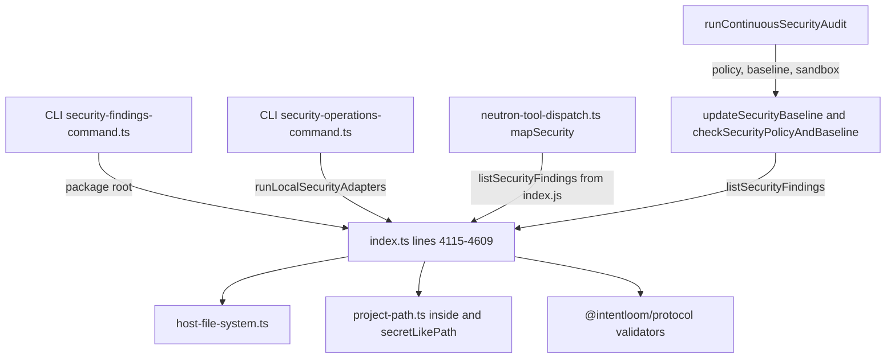
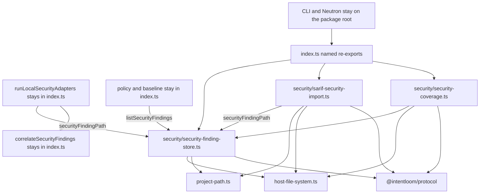
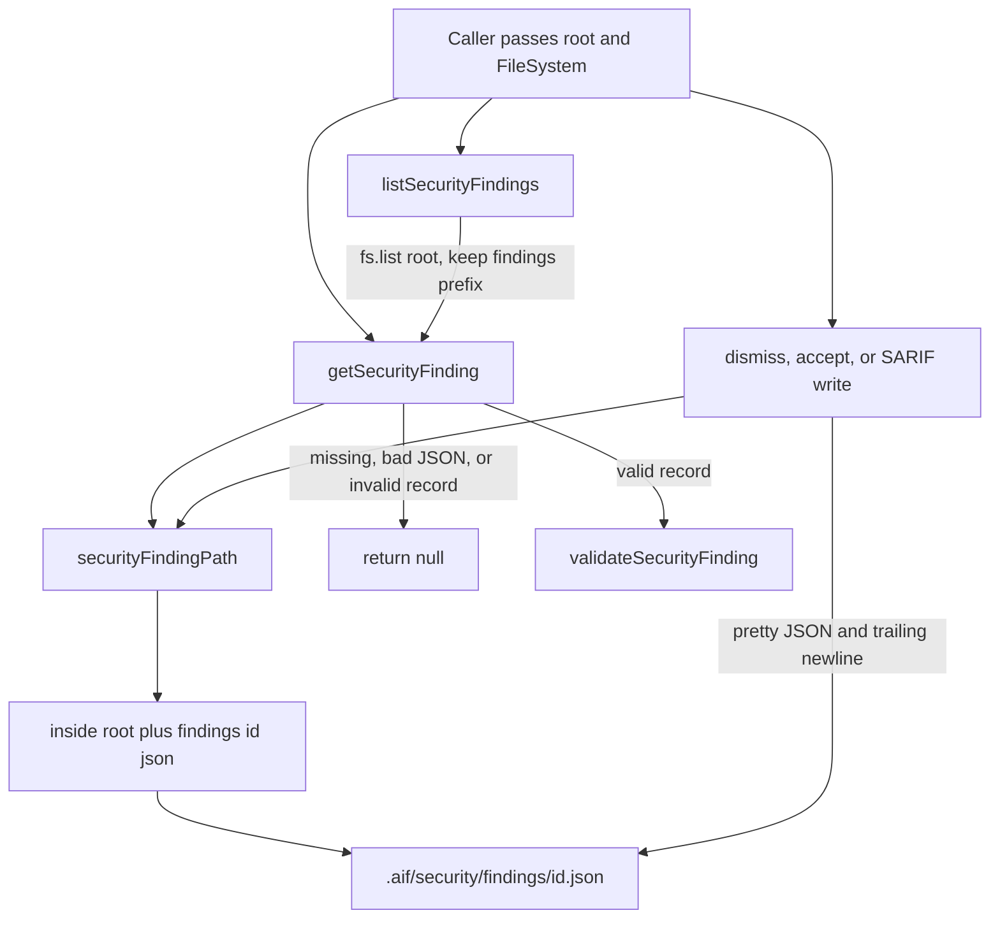
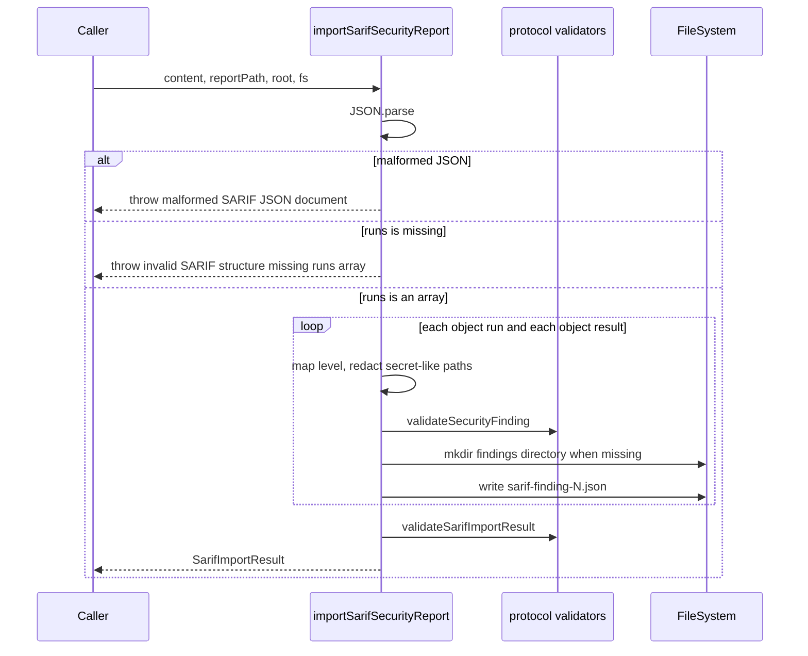
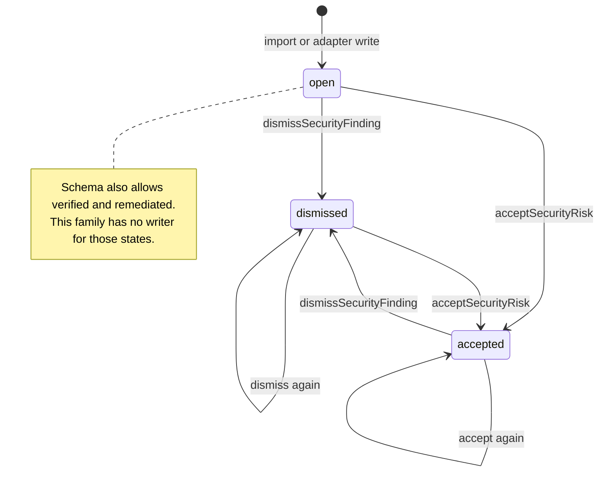
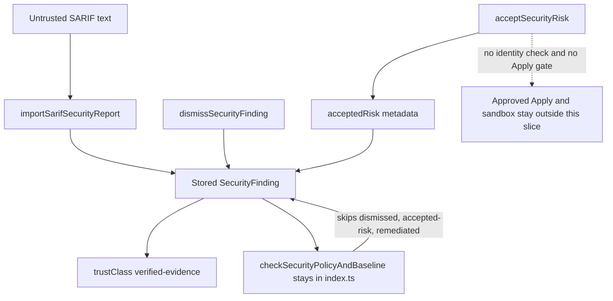
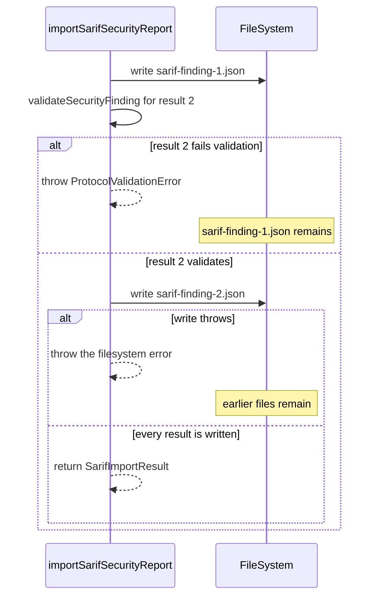
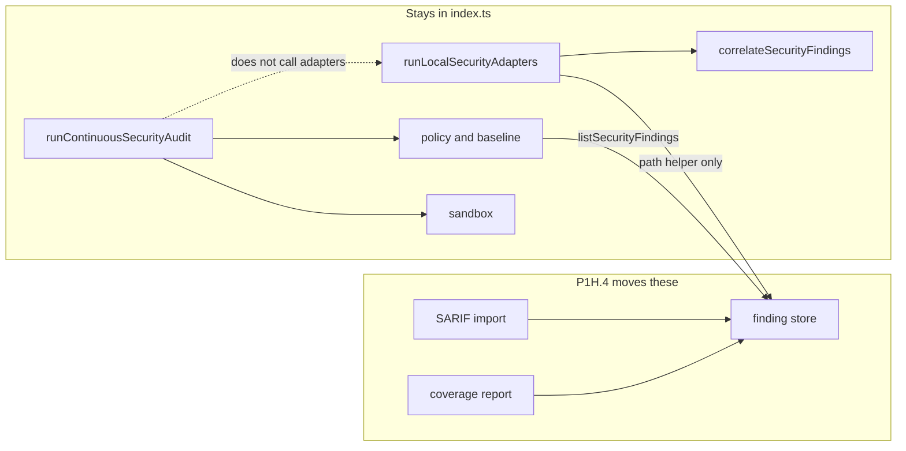

# P1H.4 Security Findings and SARIF Import extraction

Status: **proposed**. This document is a Design First review artifact.
It does not implement P1H.4, and it does not authorize implementation
until a maintainer approves it. A green CI result is not approval.

Baseline: `main` at `911b229af00fcde54d8861af83a56e7e61df0902`, the
merge commit of PR #604 (P1H.3c). P1H.3 design is PR #601
(`6b387a34c221f967a15ef670d53bea9b76e40828`). P1H.3a is PR #602
(`460b81efd1e81f5b24a22e11d3af4680c8f28aad`). P1H.3b is PR #603
(`f116d199a0783870806e8c8660d90385c106f8e1`). P1H.1 and P1H.2 are
merged. P1H.5 and later slices are not part of this design.

Canonical guidance used for this design:

- `docs/architecture/ARCHITECTURE.md` for the application use-case
  boundary and dependency direction.
- `docs/architecture/PACKAGES_STABILIZATION_PLAN.md` for the P1H order.
- `docs/governance/DESIGN_FIRST_POLICY.md`,
  `docs/governance/AI_AGENT_WORKFLOW.md`,
  `docs/governance/ENGINEERING_PRINCIPLES.md`,
  `docs/governance/CODE_QUALITY_STANDARDS.md`, and
  `docs/governance/DOMAIN_MODELING.md`.
- `docs/decisions/ADR-0027-security-evidence-and-posture.md` through
  `docs/decisions/ADR-0031-continuous-security-audit-and-verification.md`.
- `docs/security/THREAT_MODEL.md` invariants 25 through 29.
- The approved P1H.1, P1H.2, and P1H.3 system designs, as the
  extraction pattern. This design does not copy their module layouts.

`packages/application/src/engineering-quality/sarif-report.ts` parses
SARIF for Engineering Quality checker candidates. It is a different
operation. This design does not move it and does not merge it with
Security Finding import.

## 1. Problem statement

`packages/application/src/index.ts` still owns Security Finding reads,
dismissal, risk-acceptance metadata, SARIF import, and the coverage
read model. On this baseline the file measures **5,339 effective
lines** and **5,620 physical lines** (`measureProductionSource`). The
selected family is lines **4115–4383** (**247 effective**, **269
physical**).

The packages stabilization plan schedules "security findings and SARIF
import" as the fourth P1H group. The group must become leaves that
import `host-file-system.ts` and the protocol validators. Public names
stay exported from `index.ts`. No new leaf may import `index.ts`.

Success for the later implementation PRs:

- The six public operations and two private helpers named in section 4
  move unchanged into `packages/application/src/security/`.
- `index.ts` keeps the six public names as named re-exports.
- Signatures, defaults, return values, error text, null behavior,
  storage paths, JSON formatting, sorting, filtering, validation, and
  the stored trust class stay the same.
- No extracted file imports `index.ts`, the CLI, the daemon, the MCP
  server, or Desktop.
- Import-only and re-export strongly connected components keep today's
  membership and sizes.
- The Application package export map does not gain a key.
- Approved Apply, the recorded Neutron mutation component, and the
  extension-update component stay as they are.
- `host-file-system.ts`, `project-path.ts`, the P1H.1 memory modules,
  the P1H.2 Agent Session module, and the P1H.3 skill modules stay
  outside every component.

This slice relocates code. It does not redesign finding storage, SARIF
parsing, severity mapping, redaction, or risk acceptance.

## 2. Goals and non-goals

Goals:

- Give finding storage, SARIF import, and coverage explicit module
  owners and a dependency direction that does not point back at the
  barrel.
- Keep every new file at or below 250 effective lines.
- Preserve the public `@intentloom/application` surface.
- Record the behavior the move must keep, including the shortcomings
  that are already in the code.

Non-goals:

- P1H.5 Security Policy and Sandbox, P1H.6 Continuous Security Audit,
  and P1H.7 Interactive Workspace read model.
- P1I transaction and lifecycle, P1J legacy Neutron helpers, Undo U4,
  and Desktop Undo U5.
- Moving `correlateSecurityFindings` or `runLocalSecurityAdapters`.
- Moving Security Policy, Security Baseline, Sandbox, Continuous
  Security Audit, Approved Apply, Neutron mutation, workspace
  mutation, project adoption, Persistent Memory, Agent Session, or
  Skill Catalog and Proposals.
- A new approval gate, identity check, finding id scheme, deduplication
  rule, severity map, redaction rule, or trust class.
- Splitting `importSarifSecurityReport` to satisfy the 80-line
  function budget. It is 106 effective lines. The move keeps it intact.
- Editing `docs/governance/quality-exceptions.json` or the locked cycle
  tests.
- Adding a `security/index.ts` barrel or a package export-map key.

## 3. Source-code inventory

Every name below is defined in `packages/application/src/index.ts` on
`911b229af00fcde54d8861af83a56e7e61df0902`. `fs` defaults to
`nodeFileSystem` on every public operation in this family.
`correlateSecurityFindings` takes no filesystem argument.

Effective and physical counts are `measureProductionSource` on each
function's source slice.

### Selected for P1H.4

| Name                        | Lines     | Effective | Physical | Export                             |
| --------------------------- | --------- | --------: | -------: | ---------------------------------- |
| `securityFindingPath`       | 4115–4117 |         3 |        3 | private today; module export later |
| `getSecurityFinding`        | 4119–4132 |        14 |       14 | public                             |
| `listSecurityFindings`      | 4134–4168 |        35 |       35 | public                             |
| `dismissSecurityFinding`    | 4170–4189 |        20 |       20 | public                             |
| `acceptSecurityRisk`        | 4191–4221 |        31 |       31 | public                             |
| `isObjectRecord`            | 4223–4225 |         3 |        3 | private; SARIF only                |
| `importSarifSecurityReport` | 4227–4343 |       106 |      117 | public                             |
| `getSecurityCoverageReport` | 4345–4383 |        35 |       39 | public                             |

The contiguous block from `securityFindingPath` through
`getSecurityCoverageReport`, including the blank lines between
functions, is 247 effective and 269 physical.

### Inspected and excluded

| Name                             | Lines     | Effective | Physical | Decision                            |
| -------------------------------- | --------- | --------: | -------: | ----------------------------------- |
| `correlateSecurityFindings`      | 4385–4409 |        25 |       25 | stays in `index.ts`                 |
| `runLocalSecurityAdapters`       | 4411–4609 |       188 |      199 | stays in `index.ts`                 |
| `getSecurityPolicy`              | 4619–4644 |           |          | P1H.5                               |
| `writeSecurityPolicy`            | 4646–4658 |           |          | P1H.5                               |
| `getSecurityBaseline`            | 4660–4672 |           |          | P1H.5                               |
| `updateSecurityBaseline`         | 4674–4699 |           |          | P1H.5; calls `listSecurityFindings` |
| `checkSecurityPolicyAndBaseline` | 4701–4783 |           |          | P1H.5; calls `listSecurityFindings` |
| `getSandboxCapabilityPolicy`     | 4789–4818 |           |          | P1H.5                               |
| `writeSandboxCapabilityPolicy`   | 4820–4832 |           |          | P1H.5                               |
| `evaluateProposalAgainstSandbox` | 4834–4918 |           |          | P1H.5                               |
| `getSecurityAuditReport`         | 4924–4936 |           |          | P1H.6                               |
| `runContinuousSecurityAudit`     | 4938–5151 |       208 |      214 | P1H.6                               |

Policy, sandbox, and audit line spans are ownership bounds from the
source. Their per-function metrics are not an extraction estimate.
`runContinuousSecurityAudit` was measured because its size and call
list decide whether adapters belong with audit.

### Public signatures

```typescript
export async function getSecurityFinding(
  id: string,
  options: { root: string },
  fs: FileSystem = nodeFileSystem,
): Promise<SecurityFinding | null>;

export async function listSecurityFindings(
  options: {
    root: string;
    severity?: SecurityFindingSeverity;
    state?: SecurityFindingState;
  },
  fs: FileSystem = nodeFileSystem,
): Promise<readonly SecurityFinding[]>;

export async function dismissSecurityFinding(
  id: string,
  options: { root: string; reason: string },
  fs: FileSystem = nodeFileSystem,
): Promise<SecurityFinding>;

export async function acceptSecurityRisk(
  id: string,
  options: {
    root: string;
    approvedBy: string;
    reason: string;
    expiresAt?: string;
  },
  fs: FileSystem = nodeFileSystem,
): Promise<SecurityFinding>;

export async function importSarifSecurityReport(
  reportContent: string,
  reportPath: string,
  options: { root: string },
  fs: FileSystem = nodeFileSystem,
): Promise<SarifImportResult>;

export async function getSecurityCoverageReport(
  options: { root: string; projectId: string },
  fs: FileSystem = nodeFileSystem,
): Promise<SecurityCoverageReport>;
```

`securityFindingPath(root, id)` returns
`inside(root, ".aif/security/findings/<id>.json")`.
`isObjectRecord` is true for a non-null, non-array object.

### Callers and callees

| Operation                   | Calls                                                                                                                                                      | Called by production code                                            |
| --------------------------- | ---------------------------------------------------------------------------------------------------------------------------------------------------------- | -------------------------------------------------------------------- |
| `securityFindingPath`       | `inside`                                                                                                                                                   | get, dismiss, accept, SARIF import, `runLocalSecurityAdapters`       |
| `getSecurityFinding`        | path helper, `fs.exists`, `fs.read`, `JSON.parse`, `validateSecurityFinding`                                                                               | list, dismiss, accept                                                |
| `listSecurityFindings`      | `fs.list`, `relative`, `getSecurityFinding`                                                                                                                | coverage, `updateSecurityBaseline`, `checkSecurityPolicyAndBaseline` |
| `dismissSecurityFinding`    | get, `validateSecurityFinding`, `fs.write`                                                                                                                 | CLI `security dismiss`                                               |
| `acceptSecurityRisk`        | get, `validateSecurityFinding`, `fs.write`                                                                                                                 | CLI `security accept-risk`                                           |
| `importSarifSecurityReport` | `JSON.parse`, `isObjectRecord`, `secretLikePath`, `validateSecurityFinding`, path helper, `fs.exists`, `fs.mkdir`, `fs.write`, `validateSarifImportResult` | CLI `security import`                                                |
| `getSecurityCoverageReport` | `listSecurityFindings`, `validateSecurityCoverageReport`                                                                                                   | CLI `security coverage` and `security inspect`                       |
| `correlateSecurityFindings` | none                                                                                                                                                       | `runLocalSecurityAdapters` only                                      |
| `runLocalSecurityAdapters`  | `inside`, `secretLikePath`, `relative`, `validateSecurityFinding`, correlate, path helper, adapter validators, `fs`                                        | CLI `security scan`                                                  |

No production caller outside `index.ts` calls `getSecurityFinding`.
The name is still a public export and stays public.

Consumers that import the package root or `index.js`:

- `packages/cli/src/security-findings-command.ts` imports
  `acceptSecurityRisk`, `dismissSecurityFinding`,
  `getSecurityCoverageReport`, `importSarifSecurityReport`, and
  `listSecurityFindings`.
- `packages/cli/src/security-operations-command.ts` imports
  `runLocalSecurityAdapters`.
- `packages/application/src/neutron/tools/neutron-tool-dispatch.ts`
  imports `listSecurityFindings` from `../../index.js` together with
  `diffProject`, `doctorProject`,
  `evaluateProjectEngineeringConformance`, and `timelineProject`.
  `mapSecurity` lists findings, then bounds the array with
  `maxFindings`. It does not dismiss, accept, import, or scan.

No daemon, MCP server, or Desktop importer of these operations was
found. Desktop does not import `@intentloom/application`.

`updateSecurityBaseline` and `checkSecurityPolicyAndBaseline` call
`listSecurityFindings` and stay in the barrel. After the move, the
barrel keeps a value import of `listSecurityFindings`.
`runLocalSecurityAdapters` stays in the barrel and keeps a value
import of `securityFindingPath`.

## 4. Selected and excluded functions

Selected:

- Finding path, get, list, dismiss, and accept. These are the storage
  and disposition operations for one Security Finding file.
- `isObjectRecord` and `importSarifSecurityReport`. The helper is used
  only by the importer. It moves with the importer and stays
  unexported.
- `getSecurityCoverageReport`. It only reads `listSecurityFindings`
  and aggregates counts. It does not read policy, baseline, sandbox,
  or the audit report. ADR-0027 introduces `SecurityCoverageReport`
  with finding ingestion. The CLI handles it in
  `security-findings-command.ts`, beside import, list, dismiss, and
  accept-risk.

Excluded, with the reason:

- `correlateSecurityFindings` stays beside `runLocalSecurityAdapters`.
  Its only production caller is that function. It does not read or
  write finding files. ADR-0028 describes it as the adapter
  correlation engine. The finding modules do not need it, so moving
  it is not a cycle prerequisite.
- `runLocalSecurityAdapters` stays in `index.ts`. It scans a project
  and then writes findings. The scan is ADR-0028. P1H.6 is
  `runContinuousSecurityAudit`, which reads policy, baseline, and
  sandbox and does not call the adapters. Writing findings is not
  enough to pull the scanner into P1H.4. The adapters import the
  extracted path helper. That dependency points from the barrel to
  the leaf, which is the allowed direction. No intermediate
  extraction is required.
- Security Policy, Security Baseline, Sandbox, and Continuous
  Security Audit stay in `index.ts` for P1H.5 and P1H.6.
- Approved Apply, Neutron mutation, workspace mutation, project
  adoption, Persistent Memory, Agent Session, and Skill operations
  are untouched.

Where the adapters eventually move is a later design. This design
does not assign them to P1H.5 or P1H.6.

## 5. DDD boundaries

`docs/governance/DOMAIN_MODELING.md` says a bounded context is not a
directory. This extraction adds `packages/application/src/security/`
as an application module folder. It does not add a bounded context,
an Entity, an Aggregate, a Repository, a Domain Service, or a Domain
Event.

The protocol module already owns the schemas. The application module
owns the use cases that read and write those schemas through the
`FileSystem` port. `inside` and `secretLikePath` stay in
`project-path.ts`.

Terms, and the owner this design uses:

| Term                      | Meaning in the current code                                    |
| ------------------------- | -------------------------------------------------------------- |
| Security Finding          | Versioned JSON record `SecurityFinding`                        |
| Security Evidence         | `path` plus optional lines and snippet on a finding            |
| SARIF Report              | Caller-supplied JSON text plus a `reportPath` label            |
| Scanner                   | `scanner` string stored on the finding                         |
| Severity                  | `critical`, `high`, `medium`, `low`, `info`                    |
| Finding State             | `open`, `verified`, `dismissed`, `accepted-risk`, `remediated` |
| Dismissal                 | State `dismissed` plus optional `dismissalReason`              |
| Accepted Security Risk    | State `accepted-risk` plus `acceptedRisk` metadata             |
| Security Coverage         | Aggregate counts from the current finding list                 |
| Security Adapter          | Read-only scanner in `runLocalSecurityAdapters`                |
| Security Policy           | `.aif/security/policy.json` and its enforcement rules          |
| Security Baseline         | `.aif/security/baseline.json` snapshot and hash                |
| Continuous Security Audit | `.aif/security/audit-report.json` and invariant checks         |

Finding lifecycle operations record a disposition on a stored
finding. They do not evaluate Security Policy and they do not decide
whether a later command exits 0 or 3. Policy enforcement stays in
`checkSecurityPolicyAndBaseline`. That function treats `dismissed`,
`accepted-risk`, and `remediated` as outside the violation set.
`verified` and `open` stay inside it. The extraction preserves that
split.

Importing a SARIF report stores evidence from text the caller already
holds. It does not execute a scanner, a shell, or a network request.
`runLocalSecurityAdapters` executes the built-in read-only checks and
then writes findings. Those are different operations. Only the import
moves in P1H.4.

## 6. Current architecture



Editable source:
[`current-dependencies.mmd`](current-dependencies.mmd).

The finding block uses `node:path` (`dirname`, `relative`),
`host-file-system.ts`, `inside`, `secretLikePath`, and the protocol
types and validators already imported by `index.ts`. It does not call
Persistent Memory, Agent Session, Skill, Approved Apply, or Neutron
mutation code.

## 7. Proposed architecture



Editable source:
[`proposed-dependencies.mmd`](proposed-dependencies.mmd).

There is no `security/index.ts`. Nothing under `security/` imports
`index.ts`. The barrel imports the leaves. The leaves do not import
the barrel, the CLI, the daemon, the MCP server, or Desktop.

## 8. Module responsibilities

### `security/security-finding-store.ts`

Owns `securityFindingPath`, `getSecurityFinding`,
`listSecurityFindings`, `dismissSecurityFinding`, and
`acceptSecurityRisk`.

The path helper is exported from this module so SARIF import and the
barrel's adapter loop can call it. `index.ts` does not re-export it.
That matches `sessionFilePath` in P1H.2.

A mechanical splice with the imports below measures **113 effective**
and **118 physical** lines. Both are under the 250-line preference.

### `security/sarif-security-import.ts`

Owns `isObjectRecord` and `importSarifSecurityReport`. The helper
stays private. The importer calls `securityFindingPath` from the
store. It does not call get, list, dismiss, accept, or coverage.

A mechanical splice measures **121 effective** and **134 physical**
lines. The file is under 250 effective lines.
`importSarifSecurityReport` itself remains **106 effective** and
**117 physical** lines. That exceeds the 80-line function hard limit.
The implementation keeps the function intact. Splitting the
parse-and-write loop would hide the order of the partial writes this
move must preserve. `scripts/production-file-metrics.mjs` checks file
size, so the move passes that gate. This design records the function
debt here and does not add a `quality-exceptions.json` entry.

- Rule: function hard limit of 80 lines in
  `docs/governance/CODE_QUALITY_STANDARDS.md` section 4.
- Measured value: 106 effective lines, 117 physical lines.
- Reason: one validation-and-write loop whose order is the current
  partial-write behavior.
- Scope: `importSarifSecurityReport` only.
- Owner: Application maintainers.
- Review trigger: the next behavior change to that function.

### `security/security-coverage.ts`

Owns `getSecurityCoverageReport`. It imports `listSecurityFindings`
from the store. It does not write files.

A mechanical splice measures **43 effective** and **48 physical**
lines.

## 9. Dependency graph

Allowed edges after the move:

- store → `host-file-system.ts`, `project-path.ts` (`inside`),
  `@intentloom/protocol`
- SARIF import → store (`securityFindingPath`), `project-path.ts`
  (`secretLikePath`), `host-file-system.ts`, `@intentloom/protocol`
- coverage → store (`listSecurityFindings`), `host-file-system.ts`,
  `@intentloom/protocol`
- `index.ts` → store, SARIF import, coverage
- `runLocalSecurityAdapters` in `index.ts` → store
  (`securityFindingPath`) and the local `correlateSecurityFindings`
- policy and baseline in `index.ts` → store (`listSecurityFindings`)

Forbidden:

- any file under `security/` importing `index.ts`
- store importing SARIF import, coverage, adapters, policy, or audit
- a new package export-map key
- retargeting CLI, daemon, MCP, or Desktop imports onto the private
  files

Neutron keeps importing `listSecurityFindings` from `index.js`.
Retargeting that one name would not remove Neutron's import of the
barrel, because the same import also pulls doctor, diff, conformance,
and timeline. P1H.1 retargeted memory search because that removed a
real edge. This move does not.

## 10. Public API compatibility

Preserved for the six public functions:

- names, parameter order, option fields, and the `fs` default
- return types `SecurityFinding | null`, `readonly SecurityFinding[]`,
  `SecurityFinding`, `SarifImportResult`, and `SecurityCoverageReport`
- thrown error text documented in section 15
- protocol types re-exported by `index.ts` today
- package-root imports from `@intentloom/application`
- filesystem injection

`index.ts` re-exports:

```typescript
import {
  listSecurityFindings,
  securityFindingPath,
} from "./security/security-finding-store.js";

export {
  acceptSecurityRisk,
  dismissSecurityFinding,
  getSecurityFinding,
  listSecurityFindings,
} from "./security/security-finding-store.js";
export { importSarifSecurityReport } from "./security/sarif-security-import.js";
export { getSecurityCoverageReport } from "./security/security-coverage.js";
```

`securityFindingPath` is a local value import. It is not part of the
re-export list. `listSecurityFindings` is both a local value, because
baseline code still calls it, and a public re-export.

The twelve keys in `packages/application/package.json` `exports` stay.
No `./security` key is added.

CLI default strings stay in the CLI. `security dismiss` still defaults
`reason` to `Dismissed by maintainer`. `security accept-risk` still
defaults `approvedBy` to `maintainer` and `reason` to `Accepted risk`.
Those defaults are not application parameters.

## 11. Persistence and schemas

Finding files stay at `.aif/security/findings/<id>.json`. The path is
`inside(root, ".aif/security/findings/<id>.json")`. `inside`
resolves the path and throws `path traversal: <path>` when the
resolved target escapes `root`.



Editable source:
[`finding-persistence-read.mmd`](finding-persistence-read.mmd).

`getSecurityFinding`:

- Missing file returns `null`.
- `JSON.parse` failure and `validateSecurityFinding` failure return
  `null`. The `try` starts after the path is built, so a traversal
  throw from `inside` is not turned into `null`.
- A valid record is returned from `validateSecurityFinding`, which
  rebuilds the object in validator field order.

`listSecurityFindings`:

- Calls `fs.list(options.root)`, not a dedicated directory listing.
- If a listed path starts with `root`, it is made relative with
  `node:path` `relative`. Otherwise the listed string is used as-is.
  `nodeFileSystem.list` returns project-relative paths. The memory
  filesystem used in tests returns absolute keys. Both shapes are
  already handled.
- Keeps paths that start with `.aif/security/findings/` and end with
  `.json` after backslashes are normalized.
- The id is the remainder after the prefix and the `.json` suffix, so
  a nested relative path becomes an id that contains slashes.
- Drops records for which `getSecurityFinding` returns `null`.
- Filters with exact `severity` and `state` equality when those
  options are present. An unknown filter value matches nothing. The
  function does not validate the filter strings.
- Sorts with `a.id.localeCompare(b.id)`.

`nodeFileSystem.list` skips symbolic links, the ignored scan
directories in `project-scan-exclusions.ts`, binary extensions, depth
above 32, and paths after 10,000 files. `.aif` is not an ignored
directory. `getSecurityFinding` can still read an id whose file the
walker skipped. The extraction does not change the walker.

Dismiss and accept:

- Throw `security finding not found: ${id}` when get returns `null`.
- Do not call `mkdir`. A missing parent directory fails at `fs.write`.
- Write `JSON.stringify(updated, null, 2)` plus a trailing newline.
- Do not inspect the previous state. Dismiss does not remove
  `acceptedRisk`. Accept does not remove `dismissalReason`.
- Set `updatedAt` to `new Date().toISOString()`. `createdAt` stays on
  the spread record and is copied by the validator.
- Empty `dismissalReason` is omitted by the validator. The state is
  still `dismissed`.
- `expiresAt` is copied only when the option is truthy. The validator
  also drops an empty `expiresAt`. There is no date-format check.

SARIF import and the adapter loop call `fs.mkdir(dirname(path))` when
the parent is missing. `nodeFileSystem.mkdir` is recursive. Dismiss
and accept do not.

Schemas stay the protocol `schemaVersion: "1"` objects. This design
does not add a report file. ADR-0027 names `.aif/security/reports/`.
The current importer does not write that directory. `reportPath` is a
field on the returned `SarifImportResult` only.

## 12. SARIF import flow



Editable source:
[`sarif-import-sequence.mmd`](sarif-import-sequence.mmd).

Observable behavior on this baseline:

- `JSON.parse` failure throws `malformed SARIF JSON document`. Nothing
  is written.
- A parsed value that is not a non-array object, or whose `runs` is
  not an array, throws `invalid SARIF structure: missing runs array`.
  Nothing is written.
- The implementation does not check SARIF `version`, `$schema`, or the
  SARIF 2.1.0 required properties beyond `runs`. It is not full
  SARIF validation.
- Non-object runs are skipped. A missing or non-array `results` is
  treated as an empty list. Non-object results are skipped.
- Scanner name is `tool.driver.name` when that value is a string,
  otherwise `sarif-scanner`.
- Rule id is `result.ruleId` when that value is a string, including
  the empty string, otherwise `SARIF-RULE`.
- Title is `result.message.text` when that value is a string,
  otherwise `SARIF Finding`.
- Level defaults to `warning` when `result.level` is not a string.
  The string is lowercased.

| Level                      | Stored severity |
| -------------------------- | --------------- |
| non-string, then `warning` | `medium`        |
| `error`                    | `high`          |
| `warning`                  | `medium`        |
| `note`                     | `low`           |
| any other string           | `info`          |

`critical`, `high`, and `none` are other strings. They become `info`.

- Each location becomes evidence. A non-object location becomes
  `{ path: "unknown" }`. Missing URI becomes `unknown`. `startLine`
  and `endLine` are copied only when they are numbers. Snippet text
  is copied only when it is a string.
- `secretLikePath` is applied to the evidence URI, the snippet text,
  and the title. A match stores `[REDACTED]` for that field.
  `secretLikePath` matches a `/`-separated segment that is `.env`,
  starts with `.env.`, or ends with `.key`, `.pem`, `.p12`, or
  `.pfx`. It does not match secret values such as `API_KEY=secret123`.
  The existing S1 fixture expects the `.env.production` path to be
  redacted and does not expect the snippet value to be redacted.
- Rule id, scanner name, description, and `reportPath` are not passed
  through `secretLikePath`. Description is the literal
  `Imported from <scannerName>`.
- Category is always `vulnerability`. State is always `open`.
  `trustClass` is always `verified-evidence`.
- The id is `` `sarif-finding-${findingCounter}` ``. The counter
  starts at 1 for each call and increments for each result that
  reaches the id line, including a result whose later validation
  throws. The counter is not stored. A second import of two results
  writes `sarif-finding-1.json` and `sarif-finding-2.json` again and
  replaces the previous bytes, including a dismissed or accepted
  state.
- Evidence paths are stored as the raw URI or `[REDACTED]`. They are
  not passed through `inside` and are not rewritten relative to the
  project root.
- `reportPath` is not opened. The caller supplies `reportContent`.
  The CLI reads the file with `resolveWithin` and passes the original
  `--file` string as `reportPath`.
- After the loop, the returned object is `validateSarifImportResult`
  with `importedCount: findings.length`, the findings written in this
  call, and one shared `importedAt`. An empty `runs` array returns a
  count of 0 and writes nothing.

The id form stays `sarif-finding-<counter>`. This design does not
replace it with a hash or a UUID, and it does not add deduplication,
batching, transactions, or rollback.

## 13. Finding lifecycle



Editable source:
[`finding-lifecycle.mmd`](finding-lifecycle.mmd).

`accepted` in the diagram is the state `accepted-risk`.

Dismiss sets `state` to `dismissed` and `dismissalReason` to the
caller string. Accept sets `state` to `accepted-risk` and
`acceptedRisk` to `{ approvedBy, reason, approvedAt, expiresAt? }`.
`approvedAt` is the same clock value as `updatedAt`.

Neither operation checks the current state, the caller identity, an
approval record, the sandbox, or the policy file. Accepting risk does
not bypass Approved Apply, sandbox evaluation, or any other gate. It
records metadata on the finding. Existing policy code later skips
findings whose state is `dismissed`, `accepted-risk`, or `remediated`.
That skip stays in the barrel with the policy operation.

ADR-0027 describes transitions from `open` to `verified`,
`dismissed`, `accepted-risk`, or `remediated`. The code in this family
only writes `dismissed` and `accepted-risk`. `verified` and
`remediated` remain valid schema states for a hand-written file that
passes `validateSecurityFinding`. No operation in this family sets
them. The extraction does not add those writers.

## 14. Security and trust boundaries



Editable source:
[`trust-authorization.mmd`](trust-authorization.mmd).

The table separates what the code enforces, what is already weak, and
what a later design would have to approve. P1H.4 implementation must
preserve column A. It must not implement column C.

| Topic                       | A. Enforced today                                           | B. Known weakness                                                                                            | C. Later design, not this extraction         |
| --------------------------- | ----------------------------------------------------------- | ------------------------------------------------------------------------------------------------------------ | -------------------------------------------- |
| SARIF input                 | JSON object with a `runs` array; validator on each finding  | No SARIF version or full schema check; no size limit                                                         | Bounded parse and real SARIF validation      |
| Scanner name, rule, message | Stored as strings; empty title or rule fails the validator  | Scanner name is interpolated into `description` without redaction                                            | Redaction policy for those fields            |
| Paths and snippets          | `secretLikePath` on URI, snippet, and title                 | Secret values that are not secret-like paths stay in the snippet. The S1 fixture keeps `API_KEY=secret123`   | Content redaction                            |
| Evidence paths              | Stored as supplied or `[REDACTED]`                          | Not canonicalized to the project root, despite ADR-0027 and threat-model invariant 25                        | Canonical evidence paths                     |
| Finding id traversal        | `inside` throws `path traversal: ...`                       | `get` does not catch that throw. A listed id that escapes can fail the whole list                            | Decide null versus throw                     |
| Oversized reports           | No special case                                             | `JSON.parse` holds the whole document                                                                        | Size limit                                   |
| Duplicate ids               | Same id overwrites the file                                 | A repeated import resets `sarif-finding-1` to `open` and drops dismissal                                     | Stable ids or conflict detection             |
| Partial import              | Earlier files remain when a later result throws             | ADR-0027 says malformed reports abort without partial writes. The code writes inside the loop                | Transaction or prevalidation                 |
| State transitions           | Any found record can be dismissed or accepted               | Previous `acceptedRisk` or `dismissalReason` can remain beside the new state                                 | An explicit state machine                    |
| Risk acceptance             | Metadata is stored and validated as strings                 | `approvedBy` is caller-controlled. No identity, expiry check, or second person. Policy later skips the state | A separate approval design                   |
| Filesystem port             | Caller may inject `FileSystem`; default is `nodeFileSystem` | A caller-supplied port is trusted as the host boundary                                                       | No change in this extraction                 |
| Repeated imports            | Counter restarts at 1                                       | Overwrite, not append                                                                                        | Deduplication design                         |
| Corrupt records             | `get` returns `null`; list skips null                       | List still throws if path construction throws                                                                | Same as the traversal row                    |
| Trust class                 | Importer writes `verified-evidence`                         | Untrusted SARIF is labeled verified evidence. The validator casts any non-empty `trustClass` string          | A trust-class change requires its own design |

Human approval boundaries that already exist stay outside this move:
Approved Apply, sandbox evaluation, skill-proposal `approvalEvidence`,
and persistent-memory acceptance. `acceptSecurityRisk` is not one of
those gates.

Invariant 25 says SARIF imports are untrusted, paths are canonicalized,
and secrets are redacted. The code redacts secret-like paths, confines
the finding file with `inside`, and does not execute the report. It
does not canonicalize evidence URIs, and it labels the stored finding
`verified-evidence`. Invariant 26's adapter deduplication stays with
`correlateSecurityFindings` in the barrel. This extraction does not
edit `docs/security/THREAT_MODEL.md`.

The partial-write contradiction with ADR-0027, the `verified-evidence`
label on untrusted SARIF, and the overwrite of disposition state are
serious enough to need their own Design First change before any
mitigation. They are not authorized by approval of this extraction.

## 15. Error and recovery behavior



Editable source:
[`failure-partial-write.mmd`](failure-partial-write.mmd).

Exact application errors:

- `malformed SARIF JSON document`
- `invalid SARIF structure: missing runs array`
- `security finding not found: ${id}`
- `path traversal: ${path}` from `inside`
- `ProtocolValidationError` from the protocol validators, with the
  existing messages such as `security finding must be an object`,
  `id must be a non-empty string`, and
  `invalid security finding severity`

There is no retry, timeout, or rollback. A failed dismiss or accept
leaves the previous file in place when the failure happens before
`fs.write`. A failed import leaves every finding file that was
already written. A concrete trigger is a later result whose `ruleId`
or title is an empty string: `stringValue` rejects it after earlier
results have been written.

An empty import returns a validated result and writes nothing. It is
not an error.

## 16. Local adapter and audit boundary



Editable source:
[`adapter-audit-boundary.mmd`](adapter-audit-boundary.mmd).

`runLocalSecurityAdapters` stays in `index.ts` and imports
`securityFindingPath`. `correlateSecurityFindings` stays next to it.
`runContinuousSecurityAudit` does not call either function. It calls
`getSecurityPolicy`, `getSecurityBaseline`,
`getSandboxCapabilityPolicy`, and `checkSecurityPolicyAndBaseline`.
Its invariant 25 and 26 checks are fixed status strings. They do not
execute import or the adapters.

The adapter function is 188 effective lines. Moving it unchanged would
also need the function-size note this design uses for SARIF import.
That note belongs with the adapter extraction, not with P1H.4.

Categories `source`, `extension`, `hook`, and `agentic` are in the
default category list and have no branch in the function. They return
an adapter result with an empty finding list. The extraction does not
add those branches.

## 17. Alternative designs

### One module for the whole selected block

The selected block is 247 effective lines before imports. With the
import header it would sit above the 250-line preference and near the
300-line review line. SARIF parsing, disposition writes, and coverage
aggregation change for different reasons. One file was rejected.

### Store plus coverage in one file, SARIF separate

Coverage is 35 effective lines and only calls list. Folding it into
the store would stay under 250 lines and remove one file. It was
rejected because the coverage report is a derived read model with its
own protocol type and no write path. The store would then mix
aggregation with disposition writes. The three-file split matches the
P1H.1 memory split and keeps each file under 250.

### Move correlation and adapters with the findings

Rejected. Correlation's only production caller is the adapter
orchestrator. The audit orchestrator does not call the adapters.
Section 4 records the dependency direction that lets the findings
move while the scanner stays.

### Fix partial writes, trust class, and ids during the move

Rejected. Those are behavior changes. Each needs a separate Design
First review. The implementation tests should lock today's behavior
so a drive-by fix cannot land inside the extraction.

## 18. SCC baseline and acceptance criteria

Measured with `applicationCycles` from
`tests/application-source-cycles.ts` on this baseline.

Import-only, two components, sizes 3 and 3:

- `approved-apply-baseline.ts`, `generated-file-sync-declared.ts`,
  `index.ts`
- `neutron/mutation/apply/neutron-mutation-apply-durable-record.ts`,
  `neutron/mutation/apply/neutron-mutation-apply-store.ts`,
  `neutron/mutation/verification/neutron-mutation-verification-retry-eligibility.ts`

Re-export-inclusive, three components, sizes 4, 29, and 3:

- Extension update: `apply-extension-update.ts`,
  `discover-and-apply-extension-update.ts`,
  `extension-update-files.ts`,
  `propose-and-apply-extension-adoption.ts`
- The 29-file component locked in
  `tests/application-inception-cycle.test.ts`:
  `approved-apply-baseline.ts`, `approved-apply-engine.ts`,
  `bounded-execution-apply.ts`, `bounded-execution-w11.ts`,
  `bounded-execution-workspace-cli.ts`,
  `bounded-execution-workspace.ts`, `engineering-quality-entry.ts`,
  `engineering-quality/cli-specialized-packs-external.ts`,
  `engineering-quality/index.ts`,
  `engineering-quality/specialized-pack-external-apply.ts`,
  `engineering-quality/specialized-pack-external-viewmodel.ts`,
  `existing-project-adoption-apply-gates.ts`,
  `existing-project-adoption-apply-health.ts`,
  `existing-project-adoption-apply.ts`,
  `existing-project-adoption-approval.ts`,
  `existing-project-adoption-decisions.ts`,
  `existing-project-adoption-plan.ts`,
  `existing-project-adoption-prepared-plan-revalidate.ts`,
  `existing-project-adoption-prepared-plan.ts`,
  `existing-project-w9.ts`, `existing-project-workspace-cli.ts`,
  `existing-project-workspace.ts`, `foundation-flow.ts`,
  `generated-file-sync-declared.ts`,
  `harness/harness-benchmark-sample.ts`,
  `harness/harness-benchmark.ts`, `harness/harness.ts`,
  `inception-flow.ts`, `index.ts`
- The same Neutron mutation component as the import-only graph

`host-file-system.ts`, `project-path.ts`, the three
`memory/persistent-memory-*.ts` files,
`agent-session/agent-session.ts`, and the six `skills/*.ts` files are
outside every component.

Acceptance for the implementation:

- No new component and no larger component.
- The three components above keep the same membership.
- The three new security files stay outside every component.
- The locked expectations in
  `tests/application-inception-cycle.test.ts` and
  `tests/application-foundation-scaffold-cycle.test.ts` are not edited.

The proposed edges are one-way into the new files. They do not add a
cycle. If an implementation review finds a cycle, stop and extract
only the in-scope callee. Do not point a security leaf back at
`index.ts`.

## 19. Line-count measurements

`index.ts` on this baseline: **5,339 effective**, **5,620 physical**.
That matches the P1H.3c record.

Selected family, lines 4115–4383: **247 effective**, **269 physical**.

Per-function counts are in section 3.
`importSarifSecurityReport` is over the function hard limit.
`runLocalSecurityAdapters` is 188 effective lines and stays in the
grandfathered barrel. Neither fact authorizes an edit to
`docs/governance/quality-exceptions.json` or a higher grandfathered
ceiling.

Estimated module sizes, from `measureProductionSource` on a mechanical
splice that has not been formatted:

| Module                      | Effective | Physical |
| --------------------------- | --------: | -------: |
| `security-finding-store.ts` |       113 |      118 |
| `sarif-security-import.ts`  |       121 |      134 |
| `security-coverage.ts`      |        43 |       48 |

Estimated `index.ts` after both implementation slices: **5,101
effective**, **5,363 physical**. That is 238 effective lines and 257
physical lines below this baseline. The estimate is the splice result,
not an implementation measurement. Prettier may move it by a few lines,
as it did for earlier P1H slices.

Staged estimates, same method:

| Slice                     | `index.ts` after | Effective delta | Physical delta |
| ------------------------- | ---------------- | --------------: | -------------: |
| P1H.4a store and coverage | 5,209 / 5,483    |            −130 |           −137 |
| P1H.4b SARIF import       | 5,101 / 5,363    |            −108 |           −120 |

## 20. Implementation sequence

Two implementation PRs, in order. A maintainer may land them as one PR
without a new design, because both are specified here. Neither PR
starts P1H.5.

### P1H.4a — finding store and coverage

- Move `securityFindingPath`, `getSecurityFinding`,
  `listSecurityFindings`, `dismissSecurityFinding`,
  `acceptSecurityRisk`, and `getSecurityCoverageReport`.
- New files: `security-finding-store.ts`, `security-coverage.ts`.
- `index.ts` value-imports `listSecurityFindings` and
  `securityFindingPath`.
- `index.ts` re-exports the five public names.
- `importSarifSecurityReport` and `runLocalSecurityAdapters` stay in
  the barrel and call the imported path helper.
- `isObjectRecord` stays in the barrel with the importer.
- Expected barrel reduction: about 130 effective and 137 physical
  lines.
- Tests: section 21 rows for get, list, dismiss, accept, coverage,
  path JSON, package exports, and cycles. Existing SARIF tests stay
  green against the barrel.
- Depends on this design being approved. No code dependency on a
  previous P1H.4 PR.
- Acceptance: public behavior unchanged, both new files at or below
  250 effective lines, no new SCC, export map unchanged,
  `quality-exceptions.json` unchanged.

### P1H.4b — SARIF import

- Move `isObjectRecord` and `importSarifSecurityReport` into
  `sarif-security-import.ts`.
- The importer imports `securityFindingPath` from the store.
- `index.ts` re-exports `importSarifSecurityReport` and does not need
  a local value import of it. The path helper import remains for the
  adapters.
- The function stays whole at 106 effective lines. The debt note in
  section 8 travels into the stabilization plan when this PR lands.
- Expected barrel reduction from the P1H.4a estimate: about 108
  effective and 120 physical lines.
- Tests: section 21 rows for SARIF errors, severity, redaction, trust
  class, overwrite, and partial write.
- Depends on P1H.4a.
- Acceptance: same cycle, export-map, and behavior constraints as
  P1H.4a, plus the SARIF cases.

Future work that needs its own Design First approval:

- Any change to partial writes, trust class, finding ids, redaction,
  evidence canonicalization, or risk-acceptance authorization.
- The extraction of `runLocalSecurityAdapters` and
  `correlateSecurityFindings`.
- P1H.5, P1H.6, and P1H.7.

## 21. Regression-test strategy

Existing coverage, which the implementation must keep and must not
weaken:

| File                                                  | What it covers                                                                                                          |
| ----------------------------------------------------- | ----------------------------------------------------------------------------------------------------------------------- |
| `tests/memory-security-s1.test.ts`                    | Schema, SARIF import, secret-path redaction, dismiss, accept, coverage counts, the two SARIF error strings, CLI routing |
| `tests/memory-security-s2.test.ts`                    | Correlation, adapter execution, scan CLI                                                                                |
| `tests/memory-security-s3.test.ts`                    | Policy and baseline, using imported findings                                                                            |
| `tests/cli-security.test.ts`                          | Import, coverage, dismiss, accept, list filters, scan, policy, sandbox, audit                                           |
| `tests/neutron-n4-readonly-tools.test.ts`             | `mapSecurity` read-only listing                                                                                         |
| `tests/application-inception-cycle.test.ts`           | SCC membership                                                                                                          |
| `tests/application-foundation-scaffold-cycle.test.ts` | Cycle helper                                                                                                            |

Gaps the implementation should fill with new tests, without rewriting
the assertions above:

- The six names remain on the package root, and
  `securityFindingPath` does not.
- The export map is unchanged.
- Pretty JSON, trailing newline, and the findings path.
- `getSecurityFinding` returns `null` for a missing file, invalid
  JSON, and a validator failure, and throws the existing traversal
  error when `inside` rejects the id.
- List filter and `localeCompare` order, including a corrupt file
  skipped by get.
- Dismiss and accept metadata, the not-found error, and the current
  behavior that the other metadata field is left in place.
- Severity rows from section 12, including a non-string level and an
  unknown level string.
- Secret-like path redaction and a snippet that is not a secret-like
  path and therefore stays.
- Stored `trustClass` is `verified-evidence`.
- A second import overwrites `sarif-finding-1.json`.
- A later empty `ruleId` leaves the earlier finding file in place and
  rejects the call.
- `listSecurityFindings` still sees imported findings for coverage,
  baseline, and `mapSecurity`.
- Cycle membership and the new files' line counts.

`runLocalSecurityAdapters` tests stay on the existing S2 file. This
design does not add adapter behavior.

## 22. Migration and rollback

The implementation is a source move. Finding files already on disk
stay valid. There is no schema migration and no id rewrite.

Rollback is reverting the implementation PR. Files written by the old
and new code have the same path and the same JSON shape. A rollback
does not need a data conversion.

During review, do not retarget external imports to
`packages/application/src/security/`. Consumers stay on the package
root.

## 23. Open decisions and limitations

Decided by this design:

- The six public operations and two private helpers in section 4 move.
- Coverage moves with the finding read model.
- Correlation and local adapters stay in `index.ts`.
- Three modules, no security barrel, no new export-map key.
- `importSarifSecurityReport` stays one function.
- Behavior in sections 11 through 15 is preserved, including the known
  weaknesses.

Not decided here, and not authorized by approval of this design:

- Whether implementation is one PR or the two PRs in section 20. Either
  matches this design.
- The future module for adapters and correlation.
- Any mitigation in column C of section 14.

Limitations of the current code that the move must not quietly close
are the partial writes, the `verified-evidence` label, the restarting
`sarif-finding-<counter>` ids, the narrow `secretLikePath` redaction,
the lack of evidence-path canonicalization, and the caller-supplied
`approvedBy` string.

## Diagram index

| Diagram                    | Source                         |
| -------------------------- | ------------------------------ |
| Current dependencies       | `current-dependencies.mmd`     |
| Proposed dependencies      | `proposed-dependencies.mmd`    |
| Finding lifecycle          | `finding-lifecycle.mmd`        |
| SARIF import sequence      | `sarif-import-sequence.mmd`    |
| Persistence and read flow  | `finding-persistence-read.mmd` |
| Trust and authorization    | `trust-authorization.mmd`      |
| Partial-write failure      | `failure-partial-write.mmd`    |
| Adapter and audit boundary | `adapter-audit-boundary.mmd`   |

Mermaid is the diagram format. Excalidraw and draw.io are not used.
The graphs are dependency, state, and sequence drawings. A second
drawing tool would duplicate them.
