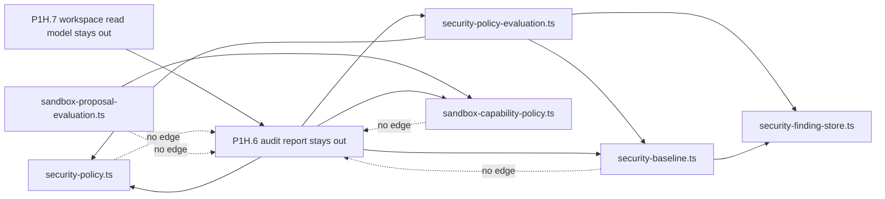
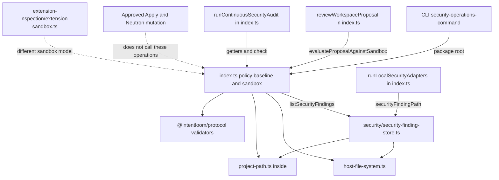
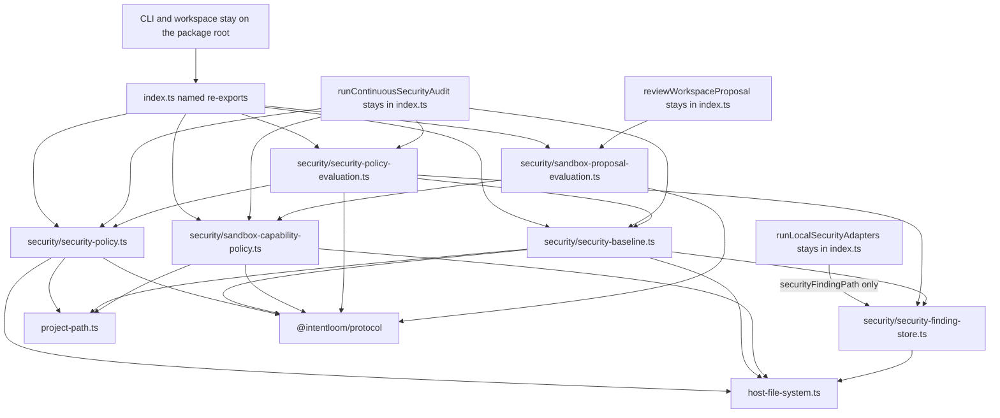
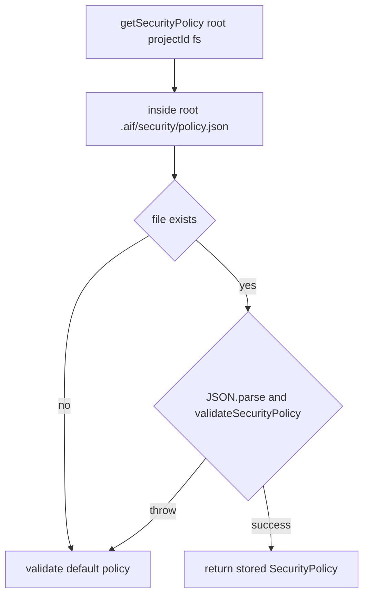
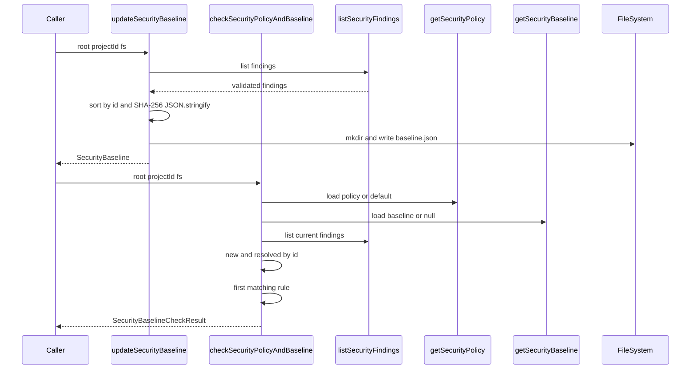
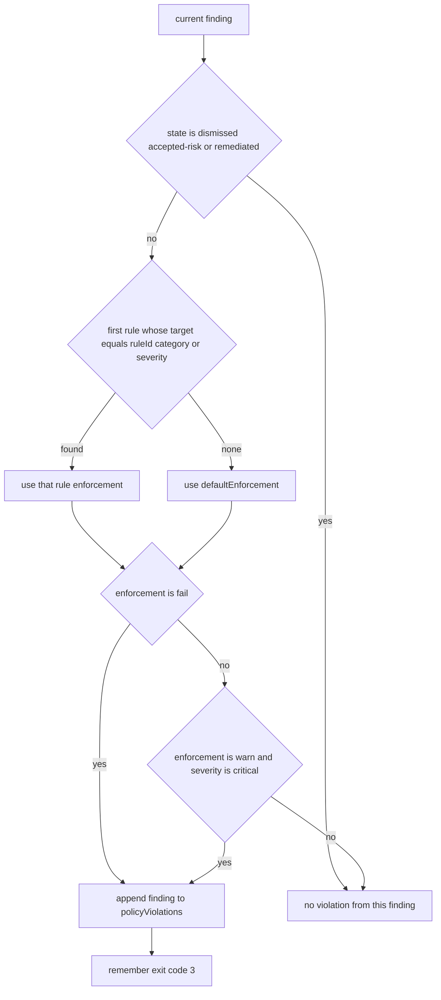
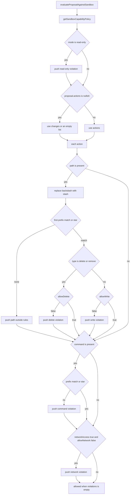
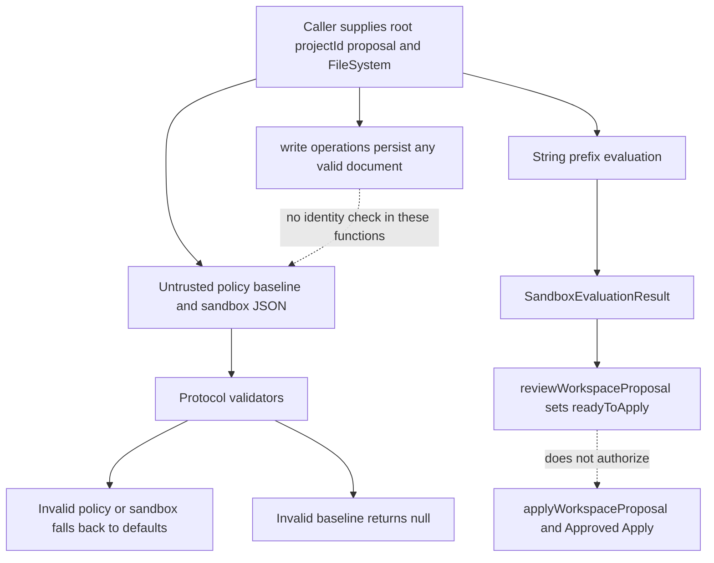

# P1H.5 Security Policy and Sandbox extraction

Status: **proposed**. This document is a Design First review artifact.
It does not implement P1H.5, and it does not authorize implementation
until a maintainer approves it. A green CI result is not approval.

## 1. Context and baseline

Baseline: `main` at `7a77db52753360f0029cd266d8c95eb78c34995c`, the
merge commit of PR #607 (P1H.4b). The working tree was clean. Open
pull requests at the start of this design were dependency updates and
do not overlap this slice. No earlier P1H.5 design exists.

Completed before this design:

- P1H.1 Persistent Memory, design PR #597, implementation PR #598.
- P1H.2 Agent Session, design PR #599, implementation PR #600.
- P1H.3 Skill Catalog and Proposals, design PR #601. P1H.3a is PR
  #602, P1H.3b is PR #603, and P1H.3c is PR #604.
- P1H.4 Security Findings and SARIF Import, design PR #605
  (`6a9d0d26015caa857c19d0d22415904d832ad818`). P1H.4a finding store
  and coverage is PR #606
  (`ec951f32246ad0c94a145f520dc1862d9592c72e`). P1H.4b SARIF import is
  PR #607, merged at the baseline SHA above. P1H.4 is fully
  implemented.

P1H.6, P1H.7, P1I, P1J, Undo U4, and Desktop Undo U5 have not started.

Canonical guidance used for this design:

- `docs/architecture/ARCHITECTURE.md` for the application use-case
  boundary. Clients call `@intentloom/application`. Application code
  does not import the CLI, daemon, MCP server, or Desktop.
- `docs/architecture/PACKAGES_STABILIZATION_PLAN.md` for the P1H
  order. Policy and sandbox are the next group after findings and
  SARIF. Continuous audit and the interactive workspace read model
  are later groups.
- `docs/governance/DESIGN_FIRST_POLICY.md`,
  `docs/governance/AI_AGENT_WORKFLOW.md`,
  `docs/governance/ENGINEERING_PRINCIPLES.md`,
  `docs/governance/CODE_QUALITY_STANDARDS.md`, and
  `docs/governance/DOMAIN_MODELING.md`.
- `docs/governance/quality-exceptions.json`. The grandfathered
  `packages/application/src/index.ts` ceiling stays 6,764 effective
  lines and 7,151 physical lines. This design does not edit that file
  and does not raise the ceiling.
- `docs/security/THREAT_MODEL.md`, especially the policy, sandbox, and
  audit rows and invariants 27 through 29.
- `docs/decisions/ADR-0027-security-evidence-and-posture.md` through
  `docs/decisions/ADR-0031-continuous-security-audit-and-verification.md`.
  ADR-0029 and ADR-0030 name the behavior this move must keep.
  Where the implementation is narrower than those ADRs, section 15
  records the gap and leaves the code as it is.
- The approved P1H.4 system design, as the extraction pattern. This
  design does not copy its module layout and does not reopen finding
  storage or SARIF import.

Task triage for this design-only change: blast radius 1, ambiguity 1,
risk 2, verification 2, unknowns 1, total 7. The recommended role is
frontier with high effort. This session cannot change its model. No
subagents were used. The stop condition is one design pull request,
with no production edit. `catalog/skills/aif-security-review` applies
to the trust-boundary analysis in section 15. It does not authorize a
behavior change.

## 2. Problem statement

`packages/application/src/index.ts` still owns Security Policy,
Security Baseline, baseline comparison, Sandbox Capability Policy, and
Sandbox Evaluation. On this baseline the file measures **5,102
effective lines** and **5,362 physical lines**
(`measureProductionSource`). The selected family is lines
**4353–4660** (**279 effective**, **308 physical**).

The packages stabilization plan separates that family from Continuous
Security Audit and from the interactive workspace read model. The
family must become leaves under `packages/application/src/security/`.
Public names stay exported from `index.ts`. No new leaf may import
`index.ts`.

Success for the later implementation pull requests:

- The eight public operations and three private path helpers named in
  section 4 move unchanged.
- `index.ts` keeps the eight public names as explicit named
  re-exports.
- Signatures, defaults, return values, thrown errors, null behavior,
  storage paths, JSON formatting, rule order, hash input, violation
  text, and filesystem injection stay the same.
- No extracted file imports `index.ts`, the CLI, the daemon, the MCP
  server, or Desktop.
- Import-only and re-export strongly connected components keep today's
  membership and sizes.
- The Application package export map does not gain a key.
- Approved Apply, the recorded Neutron mutation component, and the
  extension-update component stay as they are.
- `host-file-system.ts`, `project-path.ts`, the P1H.1 memory modules,
  the P1H.2 Agent Session module, the P1H.3 skill modules, and the
  P1H.4 security modules stay outside every component. The new files
  join them outside every component.

This slice relocates code. It does not add a policy engine, a sandbox
runtime, path canonicalization, command parsing, or an execution gate.

## 3. Goals and non-goals

Goals:

- Give policy configuration, baseline persistence, finding comparison,
  sandbox configuration, and proposal evaluation explicit module
  owners.
- Keep policy and baseline persistence independent of each other and
  of sandbox evaluation.
- Let a later Continuous Security Audit module import these leaves
  without a cycle through `index.ts`.
- Keep every new file at or below 250 effective lines.
- Preserve the public `@intentloom/application` surface, including
  the current weaknesses recorded in section 15.

Non-goals:

- P1H.6 Continuous Security Audit and P1H.7 Interactive Workspace
  read model.
- P1I transaction and lifecycle, P1J legacy Neutron helpers, Undo U4,
  and Desktop Undo U5.
- Moving `getSecurityAuditReport`, `runContinuousSecurityAudit`, or
  `securityAuditReportPath`.
- Moving `correlateSecurityFindings`, `runLocalSecurityAdapters`,
  `reviewWorkspaceProposal`, `applyWorkspaceProposal`, Approved Apply,
  Neutron mutation, project adoption, Persistent Memory, Agent
  Session, Skill Catalog and Proposals, Security Findings, or SARIF
  import.
- Moving `packages/application/src/extension-inspection/extension-sandbox.ts`
  or the protocol `ExtensionSandboxPolicy` types. That sandbox judges
  an extension manifest. It is not the Sandbox Capability Policy.
- A new enforcement model, rule-precedence model, hash algorithm, or
  default policy.
- Path canonicalization, shell parsing, process isolation, permission
  escalation, or runtime containment.
- Editing `docs/governance/quality-exceptions.json` or the locked
  cycle tests.
- Adding `security/index.ts` or a package export-map key.
- Retargeting CLI, tests, Neutron, or workspace callers from the
  package root to an internal file.

## 4. Source inventory

Every name below is defined in `packages/application/src/index.ts` on
`7a77db52753360f0029cd266d8c95eb78c34995c`. `fs` defaults to
`nodeFileSystem` on every public operation in this family. Counts are
`measureProductionSource` on each function slice. The three path
helpers are the only private helpers in the family. `evaluateProposalAgainstSandbox`
declares a local `SandboxActionItem` interface inside the function.
That interface moves with the function and does not become its own
module.

### Selected for P1H.5

| Name                             | Lines     | Effective | Physical | Role                                      |
| -------------------------------- | --------- | --------: | -------: | ----------------------------------------- |
| `securityPolicyPath`             | 4353–4355 |         3 |        3 | private; stays module-private             |
| `getSecurityPolicy`              | 4361–4386 |        25 |       26 | public                                    |
| `writeSecurityPolicy`            | 4388–4400 |        13 |       13 | public                                    |
| `securityBaselinePath`           | 4357–4359 |         3 |        3 | private; stays module-private             |
| `getSecurityBaseline`            | 4402–4414 |        13 |       13 | public                                    |
| `updateSecurityBaseline`         | 4416–4441 |        24 |       26 | public; calls `listSecurityFindings`      |
| `checkSecurityPolicyAndBaseline` | 4443–4525 |        74 |       83 | public; calls policy, baseline, and store |
| `sandboxCapabilityPolicyPath`    | 4527–4529 |         3 |        3 | private; stays module-private             |
| `getSandboxCapabilityPolicy`     | 4531–4560 |        29 |       30 | public                                    |
| `writeSandboxCapabilityPolicy`   | 4562–4574 |        13 |       13 | public                                    |
| `evaluateProposalAgainstSandbox` | 4576–4660 |        78 |       85 | public; calls sandbox policy              |

The contiguous block from `securityPolicyPath` through
`evaluateProposalAgainstSandbox` is 279 effective and 308 physical
lines. No operation in that block calls `index.ts` as a module. The
calls are direct function calls in the same file today.

`checkSecurityPolicyAndBaseline` is 74 effective lines.
`evaluateProposalAgainstSandbox` is 78 effective lines. Both exceed
the 40-line preference in `docs/governance/CODE_QUALITY_STANDARDS.md`
section 4 and stay under the 80-line hard limit. The move keeps each
function intact. Splitting the first-match loop or the per-action
violation loop would hide the order section 13 and section 14 require
the implementation to preserve. `scripts/production-file-metrics.mjs`
checks file size, not function size. No `quality-exceptions.json`
entry is required, and this design does not add one.

### Inspected and excluded

| Name                         | Lines     | Effective | Physical | Decision                                      |
| ---------------------------- | --------- | --------: | -------: | --------------------------------------------- |
| `securityAuditReportPath`    | 4662–4664 |         3 |        3 | P1H.6                                         |
| `getSecurityAuditReport`     | 4666–4678 |        13 |       13 | P1H.6                                         |
| `runContinuousSecurityAudit` | 4680–4893 |       208 |      214 | P1H.6; calls policy, baseline, sandbox, check |
| `reviewWorkspaceProposal`    | 5153–5192 |        38 |       40 | stays; calls sandbox evaluation               |
| `correlateSecurityFindings`  | 4127–4150 |        24 |       24 | stays in `index.ts`                           |

`runContinuousSecurityAudit` is above the 80-line hard limit. It
stays in `index.ts` for P1H.6. This design does not split it and does
not add an exception. The existing debt remains owned by Application
maintainers, with review at the next behavior change to that
function.

`runContinuousSecurityAudit` calls `getSecurityPolicy`,
`getSecurityBaseline`, `getSandboxCapabilityPolicy`, and
`checkSecurityPolicyAndBaseline`. It does not call
`evaluateProposalAgainstSandbox`, `writeSecurityPolicy`,
`writeSandboxCapabilityPolicy`, or `updateSecurityBaseline`. It reads
`sandbox.allowNetwork`, `sandbox.mode`, `sandbox.pathRules.length`,
`policy.defaultEnforcement`, whether `baseline` is null, and
`baselineCheck.policyViolations.length`. Invariant 27 is `failed`
when `policyViolations` is non-empty, including a warn-and-critical
violation whose check exit code is still 0. That coupling is current
behavior. The extracted functions must keep those fields so the audit
function, still in the barrel, keeps working.

`getInteractiveWorkspaceState` and `syncLocalWorkspaceState` call
`getSecurityAuditReport`. They do not call the P1H.5 operations.
They stay with P1H.7.

### Public signatures

```typescript
export async function getSecurityPolicy(
  options: { root: string; projectId?: string },
  fs: FileSystem = nodeFileSystem,
): Promise<SecurityPolicy>;

export async function writeSecurityPolicy(
  policy: SecurityPolicy,
  options: { root: string },
  fs: FileSystem = nodeFileSystem,
): Promise<SecurityPolicy>;

export async function getSecurityBaseline(
  options: { root: string },
  fs: FileSystem = nodeFileSystem,
): Promise<SecurityBaseline | null>;

export async function updateSecurityBaseline(
  options: { root: string; projectId: string },
  fs: FileSystem = nodeFileSystem,
): Promise<SecurityBaseline>;

export async function checkSecurityPolicyAndBaseline(
  options: { root: string; projectId: string },
  fs: FileSystem = nodeFileSystem,
): Promise<SecurityBaselineCheckResult>;

export async function getSandboxCapabilityPolicy(
  options: { root: string; projectId?: string },
  fs: FileSystem = nodeFileSystem,
): Promise<SandboxCapabilityPolicy>;

export async function writeSandboxCapabilityPolicy(
  policy: SandboxCapabilityPolicy,
  options: { root: string },
  fs: FileSystem = nodeFileSystem,
): Promise<SandboxCapabilityPolicy>;

export async function evaluateProposalAgainstSandbox(
  proposal: {
    actions?: readonly {
      type: string;
      path?: string;
      command?: string;
      networkAccess?: boolean;
    }[];
    changes?: readonly {
      type: string;
      path?: string;
    }[];
  },
  options: { root: string; projectId: string },
  fs: FileSystem = nodeFileSystem,
): Promise<SandboxEvaluationResult>;
```

`securityPolicyPath(root)` returns
`inside(root, ".aif/security/policy.json")`.
`securityBaselinePath(root)` returns
`inside(root, ".aif/security/baseline.json")`.
`sandboxCapabilityPolicyPath(root)` returns
`inside(root, ".aif/security/sandbox.json")`.
`inside` resolves the path and throws `path traversal: <path>` when
the target escapes `root`. These three relative paths do not escape
`root`.

### Callers and callees

Production callers of the package root, which stay on that root:

| Operation                        | Production callers                                                               |
| -------------------------------- | -------------------------------------------------------------------------------- |
| `getSecurityPolicy`              | `checkSecurityPolicyAndBaseline`, `runContinuousSecurityAudit`, CLI `policy`     |
| `writeSecurityPolicy`            | tests only; the CLI policy command reads and does not write                      |
| `getSecurityBaseline`            | `checkSecurityPolicyAndBaseline`, `runContinuousSecurityAudit`, tests            |
| `updateSecurityBaseline`         | CLI `baseline update`                                                            |
| `checkSecurityPolicyAndBaseline` | `runContinuousSecurityAudit`, CLI `baseline` check                               |
| `getSandboxCapabilityPolicy`     | `evaluateProposalAgainstSandbox`, `runContinuousSecurityAudit`, CLI sandbox read |
| `writeSandboxCapabilityPolicy`   | tests and workspace tests; the CLI sandbox command does not write the file       |
| `evaluateProposalAgainstSandbox` | `reviewWorkspaceProposal`, CLI `sandbox validate` and `sandbox eval`             |

No daemon, MCP server, Desktop, Approved Apply, or Neutron mutation
module calls these eight functions. `packages/cli` imports them from
`@intentloom/application`.

`reviewWorkspaceProposal` passes
`{ changes: items mapped to { type: "modify", path } }` and sets
`projectId` to the proposal id. Its `policyPath` option is unused.
`readyToApply` is `sandboxEval.allowed`. `applyWorkspaceProposal`
does not call the evaluator. It requires a non-empty `approvedBy`
and then calls `adoptProject`. That split stays.

Callees that move with the owning function:

- Policy and sandbox reads and writes use `inside`, `dirname`,
  `fs.exists`, `fs.read`, `fs.mkdir`, `fs.write`, `JSON.parse`,
  `JSON.stringify`, and the matching protocol validator.
- `updateSecurityBaseline` also uses `listSecurityFindings` and
  `createHash("sha256")`.
- `checkSecurityPolicyAndBaseline` also uses `listSecurityFindings`,
  `getSecurityPolicy`, and `getSecurityBaseline`.
- `evaluateProposalAgainstSandbox` uses
  `getSandboxCapabilityPolicy` and `validateSandboxEvaluationResult`.

`listSecurityFindings` comes from
`security/security-finding-store.ts`. With no `severity` or `state`
filter it returns every valid finding under
`.aif/security/findings/`, sorted by `id` with `localeCompare`.
States are `open`, `verified`, `dismissed`, `accepted-risk`, and
`remediated`. Corrupt finding files are skipped by the store. The
baseline family must keep importing that function. It must not grow
a second finder.

After the posture functions move, `index.ts` no longer calls
`listSecurityFindings`. `runLocalSecurityAdapters` still calls
`securityFindingPath`. The barrel keeps that value import and drops
the `listSecurityFindings` value import. The public re-export of
`listSecurityFindings` stays.

## 5. Scope and exclusions

Selected: the eleven names in section 4.

Excluded from this extraction, and from any drive-by edit in the
implementation pull requests:

- Audit report read, audit execution, and `securityAuditReportPath`.
- Workspace read model, workspace apply, and proposal review. Review
  keeps calling the extracted evaluator through the barrel.
- Finding store, coverage, SARIF import, correlation, and local
  adapters.
- Extension sandbox evaluation.
- Approved Apply, Neutron mutation, and project adoption.
- Protocol schemas and validators. They stay in
  `@intentloom/protocol`.

P1H.6 may later import `getSecurityPolicy`, `getSecurityBaseline`,
`getSandboxCapabilityPolicy`, and `checkSecurityPolicyAndBaseline`
from these leaves. It must not import `index.ts`. None of the P1H.5
leaves may import the audit module. Workspace reads the audit report.
It does not import the P1H.5 leaves directly today.

Editable source:
[`p1h5-p1h6-boundary.mmd`](p1h5-p1h6-boundary.mmd).



## 6. Existing DDD ownership

`docs/governance/DOMAIN_MODELING.md` uses pragmatic DDD. These
operations are application use cases over protocol documents. They
are not new Entities, Aggregates, Repositories, Domain Services, or
Domain Events. The filesystem port stays `FileSystem`. The path
boundary stays `inside`.

Terms, and the difference between them:

- **Security Policy** is the configured enforcement document at
  `.aif/security/policy.json`. It maps a target string to `ignore`,
  `warn`, or `fail`.
- **Security Finding** is the stored finding from P1H.4. Policy does
  not create findings.
- **Security Baseline** is the stored snapshot at
  `.aif/security/baseline.json`, including `acceptedFindings` and
  `baselineHash`. The name `acceptedFindings` means the findings
  captured by the snapshot. It does not mean the finding state
  `accepted-risk`.
- **Policy Violation** is a finding placed in
  `SecurityBaselineCheckResult.policyViolations` by the comparison
  below. It is not a separate stored record.
- **Enforcement Rule** is one `{ target, enforcement }` entry.
  `severityOverride` is accepted by the validator and stored. The
  comparison does not read it.
- **Sandbox Capability Policy** is `.aif/security/sandbox.json`.
- **Sandbox Evaluation** is a pure classification of a caller-supplied
  proposal into `SandboxEvaluationResult`. It does not run commands,
  write project files, or contain a process.
- **Proposed Action** is one element of `proposal.actions` or, when
  `actions` is nullish, `proposal.changes`.
- **Approved Apply** is the separate mutation authority for adoption
  and Neutron. It does not call this evaluator.
- **Continuous Security Audit** is the 28-check report. It consumes
  policy, baseline, and sandbox policy. It is P1H.6.

Policy configuration chooses rules. Finding comparison applies those
rules to current and baseline findings. Proposal evaluation applies
sandbox path, command, and network rules to a proposal. The three do
not share a module.

## 7. Current architecture

On this baseline the eleven names are still functions in `index.ts`.
P1H.4 already moved the finding store, coverage, and SARIF import to
leaves. `index.ts` value-imports `listSecurityFindings` and
`securityFindingPath`. Baseline update and the comparison call
`listSecurityFindings`. Adapters call `securityFindingPath`.

Policy, baseline, and sandbox do not import one another as modules
because they are the same file. The only cross-calls are:

- comparison calls policy read and baseline read;
- baseline update and comparison call the finding store;
- sandbox evaluation calls sandbox policy read;
- audit, still in `index.ts`, calls policy read, baseline read,
  sandbox policy read, and comparison.

Sandbox evaluation does not read the Security Policy. Security Policy
does not read the sandbox file. Baseline persistence does not read
the Security Policy. That independence is already true in the source
and the move must keep it.

Editable source:
[`current-dependencies.mmd`](current-dependencies.mmd).



## 8. Proposed architecture

Five leaves, all under `packages/application/src/security/`:

| Module                           | Owns                                                                      |
| -------------------------------- | ------------------------------------------------------------------------- |
| `security-policy.ts`             | path helper, `getSecurityPolicy`, `writeSecurityPolicy`                   |
| `security-baseline.ts`           | path helper, `getSecurityBaseline`, `updateSecurityBaseline`              |
| `security-policy-evaluation.ts`  | `checkSecurityPolicyAndBaseline`                                          |
| `sandbox-capability-policy.ts`   | path helper, `getSandboxCapabilityPolicy`, `writeSandboxCapabilityPolicy` |
| `sandbox-proposal-evaluation.ts` | `evaluateProposalAgainstSandbox`                                          |

There is no `security/index.ts`. Path helpers are not exported from
their modules, because no other module calls them. P1H.4 exported
`securityFindingPath` because adapters and SARIF import need it.
That reason does not exist here.

Dependency direction:

- `security-policy.ts` depends on `host-file-system.ts`,
  `project-path.ts`, and `@intentloom/protocol`. It does not import
  the finding store, baseline, sandbox, or `index.ts`.
- `security-baseline.ts` depends on those same ports plus
  `listSecurityFindings`. It does not import policy or sandbox.
- `security-policy-evaluation.ts` imports `getSecurityPolicy`,
  `getSecurityBaseline`, and `listSecurityFindings`. It does not
  import sandbox or `index.ts`.
- `sandbox-capability-policy.ts` matches the policy module's
  dependencies and does not import policy, baseline, or findings.
- `sandbox-proposal-evaluation.ts` imports
  `getSandboxCapabilityPolicy` only. It does not import `index.ts`.

`index.ts` re-exports the eight public names and value-imports the
five names that remaining barrel code calls. Section 10 lists them.

A mechanical splice of this shape, with the function bodies unchanged
and Prettier leaving the new files unchanged, measures:

| Module                           | Effective | Physical |
| -------------------------------- | --------: | -------: |
| `security-policy.ts`             |        48 |       52 |
| `security-baseline.ts`           |        49 |       54 |
| `security-policy-evaluation.ts`  |        83 |       93 |
| `sandbox-capability-policy.ts`   |        52 |       56 |
| `sandbox-proposal-evaluation.ts` |        84 |       92 |

Every file is under the 250-line preference and under the 400 / 700
hard limits. `index.ts` measures **4,833 effective** and **5,064
physical** lines after the splice, down 269 effective and 298
physical from 5,102 and 5,362. The one-line physical difference from
an alternate splice is the blank line between the removed block and
`securityAuditReportPath`. Implementation should keep a single blank
line there. The estimate is not a new ceiling.

Editable source:
[`proposed-dependencies.mmd`](proposed-dependencies.mmd).



## 9. Dependency graph

The edges that matter for ordering:

1. Policy persistence has no sibling dependency. It can move alone.
2. Baseline persistence depends on the finding store, which already
   exists. It can move without the policy module.
3. Comparison depends on policy read, baseline read, and the finding
   store. It moves with or after those two modules.
4. Sandbox policy persistence has no sibling dependency. It can move
   alone, including before the posture modules.
5. Sandbox evaluation depends only on sandbox policy read.

No selected module depends on audit, workspace, Approved Apply, or
the barrel. Audit's future module may depend on policy, baseline,
comparison, and sandbox policy. Sandbox evaluation is not an audit
dependency today, because audit does not call it.

## 10. Module responsibilities

`security-policy.ts` loads and stores the Security Policy. Missing,
unreadable, and invalid documents fall back to the default in
section 12. Writes validate before `mkdir` and `write`.

`security-baseline.ts` loads and replaces the Security Baseline.
Missing and invalid documents return null. Update replaces the whole
document from the current finding list.

`security-policy-evaluation.ts` is the only module that knows both
policy rules and the baseline snapshot. It returns
`SecurityBaselineCheckResult`. It does not write either file.

`sandbox-capability-policy.ts` loads and stores the Sandbox
Capability Policy. Missing, unreadable, and invalid documents fall
back to the default in section 14.

`sandbox-proposal-evaluation.ts` classifies one proposal and returns
`SandboxEvaluationResult`. It does not write the policy and does not
execute the proposal.

Barrel value imports after both slices:

- `securityFindingPath` from the finding store, for adapters.
- `getSecurityPolicy` from `security-policy.ts`, for audit.
- `getSecurityBaseline` from `security-baseline.ts`, for audit.
- `checkSecurityPolicyAndBaseline` from
  `security-policy-evaluation.ts`, for audit.
- `getSandboxCapabilityPolicy` from `sandbox-capability-policy.ts`,
  for audit.
- `evaluateProposalAgainstSandbox` from
  `sandbox-proposal-evaluation.ts`, for `reviewWorkspaceProposal`.

`writeSecurityPolicy`, `updateSecurityBaseline`, and
`writeSandboxCapabilityPolicy` are named re-exports only. Remaining
barrel code does not call them. Re-exports are explicit. They are
not `export *`.

```typescript
export {
  getSecurityPolicy,
  writeSecurityPolicy,
} from "./security/security-policy.js";
export {
  getSecurityBaseline,
  updateSecurityBaseline,
} from "./security/security-baseline.js";
export { checkSecurityPolicyAndBaseline } from "./security/security-policy-evaluation.js";
export {
  getSandboxCapabilityPolicy,
  writeSandboxCapabilityPolicy,
} from "./security/sandbox-capability-policy.js";
export { evaluateProposalAgainstSandbox } from "./security/sandbox-proposal-evaluation.js";
```

The value imports of the five called names may be separate `import`
statements from the same modules. That matches the finding-store
pattern. Protocol type re-exports for `SecurityPolicy`,
`SecurityBaseline`, `SecurityBaselineCheckResult`,
`SandboxCapabilityPolicy`, and `SandboxEvaluationResult` stay in
`index.ts`. The value imports of `validateSecurityPolicy`,
`validateSecurityBaseline`, `validateSecurityBaselineCheckResult`,
`validateSandboxCapabilityPolicy`, and
`validateSandboxEvaluationResult` leave `index.ts` with the
functions. `createHash` stays, because audit and another barrel
checksum still use it.

## 11. Public API contracts

The package root remains `@intentloom/application` export key `.`.
`packages/application/package.json` keeps its current twelve export
keys. No subpath such as `@intentloom/application/security` is added.

Preserved for all eight operations: name, async signature, parameter
order, `fs` default, return type, validator, and the decision to
throw or return a value. Callers that import the names from the
package root do not change. Tests keep importing from
`@intentloom/application`.

Private path helpers do not become package-root exports. A regression
test should assert the eight names are present and the three helpers
are absent.

CLI exit codes stay in `packages/cli`. Baseline check returns
`result.exitCode`. Sandbox validate returns 0 when `allowed` is true
and 3 when it is false. Those commands are not moved.

## 12. Policy persistence and fallback

Editable source:
[`policy-load-fallback.mmd`](policy-load-fallback.mmd).



When the file is missing, `fs.read` throws, `JSON.parse` throws, or
`validateSecurityPolicy` throws, `getSecurityPolicy` returns this
document, after validation:

- `schemaVersion`: `"1"`.
- `projectId`: `options.projectId` when provided, otherwise
  `"project-local"`. The CLI passes `--project-id` or
  `"project-local"`, so the application fallback and the CLI default
  meet at the same string.
- `defaultEnforcement`: `"warn"`.
- `rules`, in this order:
  1. target `critical`, enforcement `fail`;
  2. target `high`, enforcement `fail`;
  3. target `medium`, enforcement `warn`;
  4. target `low`, enforcement `ignore`.
- `updatedAt`: `new Date().toISOString()` at the moment the fallback
  object is built.

The fallback is not a fail-closed error. A corrupt policy is treated
as this default. That is current behavior.

`writeSecurityPolicy` validates first. Validation failure throws the
protocol error and does not write. The validator requires an object,
schema version `"1"`, a known enforcement level, object rules, string
targets, and string `projectId` and `updatedAt`. Non-array `rules`
become an empty array. `allowedScanners` is copied when it is an
array. `severityOverride` is copied when it is a non-empty string.
The write does not replace `updatedAt` and does not check that
`projectId` matches a caller. It creates the parent directory with
the filesystem `mkdir`, which is recursive on `nodeFileSystem`, and
writes `JSON.stringify(validated, null, 2)` plus a trailing newline.
The returned value is the validated policy.

## 13. Baseline comparison and hashing

Editable sources:
[`baseline-update-comparison.mmd`](baseline-update-comparison.mmd)
and
[`policy-enforcement-decision.mmd`](policy-enforcement-decision.mmd).



`getSecurityBaseline` returns null when the file is missing or when
read, parse, or `validateSecurityBaseline` throws. It does not invent
an empty baseline.

`updateSecurityBaseline`:

- lists findings with no severity or state filter;
- copies and sorts by `id` using `localeCompare`;
- sets `baselineHash` to the hex SHA-256 of `JSON.stringify(sorted)`;
- sets both `createdAt` and `updatedAt` to the same new timestamp;
- does not read the previous file, so a previous `createdAt` is not
  kept;
- stores every listed finding, including dismissed, accepted-risk,
  and remediated findings, in `acceptedFindings`;
- writes pretty JSON with a trailing newline and returns the
  validated baseline.

The hash is not recomputed or compared by `getSecurityBaseline` or
by `checkSecurityPolicyAndBaseline`. A hand-edited snapshot whose
hash does not match `acceptedFindings` is still used. The comparison
uses finding ids from `acceptedFindings`, not the hash.

Comparison:

- `newFindings` are current findings whose id is absent from the
  baseline map. A null baseline makes every current finding new.
- `resolvedFindings` are baseline findings whose id is absent from
  the current map. They are collected only when a baseline loaded.
  Order follows `acceptedFindings`. A same id with different content
  is neither new nor resolved.
- Duplicate ids in a hand-written baseline: the map keeps the last
  object, and the resolved loop still emits each missing entry.

Enforcement, for each current finding:



`open` and `verified` are evaluated. `dismissed`, `accepted-risk`,
and `remediated` are skipped before rule matching. They can still be
new or resolved by id.

The first rule whose `target` equals `ruleId`, `category`, or
`severity` wins. Later rules are not consulted. A rule aimed at a
rule id does not override an earlier rule aimed at that finding's
severity. Under the default rules, severity `critical` matches the
first rule and the enforcement is `fail`, not `warn`.

`exitCode` is 3 when any evaluated finding has enforcement `fail`.
Otherwise it is 0. A `warn` enforcement on a `critical` finding is
appended to `policyViolations` and does not set the fail flag. The
result can list a violation while `exitCode` stays 0. Severity
`info` matches none of the default targets. With default enforcement
`warn` it is not a violation, because the warn-and-critical branch
requires severity `critical`.

`severityOverride` and `allowedScanners` do not affect this decision.
`projectId` on the result is `options.projectId`, not the project id
stored in the policy file. `checkedAt` is a new timestamp.

## 14. Sandbox capability evaluation

Editable source:
[`sandbox-proposal-evaluation.mmd`](sandbox-proposal-evaluation.mmd).



`getSandboxCapabilityPolicy` uses the same missing-and-invalid
fallback shape as policy load. The default document is:

- `mode`: `"proposal-only"`;
- path rule `src/`, `allowWrite` true, `allowDelete` false;
- path rule `.aif/`, `allowWrite` true, `allowDelete` false;
- command prefixes `pnpm test`, `pnpm lint`, and `git diff`, in that
  order;
- `allowNetwork`: false;
- `projectId`: `options.projectId` or `"project-local"`;
- `updatedAt`: a new timestamp.

`writeSandboxCapabilityPolicy` validates, creates the parent
directory, and writes pretty JSON with a trailing newline. The
validator accepts modes `read-only`, `proposal-only`, and `mutating`.
`allowWrite`, `allowDelete`, and `allowNetwork` are true only when
the JSON value is boolean `true`. `allowArgs` is copied when it is an
array. The evaluator does not read `allowArgs`.

Evaluation:

- Load the policy, including the fallback above.
- If `mode` is `"read-only"`, push
  `Sandbox policy is in read-only mode: all mutation proposals are rejected`.
  Then continue. `"proposal-only"` and `"mutating"` add no mode
  message. The evaluator treats those two modes the same.
- Choose `proposal.actions` when it is not nullish, otherwise
  `proposal.changes`, otherwise `[]`. An empty `actions` array hides
  `changes`.
- For each action, missing `type` becomes `"write"` through `??`.
  A present empty string stays empty and is treated as a write.
- When `path` is present, replace every `\\` with `/`. Do not resolve
  `.` or `..`, do not case-fold, and do not join with `root`.
- The first path rule whose `pathPrefix` is a string prefix of that
  path, or whose `pathPrefix` is `"*"`, wins.
- `delete` and `remove` consult `allowDelete`. Every other type
  consults `allowWrite`.
- Messages, exactly:
  - `Path '${path}' is outside allowed sandbox path rules`
  - `Delete operation on path '${path}' violates sandbox policy (allowDelete: false)`
  - `Write operation on path '${path}' violates sandbox policy (allowWrite: false)`
- A command is allowed when some `commandPrefix` is a string prefix
  of the command, or the prefix is `"*"`. Otherwise push
  `Command '${command}' is not in allowed sandbox command rules`.
- When `networkAccess === true` and `allowNetwork` is false, push
  `Action requires network access, which is disabled by sandbox policy (allowNetwork: false)`.
  The command text is not inspected for network use.
- One action can contribute a path message, a command message, and a
  network message, in that order. The read-only message stays first.
- The result uses `options.projectId`, `allowed` when the violation
  list is empty, the violation list, and a new `evaluatedAt`.
  `validateSandboxEvaluationResult` is the last step.

This function does not spawn a process, open a network socket, lock a
directory, or stop `applyWorkspaceProposal`. `reviewWorkspaceProposal`
copies `allowed` into `readyToApply`. Apply does not read that flag.

The string comparisons do not call `path.resolve`. They are the same
on Windows, Linux, and macOS. Backslash normalization is the only
separator handling. Stored policy files still go through `inside`,
which uses Node's path rules for the location of the JSON file, not
for proposal paths.

## 15. Security and trust analysis

`catalog/skills/aif-security-review` asks for findings, mitigations,
and residual risk against `docs/security/THREAT_MODEL.md`. This move
has no behavior diff. The findings below are properties of the
current functions. Approval of this design preserves column A and
does not implement column C.

Editable source:
[`trust-authorization.mmd`](trust-authorization.mmd).



### A. Behavior the current code enforces

- Writes reject documents that fail the existing validators.
- Reads of policy and sandbox fall back to the documented defaults
  when the file is missing or invalid.
- Baseline reads return null in those cases.
- Baseline update hashes the sorted finding array with SHA-256 and
  stores pretty JSON.
- Comparison uses finding ids, the first matching rule, the state
  skip list, and exit code 0 or 3 as section 13 describes.
- Sandbox evaluation emits the messages and order in section 14.
- `inside` still binds the three JSON paths under the caller-supplied
  root.
- The injected `FileSystem` remains the test seam. The functions do
  not open a network connection of their own.
- Default sandbox network access is false. Default delete permission
  is false. Default command prefixes are the three strings above.

### B. Weaknesses the move must not quietly close

- A corrupt Security Policy falls open to the default, which still
  fails `critical` and `high` but does not fail the call.
- A corrupt baseline is ignored. Every current finding becomes new,
  and enforcement still uses the policy. The stored hash is not an
  integrity check on read.
- `updateSecurityBaseline` and both write functions accept any
  caller. They do not require a maintainer id. The CLI baseline
  update command is an explicit invocation, and the function itself
  has no second check. ADR-0029's "explicit maintainer invocation"
  is that command, not an identity proof inside the function.
- `projectId` on the caller is not compared with `projectId` in the
  file. Check and evaluation results use the caller's id.
- Rule matching is first-hit across rule id, category, and severity.
  A broad earlier rule hides a later specific rule.
- `severityOverride` and `allowedScanners` are stored and unused.
- `src/../secret` starts with `src/` and matches the default write
  rule. `./src/app.ts` does not start with `src/` and is outside the
  default rules. Matching is case-sensitive. `"*"` matches every
  path.
- `pnpm test` is a string prefix, so `pnpm testing` and
  `pnpm test; rm -rf /` match. `allowArgs` is ignored. There is no
  shell parser.
- `proposal-only` does not block execution inside the evaluator.
  ADR-0030 describes that mode as blocking persistent execution until
  approval. The code does not distinguish it from `mutating`.
- `read-only` adds a violation and still reports later path and
  command violations. It does not skip the rest of the proposal.
- Network denial looks only at `networkAccess === true`.
- `reviewWorkspaceProposal` ignores `policyPath`. Apply and Approved
  Apply do not call the evaluator. A passing evaluation is not
  containment, and a failing evaluation does not stop apply.
- `createdAt` is replaced on every baseline update.
- Same-id finding edits are invisible to new and resolved sets.
- Invariant 28 in the threat model says out-of-bounds proposals are
  blocked. The function reports violations. Blocking, when it
  happens, is a caller's choice. `evaluateProposalAgainstSandbox` is
  not process isolation and is not an operating-system sandbox.
  Threat model non-goals already say application scopes are not an OS
  sandbox.

### C. Future work that needs its own Design First review

- Fail closed on corrupt policy or sandbox JSON.
- Verify `baselineHash` before trusting `acceptedFindings`, and
  preserve `createdAt` across updates.
- Choose rule precedence by specificity instead of first match.
- Canonicalize proposal paths, reject `..`, and decide whether
  `./src/` should match `src/`.
- Parse commands and honor `allowArgs`, or stop storing `allowArgs`.
- Make `proposal-only` refuse execution at the real apply boundary.
- Re-check the sandbox inside `applyWorkspaceProposal` and document
  the relationship to Approved Apply without merging those
  authorities.
- Use or drop `severityOverride` and `allowedScanners`.
- Bind `projectId` and require an explicit actor on policy and
  baseline writes.
- Any runtime sandbox, container, or syscall filter.

Column C is not a defect list for the implementation pull requests to
fix. Tests for column B should lock the current strings and matches
so a later "cleanup" cannot change them inside the extraction.

Residual risk after the move is the same as today's risk. The
mitigation in this design is to keep the behavior local, named, and
covered, and to keep execution authority in Approved Apply and the
workspace apply function until a separate design changes those gates.

## 16. Error and failure semantics

| Situation                                           | Result                                                                |
| --------------------------------------------------- | --------------------------------------------------------------------- |
| Policy or sandbox file missing or invalid           | Validated default document                                            |
| Baseline file missing or invalid                    | `null`                                                                |
| Policy, baseline, or sandbox write fails validation | Protocol error `-32602` with the existing validator text; no write    |
| Filesystem write or mkdir throws                    | The throw propagates                                                  |
| `inside` rejects a path                             | `path traversal: <path>`; the three fixed relative paths do not       |
| Comparison of a null baseline                       | All current findings are new; resolved list is empty; rules still run |
| Sandbox proposal with no actions and no changes     | No per-action violations; read-only mode is still a violation         |
| Check result validation                             | The function builds a schema-version `"1"` object and validates it    |

No selected function catches a filesystem error on write. No selected
function deletes a previous file before the new write. A failed write
leaves the previous file as the filesystem left it. There is no
partial multi-file transaction in this family: each write is one
JSON file.

Timestamps are not injected. The move must not add a clock port.

## 17. Alternatives and trade-offs

Five modules are the proposed boundary because the source already
separates the calls that way. Policy persistence and baseline
persistence do not call each other. Comparison is their only shared
consumer. Sandbox evaluation calls only its policy module.

Considered and not proposed:

- One file for policy, baseline, and comparison, plus one file for
  sandbox policy and evaluation. A splice measures about 169 and 132
  effective lines. Both fit under 250. The single posture file would
  change for two document formats and for the comparison algorithm.
  That is more than one reason to change. The split costs three small
  files and removes the need for baseline persistence to import
  policy.
- Putting comparison inside `security-baseline.ts`. That file would
  be about 127 effective lines and would import policy. Baseline
  storage would then know enforcement rules. The separate evaluation
  module keeps storage free of that rule.
- Putting sandbox evaluation in the policy module. The function is 78
  effective lines and the policy module would then mix document I/O
  with proposal classification. The call direction is evaluation to
  policy, which the two-file split already expresses.
- Leaving comparison in `index.ts` until P1H.6. Audit could keep
  calling a local function, but the barrel would still own the rule
  loop this slice is meant to move. P1H.6 would then depend on the
  barrel or would have to move comparison later. Moving it now gives
  P1H.6 a leaf to import.
- A new `security/index.ts` or a package export key. Both would add a
  public surface this stabilization step does not need. External
  callers stay on the package root.
- Splitting `checkSecurityPolicyAndBaseline` or
  `evaluateProposalAgainstSandbox` to satisfy the 40-line preference.
  Both are under the hard limit. A split that changes match order or
  message order is a behavior change. It is out of scope.

The extension sandbox stays a different model. Folding it into these
modules because both names contain "sandbox" would mix manifest
capability ranks with proposal path prefixes.

## 18. SCC invariants

`tests/application-source-cycles.ts` on this baseline:

| Graph               | Components | Sizes    | Membership                                                                                                     |
| ------------------- | ---------: | -------- | -------------------------------------------------------------------------------------------------------------- |
| Import-only         |          2 | 3, 3     | Approved Apply (`approved-apply-baseline.ts`, `generated-file-sync-declared.ts`, `index.ts`); Neutron mutation |
| Re-export-inclusive |          3 | 4, 29, 3 | Extension update; the locked 29-file barrel component; the same Neutron mutation component                     |

The Neutron import component is
`neutron/mutation/apply/neutron-mutation-apply-durable-record.ts`,
`neutron/mutation/apply/neutron-mutation-apply-store.ts`, and
`neutron/mutation/verification/neutron-mutation-verification-retry-eligibility.ts`.
The extension-update component is `apply-extension-update.ts`,
`discover-and-apply-extension-update.ts`,
`extension-update-files.ts`, and
`propose-and-apply-extension-adoption.ts`. The 29-file component is
the list locked in `tests/application-inception-cycle.test.ts`.

`host-file-system.ts`, `project-path.ts`, the memory modules, the
agent-session module, the skill modules, and the three existing
security modules are outside every component. The five new files must
stay outside every component. They import the filesystem port, path
helper, protocol package, finding store, and each other only along
the edges in section 8. None of those targets import the new files
except `index.ts`. An import from `index.ts` to a leaf that does not
import `index.ts` does not enlarge a component.

The implementation must not edit
`tests/application-inception-cycle.test.ts` or
`tests/application-foundation-scaffold-cycle.test.ts`. A new component
or a larger size fails those tests. That failure is a rejected
implementation, not a reason to update the expectation.

## 19. Source-size metrics

Measured with `measureProductionSource` on
`7a77db52753360f0029cd266d8c95eb78c34995c`.

| Item                                | Effective | Physical |
| ----------------------------------- | --------: | -------: |
| `index.ts` before                   |     5,102 |    5,362 |
| Selected block, lines 4353–4660     |       279 |      308 |
| Posture block through comparison    |       155 |      173 |
| Sandbox block                       |       123 |      134 |
| `index.ts` after posture slice only |     4,952 |    5,194 |
| `index.ts` after sandbox slice only |     4,983 |    5,232 |
| `index.ts` after both slices        |     4,833 |    5,064 |

The posture-only reduction is 150 effective and 168 physical lines.
The sandbox-only reduction is 119 effective and 130 physical lines.
The two reductions add to the combined reduction. New-file sizes are
in section 8. None exceed 250 effective lines. `index.ts` stays under
its grandfathered ceiling. The ceiling is not edited.

`checkSecurityPolicyAndBaseline` remains 74 effective lines.
`evaluateProposalAgainstSandbox` remains 78. `runContinuousSecurityAudit`
remains 208 effective and 214 physical lines in `index.ts`.

## 20. Regression-test strategy

This design pull request does not modify tests. Implementation pull
requests add focused tests and do not rewrite existing assertions.

Existing coverage to run unchanged:

| File                                                  | What it already locks                                                                               |
| ----------------------------------------------------- | --------------------------------------------------------------------------------------------------- |
| `tests/memory-security-s3.test.ts`                    | Default warn enforcement, policy rewrite, baseline update, exit code 3, CLI policy and baseline     |
| `tests/memory-security-s4.test.ts`                    | Default proposal-only policy, denied network, allow and deny proposals, read-only text, CLI sandbox |
| `tests/memory-security-s1.test.ts`                    | Finding and SARIF behavior the baseline snapshot still includes                                     |
| `tests/memory-security-s5.test.ts`                    | Audit report shape, which reads policy, baseline, and sandbox                                       |
| `tests/cli-security.test.ts`                          | Baseline exit 3, sandbox validate exit 3, audit invariant failure                                   |
| `tests/security-finding-store-p1h4a.test.ts`          | Comparison sees a stored finding and baseline update lists it                                       |
| `tests/sarif-security-import-p1h4b.test.ts`           | The same coupling after SARIF import                                                                |
| `tests/v1-security-supply-chain.test.ts`              | Audit execution and report read                                                                     |
| `tests/workspace-apply.test.ts`                       | Review uses a caller-written sandbox policy and sets `readyToApply`                                 |
| `tests/cli-workspace.test.ts`                         | Workspace commands that write a sandbox policy before review                                        |
| `tests/application-inception-cycle.test.ts`           | SCC membership                                                                                      |
| `tests/application-foundation-scaffold-cycle.test.ts` | Cycle helper                                                                                        |

New implementation tests, beside those files, should lock:

- missing and corrupt policy fallback, including rule order and
  `project-local` when `projectId` is omitted;
- write-then-read pretty JSON and a trailing newline;
- validator failure on write does not replace a good file;
- missing and corrupt baseline return null;
- hash equals SHA-256 of `JSON.stringify` of id-sorted findings;
- new and resolved ids, including a same-id content change;
- first-rule precedence over a later rule-id rule;
- default `critical` severity is `fail` and exit code 3;
- `warn` plus severity `critical` is a violation with exit code 0;
- `dismissed`, `accepted-risk`, and `remediated` are not violations;
  `verified` and `open` are evaluated;
- default sandbox mode, path rules, command prefixes, and
  `allowNetwork: false`;
- read-only message is first and `allowed` is false;
- `actions` wins over `changes`, including an empty `actions` array;
- backslash normalization, prefix match, `"*"` match, and the three
  path messages;
- command prefix match and the command message;
- network message only for `networkAccess: true` when the policy
  denies network;
- the eight names remain on the package root and the three path
  helpers do not;
- `runContinuousSecurityAudit` still sees policy violations and
  sandbox mode after the move;
- SCC sizes stay 3 and 3 import-only, and 4, 29, and 3 with
  re-exports;
- the string comparisons above do not depend on `path.resolve`, so
  the same inputs produce the same violations on Windows, Linux, and
  macOS.

Tests that record a prefix bypass or a command-prefix match are
locking column B. They are not a claim that the match is a safe
boundary. Comments in those tests should say so, without changing the
assertion into a desired future rule.

## 21. Implementation sequence

No implementation is authorized by approval until the maintainer says
so. Approval of this document allows the move it describes and does
not allow column C.

Recommended packaging: two implementation pull requests. One pull
request that moves all five modules is also valid. A five-pull-request
split is not useful: policy and baseline do not depend on each other,
and sandbox does not depend on posture.

### P1H.5a — policy, baseline, and comparison

- Move `securityPolicyPath`, `getSecurityPolicy`, and
  `writeSecurityPolicy` into `security-policy.ts`.
- Move `securityBaselinePath`, `getSecurityBaseline`, and
  `updateSecurityBaseline` into `security-baseline.ts`. The baseline
  module imports `listSecurityFindings` from the finding store.
- Move `checkSecurityPolicyAndBaseline` into
  `security-policy-evaluation.ts`. It imports the two getters and
  `listSecurityFindings`.
- `index.ts` named-re-exports the five public functions. It
  value-imports `getSecurityPolicy`, `getSecurityBaseline`, and
  `checkSecurityPolicyAndBaseline` for `runContinuousSecurityAudit`.
  It drops the `listSecurityFindings` value import and keeps
  `securityFindingPath`.
- Sandbox functions stay in `index.ts`.
- Expected barrel size: 4,952 effective and 5,194 physical lines.
- Tests: section 20 rows for policy, baseline, comparison, finding
  store, SARIF, audit, and both cycle files.
- Depends on this design being approved. No code dependency on a
  sandbox pull request.
- Acceptance: public behavior unchanged, three new files at or below
  250 effective lines, no new SCC, export map unchanged,
  `quality-exceptions.json` unchanged, path helpers not exported from
  the package root.

### P1H.5b — sandbox policy and evaluation

- Move `sandboxCapabilityPolicyPath`, `getSandboxCapabilityPolicy`,
  and `writeSandboxCapabilityPolicy` into
  `sandbox-capability-policy.ts`.
- Move `evaluateProposalAgainstSandbox` into
  `sandbox-proposal-evaluation.ts`. It imports
  `getSandboxCapabilityPolicy` from the policy module, not from
  `index.ts`.
- `index.ts` named-re-exports the three public functions. It
  value-imports `getSandboxCapabilityPolicy` for audit and
  `evaluateProposalAgainstSandbox` for `reviewWorkspaceProposal`.
- Expected barrel size from the original baseline, if this slice
  lands first: 4,983 effective and 5,232 physical lines. After
  P1H.5a: 4,833 effective and 5,064 physical lines.
- Tests: section 20 rows for sandbox defaults, read-only mode,
  proposal actions, workspace review, audit, and both cycle files.
- Depends on this design. It does not depend on P1H.5a. If both are
  open, either order merges.
- Acceptance: the same cycle, export-map, and behavior constraints as
  P1H.5a, plus the sandbox messages in section 14.

Either slice may be the only implementation pull request if it
contains all five modules. That single pull request uses the combined
size in section 19 and the union of the tests.

Explicit exclusions for every slice: audit, workspace read model,
workspace apply, Approved Apply, Neutron mutation, extension sandbox,
finding-store behavior, SARIF behavior, adapter behavior, and column C.

Future work that needs its own Design First approval:

- Column C in section 15.
- P1H.6 and P1H.7.
- Any split of `runContinuousSecurityAudit` or of the two functions
  that are over the 40-line preference.

## 22. Rollback and migration

The implementation is a source move. Policy, baseline, and sandbox
files already on disk stay valid. There is no schema migration and no
rewrite of stored JSON.

Rollback is reverting the implementation pull request. Files written
by the old and new code have the same paths and the same JSON shape.
A rollback does not need a data conversion.

During review, do not retarget external imports to
`packages/application/src/security/`. Consumers stay on the package
root.

## 23. Open decisions and deferred security work

Decided by this design, subject to maintainer approval:

- The eight public operations and three private path helpers move.
- Five modules, no security barrel, no new export-map key.
- Policy persistence and baseline persistence do not import each
  other. Comparison imports both. Sandbox evaluation imports only
  sandbox policy.
- `checkSecurityPolicyAndBaseline` and
  `evaluateProposalAgainstSandbox` stay whole.
- Behavior in sections 12 through 16 is preserved, including column B.

Not decided here, and not authorized by approval of this design:

- Whether implementation is one pull request or the two pull requests
  in section 21. Either matches this design.
- Every item in column C.
- The module boundary for Continuous Security Audit. P1H.6 will need
  its own design. This document only fixes the direction of its
  imports.

## Diagram index

| Diagram                        | Source                            |
| ------------------------------ | --------------------------------- |
| Current dependencies           | `current-dependencies.mmd`        |
| Proposed dependencies          | `proposed-dependencies.mmd`       |
| Policy load and fallback       | `policy-load-fallback.mmd`        |
| Baseline update and comparison | `baseline-update-comparison.mmd`  |
| Policy enforcement decision    | `policy-enforcement-decision.mmd` |
| Sandbox proposal evaluation    | `sandbox-proposal-evaluation.mmd` |
| Trust and authorization        | `trust-authorization.mmd`         |
| P1H.5 to P1H.6 boundary        | `p1h5-p1h6-boundary.mmd`          |

Mermaid is the diagram format. Excalidraw and draw.io are not used.
The drawings are dependency, sequence, and decision flows. Sandbox
mode and enforcement level are configuration values, not lifecycle
states, so this design does not add a state diagram. A second drawing
tool would duplicate these graphs.
