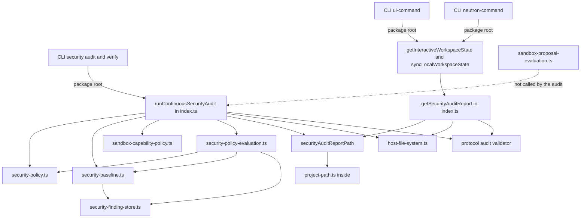
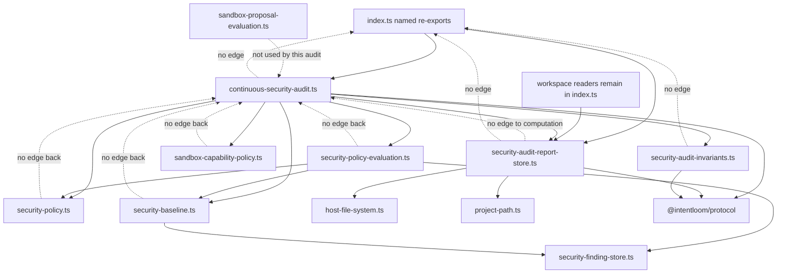
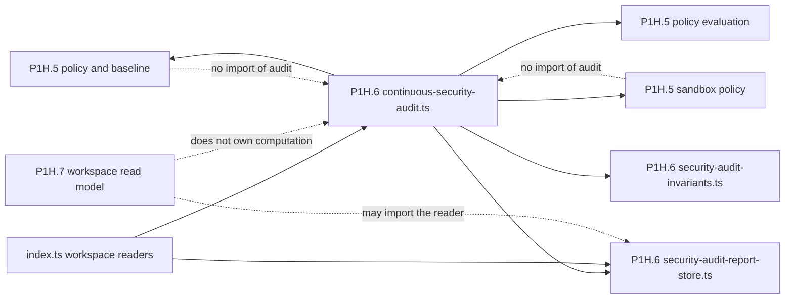
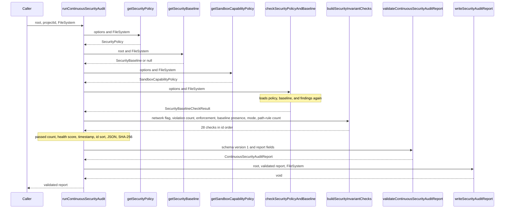
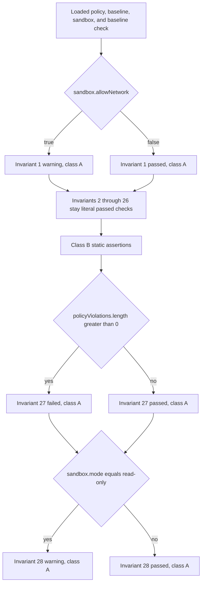
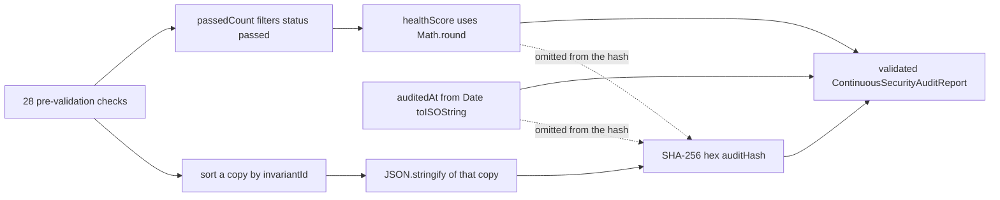
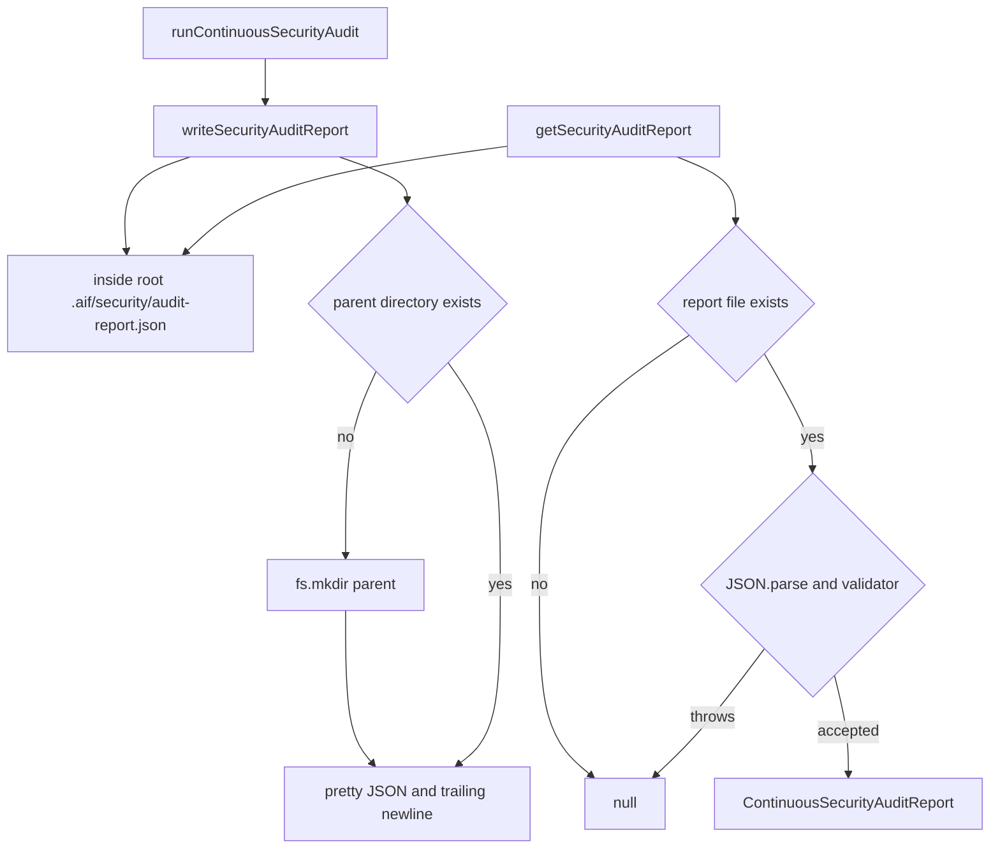
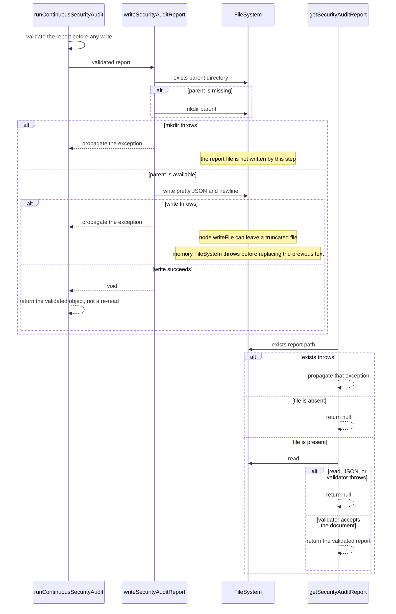
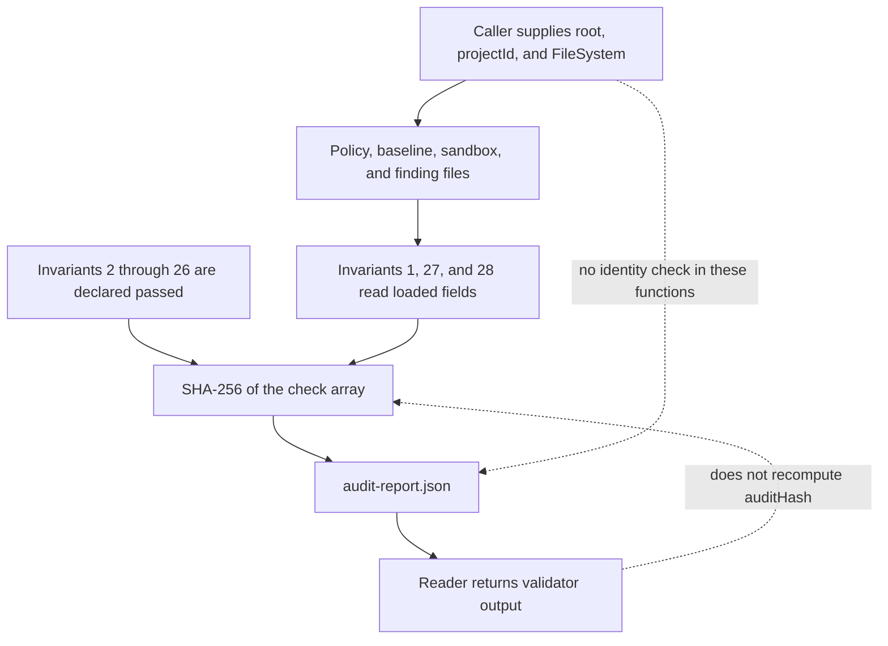

# P1H.6 Continuous Security Audit extraction

Status: **proposed** (PR #611). This document is a Design First review artifact.
It does not implement P1H.6, and it does not authorize implementation
until a maintainer approves it. A green CI result is not approval.

## 1. Context and verified baseline

Baseline: `main` at `2c0749dce9a31976195277971d6fb35fe663cd31`, the
merge commit of PR #610 (P1H.5b). The working tree was clean. Open
pull requests at the start of this design were dependency updates and
do not overlap this slice. No earlier P1H.6 design exists.

Completed before this design:

- P1H.1 Persistent Memory, design PR #597, implementation PR #598.
- P1H.2 Agent Session, design PR #599, implementation PR #600.
- P1H.3 Skill Catalog and Proposals, design PR #601. P1H.3a is PR
  #602, P1H.3b is PR #603, and P1H.3c is PR #604. P1H.3 is fully
  implemented.
- P1H.4 Security Findings and SARIF Import, design PR #605
  (`6a9d0d26015caa857c19d0d22415904d832ad818`). P1H.4a is PR #606
  (`ec951f32246ad0c94a145f520dc1862d9592c72e`). P1H.4b is PR #607
  (`7a77db52753360f0029cd266d8c95eb78c34995c`). P1H.4 is fully
  implemented.
- P1H.5 Security Policy and Sandbox, design PR #608
  (`1d0611070b02c5e9f0f0e2816a0f560fbf18c18e`). P1H.5a is PR #609
  (`7589c6ccff5d79d1f8c6e5de34d2f521ea3caa6e`). P1H.5b is PR #610,
  merged at the baseline SHA above. P1H.5 is fully implemented.

The P1H.5b implementation head is
`2da7846b1befe85c5523d58d7c5d3ed8682a6e66`. On that head, CodeQL,
Governance, Desktop SEA Feasibility, Compatibility, and Harness
Performance Benchmark all passed. The merge commit's push run of
Compatibility later failed one job, `windows-latest / Node 22`,
because `tests/package-publish-readiness.test.ts` timed out after
90 seconds. The other Compatibility jobs passed, as did Documentation
and CodeQL on that push. That timeout is outside the audit family.
This design does not treat it as an audit defect and does not change
that test.

P1H.7, P1I, P1J, Undo U4, and Desktop Undo U5 have not started.

Canonical guidance used for this design:

- `docs/architecture/ARCHITECTURE.md` for the application use-case
  boundary. Clients call `@intentloom/application`. Application code
  does not import the CLI, daemon, MCP server, or Desktop.
- `docs/architecture/PACKAGES_STABILIZATION_PLAN.md` for the P1H
  order. Continuous Security Audit follows Security Policy and
  Sandbox and precedes the Interactive Workspace read model.
- `docs/governance/DESIGN_FIRST_POLICY.md`,
  `docs/governance/AI_AGENT_WORKFLOW.md`,
  `docs/governance/ENGINEERING_PRINCIPLES.md`,
  `docs/governance/CODE_QUALITY_STANDARDS.md`, and
  `docs/governance/DOMAIN_MODELING.md`.
- `docs/governance/quality-exceptions.json`. The grandfathered
  `packages/application/src/index.ts` ceiling stays 6,764 effective
  lines and 7,151 physical lines. This design does not edit that file
  and does not raise the ceiling.
- `docs/security/THREAT_MODEL.md`, especially the audit-trail row and
  invariant 29.
- `docs/decisions/ADR-0027-security-evidence-and-posture.md` through
  `docs/decisions/ADR-0031-continuous-security-audit-and-verification.md`.
  ADR-0031 names the stored report. Where the implementation is
  narrower than that ADR or the threat model, section 17 records the
  gap and leaves the code as it is.
- The approved P1H.4 and P1H.5 system designs, as the extraction
  pattern. This design does not copy their module layouts and does
  not reopen finding storage, SARIF import, policy, baseline, or
  sandbox evaluation.

Task triage for this design-only change: blast radius 1, ambiguity 1,
risk 2, verification 2, unknowns 1, total 7. The recommended role is
frontier with high effort. This session cannot change its model. No
subagents were used. The stop condition is one design pull request,
with no production edit. `catalog/skills/aif-security-review` applies
to the trust-boundary analysis in section 17. It does not authorize a
behavior change. Grilling is skipped because the extraction scope has
one reading and the module split is the decision this design submits
for approval.

## 2. Problem statement

`packages/application/src/index.ts` still owns the Continuous Security
Audit. On this baseline the file measures **4,833 effective lines**
and **5,064 physical lines** (`measureProductionSource`). The selected
family is lines **4364–4595** (**224 effective**, **232 physical**).

`runContinuousSecurityAudit` is **208 effective lines** and **214
physical lines**. `docs/governance/CODE_QUALITY_STANDARDS.md` section
4 sets a preferred function size of 40 lines and a hard limit of 80.
The function is above that hard limit. Moving those 208 lines into a
new file without splitting them would relocate the violation. It
would not satisfy the limit. `scripts/production-file-metrics.mjs`
checks file size, not function size, so a file-budget pass would not
prove the function budget.

The packages stabilization plan separates this family from the
Interactive Workspace read model. The family must become leaves under
`packages/application/src/security/`. Public names stay exported from
`index.ts`. No new leaf may import `index.ts`. The new modules must
call the P1H.5 policy, baseline, comparison, and sandbox-policy
leaves directly.

Success for the later implementation pull request:

- The two public operations and the private path helper named in
  section 4 move, and the oversized function is split by the seams in
  section 6, without an observable behavior change.
- `index.ts` keeps both public names as explicit named re-exports.
- Signatures, defaults, return values, thrown errors, null behavior,
  storage path, JSON formatting, invariant text, status rules, score
  formula, hash input, and filesystem injection stay the same.
- No extracted file imports `index.ts`, the CLI, the daemon, the MCP
  server, or Desktop.
- Import-only and re-export strongly connected components keep today's
  membership and sizes.
- The Application package export map does not gain a key.
- Approved Apply, the recorded Neutron mutation component, and the
  extension-update component stay as they are.
- `host-file-system.ts`, `project-path.ts`, the earlier P1H modules,
  and the new audit modules stay outside every component.

This slice relocates and decomposes one function. It does not add
runtime probes, a weighted score, a new hash, a signature, identity
checks, or a transactional write.

## 3. Goals and non-goals

Goals:

- Give Audit Report persistence, invariant construction, and audit
  orchestration explicit module owners.
- Keep the report reader free of audit computation so P1H.7 can import
  it without a cycle.
- Consume the existing P1H.5 leaves instead of duplicating policy,
  baseline, or sandbox logic.
- Bring every new function to or below the 40-line preference, and
  keep every new file at or below 250 effective lines, without an
  exception.
- Preserve the public `@intentloom/application` surface, including the
  static passed checks and the other weaknesses in section 17.

Non-goals:

- P1H.7 Interactive Workspace read model.
- P1I transaction and lifecycle, P1J legacy Neutron helpers, Undo U4,
  and Desktop Undo U5.
- Editing `getSecurityPolicy`, `getSecurityBaseline`,
  `checkSecurityPolicyAndBaseline`, `getSandboxCapabilityPolicy`,
  `writeSandboxCapabilityPolicy`, `evaluateProposalAgainstSandbox`,
  the finding store, or SARIF import.
- Moving `getInteractiveWorkspaceState`, `syncLocalWorkspaceState`,
  `reviewWorkspaceProposal`, `correlateSecurityFindings`, or
  `runLocalSecurityAdapters`.
- Turning a static passed check into a runtime probe.
- Rewording titles, details, or status values.
- Renumbering invariant ids.
- Changing the hash algorithm, the score formula, the status set, or
  the report schema.
- Adding report signatures, identity verification, migrations, or
  transactional writes.
- Editing `docs/governance/quality-exceptions.json`, the threat model,
  ADR-0031, or the locked cycle tests.
- Adding `security/index.ts` or a package export-map key.
- Retargeting CLI, tests, daemon, or workspace callers from the
  package root to an internal file.

## 4. Source inventory

Every name below is defined in `packages/application/src/index.ts` on
`2c0749dce9a31976195277971d6fb35fe663cd31`. Counts are
`measureProductionSource` on each slice. There are no nested function
helpers inside the family. The 179-line checks array is one statement.

### Selected for P1H.6

| Name                         | Lines     | Effective | Physical | Role                                      |
| ---------------------------- | --------- | --------: | -------: | ----------------------------------------- |
| `securityAuditReportPath`    | 4364–4366 |         3 |        3 | private; stays module-private             |
| `getSecurityAuditReport`     | 4368–4380 |        13 |       13 | public                                    |
| `runContinuousSecurityAudit` | 4382–4595 |       208 |      214 | public; calls the four P1H.5 reads        |
| checks array                 | 4391–4569 |       179 |      179 | the oversized statement inside the runner |
| score, hash, validate, write | 4571–4594 |        20 |       24 | four blanks inside this tail              |

The contiguous family is 224 effective and 232 physical lines. The
runner's other six blank lines are the gap before the checks array,
the gap before the tail, and the four blanks inside the tail. The
loads at lines 4386–4389 are four calls:

- `getSecurityPolicy`
- `getSecurityBaseline`
- `getSandboxCapabilityPolicy`
- `checkSecurityPolicyAndBaseline`

`runContinuousSecurityAudit` does not call
`evaluateProposalAgainstSandbox`, `writeSecurityPolicy`,
`writeSandboxCapabilityPolicy`, `updateSecurityBaseline`,
`listSecurityFindings`, `importSarifSecurityReport`, or
`runLocalSecurityAdapters`.

### Public signatures

```typescript
export async function getSecurityAuditReport(
  options: { root: string },
  fs: FileSystem = nodeFileSystem,
): Promise<ContinuousSecurityAuditReport | null>;

export async function runContinuousSecurityAudit(
  options: { root: string; projectId: string },
  fs: FileSystem = nodeFileSystem,
): Promise<ContinuousSecurityAuditReport>;
```

`fs` defaults to `nodeFileSystem` on both. `projectId` is required on
the runner and is not defaulted inside it. The protocol validator
rejects a missing or empty `projectId`.

### Direct dependencies

`securityAuditReportPath` calls `inside` from
`packages/application/src/project-path.ts` with the constant relative
path `.aif/security/audit-report.json`. `inside` resolves that path
and throws `path traversal: ...` when the resolved target escapes the
root. The constant relative path does not escape a normal root. The
helper does not create directories or files.

`getSecurityAuditReport` uses the path helper, `fs.exists`, `fs.read`,
`JSON.parse`, and `validateContinuousSecurityAuditReport`.

`runContinuousSecurityAudit` uses the four P1H.5 reads above,
`createHash` from `node:crypto`, `dirname` from `node:path`,
`validateContinuousSecurityAuditReport`, `fs.exists`, `fs.mkdir`, and
`fs.write`. `createHash` remains used elsewhere in `index.ts`, at the
checkpoint checksum, so the barrel import stays after extraction.

### Filesystem and errors

`getSecurityAuditReport`:

- Computes the path before its `try`. An `inside` throw propagates.
- Returns `null` when `fs.exists` returns false.
- On `nodeFileSystem`, `exists` treats every `stat` failure, including
  a permissions error, as absence, so the reader returns `null`.
- An injected filesystem whose `exists` throws propagates that
  exception. It is outside the `try`.
- `fs.read`, `JSON.parse`, and validator failures are inside the `try`
  and return `null`.
- A document the validator accepts is returned. The reader does not
  recompute `healthScore` or `auditHash`.

`runContinuousSecurityAudit`:

- Errors from the four P1H.5 reads propagate. Those functions keep
  their own fallback and null behavior.
- Validator failure propagates. The current builder produces a
  document the validator accepts.
- `fs.exists` on the parent directory, `fs.mkdir`, and `fs.write`
  propagate. Nothing in the runner catches them.
- The caller receives the validated object only after `fs.write`
  resolves. The runner does not re-read the file.

### Data the validator accepts or coerces

`validateContinuousSecurityAuditReport` requires an object,
`schemaVersion` `"1"`, an `invariantChecks` array, a known status
(`passed`, `warning`, or `failed`), and non-empty strings for each
title, details, `projectId`, `auditHash`, and `auditedAt`. A failing
check throws `ProtocolValidationError`.

These malformed fields do not throw:

- A non-number `invariantId` becomes `0`.
- A non-number `healthScore` becomes `0`.

The returned object keeps only `schemaVersion`, `projectId`,
`healthScore`, `invariantChecks`, `auditHash`, and `auditedAt`, in
that order. Check objects keep `invariantId`, `title`, `status`, and
`details`, in that order. Extra fields are dropped. Order of the
checks array is preserved. The reader does not require 28 checks, unique
ids, or a hash that matches the checks.

The extraction must not tighten these rules.

### Callers and consumers

Package-root callers of `runContinuousSecurityAudit`:

- `packages/cli/src/security-operations-command.ts`, for both
  `security audit` and `security verify`. Both subcommands run a new
  audit. `verify` does not call `getSecurityAuditReport`. The CLI
  returns 0 when `healthScore >= 80` and no check has status `failed`.
  Otherwise it returns 3. Warning alone does not select 3.

Package-root and in-barrel callers of `getSecurityAuditReport`:

- `getInteractiveWorkspaceState` in `index.ts`. It catches every
  rejection and uses `null`.
- `syncLocalWorkspaceState` in `index.ts`. It does not catch. A null
  report becomes `securityScore: null`. A present report contributes
  `healthScore`. `exists` and path errors propagate here, while read
  and validator errors are already `null`.
- Tests import both names from `@intentloom/application`:
  `tests/memory-security-s5.test.ts`,
  `tests/v1-security-supply-chain.test.ts`,
  `tests/security-policy-baseline-p1h5a.test.ts`,
  `tests/security-sandbox-evaluation-p1h5b.test.ts`, and
  `tests/cli-security.test.ts`.

`packages/cli/src/ui-command.ts` prints
`getInteractiveWorkspaceState(...).auditReport`.
`packages/cli/src/neutron-command.ts` prints
`syncLocalWorkspaceState(...).securityScore`. Daemon, MCP server, and
Desktop do not call either audit function. Desktop does not import
`@intentloom/application`.

`tests/cli-workspace.test.ts` and `tests/workspace-apply.test.ts` do
not call the audit. They stay in the regression set because the barrel
edit must not disturb workspace commands.

### Trust boundary of the current function

The runner trusts its caller for `root`, `projectId`, and `FileSystem`.
It does not authenticate a user, authorize a project, or verify that
the filesystem is the host filesystem. The persisted report is
ordinary JSON. Section 17 separates that from the claims in ADR-0031.

### Dependency cycles today

The family is inside `index.ts`, which is a member of the Approved
Apply import cycle and the 29-file re-export component. The family
does not add an edge of its own beyond those existing memberships.
Section 20 records the graph that must stay unchanged.

## 5. Selected scope

Move and split only this family:

- `securityAuditReportPath`
- `getSecurityAuditReport`
- `runContinuousSecurityAudit`
- the checks array, the score, the hash, the validator call, and the
  report write that live inside the runner

Leave in `index.ts`:

- `getInteractiveWorkspaceState` and `syncLocalWorkspaceState`, which
  value-import the extracted reader
- `reviewWorkspaceProposal`, which keeps its value import of
  `evaluateProposalAgainstSandbox`
- `securityFindingPath` for `runLocalSecurityAdapters`
- `correlateSecurityFindings` and `runLocalSecurityAdapters`

After the move, `index.ts` drops its value imports of
`getSecurityPolicy`, `getSecurityBaseline`,
`checkSecurityPolicyAndBaseline`, and `getSandboxCapabilityPolicy`.
Those four names stay package-root re-exports. It also drops the local
`validateContinuousSecurityAuditReport` import, which has no remaining
use in the barrel. The type re-exports of `SecurityInvariantCheck` and
`ContinuousSecurityAuditReport` stay.

## 6. Existing and proposed architecture

Today the runner, the reader, and the path helper are adjacent
functions in the barrel. The runner reaches policy, baseline,
comparison, and sandbox policy through value imports that P1H.5 left
in place for this slice. Workspace reads call the local reader.

Editable source:
[`current-dependencies.mmd`](current-dependencies.mmd).



The proposed graph has three new leaves. Arrows mean "imports".

Editable source:
[`proposed-dependencies.mmd`](proposed-dependencies.mmd).



P1H.7 may later import the store. It must not need the orchestrator
to read a report, and it must not be imported by the store.

Editable source:
[`p1h6-p1h7-boundary.mmd`](p1h6-p1h7-boundary.mmd).



## 7. Module responsibility matrix

| Module                 | Path                                                               | Owns                                                              | Must not own                              |
| ---------------------- | ------------------------------------------------------------------ | ----------------------------------------------------------------- | ----------------------------------------- |
| Report store           | `packages/application/src/security/security-audit-report-store.ts` | path helper, `getSecurityAuditReport`, `writeSecurityAuditReport` | invariant text, score, hash, policy reads |
| Invariant construction | `packages/application/src/security/security-audit-invariants.ts`   | static catalog and the three dynamic checks                       | filesystem, hash, score, P1H.5 calls      |
| Audit orchestration    | `packages/application/src/security/continuous-security-audit.ts`   | `runContinuousSecurityAudit`, score, sort, hash, validator call   | a second copy of policy or sandbox rules  |
| Barrel                 | `packages/application/src/index.ts`                                | named re-exports and the two workspace value imports              | the check array                           |

`writeSecurityAuditReport` is new only as a named function. Its body is
the current parent-directory and write tail. It is exported from the
store module so the orchestrator can call it. `index.ts` must not
re-export it. `securityAuditReportPath` stays unexported.
`buildSecurityInvariantChecks` is exported from the invariants module
to the orchestrator only. The three dynamic helpers stay private to
that module.

There is no `security/index.ts`.

The invariants module imports protocol types only. It does not import
the P1H.5 leaves. The orchestrator passes the fields those leaves
already returned:

- `sandbox.allowNetwork`
- `baselineCheck.policyViolations.length`
- `policy.defaultEnforcement`
- whether `baseline` is null
- `sandbox.mode`
- `sandbox.pathRules.length`

That keeps the string templates in one place and avoids a second
policy implementation. The orchestrator still calls all four P1H.5
functions, including the two reads that `checkSecurityPolicyAndBaseline`
repeats. The double read stays. The check function's signature stays.

## 8. Dependency graph

Allowed runtime edges:

- `index.ts` value-imports `getSecurityAuditReport` from the store.
- `index.ts` re-exports `getSecurityAuditReport` from the store and
  `runContinuousSecurityAudit` from the orchestrator.
- The orchestrator imports `getSecurityPolicy`, `getSecurityBaseline`,
  `checkSecurityPolicyAndBaseline`, `getSandboxCapabilityPolicy`,
  `buildSecurityInvariantChecks`, and `writeSecurityAuditReport`.
- The store imports `inside`, the filesystem port, and the protocol
  validator.
- The invariants module imports protocol types.

Forbidden edges:

- Any new module importing `index.ts`.
- The store importing the orchestrator or the invariants module.
- Any P1H.5 leaf importing an audit module.
- The invariants module importing a P1H.5 leaf or the filesystem.
- A new barrel under `security/`.

The reader does not need the computation module. The computation
module needs the store's write function. That is a one-way edge.

## 9. Public API contracts

Both public functions remain available from `@intentloom/application`
under the signatures in section 4. The package export map stays the
twelve existing keys. External consumers keep importing the package
root.

`passedCount` is a local binding in the runner. It is not a field of
`ContinuousSecurityAuditReport`. The extraction preserves the binding's
calculation and does not add the field.

The report object is the validator's return value:

- `schemaVersion`: `"1"`
- `projectId`: the caller-supplied string
- `healthScore`: the rounded ratio in section 13
- `invariantChecks`: the id-sorted checks, after validation
- `auditHash`: the hex digest in section 14
- `auditedAt`: `new Date().toISOString()`, captured after the score and
  before the sort, as the current source does

Statement order inside the orchestrator stays: loads, build checks,
`passedCount`, `healthScore`, `auditedAt`, sort, `JSON.stringify`,
hash, validate, write, return.

## 10. Audit execution sequence

Editable source:
[`audit-execution-sequence.mmd`](audit-execution-sequence.mmd).



The builder returns checks in id order 1 through 28. The runner still
sorts a copy with `(a, b) => a.invariantId - b.invariantId` and uses
that sorted array both for `JSON.stringify` and for
`invariantChecks`. One sorted array is shared. A second independent
sort is not required and must not diverge from the hashed array.

## 11. Full invariant matrix

Ids, titles, details, and status values are copied from
`runContinuousSecurityAudit` on the baseline. Class A means the status
or details are computed from values loaded during this call. Class B
means both status and details are literals. No invariant is class C or
D. A class B row can name another subsystem in its title. This
function does not call that subsystem. Class B is not evidence that
the named control ran.

|  ID | Lines     | Class | Status                                                          | Title                                                     |
| --: | --------- | ----- | --------------------------------------------------------------- | --------------------------------------------------------- |
|   1 | 4392–4399 | A     | `warning` when `allowNetwork` is true, otherwise `passed`       | No implicit network request or telemetry                  |
|   2 | 4400–4406 | B     | `passed`                                                        | Pure validation path for mutating paths                   |
|   3 | 4407–4412 | B     | `passed`                                                        | Traceable generated artifacts                             |
|   4 | 4413–4418 | B     | `passed`                                                        | Human confirmation required for non-identical replacement |
|   5 | 4419–4424 | B     | `passed`                                                        | Security-sensitive provider behavior documented           |
|   6 | 4425–4430 | B     | `passed`                                                        | Metadata write paths reject symlinks                      |
|   7 | 4431–4436 | B     | `passed`                                                        | Symlink loops fail safely                                 |
|   8 | 4437–4442 | B     | `passed`                                                        | Destination collisions abort                              |
|   9 | 4443–4448 | B     | `passed`                                                        | Transaction consistency                                   |
|  10 | 4449–4454 | B     | `passed`                                                        | Post-write corruption handling                            |
|  11 | 4455–4460 | B     | `passed`                                                        | Post-write diagnostics path safety                        |
|  12 | 4461–4466 | B     | `passed`                                                        | Adoption dry-run and doctor read-only                     |
|  13 | 4467–4472 | B     | `passed`                                                        | Profile detection bounded                                 |
|  14 | 4473–4478 | B     | `passed`                                                        | Daemon IPC authentication                                 |
|  15 | 4479–4484 | B     | `passed`                                                        | Inspection/conformance read-only bound                    |
|  16 | 4485–4490 | B     | `passed`                                                        | Local Git read-only commands                              |
|  17 | 4491–4496 | B     | `passed`                                                        | Provider/MCP untrusted evidence                           |
|  18 | 4497–4502 | B     | `passed`                                                        | MCP typed capabilities                                    |
|  19 | 4503–4508 | B     | `passed`                                                        | MCP-triggered mutation proposal requirement               |
|  20 | 4509–4514 | B     | `passed`                                                        | Credentials outside project config                        |
|  21 | 4515–4520 | B     | `passed`                                                        | Persistent-memory proposal status                         |
|  22 | 4521–4526 | B     | `passed`                                                        | Persistent-memory explicit approval                       |
|  23 | 4527–4533 | B     | `passed`                                                        | Derived memory indexes deletable                          |
|  24 | 4534–4540 | B     | `passed`                                                        | Agent session lifecycle local storage                     |
|  25 | 4541–4546 | B     | `passed`                                                        | Security finding SARIF untrusted input                    |
|  26 | 4547–4553 | B     | `passed`                                                        | Local security adapters read-only execution               |
|  27 | 4554–4562 | A     | `failed` when `policyViolations.length > 0`, otherwise `passed` | Security policies and baselines enforcement               |
|  28 | 4563–4568 | A     | `warning` when `mode === "read-only"`, otherwise `passed`       | Agent mutation proposals sandbox capability bounds        |

Exact details:

|  ID | Details                                                                                                                                                                                                                                                                                                                         |
| --: | ------------------------------------------------------------------------------------------------------------------------------------------------------------------------------------------------------------------------------------------------------------------------------------------------------------------------------- |
|   1 | `Network access is enabled in sandbox policy` when `allowNetwork` is true. Otherwise `Network access disabled by default in sandbox policy`. The false branch uses that sentence for both the fallback and an explicit stored `false`.                                                                                          |
|   2 | `Dry-run and validation functions available across application operations`                                                                                                                                                                                                                                                      |
|   3 | `Checksum manifests and source map resolution verified`                                                                                                                                                                                                                                                                         |
|   4 | `Adoption and proposal confirmation contracts enforced`                                                                                                                                                                                                                                                                         |
|   5 | `Provider capability declarations verified`                                                                                                                                                                                                                                                                                     |
|   6 | `Symlink resolution bounds enforced on file writes`                                                                                                                                                                                                                                                                             |
|   7 | `Loop detection active in filesystem security traversal`                                                                                                                                                                                                                                                                        |
|   8 | `Collision abort contracts active`                                                                                                                                                                                                                                                                                              |
|   9 | `Source map and manifest consistency verified`                                                                                                                                                                                                                                                                                  |
|  10 | `Post-write consistency checkers active`                                                                                                                                                                                                                                                                                        |
|  11 | `Secret path redaction verified`                                                                                                                                                                                                                                                                                                |
|  12 | `Read-only guarantees verified for dry-run and doctor`                                                                                                                                                                                                                                                                          |
|  13 | `Profile definition schema validation active`                                                                                                                                                                                                                                                                                   |
|  14 | `IPC authentication contracts active`                                                                                                                                                                                                                                                                                           |
|  15 | `Project inspection operations bound to project root`                                                                                                                                                                                                                                                                           |
|  16 | `Fixed read-only git collection commands active`                                                                                                                                                                                                                                                                                |
|  17 | `Untrusted evidence proposal pattern enforced`                                                                                                                                                                                                                                                                                  |
|  18 | `MCP capability declarations typed and bounded`                                                                                                                                                                                                                                                                                 |
|  19 | `Proposal plan and approval required for MCP mutations`                                                                                                                                                                                                                                                                         |
|  20 | `Secret redaction filter active for configuration paths`                                                                                                                                                                                                                                                                        |
|  21 | `Memory proposals store proposal state prior to acceptance`                                                                                                                                                                                                                                                                     |
|  22 | `Memory acceptance requires explicit approval evidence`                                                                                                                                                                                                                                                                         |
|  23 | `Memory search indexes detachable without affecting canonical state`                                                                                                                                                                                                                                                            |
|  24 | `Agent session states stored locally under .aif/memory/sessions/`                                                                                                                                                                                                                                                               |
|  25 | `SARIF reports parsed as untrusted input with secret redaction`                                                                                                                                                                                                                                                                 |
|  26 | `Built-in security adapters execute strictly read-only file checks`                                                                                                                                                                                                                                                             |
|  27 | When the violation list is non-empty: `` `${length} policy violations detected` ``. The current code does not pluralize, so one violation is the string `1 policy violations detected`. When the list is empty: `` `Policy enforced (default: ${policy.defaultEnforcement}, baseline: ${baseline ? "present" : "missing"})` ``. |
|  28 | `` `Sandbox active (mode: ${sandbox.mode}, pathRules: ${sandbox.pathRules.length})` ``                                                                                                                                                                                                                                          |

Property order on every check object stays `invariantId`, `title`,
`status`, `details`. The static catalog is a module-level constant
containing objects 2 through 26 in that order and with those
literals. It must not be wrapped in one function. Wrapping it would
rebuild a function above the 80-line hard limit. The builder returns
`[check1, ...catalog, check27, check28]`.

Editable source:
[`invariant-classification.mmd`](invariant-classification.mmd).



## 12. Dynamic versus static checks

### Invariant 1, network flag

`getSandboxCapabilityPolicy` returns a stored policy or, when the file
is missing, unreadable, malformed, or rejected, the fallback in
`sandbox-capability-policy.ts`: mode `proposal-only`, two path rules,
three command prefixes, and `allowNetwork: false`.

Invariant 1 reads only `allowNetwork`. True selects `warning` and
`Network access is enabled in sandbox policy`. False selects `passed`
and `Network access disabled by default in sandbox policy`. The check
does not open a socket, inspect telemetry, or read
`evaluateProposalAgainstSandbox`. A passed result means the loaded
flag is false. It does not mean network access was blocked at runtime.

`tests/security-sandbox-evaluation-p1h5b.test.ts` already locks both
sentences for the default flag and for an explicit true flag.

### Invariant 27, policy violations

The status is `baselineCheck.policyViolations.length > 0`. It is not
`baselineCheck.exitCode`.

`checkSecurityPolicyAndBaseline` pushes a finding into
`policyViolations` when the matched enforcement is `fail`, or when it
is `warn` and the finding severity is `critical`. It sets `exitCode`
to 3 only when a matched enforcement is `fail`. A critical finding
under warn enforcement therefore yields a non-empty violation list and
`exitCode` 0. The audit still reports `failed` because the list is
non-empty. That distinction stays.

Empty list selects `passed`. The details then interpolate
`policy.defaultEnforcement` and `present` or `missing` from whether
the direct `getSecurityBaseline` result is null. The audit does not
read `newFindings`, `resolvedFindings`, or `baselineHash`.

A missing baseline does not by itself fail the check. A corrupt policy
file is handled inside `getSecurityPolicy`, which falls back to
`defaultEnforcement: "warn"` and the four default rules. The passed
details can then say `default: warn` without saying the stored file
was rejected.

`tests/security-policy-baseline-p1h5a.test.ts` locks the passed
wording for an empty project and the failed wording
`1 policy violations detected` for one open critical finding under
the default policy. The implementation adds the warn-and-critical
case, where the comparison `exitCode` is 0 and invariant 27 is still
`failed`.

### Invariant 28, sandbox mode and path-rule count

Status is `warning` only when `sandbox.mode === "read-only"`. The
protocol mode set is `read-only`, `proposal-only`, and `mutating`.
`proposal-only` and `mutating` both select `passed`. The extraction
must not treat `proposal-only` as read-only and must not treat
`mutating` as a failure.

`pathRules.length` appears only in the details string. An empty rule
list does not change the status. The check does not call
`evaluateProposalAgainstSandbox` and does not execute a proposal.

The same P1H.5b test locks the default text
`Sandbox active (mode: proposal-only, pathRules: 2)` with status
`passed`, and the custom text
`Sandbox active (mode: read-only, pathRules: 0)` with status
`warning`.

### Static checks 2 through 26

Each of these objects is a literal `passed` status and a literal
details string. The runner does not read memory, sessions, SARIF,
adapters, daemon IPC, git, symlinks, or adoption state while building
them. Moving the literals into a constant preserves that. Replacing a
literal with a call would be a behavior change and is out of scope.

## 13. Health score calculation

The baseline source is:

```typescript
const passedCount = checks.filter((check) => check.status === "passed").length;
const healthScore = Math.round((passedCount / checks.length) * 100);
```

`warning` and `failed` both fail the filter. They reduce the numerator
by the same amount. Titles, details, ids, the timestamp, the project
id, and the hash do not affect the score. The denominator is
`checks.length`, which is 28 for this builder. `Math.round` is the
ECMAScript rounding of that positive ratio. The implementation uses
this expression and does not switch to a weighted score.

Examples for this 28-check catalog:

| Non-passed checks | `passedCount` | Ratio     | `healthScore` |
| ----------------: | ------------: | --------- | ------------: |
|                 0 |            28 | 100       |           100 |
|                 1 |            27 | 96.428... |            96 |
|                 2 |            26 | 92.857... |            93 |
|                 3 |            25 | 89.285... |            89 |

A static `passed` entry increases `passedCount`. Twenty-five of the
twenty-eight checks are static (ids 2 through 26). If invariants 1,
27, and 28 are all non-passed, the score is still 89. With the current catalog the score
cannot fall below 89, so the CLI predicate `healthScore >= 80` cannot
fail unless the catalog changes. CLI exit 3 for this report comes from
a `failed` status, which only invariant 27 can produce. The extraction
does not change the CLI predicate and does not remove the static
passes that keep the score above 80.

The default empty project loads the policy fallback, a null baseline,
and the sandbox fallback. Invariant 1 is passed, 27 is passed, and 28
is passed. The resulting score is 100. Existing tests assert
`healthScore >= 90` or `>= 80`. They do not pin 100. The implementation
may pin 100 for the empty project because that score follows from the
current fallbacks, not from the clock.

## 14. Hash calculation

The baseline source is:

```typescript
const now = new Date().toISOString();
const sorted = [...checks].sort((a, b) => a.invariantId - b.invariantId);
const rawData = JSON.stringify(sorted);
const auditHash = createHash("sha256").update(rawData).digest("hex");
```

`JSON.stringify` uses no replacer and no spacing. Each check serializes
with keys `invariantId`, `title`, `status`, `details`. The hash input
is that array only. It excludes `schemaVersion`, `projectId`,
`healthScore`, and `auditedAt`. `createHash("sha256").update(string)`
encodes the string as UTF-8. `digest("hex")` is lowercase and 64
characters.

The sort is numeric subtraction, not `localeCompare`. The builder's
ids are 1 through 28, so the sorted order equals the builder order.
The sort still runs. The hash is taken from the pre-validation array.
The validator copies the same fields in the same order, so the stored
checks serialize to the same JSON for this builder. The implementation
must hash the pre-validation sorted array, not a later re-read and not
the timestamp.

Any change to an id, title, status, or details changes the hash. A
static literal therefore changes the hash if it is edited, and its
`passed` status also raises the score. Changing only `auditedAt`
between two runs with the same checks leaves the hash unchanged.
Tests must not require two timestamps to be equal within one
millisecond.

Editable source:
[`score-hash-data-flow.mmd`](score-hash-data-flow.mmd).



## 15. Persistence and read behavior

The report path remains `inside(root, ".aif/security/audit-report.json")`.
The stored body remains `` `${JSON.stringify(report, null, 2)}\n` ``.
The parent directory is created only when `fs.exists(dirname(path))`
is false. `nodeFileSystem.mkdir` is recursive. The memory filesystem's
`mkdir` is a no-op, and its `write` stores the full string or throws
before replacing the previous value.

`getSecurityAuditReport` returns `null` for a missing file and for any
caught read, parse, or validator error. A validator-accepted file is
returned as the validator shapes it, including a hash that does not
match the checks and a score that does not match the statuses.

Editable source:
[`report-read-write.mmd`](report-read-write.mmd).



No migration is required. Existing `audit-report.json` files stay
readable because the schema version and validator stay in protocol.

## 16. Failure semantics

Editable source:
[`failure-partial-write.mmd`](failure-partial-write.mmd).



There is no retry, temp file, or rename. A later read of a truncated
file returns `null` when the bytes fail JSON or validation. A write
that fails on the memory filesystem leaves the previous text in place.
The implementation must not add a transactional write while preserving
these two filesystem behaviors.

`getInteractiveWorkspaceState` still maps a reader rejection to a null
`auditReport`. `syncLocalWorkspaceState` still lets a reader rejection
propagate and still maps a null report to `securityScore: null`.

The CLI behavior in section 4 stays in the CLI. This slice does not
edit it. ADR-0031 says `security verify` reads an existing report or
runs a check. The code always runs a new audit for both subcommands.
That gap stays.

## 17. Security and trust boundaries

Words used here:

- A **declared invariant** is the title and details stored in the
  report.
- A **configured policy** is a Security Policy, Security Baseline, or
  Sandbox Capability Policy document the P1H.5 readers loaded.
- A **successful validation** means the protocol validator accepted a
  document.
- A **runtime security enforcement check** is code that observes the
  control the invariant names.
- A **verified security guarantee** would require that enforcement
  check to have passed. This audit does not establish that for a
  class B row.

Editable source:
[`trust-boundaries.mmd`](trust-boundaries.mmd).



### A. Behavior that this extraction preserves

- Twenty-five literal `passed` checks, ids 2 through 26, with the
  titles and details in section 11.
- Invariant 1 follows `allowNetwork` only.
- Invariant 27 follows the violation count, not `exitCode`, including
  warn-and-critical.
- Invariant 28 follows `mode === "read-only"` for status and
  `pathRules.length` for the details text only.
- The score and hash formulas in sections 13 and 14.
- Null on a missing or rejected report, and propagation of the errors
  section 16 names.
- Fallback policy and fallback sandbox behavior inside the P1H.5
  readers. This slice does not change those readers.
- Untrusted SARIF findings remain untrusted. The audit does not import
  them itself. Invariant 27 can see them only because comparison lists
  stored findings.
- No identity or authorization check is added.

### B. Weaknesses that remain

These are properties of the current code. They are not fixed here.

- Static `passed` rows assert controls the function does not run.
  Their wording, including "verified" and "enforced", is stronger than
  the evidence.
- The health score counts those rows. With this catalog it stays at
  89 or above, so the CLI score threshold of 80 cannot fail.
- `auditHash` commits the check array. It does not authenticate the
  writer. A caller who can write the file can recompute the hash.
  The reader does not compare the stored hash with the stored checks.
- Invariant 1 does not show that network access is impossible.
  Invariant 28 does not show that a proposal was contained. Sandbox
  evaluation, which this audit does not call, still uses string
  prefixes, including the inherited `src/../secret` and
  `pnpm test; rm -rf /` matches, and it does not execute or confine a
  process.
- A corrupt policy or sandbox file falls back to defaults. Passed
  details can describe that fallback as the enforced policy.
- `getSecurityBaseline` does not recompute `baselineHash`. Invariant
  27 treats any validator-accepted baseline as present.
- SARIF import can store findings the comparison later treats as
  violations. The audit does not establish the scanner's trust.
- `node:fs` `writeFile` can leave a partial file. The next read then
  returns `null` if the bytes fail validation, which hides the partial
  write rather than reporting it.
- The report has no signature, no writer identity, and no schema
  migration. ADR-0031 and threat-model invariant 29 describe
  tamper-evident verification of invariants 1 through 28. The
  implementation does not match that description. This design does not
  edit the ADR or the threat model.

### C. Future work that needs its own Design First approval

- Replacing any class B row with a runtime probe.
- Weighting `warning` differently from `failed`, or changing the CLI
  threshold.
- Verifying `auditHash` on read, or signing the report.
- Rejecting a baseline whose stored hash does not match its findings.
- Surfacing policy and sandbox fallback as a distinct status.
- Canonical path checks, command parsing, or execution containment.
- Atomic report replacement.
- Changing `security verify` so it reads the stored report instead of
  running a new audit.
- Amending ADR-0031 or the threat model so their wording matches the
  evidence above.

`catalog/skills/aif-security-review` stops at this boundary. The
residual risk is the preserved report semantics. The mitigation is a
later design, not this move.

## 18. DDD and naming

`docs/governance/DOMAIN_MODELING.md` uses pragmatic DDD. This slice
does not add an Entity, Aggregate, Repository, Domain Service, or
Domain Event.

The Audit Report is a stored document, not an aggregate. The store
module is a filesystem helper around one path, the same shape as the
P1H.5 policy and baseline modules. It is not a Repository, because
there is no second persistence implementation and no domain identity
beyond the JSON document.

Continuous Security Audit is the orchestration that assembles the
report. Security Policy Evaluation is the comparison that produces
`policyViolations`. The audit reads that result. It does not become
the comparison. The Workspace Read Model consumes a persisted report.
P1H.7 owns that read model. This design does not move it.

Terms used for the same concepts as the code:

- Continuous Security Audit
- Security Invariant Check
- Security Policy
- Security Baseline
- Sandbox Capability Policy
- Audit Report
- Health Score
- Audit Hash
- Security Finding
- Workspace Read Model

## 19. Source metrics

Current measurements use `measureProductionSource`:

| Slice                               | Effective | Physical |
| ----------------------------------- | --------: | -------: |
| `packages/application/src/index.ts` |     4,833 |    5,064 |
| family, lines 4364–4595             |       224 |      232 |
| `securityAuditReportPath`           |         3 |        3 |
| `getSecurityAuditReport`            |        13 |       13 |
| `runContinuousSecurityAudit`        |       208 |      214 |
| checks array, lines 4391–4569       |       179 |      179 |
| tail, lines 4571–4594               |        20 |       24 |

The following numbers are a Prettier-formatted simulated transcription
of the proposed modules. They are not an implementation result.

| Proposed file                         | Effective | Physical |
| ------------------------------------- | --------: | -------: |
| `security-audit-report-store.ts`      |        34 |       37 |
| `security-audit-invariants.ts`        |       216 |      221 |
| `continuous-security-audit.ts`        |        47 |       48 |
| `index.ts` after the simulated splice |     4,607 |    4,829 |

The simulated barrel reduction is 226 effective lines and 235 physical
lines. The grandfathered ceiling is unchanged and stays above the
result. All three new files stay under the 250-line preference and
under the 400 and 700 hard limits.

The simulated orchestrator file has a 12-line import block and one
function, so that function is 35 effective lines. Each dynamic check
is the existing object, 6 to 9 lines, plus a short signature. The
builder returns four expressions. Those functions sit under the
40-line preference. The 154-line static catalog is a constant, not a
function. The 80-line hard limit therefore does not apply to it, and
no `quality-exceptions.json` entry is required.

The current 208-line function is the debt this split retires. An
implementation that moves it intact would still violate the hard
limit and would not be accepted under this design.

## 20. SCC analysis

`applicationCycles` from `tests/application-source-cycles.ts`, run on
the baseline, returns:

| Graph               | Components | Sizes    |
| ------------------- | ---------: | -------- |
| Import-only         |          2 | 3, 3     |
| Re-export-inclusive |          3 | 4, 29, 3 |

Import-only membership:

- Approved Apply: `approved-apply-baseline.ts`,
  `generated-file-sync-declared.ts`, `index.ts`.
- Neutron mutation:
  `neutron/mutation/apply/neutron-mutation-apply-durable-record.ts`,
  `neutron/mutation/apply/neutron-mutation-apply-store.ts`,
  `neutron/mutation/verification/neutron-mutation-verification-retry-eligibility.ts`.

Re-export membership:

- Extension update, size 4: `apply-extension-update.ts`,
  `discover-and-apply-extension-update.ts`,
  `extension-update-files.ts`,
  `propose-and-apply-extension-adoption.ts`.
- The locked 29-file barrel component, including `index.ts` and
  `inception-flow.ts`, with the membership in
  `tests/application-inception-cycle.test.ts`.
- The same Neutron mutation component, size 3.

These files are outside every component today:
`host-file-system.ts`, `project-path.ts`,
`security/security-finding-store.ts`, `security/security-coverage.ts`,
`security/sarif-security-import.ts`, `security/security-policy.ts`,
`security/security-baseline.ts`,
`security/security-policy-evaluation.ts`,
`security/sandbox-capability-policy.ts`,
`security/sandbox-proposal-evaluation.ts`, and
`agent-session/agent-session.ts`.

The implementation must keep that graph. The three new files join the
outside set. They must not import `index.ts`. No P1H.5 leaf may import
them. Re-exporting the two public names from `index.ts` adds edges
from the barrel to the new files, not edges back, so the 29-file
component does not gain a member.

`tests/application-inception-cycle.test.ts` and
`tests/application-foundation-scaffold-cycle.test.ts` lock the
component arrays. The implementation does not edit those arrays.
A new test may assert that the three audit files are absent from
every component and do not import `../index.js`.

## 21. Alternatives and trade-offs

### Selected: three modules, split at the seams

Persistence, the invariant catalog, and orchestration are the three
cohesive pieces. The catalog has to leave the function body, or the
80-line limit is missed. The reader has to leave the orchestrator, or
P1H.7 cannot import it without also importing the policy reads. Score
and hash stay in the orchestrator because, once the array is gone,
they are a handful of statements with one caller. A fourth
`security-audit-report-builder.ts` would only forward those
statements.

### Rejected: move the 208-line function unchanged

This meets the file budget and fails the function budget. The design
does not request an exception for it. The metrics script would not
catch the failure, which is why the implementation review has to look
at the function, not only the file total.

### Rejected: two implementation PRs by default

P1H.6a could move the reader, the path, and the write tail, and leave
the runner in `index.ts`. P1H.6b would then split and move the runner.
That split is possible because the store does not need the
orchestrator. It is a poor default. P1H.6a would not retire the
208-line function, and P1H.7 is not waiting on the reader. The write
tail is only independent after it is extracted from the same function
P1H.6b has to decompose. One review of the whole family is smaller
than two reviews of a temporary barrel call.

A maintainer can still require that narrower sequence. If so, P1H.6a
must not move `runContinuousSecurityAudit` intact, and P1H.6b remains
mandatory before anyone claims the function budget is met.

### Rejected: one module for all three responsibilities

The simulated invariants file is already 216 lines. Adding the
orchestrator and the store would push a new file over the 250-line
preference and would make the reader import the policy leaves. That
blocks the P1H.7 reader edge this design is required to keep open.

### Rejected: dynamic probes during the move

Section 17 lists the probes that would change the report. They need a
separate design. Doing them inside the extraction would change
`healthScore`, the hash, and the CLI exit code.

## 22. Regression-test plan

The design pull request does not change runtime tests. The
implementation adds focused coverage, expected in a new file such as
`tests/security-audit-p1h6.test.ts`, and reruns the existing suites
below without rewriting their assertions.

The new coverage locks:

1. Both names remain on `@intentloom/application`.
2. `securityAuditReportPath` and `writeSecurityAuditReport` are absent
   from the package root.
3. A missing report returns `null`.
4. Malformed JSON, the wrong schema version, and a validator rejection
   return `null`. A non-number `invariantId` or `healthScore` still
   follows the current coercion instead of becoming `null`.
5. A valid report round-trips through write and read, aside from the
   validator dropping unknown fields.
6. All 28 ids are present.
7. Titles and details match section 11, including the unpluralized
   `1 policy violations detected` sentence.
8. `allowNetwork` false and true select the invariant 1 status and
   details in section 12.
9. A non-empty violation list fails invariant 27. An empty list passes
   it and records enforcement and baseline presence.
10. `read-only` warns invariant 28. `proposal-only` and `mutating`
    pass it. `pathRules.length` changes only the details.
11. A critical finding under warn enforcement keeps comparison
    `exitCode` 0 and still fails invariant 27. `warning` is not
    `failed`.
12. The score examples in section 13, including 27/28 rounding to 96
    and 26/28 rounding to 93.
13. Stored checks stay in id order 1 through 28.
14. The hash equals SHA-256 of `JSON.stringify` of the id-sorted
    pre-validation checks, and it does not change when only
    `auditedAt` changes.
15. `auditedAt` is a non-empty timestamp string. Tests must not
    require two timestamps to match within one millisecond.
16. The file is pretty JSON with a trailing newline.
17. A write or mkdir rejection propagates. A read rejection returns
    `null`. Default `exists` maps a stat failure to absence.
18. `getInteractiveWorkspaceState` and `syncLocalWorkspaceState` still
    consume the package-level reader, including a null score when the
    report is absent.
19. `intentloom security audit` and `security verify` still run the
    audit and keep exit codes 0 and 3.
20. Import-only components stay sizes 3 and 3. Re-export components
    stay sizes 4, 29, and 3, with the same membership. The new files
    stay outside them and do not import `index.ts`.
21. The new files stay at or below 250 effective lines. No new
    function exceeds 80 lines. `index.ts` does not grow.
22. Paths still go through `inside`, so Windows, Linux, and macOS keep
    the existing separator and traversal behavior. No new path
    encoding is introduced.

Existing suites that must keep passing unchanged include
`tests/memory-security-s5.test.ts`,
`tests/memory-security-s3.test.ts`,
`tests/memory-security-s4.test.ts`,
`tests/cli-security.test.ts`,
`tests/v1-security-supply-chain.test.ts`,
`tests/security-policy-baseline-p1h5a.test.ts`,
`tests/security-sandbox-policy-p1h5b.test.ts`,
`tests/security-sandbox-evaluation-p1h5b.test.ts`,
`tests/cli-workspace.test.ts`,
`tests/workspace-apply.test.ts`,
`tests/application-inception-cycle.test.ts`, and
`tests/application-foundation-scaffold-cycle.test.ts`.

## 23. Implementation PR sequence

### Selected: one implementation pull request

Move the family and perform the structural split in the same change.

- New modules: the three paths in section 7.
- Moved functions: `securityAuditReportPath`,
  `getSecurityAuditReport`, and `runContinuousSecurityAudit`.
- New module-local functions: `writeSecurityAuditReport`,
  `buildSecurityInvariantChecks`, and the three private dynamic
  checks. The static catalog is a constant.
- Dependencies: section 8.
- Expected metrics: section 19. Confirm them with
  `measureProductionSource` on the landed files. Do not cite the
  simulation as the landed result.
- Public re-exports: `getSecurityAuditReport` and
  `runContinuousSecurityAudit` only.
- Local value imports that remain in `index.ts`:
  `getSecurityAuditReport` for the two workspace readers, and
  `evaluateProposalAgainstSandbox` for `reviewWorkspaceProposal`.
  `securityFindingPath` stays.
- Tests: section 22.
- SCC acceptance: section 20, with the locked tests unedited.
- Rollback: revert that pull request. Reports already on disk remain
  readable. No data migration runs.
- Exclusions: section 3.

### Not selected: P1H.6a then P1H.6b

Use this only if the maintainer rejects a single review.

P1H.6a moves `securityAuditReportPath`, `getSecurityAuditReport`, and
the write tail into the store. The runner stays in `index.ts` and
calls `writeSecurityAuditReport`. The runner remains over 80 lines.
The public re-export is `getSecurityAuditReport`. The barrel
value-imports the reader and the write helper. The write helper is
not a package-root export. This slice does not claim the function
budget is met.

P1H.6b moves and splits the runner into the invariants module and the
orchestrator, drops the barrel's P1H.5 value imports, and re-exports
`runContinuousSecurityAudit`. The function budget is claimed only
after this slice. Rollback of P1H.6b leaves the store from P1H.6a in
place and returns the runner to the barrel.

Neither slice starts P1H.7.

## 24. Migration and rollback

There is no schema migration, no report rewrite, and no backfill. A
report written before the move still validates, and a report written
after the move has the same bytes for the same checks, score, hash,
project id, and timestamp.

Rollback is reverting the implementation commit or pull request. The
public names remain on the barrel either way. A partial report left by
a failed `writeFile` is existing behavior and is not repaired by the
rollback.

## 25. Open decisions and deferred security work

This design is not approved. Approval is the maintainer's review of
this pull request. A green CI result is not that approval.

The structural split does not need a new ADR or a quality exception.
It preserves ADR-0031's stored report and does not adopt the broader
verification claim that the current code does not implement.

Open only as later, separate Design First work:

- Any item in section 17.C.
- An amendment of ADR-0031 and the threat-model audit row so they no
  longer describe checks this function does not run.
- The optional two-PR sequence in section 23, if one review is
  rejected.

No production source, runtime test, public API, authorization check,
or security enforcement is changed by this design.

## Diagram index

| Diagram                                   | Source                         |
| ----------------------------------------- | ------------------------------ |
| Current audit dependencies                | `current-dependencies.mmd`     |
| Proposed module graph                     | `proposed-dependencies.mmd`    |
| Audit execution sequence                  | `audit-execution-sequence.mmd` |
| Invariant construction and classification | `invariant-classification.mmd` |
| Health score and hash data flow           | `score-hash-data-flow.mmd`     |
| Audit report read and write               | `report-read-write.mmd`        |
| Trust boundaries                          | `trust-boundaries.mmd`         |
| P1H.6 to P1H.7 boundary                   | `p1h6-p1h7-boundary.mmd`       |
| Error and partial-write flow              | `failure-partial-write.mmd`    |

Mermaid is the diagram format. Excalidraw and draw.io are not used.
The audit has no new lifecycle with states of its own, so this design
does not add a state diagram. The P1H.5 policy and sandbox designs
remain the source for those modules.
