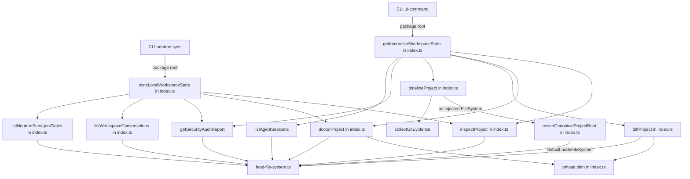
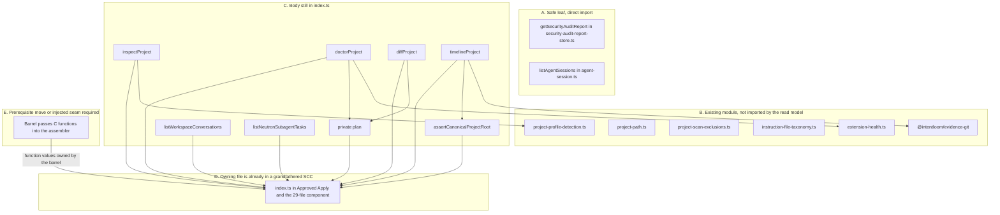
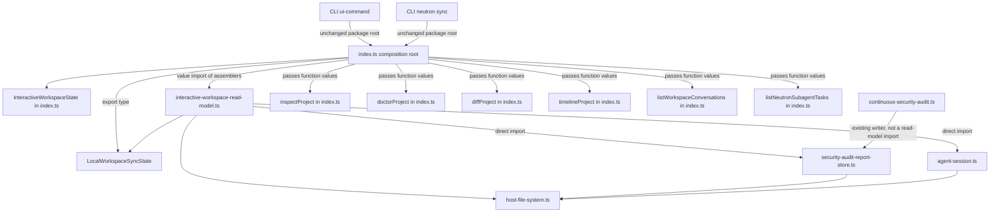
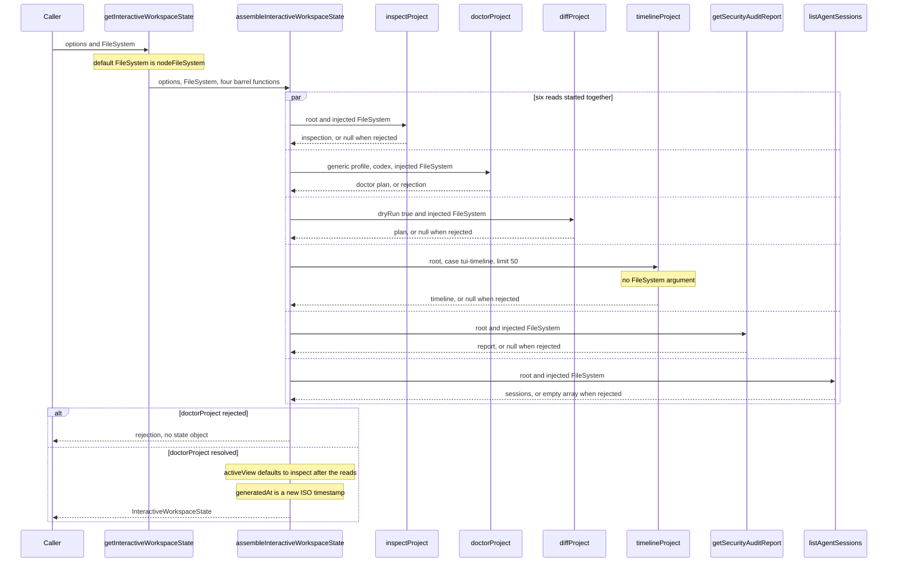
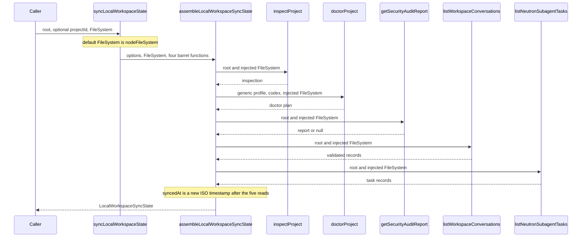
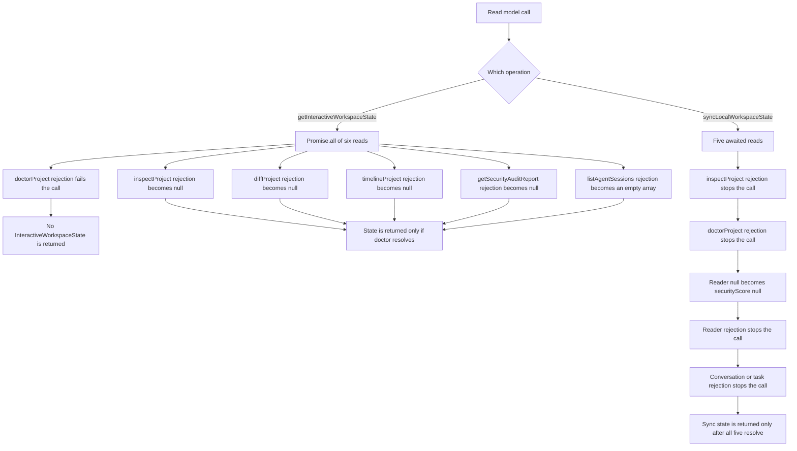
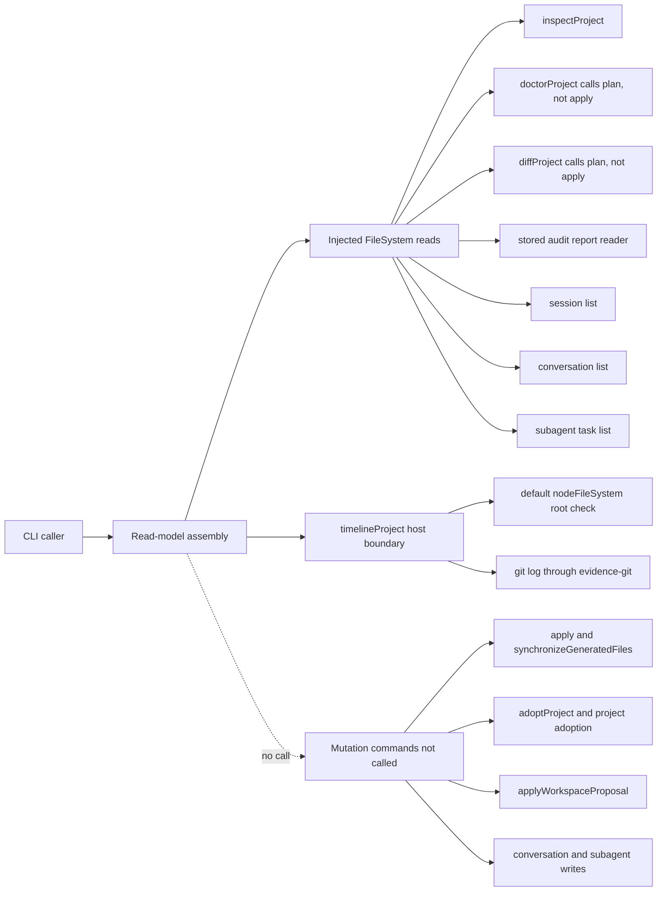
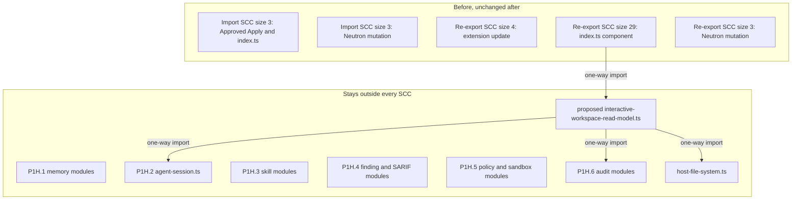
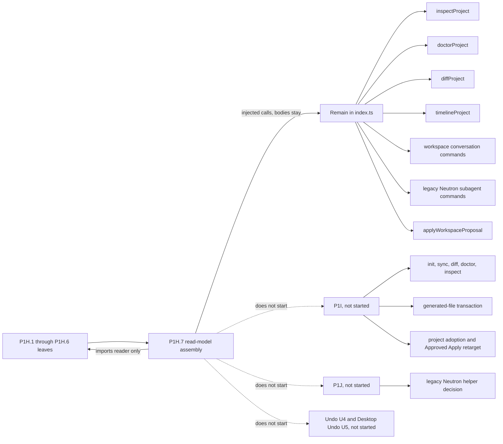

# P1H.7 Interactive Workspace read model extraction

Status: **proposed** (PR #613). This document is a Design First review artifact.
It does not implement P1H.7, and it does not authorize implementation
until a maintainer approves it. A green CI result is not approval.

Feasibility verdict: **C. Approved dependency-injection seam required.**

## 1. Context and verified baseline

Baseline: `main` at `b80614d5d65fbdbd9cbc4831a6593ead6b155280`.
That commit is the merge of PR #612. The working tree was clean
before this design. Local `main` was fast-forwarded from
`52b34c8b202cb07ab30c4f3e991dbce3815510a4` to that SHA. Open pull
requests at the start were dependency updates and do not overlap this
slice. No earlier P1H.7 design exists.

Completed before this design:

- P1H.1 Persistent Memory, design PR #597, implementation PR #598.
- P1H.2 Agent Session, design PR #599, implementation PR #600.
- P1H.3 Skill Catalog and Proposals, design PR #601. P1H.3a is PR
  #602, P1H.3b is PR #603, and P1H.3c is PR #604. P1H.3 is fully
  implemented.
- P1H.4 Security Findings and SARIF Import, design PR #605. P1H.4a is
  PR #606 and P1H.4b is PR #607. P1H.4 is fully implemented.
- P1H.5 Security Policy and Sandbox, design PR #608. P1H.5a is PR
  #609 and P1H.5b is PR #610. P1H.5 is fully implemented.
- P1H.6 Continuous Security Audit, design PR #611
  (`52b34c8b202cb07ab30c4f3e991dbce3815510a4`). Implementation PR #612
  is merged at the baseline SHA above. The final pull-request head
  was `c86cf64309258deec7c4ba2d916d891943f02ec9`. On that head,
  CodeQL, Governance, Desktop SEA Feasibility, Compatibility, and
  Harness Performance Benchmark passed. The merge push of the
  baseline SHA passed CodeQL, Documentation, and Compatibility.
  P1H.6 is fully completed.

P1I, P1J, Undo U4, and Desktop Undo U5 have not started.

The handoff text that landed inside PR #612 still said that pull
request was open. This design corrects that status. It does not
reopen the audit design.

Canonical guidance used for this design:

- `docs/architecture/ARCHITECTURE.md` for the application use-case
  boundary. Clients call `@intentloom/application`. Application code
  does not import the CLI, daemon, MCP server, or Desktop.
- `docs/architecture/PACKAGES_STABILIZATION_PLAN.md`, section P1H.
  The interactive workspace read model is the last P1H group. The
  same section says that a new file which would still import
  `index.ts` is not ready, and that the callee should move first. It
  also excludes `doctorProject` from P1H.
- `docs/governance/DESIGN_FIRST_POLICY.md`,
  `docs/governance/AI_AGENT_WORKFLOW.md`,
  `docs/governance/ENGINEERING_PRINCIPLES.md`,
  `docs/governance/CODE_QUALITY_STANDARDS.md`, and
  `docs/governance/DOMAIN_MODELING.md`.
- `docs/governance/quality-exceptions.json`. The grandfathered
  `packages/application/src/index.ts` ceiling stays 6,764 effective
  lines and 7,151 physical lines. This design does not edit that file
  and does not raise the ceiling.
- `tests/application-source-cycles.ts` and the locked expectations in
  `tests/application-inception-cycle.test.ts` and
  `tests/application-foundation-scaffold-cycle.test.ts`.
- The approved P1H.3, P1H.4, P1H.5, and P1H.6 system designs, as the
  extraction pattern. This design does not copy their module layouts
  and does not reopen memory, sessions, skills, findings, policy,
  sandbox, or audit execution.

Task triage for this design-only change: blast radius 1, ambiguity 2,
risk 2, verification 2, unknowns 2, total 9. The recommended role is
frontier with highest effort. This session cannot change its model.
No subagents were used. The route from `aif-task-router` is `plan`.
The applied guidance is Design First, domain modeling, the code-quality
budgets, and the packages plan. Feature discovery is not used: the
output is an extraction design, not a product brief.

Ambiguity is 2 because direct extraction, moving the callees first,
and a dependency-injection seam are different architectures. This
document is that decision record. An interactive grilling interview
is not a second gate: implementation is forbidden, and maintainer
review of this pull request is the approval. The security section is
the trust-boundary review. It does not authorize a behavior change.

Stop condition: one design pull request, no production edit, no
merge, and no start of P1I or later work.

## 2. Problem statement

`getInteractiveWorkspaceState` and `syncLocalWorkspaceState` still
assemble their results inside `packages/application/src/index.ts`.
P1H's goal is to move each index group into a leaf that imports the
filesystem port and the already extracted modules it needs.

These two functions are small. Their callees are not. Four of the
interactive reads, and four of the sync reads, are still implemented
in `index.ts`. `index.ts` is already a member of the Approved Apply
import component and of the 29-file re-export component. A new module
that imports `index.ts`, including `import type`, adds itself to
those components. That growth is forbidden.

The read model therefore cannot become a leaf by importing its
barrel-owned callees, and P1H does not authorize moving those
callees. The extraction needs an explicit seam that keeps the public
signatures on the barrel and keeps the new module from importing the
barrel.

## 3. Goals and non-goals

Goals:

- Preserve the public package-root functions and types.
- Preserve the current read schedule, fallbacks, defaults, and
  returned property order.
- Move the assembly logic into one application module that does not
  import `index.ts`.
- Call the extracted audit reader and session list directly.
- Leave barrel-owned operations in `index.ts` and pass them in as
  function values.
- Keep every current SCC at its current size and membership.
- Keep the new file outside every SCC, under 250 effective lines, and
  keep each new function at or below 80 lines.

Non-goals:

- Implementing the extraction in this pull request.
- Moving `inspectProject`, `doctorProject`, `diffProject`,
  `timelineProject`, `assertCanonicalProjectRoot`, or private `plan`.
- Moving workspace conversation commands, including
  `listWorkspaceConversations`.
- Moving legacy Neutron subagent commands, including
  `listNeutronSubagentTasks`.
- Moving `applyWorkspaceProposal`, `adoptProject`,
  `applyProjectAdoption`, `planProjectAdoption`, or
  `synchronizeGeneratedFiles`.
- Starting P1I, P1J, Undo U4, or Desktop Undo U5.
- Renaming either public operation, merging the two results into one
  API, or adding caching, polling, or background refresh.
- Changing authentication, authorization, redaction, or mutation
  gates.
- Recomputing the security health score or running a fresh audit.
- Editing `quality-exceptions.json`, the package export map, or the
  locked cycle tests.

## 4. Source inventory

All four declarations are in `packages/application/src/index.ts`.
Physical lines were counted on this baseline. Effective lines for
these spans equal physical lines minus blank lines. None of these
spans contain comments. The whole-file effective count is the P1H.6
implementation record for this same tree.

| Declaration                    | Lines     | Effective | Physical |
| ------------------------------ | --------- | --------: | -------: |
| `InteractiveWorkspaceState`    | 4362–4380 |        19 |       19 |
| `getInteractiveWorkspaceState` | 4382–4435 |        53 |       54 |
| `LocalWorkspaceSyncState`      | 4777–4786 |        10 |       10 |
| `syncLocalWorkspaceState`      | 4787–4813 |        27 |       27 |

`index.ts` measures 4,607 effective lines and 4,829 physical lines
with `measureProductionSource` on this tree. That matches the P1H.6
implementation record. No other local helper belongs to this group.
`workspaceConversationPath`, `redactWorkspaceSecrets`,
`workspaceProposalPath`, and `neutronSubagentTaskPath` belong to the
conversation, proposal, and subagent commands that this slice leaves
in the barrel.

`InteractiveWorkspaceState` stays in `index.ts`. Its fields name
`ProjectInspection`, `DoctorFinding`, `Plan`, and `ProjectTimeline`,
and those types are declared only in `index.ts` (lines 296, 318, 435,
and 532). Moving the interface would require importing those names
from `index.ts`. The cycle scanner records that import.

`LocalWorkspaceSyncState` has only `string` and `number` fields. It
can move with the assembler.

### Public signatures

`getInteractiveWorkspaceState` accepts `options` and
`fs: FileSystem = nodeFileSystem`, and returns
`Promise<InteractiveWorkspaceState>`.

`options` is:

- `root: string`, required.
- `projectId?: string`. Omitted means `"project-local"`.
- `activeView?` is the union `"inspect" | "doctor" | "diff" |
"timeline" | "health" | "security" | "sessions"`. Omitted means
  `"inspect"`.

`syncLocalWorkspaceState` accepts
`options: { root: string; projectId?: string }` and
`fs: FileSystem = nodeFileSystem`, and returns
`Promise<LocalWorkspaceSyncState>`. Omitted `projectId` means
`"project-local"`.

There is no third parameter today. This design does not add one.

### Returned shapes

`InteractiveWorkspaceState`, in this property order:

- `projectId`, `root`, `activeView`
- `inspect: ProjectInspection | null`
- `findings: readonly DoctorFinding[]`
- `diff: Plan | null`
- `timeline: ProjectTimeline | null`
- `auditReport: ContinuousSecurityAuditReport | null`
- `sessions: readonly AgentSessionItem[]`
- `generatedAt: string`

`LocalWorkspaceSyncState`, in this property order:

- `projectId`, `root`
- `readiness: string`
- `findingsCount: number`
- `securityScore: number | null`
- `activeConversationsCount: number`
- `subagentTasksCount: number`
- `syncedAt: string`

`readiness` is typed as `string` on the public interface. The value
comes from `inspection.readiness`.

## 5. Caller and callee inventory

Direct product callers, all through `@intentloom/application`:

| Caller                                             | Operation                      | Notes                                                                                         |
| -------------------------------------------------- | ------------------------------ | --------------------------------------------------------------------------------------------- |
| `packages/cli/src/ui-command.ts` `runUiCommand`    | `getInteractiveWorkspaceState` | Passes `--root` or `cwd()`, `--project-id` or `"project-local"`, and the raw `--view` string. |
| `packages/cli/src/neutron-command.ts` sync section | `syncLocalWorkspaceState`      | Passes `root` and the filesystem. It does not pass `projectId`, so the default applies.       |

No daemon, MCP server, or Desktop source file calls either function.
Daemon code calls `doctorProject` and `inspectProject` on its own.
Those call sites stay on the barrel and are outside this slice.

Tests that call the functions directly or through the CLI:

- `tests/interactive-ui.test.ts`
- `tests/cli-ui.test.ts`
- `tests/v1-client-surface-equivalence.test.ts`
- `tests/v1-compatibility-contract.test.ts`
- `tests/neutron-orchestration.test.ts`
- `tests/security-audit-behavior-p1h6.test.ts`

`tests/cli-workspace.test.ts` covers conversation and proposal CLI
behavior. It does not call these two functions. It stays unchanged so
the excluded conversation commands do not move.

`tests/security-audit-structure-p1h6.test.ts` currently requires
`index.ts` to contain
`import { getSecurityAuditReport } from "./security/security-audit-report-store.js"`.
That value import exists only because the two readers live in the
barrel. The implementation updates that source assertion to the new
module. It does not change the behavior assertions in the P1H.6
behavior file.

### Direct callees

`getInteractiveWorkspaceState` calls, inside one `Promise.all`:

| Callee                   | Call                                                                    | Fallback                                 |
| ------------------------ | ----------------------------------------------------------------------- | ---------------------------------------- |
| `inspectProject`         | `(options.root, fs)`                                                    | rejection becomes `null`                 |
| `doctorProject`          | `({ root, profile: "generic", adapters: ["codex"] }, fs)`               | no catch; rejection fails the whole call |
| `diffProject`            | `({ root, profile: "generic", adapters: ["codex"], dryRun: true }, fs)` | rejection becomes `null`                 |
| `timelineProject`        | `({ root, caseId: "tui-timeline", limit: 50 })`                         | rejection becomes `null`                 |
| `getSecurityAuditReport` | `({ root }, fs)`                                                        | rejection becomes `null`                 |
| `listAgentSessions`      | `({ root }, fs)`                                                        | rejection becomes `[]`                   |

`timelineProject` does not receive `fs`. `doctorProject`'s third
parameter, `validationResults`, stays at its default `[]` because the
call does not pass it. `activeView` is not an argument to any callee.
All six reads run for every view, including `"health"` and
`"sessions"`.

`syncLocalWorkspaceState` awaits, in this order, with no catch:

1. `inspectProject(options.root, fs)`
2. `doctorProject({ root, profile: "generic", adapters: ["codex"] }, fs)`
3. `getSecurityAuditReport({ root }, fs)`
4. `listWorkspaceConversations({ root }, fs)`
5. `listNeutronSubagentTasks({ root }, fs)`

The sync operation does not pass `projectId` into any callee.

## 6. Direct and transitive dependency graph



### Classification

| Caller                            | Callee                                 | Defined in                                            | Direction today     | Class   | SCC consequence of importing it from a new module                                                      |
| --------------------------------- | -------------------------------------- | ----------------------------------------------------- | ------------------- | ------- | ------------------------------------------------------------------------------------------------------ |
| Interactive and sync              | `getSecurityAuditReport`               | `security/security-audit-report-store.ts` lines 13–25 | barrel value-import | A       | None. The store does not import `index.ts`.                                                            |
| Interactive                       | `listAgentSessions`                    | `agent-session/agent-session.ts` lines 82–109         | barrel value-import | A       | None. The session module does not import `index.ts`.                                                   |
| Interactive and sync              | `inspectProject`                       | `index.ts` lines 646–764                              | same file           | C, D, E | Importing `index.ts` grows both grandfathered components.                                              |
| Interactive and sync              | `doctorProject`                        | `index.ts` lines 1933–2521                            | same file           | C, D, E | Same, and P1H forbids moving this function.                                                            |
| Interactive                       | `diffProject`                          | `index.ts` lines 1917–1922                            | same file           | C, D, E | Same. The body calls private `plan`.                                                                   |
| Interactive                       | `timelineProject`                      | `index.ts` lines 474–494                              | same file           | C, D, E | Same. The body calls `assertCanonicalProjectRoot`, also in `index.ts`.                                 |
| Sync                              | `listWorkspaceConversations`           | `index.ts` lines 4539–4568                            | same file           | C, D, E | Same. The conversation group is excluded from this slice.                                              |
| Sync                              | `listNeutronSubagentTasks`             | `index.ts` lines 4740–4776                            | same file           | C, D, E | Same. P1J leaves the legacy Neutron helpers in the barrel.                                             |
| `doctorProject` and `diffProject` | private `plan`                         | `index.ts` lines 1741–1823                            | same file           | C, D    | Not a new-module import. `plan` does not write. `apply` does, and neither read calls `apply`.          |
| `timelineProject`                 | `assertCanonicalProjectRoot`           | `index.ts` lines 459–472                              | same file           | C, D    | Uses the default `nodeFileSystem`, not the injected port.                                              |
| `timelineProject`                 | `collectGitEvidence`                   | `@intentloom/evidence-git`                            | package import      | B       | Safe as a package import, but only `timelineProject` calls it. The read model must not call it itself. |
| `timelineProject`                 | `createReleaseTimeline`                | `@intentloom/evidence-git`                            | package import      | B       | Same as the evidence call.                                                                             |
| `inspectProject`                  | `detectProjectProfiles`                | `project-profile-detection.ts`                        | barrel import       | B       | Already a leaf. The read model does not import it.                                                     |
| `inspectProject`                  | `secretLikePath`                       | `project-path.ts`                                     | barrel import       | B       | Already a leaf. The read model does not import it.                                                     |
| `inspectProject`                  | `instructionAdapters`                  | `instruction-file-taxonomy.ts`                        | barrel import       | B       | Already a leaf. The read model does not import it.                                                     |
| `doctorProject`                   | `collectExtensionHealthDoctorFindings` | `extension-inspection/extension-health.ts`            | barrel import       | B       | Already a module. The read model does not import it.                                                   |
| `getSecurityAuditReport`          | `inside`, filesystem port              | `project-path.ts`, `host-file-system.ts`              | store imports       | A, B    | The store stays the reader. The read model does not import `continuous-security-audit.ts`.             |
| `listAgentSessions`               | `getAgentSession`, `inside`            | same session file, `project-path.ts`                  | session imports     | A, B    | Listing stays in the session module. The read model does not gain session writes.                      |

Classes:

- **A.** Already extracted leaf. The new module may import it.
- **B.** Existing internal or package module. It is already safe, and
  this slice does not need a new import of it because the barrel-owned
  operation still calls it.
- **C.** The function body is still in `index.ts`.
- **D.** The owning file is `index.ts`, which is in the Approved Apply
  import component and the 29-file re-export component.
- **E.** A new module cannot call it until the body moves or the barrel
  passes the function value in.

No callee is only class E in the sense of a missing module that could
be extracted inside P1H without also taking an excluded operation.
`doctorProject` is 589 effective lines and is named as excluded.
`inspectProject` is 119 effective lines. `diffProject` is 6 lines and
calls private `plan` (83 lines). `timelineProject` is 21 lines but
calls `assertCanonicalProjectRoot`, which the P1I lifecycle group
still owns. The two list functions are small (29 and 36 effective
lines) and sit in excluded groups.



The cycle scanner in `tests/application-source-cycles.ts` treats
`import` and `import type` as the same kind of edge. An
`export type { ... } from` edge is counted only in the
re-export-inclusive graph, and it points from the exporter to the
target. A one-way edge does not enlarge a strongly connected
component. An edge back from the new module to `index.ts` does.

## 7. Feasibility verdict

**C. Approved dependency-injection seam required.**

Direct extraction is not feasible. The new module would import
`index.ts` to reach `inspectProject`, `doctorProject`, `diffProject`,
`timelineProject`, `listWorkspaceConversations`, and
`listNeutronSubagentTasks`. That import, including a type-only import,
adds the new file to the Approved Apply component and to the 29-file
component.

Moving the callees first is not feasible inside P1H. The plan says to
move a callee when the alternative is importing `index.ts`, and it
also says `doctorProject` is not part of P1H. `inspectProject`,
`diffProject`, and the generated-file transaction are the P1I slices.
Conversation commands are excluded from this group. Legacy Neutron
helpers stay in the barrel until the P1J decision. Doing that work
here would start P1I or P1J and would relocate excluded operations.

The seam that stays inside this group is dependency inversion at the
existing public functions:

- `index.ts` remains the composition root.
- It keeps the public signatures and passes the barrel-owned
  functions as ordinary arguments.
- The new module imports only class A leaves and the filesystem type.
- It does not import `index.ts` and does not read a service locator.

Maintainer approval of this design is the approval of that seam. If
this pull request is rejected, the verdict falls back to **D**:
P1H.7 stays blocked, and no implementation imports the barrel to get
around the block.

## 8. Existing DDD boundaries

`docs/governance/DOMAIN_MODELING.md` already names Agent Workspace,
Project Inspection and Evidence, and Neutron Execution as separate
context candidates. This slice does not promote a new context and
does not add an aggregate, repository, or event bus.

Ownership stays where it is:

| Concern                       | Owner                                                            | This slice                            |
| ----------------------------- | ---------------------------------------------------------------- | ------------------------------------- |
| Workspace read-model assembly | Application use case that composes other results                 | Moves behind the seam                 |
| Project inspection            | `inspectProject` and profile detection                           | Called, not owned                     |
| Project doctor                | `doctorProject`                                                  | Called, not owned                     |
| Project diff                  | `diffProject` and private `plan`                                 | Called, not owned                     |
| Timeline                      | `timelineProject` and `@intentloom/evidence-git`                 | Called, not owned                     |
| Security audit report         | `security-audit-report-store.ts`                                 | Read through the existing reader      |
| Agent sessions                | `agent-session/agent-session.ts`                                 | Listed through the existing function  |
| Workspace conversations       | Barrel conversation commands and `.aif/workspace/conversations/` | Counted by the existing list function |
| Neutron subagent tasks        | Barrel legacy task commands and `.aif/neutron/subagents/`        | Counted by the existing list function |
| Approved Apply and adoption   | Existing mutation modules and barrel commands                    | Not called                            |

The read model may hold data that other contexts produced. It does
not take their persistence or their rules. `findings` on the
interactive state are doctor findings, not inspection findings.
Inspection findings stay on `inspect.findings`.

## 9. Current architecture

Both public functions are implemented in the barrel. The barrel
value-imports `getSecurityAuditReport` and `listAgentSessions` only
so these functions can call them. Session start, close, delete, and
export are imported in that same block and are not called by the
read model. The audit orchestrator is already outside the barrel and
is not called here.

`getInteractiveWorkspaceState` starts six reads with `Promise.all`.
`syncLocalWorkspaceState` awaits five reads one after another. The
name `syncLocalWorkspaceState` does not match a write. The function
builds a summary and returns it. ADR-0036 describes that summary. This
extraction does not rename the function and does not add a write to
make the name literal.


## 10. Proposed architecture

One new file:

`packages/application/src/workspace/interactive-workspace-read-model.ts`

It owns:

- `LocalWorkspaceSyncState`
- `assembleInteractiveWorkspaceState`
- `assembleLocalWorkspaceSyncState`
- the two dependency interfaces and the private option aliases those
  functions need

It does not own a `workspace/index.ts`. The dependency interfaces are
module exports so tests can name them. `index.ts` does not re-export
the assemblers or the dependency interfaces.

A separate type-only module is not useful. `LocalWorkspaceSyncState`
is ten lines and moves with its only constructor. Splitting the two
assemblers would duplicate the shared doctor and inspect option
shape without a second consumer.

`index.ts` keeps `InteractiveWorkspaceState` and keeps both public
functions as the composition root:

```typescript
export async function getInteractiveWorkspaceState(
  options: {
    root: string;
    projectId?: string;
    activeView?:
      | "inspect"
      | "doctor"
      | "diff"
      | "timeline"
      | "health"
      | "security"
      | "sessions";
  },
  fs: FileSystem = nodeFileSystem,
): Promise<InteractiveWorkspaceState> {
  return assembleInteractiveWorkspaceState(options, fs, {
    inspectProject,
    doctorProject,
    diffProject,
    timelineProject,
  });
}
```

```typescript
export async function syncLocalWorkspaceState(
  options: { root: string; projectId?: string },
  fs: FileSystem = nodeFileSystem,
): Promise<LocalWorkspaceSyncState> {
  return assembleLocalWorkspaceSyncState(options, fs, {
    inspectProject,
    doctorProject,
    listWorkspaceConversations,
    listNeutronSubagentTasks,
  });
}
```

The assemblers do not default `fs`. The public default stays on the
public signature. The assemblers import `getSecurityAuditReport` and
`listAgentSessions` themselves, so those two are not part of the
injected surface.

The interactive dependency object is four functions:

- `inspectProject(root, fs)`
- `doctorProject({ root, profile, adapters }, fs)`
- `diffProject({ root, profile, adapters, dryRun }, fs)`
- `timelineProject({ root, caseId, limit })`

The sync dependency object is `inspectProject`, `doctorProject`,
`listWorkspaceConversations({ root }, fs)`, and
`listNeutronSubagentTasks({ root }, fs)`.

The doctor and diff option types use `AdapterName` from
`@intentloom/core` so the existing barrel functions are assignable
under strict function types. The timeline dependency does not accept
a filesystem argument. The implementation must preserve that omission.

`index.ts` replaces the agent-session value import with
`export { ... } from "./agent-session/agent-session.js"` for the six
existing public session names. It drops the value import of
`getSecurityAuditReport` and keeps the existing re-export. It keeps
the value imports of `evaluateProposalAgainstSandbox` and
`securityFindingPath`.



## 11. Public API compatibility

`@intentloom/application` continues to export:

- `getInteractiveWorkspaceState` as a value
- `syncLocalWorkspaceState` as a value
- `InteractiveWorkspaceState` as a type, still declared in `index.ts`
- `LocalWorkspaceSyncState` as a type, re-exported with `export type`

No package export-map key is added or removed. The twelve keys stay
`.`, `./model-adapter`, `./ollama-model-adapter`, `./neutron-runtime`,
`./neutron-n2`, `./neutron-context-assembly`, `./neutron-n4`,
`./neutron-scheduler`, `./neutron-graph-mutation`, `./neutron-session`,
`./engineering-assessment`, and `./engineering-quality`.

CLI, daemon, MCP, and Desktop import paths stay on the package root.
No CLI flag, daemon method, or MCP tool changes. The UI command
continues to pass the `--view` string through without an allowlist.
Its text formatter still treats `"doctor"` and `"health"` as the same
doctor rendering. That formatter is outside this extraction.

## 12. Interactive Workspace contracts

The assembler preserves this behavior:

- `projectId` is `options.projectId ?? "project-local"`, computed
  before `Promise.all`, and is not passed to callees.
- `activeView` is `options.activeView ?? "inspect"`, applied when the
  object is built, after the reads. It does not skip reads.
- The `Promise.all` array order is inspect, doctor, diff, timeline,
  audit report, sessions.
- Inspect, diff, timeline, and audit rejections become `null`.
- A session-list rejection becomes `[]`.
- A doctor rejection rejects the `Promise.all`. The other reads are
  not cancelled, and no state object is returned.
- The returned object uses `doctor.findings`, not inspection
  findings.
- `generatedAt` is `new Date().toISOString()` after the reads resolve.
- Property order is the order in section 4.

Doctor options stay `profile: "generic"` and `adapters: ["codex"]`,
as a fresh array literal. Diff options add `dryRun: true`. Timeline
options stay `caseId: "tui-timeline"` and `limit: 50`, with no
`timeoutMs`, `maxOutputBytes`, `run`, or filesystem argument.
`collectGitEvidence` therefore keeps its own defaults: limit clamped
to at most 500, timeout 5,000 milliseconds, and max output 512 KiB.



## 13. Local Workspace Sync contracts

The assembler preserves this behavior:

- `projectId` defaults to `"project-local"` and is not passed to
  callees.
- The five reads are sequential. A rejection stops the later reads.
- `readiness` is `inspection.readiness`.
- `findingsCount` is `doctor.findings.length`.
- `securityScore` is `auditReport.healthScore` when the reader returns
  a report, including score `0`. It is `null` when the reader returns
  `null`.
- `activeConversationsCount` is the length of the list result.
- `subagentTasksCount` is the length of the task result.
- `syncedAt` is `new Date().toISOString()` after all five reads.
- Property order is the order in section 4.
- The function does not write a sync record.

The conversation list still returns only records that validate, sorted
by `updatedAt`, and the sync state uses only the length. The task
list still returns validated records, optionally unfiltered because
no `conversationId` is passed, sorted by `createdAt`, and the sync
state uses only the length. Neither count is filtered by `projectId`.



## 14. Error and concurrency behavior

Interactive reads are concurrent. Sync reads are sequential. This
design does not replace `Promise.all` with sequential awaits, and it
does not replace the sequential awaits with `Promise.all` or
`Promise.allSettled`.

Caught interactive failures:

- `inspectProject` rejection, including a filesystem throw: `inspect`
  is `null`. A symlink root is not in this set. `inspectProject`
  returns an `inspection-root-symlink` finding instead of throwing.
- `diffProject` rejection: `diff` is `null`.
- `timelineProject` rejection, including `ProjectRootError` from a
  missing or symlinked real root: `timeline` is `null`.
- `getSecurityAuditReport` rejection: `auditReport` is `null`. A
  missing file, malformed JSON, or validator rejection is already
  `null` inside the reader and is not a rejection.
- `listAgentSessions` rejection: `sessions` is `[]`. A missing
  directory outcome depends on the filesystem `list` implementation.
  Malformed session JSON stays omitted by `getAgentSession`, which
  returns `null`.

Uncaught interactive failure:

- `doctorProject` rejection propagates. The implementation must not
  add `.catch` around that call.

Sync failures:

- `inspectProject`, `doctorProject`, `listWorkspaceConversations`,
  and `listNeutronSubagentTasks` rejections propagate.
- `getSecurityAuditReport` rejection propagates. A `null` return does
  not. This is intentionally different from the interactive catch.
- Malformed conversation and task JSON stay omitted by their readers.
  A `list` or `read` throw that those readers do not catch still
  propagates.

No new error type is introduced. No failure is retried.



## 15. Read-only and security analysis

The two functions do not themselves call `write`, `mkdir`, or
`remove`. That is not the same as a guarantee that every transitive
callee is free of side effects.

Preserved read behavior on the injected `FileSystem`:

- `inspectProject` reads through the port, drops secret-like paths,
  and returns `readOnly: true`. It does not write.
- `doctorProject` reads metadata and calls `plan` with `dryRun: true`.
  `plan` builds a change list and does not write. `doctorProject`
  does not call `apply`. The third validation argument stays empty
  for this caller, so the validator branch that can throw
  `ArtifactValidationFailure` is not entered.
- `diffProject` returns `plan(options, fs)`. `plan` does not consult
  `options.dryRun`. The dry-run behavior of this call is that
  `diffProject` never calls `apply`, while the argument `dryRun: true`
  is still passed. `Plan.changes` can include generated file content.
- `getSecurityAuditReport` reads `.aif/security/audit-report.json`
  through `inside`. Traversal throws from `inside` before the reader
  catches JSON and validator failures. `exists` throws propagate from
  the reader. The interactive assembler then catches that propagation.
  The sync assembler does not.
- `listAgentSessions` lists and reads `.aif/memory/sessions/*.json`.
  It does not write.
- `listWorkspaceConversations` and `listNeutronSubagentTasks` list and
  read their JSON files. They do not write. Append, start, promote,
  spawn, and apply stay on other functions and are not called.
- `desired()`, reached through `plan`, reads the real catalog with
  `node:fs/promises` only when both `validator` and `catalogRoot` are
  set. These callers set neither, so that branch stays closed and the
  empty catalog is used.

Preserved behavior outside the injected port:

- `timelineProject` calls `assertCanonicalProjectRoot(options.root)`
  with the default `nodeFileSystem`. A memory filesystem passed to
  the read model does not supply the timeline root check.
- The same call then runs `git log` through `collectGitEvidence`
  unless the root check throws. The throw is caught only by the
  interactive `.catch`, which stores `null`.

Existing tests that compare `fs.list` before and after the call
observe the injected port. They do not prove that the host git
process was idle. This design keeps both facts.

Data exposure that already exists and stays:

- The interactive object carries inspection, doctor findings, the
  full diff plan, the timeline, the stored audit report, and session
  records.
- Session text still uses the session module's secret-like path
  redaction. It is not a second redaction pass.
- Conversation message bodies are loaded by the list function and are
  not copied into `LocalWorkspaceSyncState`. Redaction still happens
  on append, not on list.
- Subagent `taskInput` and `resultOutput` are loaded and are not
  copied into the sync object.
- A missing or rejected audit report stays `null`. Score `0` stays
  `0`. Nothing in this slice hashes or rescores the report.
- `projectId` on either result is the caller value or
  `"project-local"`. It is not compared with ids inside sessions,
  conversations, tasks, or the audit report.
- The six interactive reads and the five sync reads are not one
  snapshot. Files can change between them. No lock is added.



### Existing behavior to preserve

The contracts in sections 12 through 14, the port-versus-host split
above, and the current absence of a write in these two functions.

### Existing weaknesses to leave in place

- Timeline ignores the injected filesystem and can run `git log`.
- `plan` ignores `dryRun` even though the diff call passes `true`.
- Diff results can contain generated file content.
- Aggregated ids are not checked against `projectId`.
- Parallel and sequential reads are not a single snapshot.
- Interactive and sync treat a thrown audit read differently.
- Conversation and task bodies are read in order to count them.
- Doctor and inspect remain large barrel functions with the side
  effects of their current callees.

### Later improvements

Each of these needs its own Design First decision:

- Pass the injected filesystem into `timelineProject`, or stop calling
  host git from a memory-filesystem read model.
- Make `plan` honor `dryRun` instead of relying on callers to skip
  `apply`.
- Filter sessions, conversations, and tasks by `projectId` only if a
  product decision says the current unfiltered counts are wrong.
- Extract `inspectProject`, `doctorProject`, `diffProject`, and
  `timelineProject` in P1I, then delete the injected parameters that
  those extractions replace.
- Decide the legacy Neutron helpers in P1J before moving
  `listNeutronSubagentTasks`.
- Extract conversation reads only in a design that also accounts for
  the conversation mutation commands.

This extraction does not do that remediation.

## 16. Alternatives and rejected approaches

| Approach                                                                                            | Result                                                                                                                                                           |
| --------------------------------------------------------------------------------------------------- | ---------------------------------------------------------------------------------------------------------------------------------------------------------------- |
| Import the barrel-owned functions from `../index.js`                                                | Rejected. It creates the forbidden cycle and grows both grandfathered components.                                                                                |
| `import type` of `Plan`, `DoctorFinding`, `ProjectInspection`, or `ProjectTimeline` from `index.ts` | Rejected. The cycle scanner counts that edge. `InteractiveWorkspaceState` therefore stays in the barrel.                                                         |
| Move `doctorProject`, `inspectProject`, `diffProject`, and `timelineProject` in this slice          | Rejected for P1H.7. Doctor is excluded. The others are the P1I lifecycle slice and still depend on private transaction helpers.                                  |
| Move `listWorkspaceConversations` or `listNeutronSubagentTasks` first                               | Rejected. Both are in groups this mission and the roadmap keep out of P1H.7.                                                                                     |
| Add a third public argument or a mutable registry                                                   | Rejected. The public signatures stay two arguments. A registry is a service locator.                                                                             |
| A new module that imports the barrel and re-exports the functions                                   | Rejected. That is the prohibited wrapper direction. The composition root stays in the barrel, which already holds the callees.                                   |
| Merge the two results, rename `syncLocalWorkspaceState`, or add a write                             | Rejected. The name is not a license to change the operation.                                                                                                     |
| Run the six reads sequentially, or the five reads in parallel                                       | Rejected. Both schedules are observable and stay as they are.                                                                                                    |
| Import `continuous-security-audit.ts` and recompute the score                                       | Rejected. The reader already returns the stored report. The orchestrator must not depend on the read model, and the read model must not import the orchestrator. |
| Add `workspace/index.ts` or a new package export key                                                | Rejected. One module and the existing root export are enough.                                                                                                    |
| Split the assemblers across several files                                                           | Rejected. The sketch is one module under the 250-line preference.                                                                                                |

The callee-first sequence remains the fallback if the maintainer
rejects the seam. It is a later architecture decision. It is not work
this design starts.

## 17. SCC analysis

Locked measurements on this baseline, from
`tests/application-inception-cycle.test.ts` and
`tests/application-foundation-scaffold-cycle.test.ts`:

| Graph               | Components | Sizes    | Membership                                                                                                                                 |
| ------------------- | ---------- | -------- | ------------------------------------------------------------------------------------------------------------------------------------------ |
| Import-only         | 2          | 3, 3     | Approved Apply: `approved-apply-baseline.ts`, `generated-file-sync-declared.ts`, `index.ts`. Neutron mutation: the three recorded files.   |
| Re-export-inclusive | 3          | 4, 29, 3 | Extension update: the four recorded files. The 29-file component that contains `index.ts` and `inception-flow.ts`. Neutron mutation again. |

P1H.1 through P1H.6 modules are outside every component.
`host-file-system.ts` is outside every component. The locked tests
must not be edited.

The proposed edges are one-way:

- `index.ts` value-imports the assemblers.
- `index.ts` type-re-exports `LocalWorkspaceSyncState`.
- The new module imports `agent-session.ts`,
  `security-audit-report-store.ts`, and the `FileSystem` type from
  `host-file-system.ts`.
- The new module does not import `index.ts`,
  `continuous-security-audit.ts`, conversation helpers, or Neutron
  mutation files.

Those edges do not add the new file, the session module, the audit
store, or `host-file-system.ts` to a component. Approved Apply stays
size 3. The 29-file component stays size 29. Extension update stays
size 4. Neutron mutation stays size 3. No new component appears.

A direct or type-only import from the new module to `index.ts` would
make the import component size 4 and the re-export component size 30.
That design is invalid.



## 18. Source-size metrics

Baseline `index.ts`: 4,607 effective lines and 4,829 physical lines,
remeasured with `measureProductionSource` on this tree. That matches
the merged P1H.6 implementation record. The grandfathered ceiling
stays 6,764 / 7,151.

A line-counted sketch of the proposed module, not an implementation
measurement, is 191 effective lines and 201 physical lines.
`assembleInteractiveWorkspaceState` in that sketch is 64 physical
lines. `assembleLocalWorkspaceSyncState` is 34. Both are under the
80-line hard limit. The interactive assembler remains above the
40-line preference because the `Promise.all` call and its six
fallbacks stay in one function. Splitting that call would hide the
schedule this design preserves. No quality-exception entry is
required. The file stays under the 250-line preference.

Estimated barrel delta, from replacing the two bodies and the sync
interface, folding the unused session value import into its re-export,
dropping the audit-reader value import, and adding the assembler
import:

| Change                                               | Effective | Physical |
| ---------------------------------------------------- | --------: | -------: |
| Interactive function 53/54 becomes a 22-line wrapper |       -31 |      -32 |
| Sync function 27/27 becomes an 11-line wrapper       |       -16 |      -16 |
| Sync interface 10/10 becomes one `export type`       |        -9 |       -9 |
| Session value-import block folded into the re-export |        -8 |       -8 |
| Audit reader value import removed                    |        -1 |       -1 |
| Assembler import added                               |        +3 |       +3 |
| Estimated net                                        |       -62 |      -63 |

Estimated remaining barrel: about 4,545 effective lines and 4,766
physical lines. Formatting can move the wrapper and import counts by
a few lines. The implementation records the scanner result and does
not cite this estimate as that result. The barrel shrinks. It does
not grow toward the ceiling.

No prerequisite extraction has a line count in this slice, because
the recommended implementation does not extract one. The rejected
callee-first alternative would move at least `doctorProject` (589
effective lines) and `inspectProject` (119), plus `plan` and the
timeline helpers, which is P1I work.

## 19. Testing strategy

This design pull request adds no runtime test and does not claim the
extraction passed. The implementation pull request adds
`tests/workspace-read-model-p1h7.test.ts` and updates the one P1H.6
source assertion named in section 5.

The new tests should cover:

1. Package-root `typeof` of both functions, and type assignability of
   both result interfaces, including `export type` for
   `LocalWorkspaceSyncState`.
2. Exact property order and field presence of both results.
3. Default `projectId` `"project-local"` for both functions.
4. Default `activeView` `"inspect"`.
5. Each supported `activeView` value is copied through, including
   `"health"`, while all reads still run.
6. Inspector output is the `inspectProject` result, and a rejected
   inspect becomes `null` without hiding a doctor rejection.
7. `findings` are `doctor.findings` for the fixed generic/codex
   options, and the third doctor argument stays absent.
8. Diff is called with `dryRun: true` and the same profile and
   adapter. A rejected diff becomes `null`. The plan content is not
   stripped.
9. Timeline is called with `caseId: "tui-timeline"` and `limit: 50`,
   and without a filesystem argument. A rejected timeline becomes
   `null`.
10. A missing or rejected stored report is `auditReport: null`. A
    present report is passed through. The score is not recomputed.
11. A session-list rejection becomes `[]`. A successful list is
    passed through.
12. Conversation count is the list length, including the current
    omission of invalid JSON.
13. Subagent task count is the list length, with no `conversationId`
    filter.
14. The six interactive dependency calls are all started before the
    first one is required to settle. The five sync calls start only
    after the previous one settles.
15. A doctor rejection rejects the interactive call. An inspect
    rejection does not, when doctor resolves.
16. A thrown audit read becomes `null` for the interactive state and
    rejects the sync state. A `null` report becomes `securityScore:
null` and does not reject sync. Score `0` stays `0`.
17. `generatedAt` and `syncedAt` match an ISO-8601 `toISOString()`
    value and are produced only after the reads that the function
    awaits.
18. On the injected filesystem, the file set is unchanged by both
    functions. The timeline host `git` call remains an inherited
    limitation and is not redefined as a port write.
19. Existing `intentloom ui` JSON and text coverage, including
    `--view doctor` and `--view timeline`, still passes.
20. Existing `intentloom neutron sync` coverage still passes. Daemon
    and MCP have no direct caller; their doctor and inspect paths
    stay covered by their current tests.
21. The twelve export-map keys are unchanged.
22. Import-only and re-export cycle expectations are unchanged, and
    the new file's relative specifiers do not include `index.js` or
    `continuous-security-audit.js`.
23. The new file is under 250 effective lines. Neither assembler
    exceeds 80. `index.ts` effective and physical lines are below the
    pre-move counts. `quality-exceptions.json` is unchanged.
24. Path assertions that already cover `inside` and Windows separators
    stay in the callee tests. The assemblers do not add a second path
    normalizer. The implementation runs the existing cross-platform
    suite rather than inventing a new path rule.

Seam tests may import the assemblers from the source path. That path
is not a package export. Public CLI tests continue to import the
package root. Existing behavior assertions are not rewritten, except
the single import-site assertion in the P1H.6 structure test.

`tests/application-inception-cycle.test.ts` and
`tests/application-foundation-scaffold-cycle.test.ts` stay unchanged.

## 20. Implementation PR sequence

One implementation pull request after this design is approved. It
does not start until that approval.

- Operations: the two public functions stay exported from `index.ts`.
  Their bodies move to the assemblers. `LocalWorkspaceSyncState`
  moves. `InteractiveWorkspaceState` stays.
- Module:
  `packages/application/src/workspace/interactive-workspace-read-model.ts`.
- Imports: `FileSystem` type, `AdapterName` type, protocol session and
  audit-report types, `listAgentSessions`, and
  `getSecurityAuditReport`. No import of `index.ts`. No import of
  `continuous-security-audit.ts`.
- Re-exports: `export type { LocalWorkspaceSyncState }`. Session names
  stay re-exported from `agent-session.ts`. Audit names stay
  re-exported from their current modules.
- Expected reduction: section 18. Measure with
  `measureProductionSource` after the move.
- Limits: new file at or below 250 effective lines, functions at or
  below 80, no `quality-exceptions.json` edit.
- Tests: section 19.
- SCC acceptance: section 17, with the locked tests unedited.
- Rollback: revert that pull request. No stored format changes, so
  there is no data migration. Public names remain on the barrel.

Explicitly not in that pull request: conversation mutation, Neutron
subagent mutation, `applyWorkspaceProposal`, Approved Apply, project
adoption, `doctorProject`, `inspectProject`, `diffProject`,
`timelineProject`, `synchronizeGeneratedFiles`, and any P1I or P1J
file move.

If this design is not approved, there is no implementation pull
request and no substitute import of the barrel.



## 21. Rollback and migration

There is no schema, file-format, or project-data migration. The
implementation only moves TypeScript. Rollback is reverting that
commit. Reports, sessions, conversations, and tasks already on disk
stay readable because their modules are not rewritten.

A partial implementation that imports `index.ts` from the new module
is not an acceptable intermediate. Revert it rather than landing the
cycle.

## 22. Open decisions and deferred improvements

This design is not approved. Approval is the maintainer's review of
this pull request. That approval accepts verdict C and the seam in
section 10. A green CI result is not that approval.

No new ADR is required for this one composition root. The packages
plan's sentence "move the callee first" remains the rule when a slice
can move the callee inside its own authority. It cannot here, because
the callees are excluded or belong to P1I and P1J. Approval of this
document is the exception for these two assemblers only.

If the seam is rejected, P1H.7 is blocked. The next decision is
whether to reorder P1I ahead of the read model and whether to
authorize separate extractions of the conversation list and the
subagent list. This pull request does not make that decision and does
not start the work.

Deferred improvements are section 15. They are not implementation
tasks of the approved seam.

## Diagram index

| Diagram                           | Source                              |
| --------------------------------- | ----------------------------------- |
| Current read-model dependencies   | `current-dependencies.mmd`          |
| Dependency classification         | `dependency-classification.mmd`     |
| Proposed module graph             | `proposed-dependencies.mmd`         |
| Interactive assembly sequence     | `interactive-assembly-sequence.mmd` |
| Local sync assembly sequence      | `local-sync-assembly-sequence.mmd`  |
| Error and fallback flow           | `error-fallback-flow.mmd`           |
| Read-only and mutation boundaries | `trust-boundaries.mmd`              |
| SCC impact                        | `scc-impact.mmd`                    |
| P1H.7 to P1I boundary             | `p1h7-p1i-boundary.mmd`             |

Embedded copies of those diagrams appear at the markers above and are
kept identical to the `.mmd` sources.
