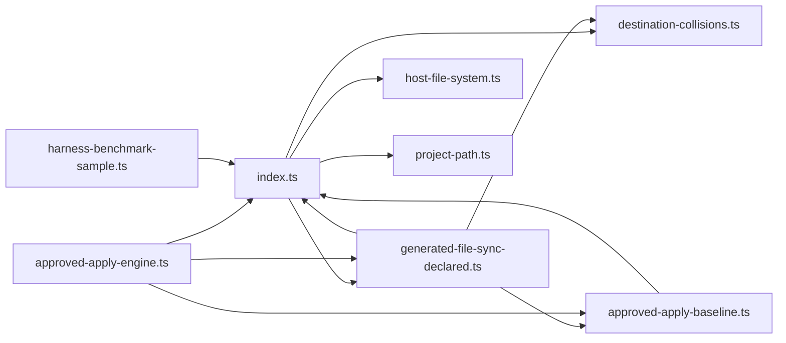
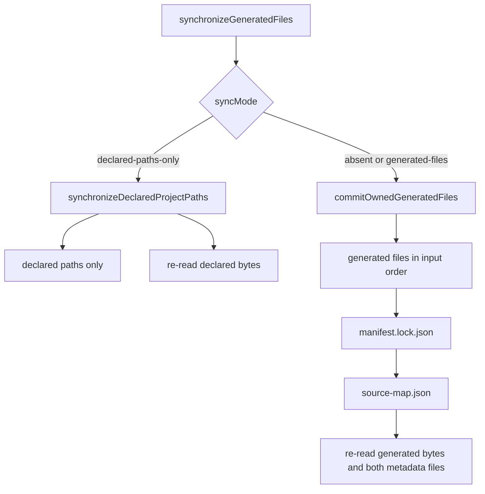
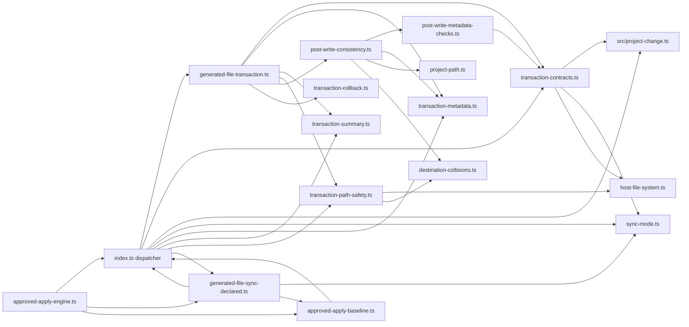
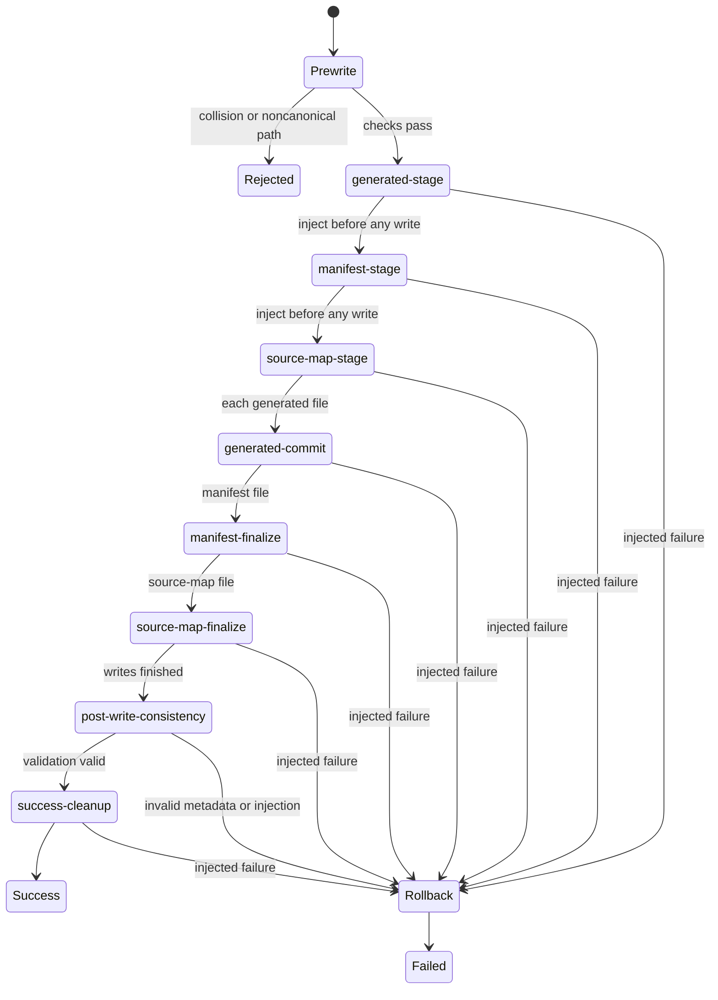
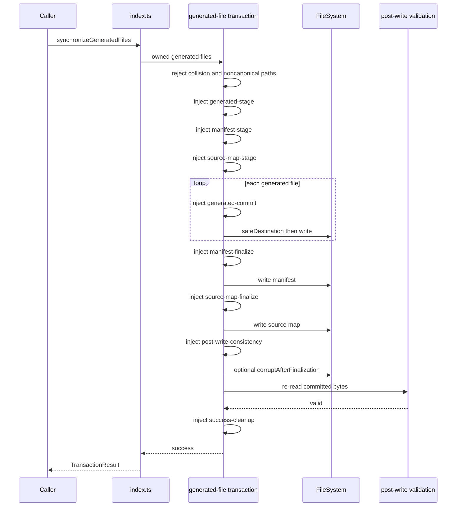
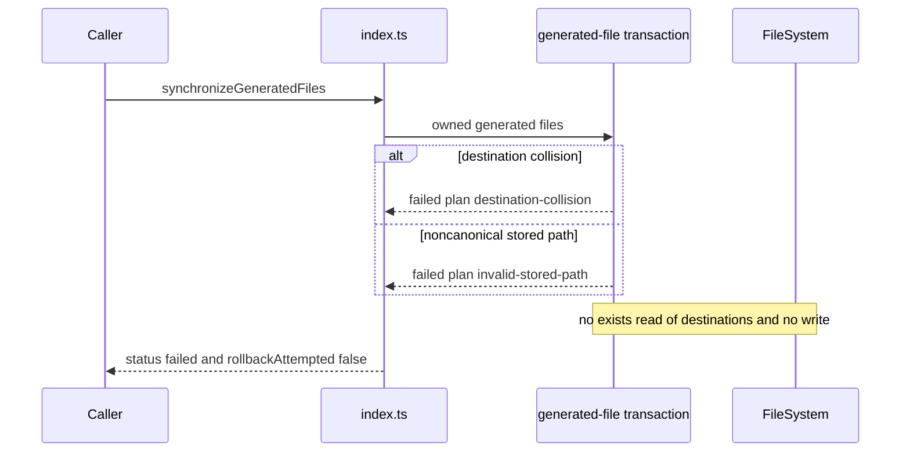
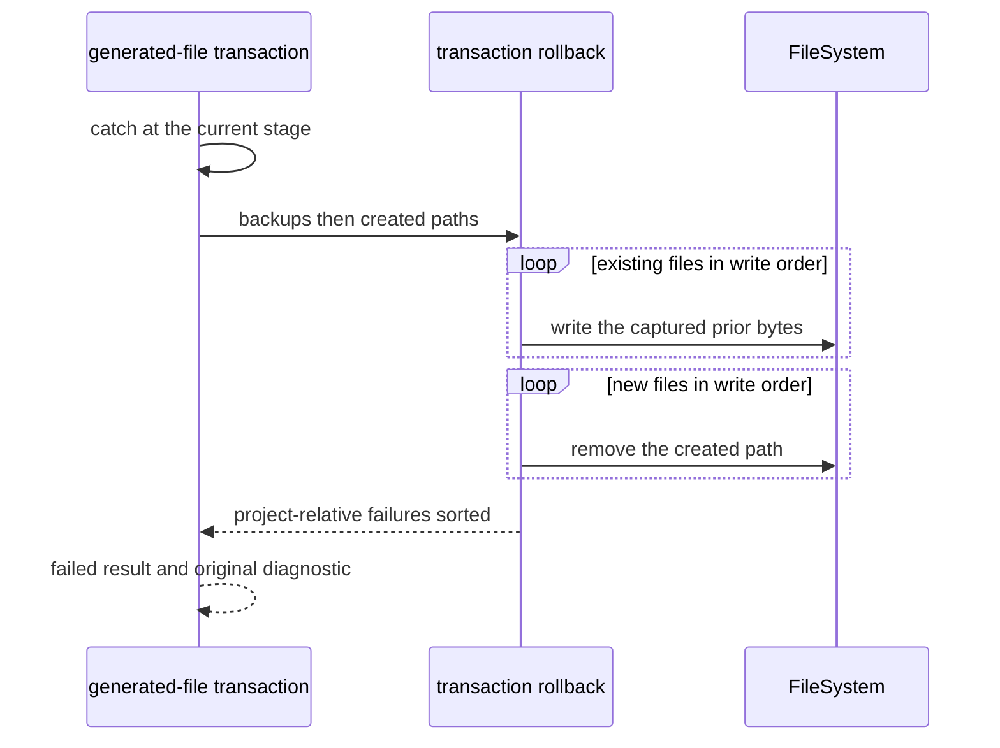
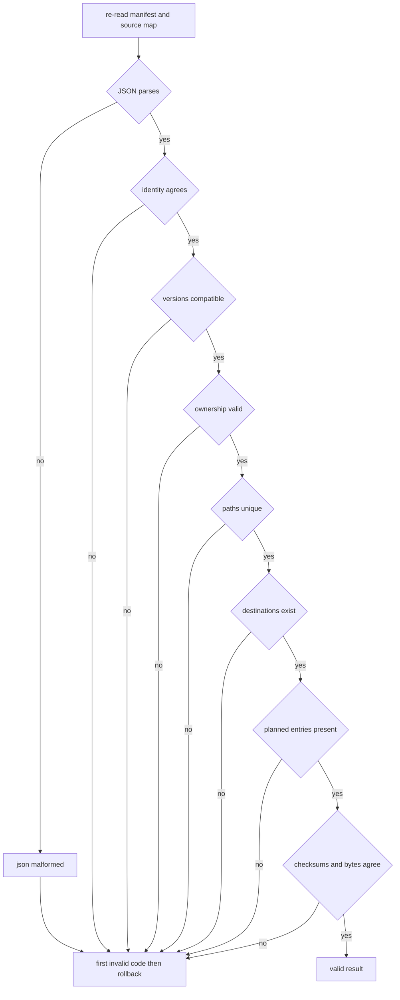
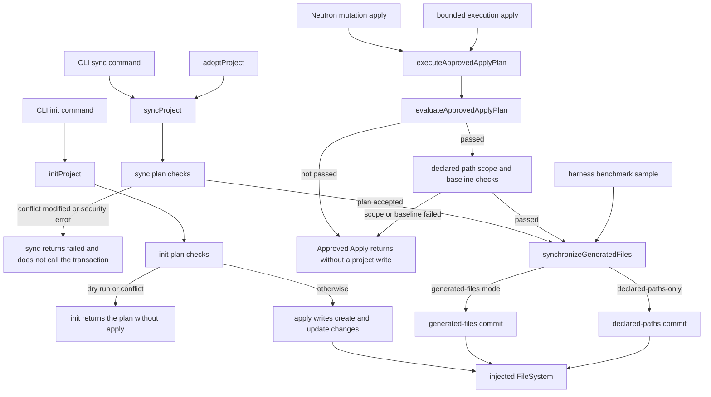
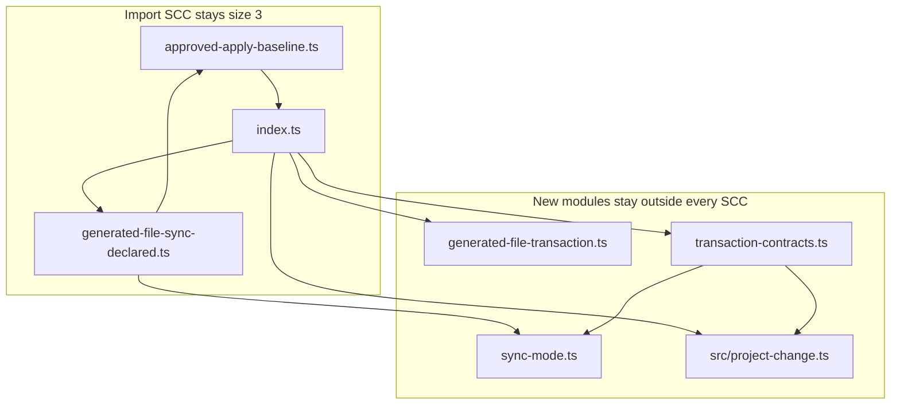

# P1I.1 Generated-file transaction extraction

Status: **proposed** (PR #615). This document is a Design First review artifact.
It does not implement P1I.1, and it does not authorize implementation
until a maintainer approves it. A green CI result is not approval.

Feasibility verdict: **C. Composition-root dispatch, with leaf-owned
transaction contracts.** Direct extraction is not safe. The Approved
Apply import cycle stays at its locked membership.

## 1. Context and verified baseline

Baseline: `main` at `e07fddccbc771e415bc1d9056051edb9e00b4d58`.
That commit is the merge of PR #614. Local `main` was fast-forwarded
from `017cb370cf4329a96d723cd83721acbb175f1827` to that SHA. The
working tree was clean before this design. No earlier P1I design
exists under `docs/designs/`.

Completed before this design:

- P1H.1 Persistent Memory, design PR #597, implementation PR #598.
- P1H.2 Agent Session, design PR #599, implementation PR #600.
- P1H.3 Skill Catalog and Proposals, design PR #601. P1H.3a is PR
  #602, P1H.3b is PR #603, and P1H.3c is PR #604. P1H.3 is fully
  implemented.
- P1H.4 Security Findings and SARIF Import, design PR #605. P1H.4a is
  PR #606 and P1H.4b is PR #607. P1H.4 is fully implemented.
- P1H.5 Security Policy and Sandbox, design PR #608. P1H.5a is PR
  #609 and P1H.5b is PR #610. P1H.5 is fully implemented.
- P1H.6 Continuous Security Audit, design PR #611
  (`52b34c8b202cb07ab30c4f3e991dbce3815510a4`). Implementation PR #612
  is merged at `b80614d5d65fbdbd9cbc4831a6593ead6b155280`.
- P1H.7 Interactive Workspace read model, design PR #613
  (`017cb370cf4329a96d723cd83721acbb175f1827`). Implementation PR #614
  is merged at the baseline SHA. The pull-request head was
  `4ae226125c91301ae5dedfe2a2dfe87b5127110f`. On that head, CodeQL,
  Governance, Desktop SEA Feasibility, Compatibility, and Harness
  Performance Benchmark passed. The merge push of the baseline SHA
  passed CodeQL, Documentation, and Compatibility. P1H.7 is complete.
  P1H is complete.

Open pull requests at the start were Dependabot updates. None of them
edit the application transaction family. P1I.2, P1I.3, P1J, Undo U4,
and Desktop Undo U5 have not started.

Canonical guidance used for this design:

- `docs/architecture/ARCHITECTURE.md` for the application use-case
  boundary. Clients call `@intentloom/application`. Application code
  does not import the CLI, daemon, MCP server, or Desktop.
- `docs/architecture/PACKAGES_STABILIZATION_PLAN.md`, section P1I.
  The first implementation PR is the generated-file transaction.
  Lifecycle operations are the following PR. Adoption, and the
  Approved Apply import retarget that removes `index.ts` from cycle
  1, are the PR after that.
- `docs/decisions/ADR-0007-private-application-operation-boundary.md`.
  The application package owns project operations, including
  transaction, validation, ownership, and result types. It does not
  own CLI exit codes.
- `docs/decisions/ADR-0053-approved-apply-transaction-engine.md` and
  `docs/releases/APPROVED_APPLY_HARDENING_AUDIT.md`. Approved Apply
  authorizes a plan before `synchronizeGeneratedFiles` runs.
- `docs/reference/GENERATED_FILES.md` for ownership, write order,
  metadata shape, post-write codes, and the documented TOCTOU limit.
- `docs/governance/DESIGN_FIRST_POLICY.md`,
  `docs/governance/AI_AGENT_WORKFLOW.md`,
  `docs/governance/ENGINEERING_PRINCIPLES.md`,
  `docs/governance/CODE_QUALITY_STANDARDS.md`, and
  `docs/governance/DOMAIN_MODELING.md`.
- `docs/governance/quality-exceptions.json`. The grandfathered
  `packages/application/src/index.ts` ceiling stays 6,764 effective
  lines and 7,151 physical lines. This design does not edit that file
  and does not raise the ceiling.
- `tests/application-source-cycles.ts` and the locked expectations in
  `tests/application-inception-cycle.test.ts` and
  `tests/application-foundation-scaffold-cycle.test.ts`.
- The approved P1H.7 design, as the nearest extraction pattern. This
  design does not reopen the read model.

Task triage for this design-only change: blast radius 1, ambiguity 2,
risk 2, verification 2, unknowns 2, total 9. The recommended role is
frontier with highest effort. Harness: Cursor. This session cannot
change its model. No subagents were used. The route from
`aif-task-router` is `plan`. The security section is the
trust-boundary review named for risk 2. It does not authorize a
behavior change.

Ambiguity is 2 because direct extraction, contract relocation alone,
composition-root dispatch, and a factory seam are different
architectures. This document is that decision record. An interactive
grilling interview is not a second gate: implementation is forbidden,
and maintainer review of this pull request is the approval.

Stop condition: one design pull request, no production edit, no
merge, and no start of P1I.2, P1I.3, P1J, U4, or U5.

## 2. Problem statement

`synchronizeGeneratedFiles` still commits generated files from
`packages/application/src/index.ts`. The same file owns the
transaction stage names, the post-write corruption codes, metadata
construction, ownership validation, and the generated-files rollback
loop.

`index.ts` is already a member of the Approved Apply import component
and of the 29-file re-export component. A new module that imports
`index.ts`, including `import type`, joins those components.
`generated-file-sync-declared.ts` already imports transaction types
from `index.ts`, and `approved-apply-baseline.ts` imports `FileSystem`
from `index.ts`. Those two edges are what keep the import component
at exactly three files.

The generated-files commit cannot move into a module that imports
`generated-file-sync-declared.ts`. That module reaches `index.ts`,
and `index.ts` would reach the new module. The component would grow.
P1I.1 is not authorized to dissolve that cycle. The packages plan
leaves the Approved Apply import retarget to the later adoption PR.

The two sync modes are not the same transaction. Declared-paths mode
already lives in `generated-file-sync-declared.ts`. It does not write
the manifest or the source map, and its path walk and rollback report
differ from the generated-files path. This slice must not merge those
implementations.

## 3. Goals and non-goals

Goals:

- Preserve `synchronizeGeneratedFiles` as a five-argument package-root
  function, including optional parameters and the `options = {}`
  default.
- Preserve generated-files orchestration, metadata finalization,
  post-write validation, rollback, stage identifiers, and the
  injected failure and corruption seams.
- Preserve declared-paths-only behavior, including the differences
  recorded in section 6.
- Move the generated-files implementation into application modules
  that do not import `index.ts`.
- Keep every current SCC at its current size and membership.
- Keep each new production file at or below 250 effective lines, and
  each new function at or below 80 lines. Prefer functions at or
  below 40 lines.
- Leave `quality-exceptions.json` and the twelve package export-map
  keys unchanged.

Non-goals:

- Implementing the extraction in this pull request.
- Moving `initProject`, `syncProject`, `diffProject`, `doctorProject`,
  `inspectProject`, `adoptProject`, `planProjectAdoption`, or
  `applyProjectAdoption`.
- Editing the bodies of `desired`, `plan`, `apply`, `ownership`, or
  `doctorProject`. Those functions may call the moved helpers by the
  same names. P1I.2 owns their move.
- Retargeting `approved-apply-engine.ts` or
  `approved-apply-baseline.ts` off `index.ts`. That retarget is the
  P1I.3 cycle removal.
- Unifying the declared-paths helpers with the generated-files
  helpers.
- Changing Neutron mutation, Undo, Protocol, Validator, package
  dependencies, CI, or public API names.
- Closing the filesystem TOCTOU window, adding sandbox isolation, or
  strengthening path checks.
- Introducing a dependency registry, a plugin host, or a new package
  export.

## 4. Source inventory

Measurements use `measureProductionSource` from
`scripts/production-file-metrics.mjs` on this baseline. Function
sizes use the same function-slice method as
`tests/workspace-read-model-p1h7-structure.test.ts`. Type sizes are
the effective lines from one column-0 declaration to the next.

`packages/application/src/index.ts` is 4,547 effective lines and
4,769 physical lines. Related files:

| File                              | Effective | Physical |
| --------------------------------- | --------: | -------: |
| `index.ts`                        |     4,547 |    4,769 |
| `generated-file-sync-declared.ts` |       302 |      317 |
| `approved-apply-baseline.ts`      |       184 |      210 |
| `approved-apply-engine.ts`        |       146 |      160 |
| `host-file-system.ts`             |       141 |      144 |
| `destination-collisions.ts`       |        43 |       46 |
| `project-path.ts`                 |        24 |       27 |
| `generated-metadata-compare.ts`   |       102 |      108 |

`generated-file-sync-declared.ts` is above the 300-line review line
and under the 400-line hard limit. This slice must not grow it.

### 4.1 Declarations that participate

Public contracts still declared in `index.ts`:

| Declaration                  | Lines     | Effective | Physical | Exported |
| ---------------------------- | --------- | --------: | -------: | -------- |
| `ChangeKind`                 | 282–289   |         8 |        8 | yes      |
| `Change`                     | 290–295   |         6 |        6 | yes      |
| `Plan`                       | 296–299   |         4 |        4 | yes      |
| `TransactionStage`           | 345–353   |         9 |        9 | yes      |
| `TransactionResult`          | 354–368   |        15 |       15 | yes      |
| `PostWriteCorruptionCode`    | 369–400   |        32 |       32 | yes      |
| `ValidPostWriteValidation`   | 401–411   |        11 |       11 | yes      |
| `InvalidPostWriteValidation` | 412–417   |         6 |        6 | yes      |
| `PostWriteValidationResult`  | 418–419   |         2 |        2 | yes      |
| `PostWriteCorruptionContext` | 606–609   |         4 |        4 | yes      |
| `TransactionOptions`         | 610–617   |         8 |        8 | yes      |
| `synchronizeGeneratedFiles`  | 1306–1490 |       185 |      185 | yes      |

`PostWriteCorruptionCode` is 32 lines because the count includes the
`export type` line. The union itself is 31 string literals, from
`manifest-json-malformed` through `normalized-destination-duplicate`.

Private generated-files implementation still in `index.ts`:

| Declaration                       | Line | Effective | Physical |
| --------------------------------- | ---: | --------: | -------: |
| `lockPath`                        |  633 |         1 |        1 |
| `sourceMapPath`                   |  634 |         1 |        1 |
| `metadataFormatVersion`           |  635 |         1 |        1 |
| `adapterOutputVersion`            |  636 |         1 |        1 |
| `transactionAdapterId`            |  637 |         1 |        1 |
| `collisionPlan`                   |  779 |        12 |       12 |
| `noncanonicalPathPlan`            |  792 |        21 |       21 |
| `MetadataObject`                  |  814 |         1 |        1 |
| `MetadataRecord`                  |  815 |         1 |        1 |
| `PostWriteValidationInput`        |  817 |         8 |        8 |
| `TransactionMetadata`             |  826 |         4 |        4 |
| `MetadataPins`                    |  831 |         8 |        8 |
| `buildTransactionMetadata`        |  840 |        68 |       68 |
| `transactionSummary`              |  909 |        32 |       32 |
| `PostWriteValidationFailure`      |  942 |         5 |        5 |
| `invalidPostWriteState`           |  948 |        12 |       12 |
| `metadataRecords`                 |  961 |        10 |       10 |
| `pathFailure`                     |  972 |        25 |       25 |
| `duplicateFailure`                |  998 |        33 |       33 |
| `missingIdentity`                 | 1032 |        15 |       15 |
| `validateCommittedOwnershipState` | 1048 |       246 |      257 |
| `safeDestination`                 | 1492 |        30 |       31 |

`TransactionMetadata` is not an exported name. It is the unexported
type of the fifth parameter. Callers see the structural shape
`{ manifest: string; sourceMap: string }`.

`validateCommittedOwnershipState` and `synchronizeGeneratedFiles`
exceed both the 40-line preference and the 80-line hard limit.
`buildTransactionMetadata` is 68 lines, under the hard limit and over
the preference. The move must split the first two. The metadata
builder should split into the manifest document and the source-map
document so the new functions also meet the preference.

### 4.2 Declarations that stay

These stay in `index.ts` for P1I.2 or later:

- Doctor, inspection, adoption, timeline, and init contracts,
  including `DoctorPlan`, `InitOptions`, `SyncOptions`,
  `SyncDryRunResult`, `AdoptionProposal`, and
  `ArtifactValidationFailure`.
- `configPath`, `emptyCatalog`, `inspectionAdapterNames`, and
  `inspectionMetadataPaths`.
- `desired`, `ownership`, `plan`, `apply`, `initProject`,
  `syncProject`, `diffProject`, `inspectProject`, and `doctorProject`.
  `plan` is 83 effective lines and stays oversized until P1I.2. This
  slice does not edit its body.
- `FileSystem`, `nodeFileSystem`, and `createMemoryFileSystem`,
  already owned by `host-file-system.ts` and re-exported.

`ArtifactValidationFailure` is thrown by `desired` and `doctorProject`.
The commit path does not throw it. Moving the class without those
functions does not shrink the transaction.

The whole of `generated-file-sync-declared.ts` stays the owner of
declared-paths synchronization, except the sync-mode symbols named in
the move matrix. Its private `collisionPlan`, `noncanonicalPathPlan`,
`safeDestination`, `inside`, and `validateDeclaredPathBytes` stay
where they are.

`approved-apply-engine.ts` keeps importing `synchronizeGeneratedFiles`
from `index.ts`. `approved-apply-baseline.ts` keeps
`import type { FileSystem } from "./index.js"`.

### 4.3 Current callers

Package-root callers of `synchronizeGeneratedFiles`:

- `index.ts` `syncProject`, after `plan` accepts the proposal. It
  passes metadata produced by `desired`.
- `approved-apply-engine.ts` `executeApprovedApplyPlan`, after
  `evaluateApprovedApplyPlan` passes and, for declared-paths mode,
  after the Neutron path-set check.
- `harness/harness-benchmark-sample.ts`.

External packages do not import the function by a deep path. The CLI
imports `TransactionOptions` and maps `TransactionResult` in
`packages/cli/src/mutation-outcome.ts`. Daemon, MCP, and Desktop do
not import the function. They reach it through application operations
that already call the package root.

`buildTransactionMetadata` is also called by `desired`.
`transactionSummary` is also called by `syncProject`. `collisionPlan`
and `safeDestination` are also called by `plan`. `safeDestination` is
also called by `apply`. Those call sites stay in `index.ts` and import
the moved helpers.

## 5. Current architecture



Editable source:
[`current-dependencies.mmd`](current-dependencies.mmd).

Import-only edges that form the size-3 component are:

- `index.ts` value-imports `isDeclaredPathsOnlySyncMode` and
  `synchronizeDeclaredProjectPaths` from
  `generated-file-sync-declared.ts`.
- `generated-file-sync-declared.ts` imports `ApplyBlockedBeforeWrite`
  from `approved-apply-baseline.ts` and imports transaction types from
  `index.ts`.
- `approved-apply-baseline.ts` imports `FileSystem` from `index.ts`.

`TransactionOptions.syncMode` is an inline type query of
`GeneratedFileSyncMode` from `generated-file-sync-declared.ts`. A
contract module that repeats that query imports the declared-paths
module. That module reaches `index.ts`.

### 5.1 Mode difference, verified from source

Generated-files mode, in `synchronizeGeneratedFiles` when
`syncMode` is absent or is not `declared-paths-only`:

- Rejects destination collisions and noncanonical stored paths before
  any destination read that leads to a write. The failure result has
  no `failedStage`, `rollbackAttempted: false`, and
  `rollbackCompleted: true`.
- Recomputes `checksum(file.content)` and does not trust the caller
  checksum.
- Writes generated files in input order, then
  `.aif/manifest.lock.json`, then `.aif/source-map.json`.
- Uses `validatedMetadata` when the caller passes it. Otherwise it
  builds metadata with the default pins `profile: "generic"`,
  `adapters: ["codex"]`, and one source hash for
  `transaction:generated`.
- Injects `generated-stage`, `manifest-stage`, and `source-map-stage`
  before any write. Each generated file then injects
  `generated-commit`. The manifest injects `manifest-finalize`. The
  source map injects `source-map-finalize`.
- Calls `corruptAfterFinalization` only after the
  `post-write-consistency` injection and before validation.
- Sorts `createdFiles`, `updatedFiles`, `unchangedFiles`, and
  `rollbackFailures`.
- On failure, sets `consistencyValidated` from
  `postWriteValidation.status === "valid"`.

Declared-paths mode, in `synchronizeDeclaredProjectPaths`:

- Writes only the normalized declared paths. Manifest and source map
  stay untouched. `manifestUpdated` and `sourceMapUpdated` stay false.
  `planSynchronizeGeneratedFilesWriteSet` is the read-side expression
  of that difference.
- Applies `normalizeStoredPath` to each path before the write.
- Does not sort created, updated, unchanged, or rollback-failure
  arrays.
- Does not call `corruptAfterFinalization`.
- Does not inject `manifest-stage`, `manifest-finalize`,
  `source-map-stage`, or `source-map-finalize`. A `failAt` of one of
  those stages does not throw.
- Validates by re-reading declared bytes and comparing them to
  `file.content`. The only corruption code on that path is
  `committed-generated-bytes-mismatch`. Metadata counts in the valid
  result are 0.
- On failure, `consistencyValidated` stays false.
- Rethrows `ApplyBlockedBeforeWrite` when no file was written.
- Its `safeDestination` returns when an existing realpath is inside
  the root. The generated-files `safeDestination` keeps walking until
  `resolve(root)`. The stop conditions differ. Both copies stay.



Editable source: [`mode-boundary.mmd`](mode-boundary.mmd).

## 6. Proposed architecture

Verdict **C** keeps the public function in `index.ts` as a
composition-root dispatcher. The dispatcher is the only place that
calls `synchronizeDeclaredProjectPaths`. The generated-files commit
moves to a leaf that cannot see the declared-paths module.



Editable source:
[`proposed-dependencies.mmd`](proposed-dependencies.mmd).

There is no `generated-file/index.ts` and no new package export-map
key. Public names stay on `packages/application/src/index.ts`.

The dispatcher keeps this signature and behavior:

```ts
export async function synchronizeGeneratedFiles(
  root: string,
  files: readonly GeneratedFile[],
  fs: FileSystem,
  options: TransactionOptions = {},
  validatedMetadata?: TransactionMetadata,
): Promise<TransactionResult> {
  if (isDeclaredPathsOnlySyncMode(options.syncMode)) {
    return synchronizeDeclaredProjectPaths(root, files, fs, options);
  }
  return commitOwnedGeneratedFiles(root, files, fs, options, validatedMetadata);
}
```

`TransactionMetadata` stays an unexported name. The barrel may keep a
local unexported interface with the same two fields so the root
declaration file does not export a new type name. The commit function
accepts that same shape. This is not a sixth parameter.

`commitOwnedGeneratedFiles` is not a package-root export.

## 7. Alternatives and graph consequences

Type-only imports are edges. `tests/application-source-cycles.ts`
records every relative `import` and, for the re-export graph, every
`export … from`. A new file joins an existing component when
`index.ts` reaches it and it has any path back to `index.ts`.

### A. Direct extraction

Move `synchronizeGeneratedFiles`, including the declared-paths branch,
into `generated-file-transaction.ts`. That file imports
`synchronizeDeclaredProjectPaths`.

Import graph: the new file reaches
`generated-file-sync-declared.ts`, which reaches
`approved-apply-baseline.ts`, which reaches `index.ts`. `index.ts`
imports or re-exports the new file. The import component becomes four
files: the current three plus the new file. The re-export component
grows from 29 files to 30. Locked cycle tests fail.

If the contract module also type-imports `GeneratedFileSyncMode` from
`generated-file-sync-declared.ts`, that contract module joins the same
component even before the function moves.

**Rejected.** It enlarges both locked components.

### B. Contract relocation only

Move the public types to a leaf and leave
`synchronizeGeneratedFiles` implemented in `index.ts`.

The import component can stay at three files if the leaf does not
import `index.ts` or `generated-file-sync-declared.ts`. The barrel
does not shrink by the 185-line function or the 246-line validator.
P1I.1 asked for the transaction family, not only its types.

**Necessary and not sufficient.** The recommended design includes
this relocation and also moves the commit.

### C. Composition-root dispatch

Recommended. Section 6 is this alternative.

`index.ts` keeps the mode branch and the public signature. New modules
import only leaves that do not reach `index.ts`: `host-file-system.ts`,
`project-path.ts`, `destination-collisions.ts`, `@intentloom/core`,
and `@intentloom/adapters`. They do not import `index.ts`,
`generated-file-sync-declared.ts`, `approved-apply-baseline.ts`,
`approved-apply-engine.ts`, or any other file that reaches `index.ts`.

`generated-file-sync-declared.ts` gains an import and re-export of the
sync-mode leaf. It keeps its import of `index.ts` and of
`approved-apply-baseline.ts`. `approved-apply-baseline.ts` keeps its
`FileSystem` import from `index.ts`. The import component stays the
same three files. The re-export component stays the same 29 files.
New files stay outside every component.

**Selected.**

### D. Bound factory

`createSynchronizeGeneratedFiles(declaredRunner)` would hide the
declared-paths dependency behind a parameter. The public function
would still be the bound value on the barrel, or the signature would
gain a parameter.

A module-level setter is a registry. The packages rules reject a
speculative framework. The explicit dispatcher in alternative C is
the same seam without the factory.

**Rejected.**

No option is blocked. C preserves the locked cycle structure. A does
not. The maintainer decision is whether to accept C. Rejecting C
blocks P1I.1 until the cycle is allowed to change, which this plan
assigns to P1I.3.

## 8. Declaration move matrix

| Declaration                                              | Current owner                                | Proposed owner                               | Dependencies                                              | Public API          | Move/Stay | Justification                                                                                    |
| -------------------------------------------------------- | -------------------------------------------- | -------------------------------------------- | --------------------------------------------------------- | ------------------- | --------- | ------------------------------------------------------------------------------------------------ |
| `ChangeKind`, `Change`, `Plan`                           | `index.ts`                                   | `packages/application/src/project-change.ts` | none                                                      | re-export           | Move      | Shared by doctor, init, diff, sync, and the transaction. `TransactionResult` extends `Plan`.     |
| `GeneratedFileSyncMode`                                  | `generated-file-sync-declared.ts`            | `generated-file/sync-mode.ts`                | none                                                      | re-export           | Move      | `TransactionOptions` must name this alias without importing the declared-paths module.           |
| `GENERATED_FILE_SYNC_DECLARED_PATHS_ONLY`                | `generated-file-sync-declared.ts`            | `generated-file/sync-mode.ts`                | none                                                      | re-export           | Move      | Same alias home as the sync-mode type.                                                           |
| `isDeclaredPathsOnlySyncMode`                            | `generated-file-sync-declared.ts`            | `generated-file/sync-mode.ts`                | sync-mode constant                                        | re-export           | Move      | The dispatcher and the declared-paths module both call one predicate.                            |
| `TransactionStage`                                       | `index.ts`                                   | `generated-file/transaction-contracts.ts`    | none                                                      | re-export           | Move      | Stage identifiers used by the commit leaf.                                                       |
| `TransactionResult`                                      | `index.ts`                                   | `generated-file/transaction-contracts.ts`    | `Plan`                                                    | re-export           | Move      | Return type of the public function and the commit leaf.                                          |
| `PostWriteCorruptionCode`                                | `index.ts`                                   | `generated-file/transaction-contracts.ts`    | none                                                      | re-export           | Move      | Corruption vocabulary for the validator leaf.                                                    |
| `ValidPostWriteValidation`                               | `index.ts`                                   | `generated-file/transaction-contracts.ts`    | none                                                      | re-export           | Move      | Success arm of the post-write result.                                                            |
| `InvalidPostWriteValidation`                             | `index.ts`                                   | `generated-file/transaction-contracts.ts`    | `PostWriteCorruptionCode`                                 | re-export           | Move      | Failure arm of the post-write result.                                                            |
| `PostWriteValidationResult`                              | `index.ts`                                   | `generated-file/transaction-contracts.ts`    | the two validation arms                                   | re-export           | Move      | Public union.                                                                                    |
| `PostWriteCorruptionContext`                             | `index.ts`                                   | `generated-file/transaction-contracts.ts`    | `FileSystem` from `host-file-system.ts`                   | re-export           | Move      | Callback argument. Importing it from `index.ts` would cycle.                                     |
| `TransactionOptions`                                     | `index.ts`                                   | `generated-file/transaction-contracts.ts`    | `GeneratedFileSyncMode`, `TransactionStage`, `FileSystem` | re-export           | Move      | Public options. The sync-mode field imports the new leaf, not the declared-paths module.         |
| `TransactionMetadata`                                    | `index.ts`, unexported                       | unexported in `transaction-metadata.ts`      | none                                                      | not a new export    | Move      | Fifth-parameter shape. The root does not gain an exported name.                                  |
| `lockPath`, `sourceMapPath`                              | `index.ts`, unexported                       | `transaction-metadata.ts`, unexported        | none                                                      | no                  | Move      | Commit and validation need them. Lifecycle in `index.ts` imports them.                           |
| `metadataFormatVersion`                                  | `index.ts`, unexported                       | `transaction-metadata.ts`, unexported        | none                                                      | no                  | Move      | Shared by metadata build and post-write checks.                                                  |
| `adapterOutputVersion`                                   | `index.ts`, unexported                       | `transaction-metadata.ts`, unexported        | `adapterVersion`                                          | no                  | Move      | One adapter-version authority, unchanged.                                                        |
| `transactionAdapterId`                                   | `index.ts`, unexported                       | `transaction-metadata.ts`, unexported        | none                                                      | no                  | Move      | Literal `aif:generated-files`.                                                                   |
| `MetadataPins`                                           | `index.ts`, unexported                       | `transaction-metadata.ts`, unexported        | `AdapterName`                                             | no                  | Move      | Input of metadata construction.                                                                  |
| `buildTransactionMetadata`                               | `index.ts`                                   | `transaction-metadata.ts`                    | core checksum, `INTENTLOOM_VERSION`, adapter version      | no                  | Move      | Used by the commit and by `desired`, which stays in `index.ts`.                                  |
| `collisionPlan`                                          | `index.ts` private copy                      | `transaction-path-safety.ts`                 | `findDestinationCollisions`, `Plan`                       | no                  | Move      | Generated-files copy only. The declared-paths copy stays.                                        |
| `noncanonicalPathPlan`                                   | `index.ts` private copy                      | `transaction-path-safety.ts`                 | `normalizeStoredPath`, `Plan`                             | no                  | Move      | Generated-files copy only.                                                                       |
| `safeDestination`                                        | `index.ts` private copy                      | `transaction-path-safety.ts`                 | `FileSystem`, `node:path`                                 | no                  | Move      | Generated-files walk. Declared-paths keeps its own walk.                                         |
| `transactionSummary`                                     | `index.ts`                                   | `transaction-summary.ts`                     | `Change`, metadata paths                                  | no                  | Move      | Sorted created, updated, and unchanged paths. `syncProject` still calls it.                      |
| Post-write helpers and `validateCommittedOwnershipState` | `index.ts`                                   | the two post-write modules                   | contracts, `inside`, `destinationCollisionKey`, checksum  | no                  | Move      | The 246-line function is decomposed. It is not called outside the commit.                        |
| Generated-files commit body                              | `synchronizeGeneratedFiles`                  | `commitOwnedGeneratedFiles`                  | the leaves above                                          | no                  | Move      | Orchestration without the declared-paths branch.                                                 |
| `synchronizeGeneratedFiles`                              | `index.ts`                                   | `index.ts`                                   | sync-mode predicate, declared runner, commit              | yes, same signature | Stay      | Composition root. Moving the whole function imports the declared-paths module and grows the SCC. |
| Declared-paths private helpers                           | `generated-file-sync-declared.ts`            | same file                                    | existing                                                  | no                  | Stay      | Different walk, sort, metadata, and failure behavior.                                            |
| `synchronizeDeclaredProjectPaths`                        | `generated-file-sync-declared.ts`            | same file                                    | baseline, contracts via `index.ts`                        | re-export           | Stay      | Already extracted. It keeps importing types from `index.ts`.                                     |
| `planSynchronizeGeneratedFilesWriteSet`                  | `generated-file-sync-declared.ts`            | same file                                    | sync-mode leaf                                            | re-export           | Stay      | Write-set preview. It must keep adding metadata paths only for generated-files mode.             |
| `desired`, `plan`, `apply`, lifecycle exports            | `index.ts`                                   | `index.ts`                                   | moved helpers by name                                     | yes                 | Stay      | P1I.2. Bodies stay.                                                                              |
| `ArtifactValidationFailure`                              | `index.ts`                                   | `index.ts`                                   | validator result type                                     | yes                 | Stay      | Thrown by `desired` and `doctorProject`, not by the commit.                                      |
| `FileSystem` import in baseline                          | `approved-apply-baseline.ts` from `index.ts` | same import                                  | `index.ts`                                                | no                  | Stay      | Removing it dissolves cycle 1. That is P1I.3.                                                    |
| Engine import of `synchronizeGeneratedFiles`             | `approved-apply-engine.ts` from `index.ts`   | same import                                  | `index.ts`                                                | no                  | Stay      | Public entry remains the dispatcher.                                                             |

`generated-file-sync-declared.ts` replaces its local sync-mode
declarations with a re-export from `sync-mode.ts`. That edit shrinks
the file. It does not retarget the type import from `index.ts`.

## 9. Module boundaries

Transaction modules live under
`packages/application/src/generated-file/`. `ChangeKind`, `Change`,
and `Plan` do not. `DoctorPlan` extends `Plan`. `initProject`,
`diffProject`, and `syncProject` return or consume `Plan`. Putting
those three types under `generated-file/` would make lifecycle
contracts look owned by the transaction. The shared home is
`packages/application/src/project-change.ts`, next to
`project-path.ts` and `host-file-system.ts`. The public names stay
`ChangeKind`, `Change`, and `Plan`. There is no second copy.

Estimates below are planning figures, not implementation
measurements. The implementation PR must measure them again with
`measureProductionSource`. Moving the shared contract out of
`generated-file/` does not change its size estimate or the SCC.

| Module                          | Responsibility                                                   | Imports                                                                           | Estimate  | Direction                                     |
| ------------------------------- | ---------------------------------------------------------------- | --------------------------------------------------------------------------------- | --------- | --------------------------------------------- |
| `src/project-change.ts`         | `ChangeKind`, `Change`, `Plan`                                   | none                                                                              | 22 / 24   | leaf shared by lifecycle and transaction      |
| `sync-mode.ts`                  | sync-mode constant, type, and predicate                          | none                                                                              | 14 / 16   | leaf                                          |
| `transaction-contracts.ts`      | public transaction types                                         | `../project-change.ts`, `sync-mode.ts`, `host-file-system.ts` type                | 100 / 110 | depends on leaves                             |
| `transaction-metadata.ts`       | pins, manifest, source map, path constants                       | `@intentloom/core`, `@intentloom/adapters`, `project-change` not required         | 110 / 120 | leaf besides contracts if it returns metadata |
| `transaction-summary.ts`        | sorted summary and the pre-write failure shape                   | contracts, metadata paths                                                         | 60 / 70   | depends on contracts                          |
| `transaction-path-safety.ts`    | generated-files collision, canonical path, symlink walk          | `destination-collisions.ts`, `@intentloom/core`, `host-file-system.ts`, contracts | 80 / 90   | depends on contracts and existing leaves      |
| `post-write-metadata-checks.ts` | parse, identity, version, ownership, path, duplicate             | contracts, metadata constants, `destination-collisions.ts`, `@intentloom/core`    | 220 / 240 | depends on contracts                          |
| `post-write-consistency.ts`     | presence, entries, checksum cascade, byte equality, orchestrator | metadata checks, `project-path.ts`, contracts, metadata                           | 210 / 230 | depends on the check module                   |
| `transaction-rollback.ts`       | restore prior bytes, then remove created files                   | `host-file-system.ts`                                                             | 45 / 50   | generated-files only                          |
| `generated-file-transaction.ts` | `commitOwnedGeneratedFiles`                                      | contracts, metadata, summary, path safety, post-write, rollback                   | 160 / 180 | does not import declared-paths or `index.ts`  |

No new file imports its own package root. No new file is expected to
pass 250 effective lines. If a post-write split measures over 250,
move only the checksum cascade into a third file. Do not compress
statements to hit the number.

### 9.1 Function split

`validateCommittedOwnershipState` becomes an orchestrator of about 40
lines. It returns the first invalid result. The check order stays:

1. Re-read `.aif/manifest.lock.json` and `.aif/source-map.json`.
2. Parse JSON. Malformed manifest wins over a malformed source map
   because the manifest parse runs first.
3. Adapter id missing, then adapter id mismatch.
4. Canonical source id missing, then mismatch.
5. Framework version missing, then incompatible.
6. Adapter output version missing, then incompatible.
7. Metadata format, lock version, and source-map schema version.
8. Manifest `ownershipPolicy`, then manifest paths, source-map paths,
   manifest duplicates, source-map duplicates, and normalized
   duplicates.
9. Each source-map `ownership` value.
10. Manifest destination existence, then source-map destination
    existence, using the current code choice among
    `source-map-destination-missing`,
    `ownership-record-without-generated-file`, and the planned-path
    branch.
11. Planned manifest entries, then planned source-map entries,
    including `generated-file-without-ownership` when the path was
    created in this transaction.
12. For each planned file, the current checksum cascade:
    source-map versus bytes, manifest versus source map, manifest
    versus bytes when the file bytes differ, then the same three
    codes again, then `committed-generated-bytes-mismatch`.
13. Planned manifest text, then planned source-map text.
14. The valid result, with the current counts and the five `true`
    flags.

Each extracted check stays at or below 80 lines. Checks that are
naturally under 40 lines stay there. The checksum cascade may stay
one function between 41 and 80 lines if splitting it would reorder
the codes. That is inside the hard limit and does not need a
quality-exception edit.

`commitOwnedGeneratedFiles` becomes an orchestrator of about 40 lines:

1. `collisionPlan`, then `noncanonicalPathPlan`. Either one returns
   the current pre-write failure object.
2. Recompute checksums. Use `validatedMetadata` or
   `buildTransactionMetadata`.
3. Append the manifest and source map after the generated files.
4. Build the create/update change list and the created-path set.
5. Inject the three pre-write stages.
6. Write generated files, then manifest, then source map.
7. Inject `post-write-consistency`, run the corruption callback, then
   validate.
8. Inject `success-cleanup` and return the success object.
9. On throw, restore and remove through `transaction-rollback.ts`.

`buildTransactionMetadata` splits into shared identity, the manifest
object, and the source-map object. Key order stays the source order
in section 11. Each piece stays at or below 40 lines.

`safeDestination`, `collisionPlan`, `noncanonicalPathPlan`, and
`transactionSummary` are already at or below 40 lines. They move
without a behavior edit.

## 10. Typed contracts and compatibility

Preserved package-root names:

- `synchronizeGeneratedFiles`
- `TransactionStage`
- `TransactionResult`
- `TransactionOptions`
- `PostWriteValidationResult`
- `PostWriteCorruptionCode`
- `ValidPostWriteValidation`
- `InvalidPostWriteValidation`
- `PostWriteCorruptionContext`
- `Change`, `ChangeKind`, `Plan`
- `GeneratedFileSyncMode`
- `GENERATED_FILE_SYNC_DECLARED_PATHS_ONLY`
- `isDeclaredPathsOnlySyncMode`
- `planSynchronizeGeneratedFilesWriteSet`
- `synchronizeDeclaredProjectPaths`

`TransactionOptions` keeps `syncMode`, `failAt`, `rollbackFailPaths`,
and `corruptAfterFinalization`. `syncMode` remains the existing
`GeneratedFileSyncMode` alias, now defined in `sync-mode.ts` and
re-exported by the declared-paths module and the package root.
`exactOptionalPropertyTypes` stays in force. The default argument
stays `{}`.

The twelve `packages/application/package.json` export keys stay.
CLI, daemon, MCP, and Desktop import paths stay on the package root
or on those existing keys. No Protocol or Validator schema changes.

`index.ts` value-imports the commit and the helpers lifecycle still
calls. It re-exports the public types with `export type`. Re-export
edges point from `index.ts` and from `generated-file-sync-declared.ts`
toward the new leaves. The leaves do not export from `index.ts`.

Deep imports of a new file are not a supported public API. Tests
should keep importing the public names from the package root.

## 11. Transaction behavior that the move preserves

### 11.1 Metadata

Manifest object key order:

1. `schemaVersion`, `lockVersion`, both the metadata format version
2. `ownershipPolicy`: `aif-owned-generated`
3. `profile`
4. `schemaVersions` with `config`, `manifestLock`, `sourceMap`,
   `planning`, `agentSkillPolicy`, each `"1"`
5. `adapters`, sorted by id, each `{ id, version }`
6. `sourceHashes`, sorted by id
7. `metadataFormatVersion`, `frameworkVersion`,
   `adapterOutputVersion`, `adapterId`, `canonicalSourceId`
8. `generated`: `{ path, checksum }` in file order

Source-map object key order:

1. `schemaVersion`
2. the same shared identity fields
3. `files`: `{ path, checksum, sources, ownership }` with ownership
   `aif-owned-generated`

Both documents are `JSON.stringify(value, null, 2)` plus a trailing
newline. `canonicalSourceId` is the checksum of the JSON array of
sorted unique `sources`. `frameworkVersion` is `INTENTLOOM_VERSION`.
`adapterOutputVersion` is the adapter package version.
`adapterId` is `aif:generated-files`. There is no timestamp.

Default pins, used only when the caller omits `validatedMetadata`,
stay `generic`, `codex`, and the `transaction:generated` source hash.

### 11.2 Stages



Editable source: [`stage-state.mmd`](stage-state.mmd).

The eight `TransactionStage` strings stay. `failAt` throws
`injected:<stage>` when that stage is injected. A throw before a
write still enters the catch. The backups map and the created list
are empty, so rollback is a no-op and `rollbackCompleted` is true.

### 11.3 Success



Editable source:
[`successful-transaction.mmd`](successful-transaction.mmd).

For each written path the order stays `safeDestination`, then
`exists`, then `read` into the backup map or push onto the created
list, then `mkdir` of the parent, then `write`. The created-path set
used by ownership validation records generated paths that did not
exist. It does not record the manifest or source map.

The success object spreads the proposal, sets `status: "success"`,
`rollbackAttempted: false`, `rollbackCompleted: true`, empty rollback
failures, the sorted summary, `consistencyValidated: true`,
`cleanupCompleted: true`, and `postWriteValidation`.

### 11.4 Rejection before a write



Editable source:
[`rejected-transaction.mmd`](rejected-transaction.mmd).

Collision changes stay `kind: "conflict"` with `reason` set to
`JSON.stringify(collision)` and diagnostic `destination-collision`.
Noncanonical changes stay `kind: "security-error"` with diagnostic
`invalid-stored-path`. Paths in that plan are sorted. Neither result
sets `failedStage`.

### 11.5 Partial commit and rollback



Editable source: [`rollback-sequence.mmd`](rollback-sequence.mmd).

Rollback order stays: every backup, in `Map` insertion order, then
every created path, in creation order. Project-relative diagnostics
use `relative(resolve(root), path)` with backslashes replaced by
`/`. They do not use `realpath`. An injected rollback failure is a
thrown error for that project-relative path. The original error is
kept. Incomplete rollback appends `transaction-rollback-incomplete`
and does not replace the original diagnostic. `rollbackFailures` is
sorted for generated-files mode only.

`PostWriteValidationFailure` copies its validation onto the result.
Other errors leave `postWriteValidation` absent unless validation
already assigned it. `failedStage` is the stage last injected.
`cleanupCompleted` is false. The summary still reports the planned
create, update, and unchanged sets from before the rollback.

Declared-paths rollback stays in its own function. It does not sort
failure paths, and it rethrows `ApplyBlockedBeforeWrite` when nothing
was written. Do not route it through `transaction-rollback.ts`.

### 11.6 Post-write flow



Editable source: [`post-write-flow.mmd`](post-write-flow.mmd).

Validation reads filesystem bytes. It does not trust the in-memory
strings except as the planned text compared at the end. Affected
paths and identifiers are de-duplicated and sorted. The invalid
object carries one code. The union has 31 string literals. The
32 in the section 4 table is the declaration's line count, including
`export type PostWriteCorruptionCode =`.
`tests/post-write-corruption.test.ts` names all 31 codes across 34
cases. `adapter-id-missing`, `canonical-source-id-missing`, and
`source-map-duplicate-ownership` each have two cases. No code is
absent. The manifest `ownershipPolicy` branch of
`ownership-classification-invalid` has no separate case. The existing
case covers that code through a source-map `ownership` value. The
implementation must not drop either branch.

Declared-paths validation stays `validateDeclaredPathBytes`. It does
not read the manifest or the source map.

## 12. Bounded context, ownership, and trust

The owning context is the private application project-operation
boundary from ADR-0007. This slice does not add an Entity, an
Aggregate, a Repository, or a Domain Event.

Terms already used by the repository:

- **Project-owned file.** An existing file without a valid source-map
  ownership record. A generated-looking header is not ownership.
- **Intentloom-owned generated file.** `aif-owned-generated` in the
  source map, with a normalized relative path and a matching checksum.
- **Manifest lock and source map.** `.aif/manifest.lock.json` and
  `.aif/source-map.json`. They are generated records. They are written
  after generated files.
- **Validated write plan.** The `Plan` of create and update changes
  after collision and path checks. It is not itself authorization.
- **Approved Apply.** `evaluateApprovedApplyPlan` runs inside
  `executeApprovedApplyPlan`, before that function calls
  `synchronizeGeneratedFiles`. The transaction does not call the
  gate. Callers that are not the engine do not pass through it.
- **Filesystem port.** The injected `FileSystem`. Tests use the memory
  port. Production passes `nodeFileSystem` from the caller. The
  transaction does not open `node:fs` itself. `desired` still reads
  the catalog with `node:fs/promises`; that stays in `index.ts`.
- **Rollback evidence.** Prior bytes in the backup map, and the
  created-path list. Approved Apply additionally keeps its own
  baseline in `approved-apply-baseline.ts`. This slice does not merge
  those two records.
- **Rejected state.** Collision or noncanonical path. No write.
- **Partial state.** A throw after one or more writes. Rollback
  restores or removes those paths.
- **Inconsistent state.** Rollback could not restore a listed
  project-relative path. The result says
  `transaction-rollback-incomplete`. Success is not returned.



Editable source: [`trust-boundaries.mmd`](trust-boundaries.mmd).

The diagram separates three production paths that the previous
drawing collapsed.

Ordinary synchronization starts at the CLI sync command or at
`adoptProject`. Both call `syncProject`. `syncProject` runs `plan`
first. A conflict, modified file, or security error returns a failed
result and does not call `synchronizeGeneratedFiles`. An accepted
plan calls the dispatcher. That path uses the existing planning,
ownership, and filesystem checks. It does not call
`evaluateApprovedApplyPlan`.

`initProject` is not that path. The CLI init command calls
`initProject`. `initProject` calls `plan`, then `apply` when the run
is not a dry run and the plan has no `conflict` change. `apply`
writes `create` and `update` changes through the injected filesystem.
`initProject` does not call `synchronizeGeneratedFiles`. `diffProject`
returns `plan` and does not write.

Approved Apply starts at Neutron mutation apply or bounded-execution
apply. Both call `executeApprovedApplyPlan`. That function calls
`evaluateApprovedApplyPlan` before any project write. A failed gate
returns without `synchronizeGeneratedFiles`. A passed gate still runs
the declared-path scope check, when that mode is set, and the
baseline check, when a baseline was supplied. Only after those checks
does the engine call `synchronizeGeneratedFiles`.

`harness/harness-benchmark-sample.ts` calls
`synchronizeGeneratedFiles` directly. It does not pass through the
gate. Package-root tests do the same. Daemon, MCP, and Desktop do not
call this function. They are not drawn as if they did.

The dispatcher still chooses generated-files mode or declared-paths
mode. Neither mode adds an authorization check that the caller did
not already perform. Moving the commit must not insert the gate into
`syncProject` or `initProject`, and must not remove it from
`executeApprovedApplyPlan`.

Sandbox evaluation is a policy decision in the security modules. It
is not operating-system isolation, and this extraction does not
invoke it. Static contracts and this document do not enforce the
runtime checks. The checks that exist today stay in the moved
functions.

Existing guarantees:

- Collision and noncanonical paths return before writes.
- `safeDestination` rejects a symlink component and a realpath outside
  the resolved root.
- `inside` still rejects a stored path that escapes the root when a
  later read uses it.
- Post-write failure rolls back.
- Metadata is last.

Existing limitations, preserved on purpose:

- `safeDestination` runs before `mkdir` and `write`, not again after
  `mkdir`. The comment on `apply` already says this narrows a symlink
  race and does not eliminate it. `docs/reference/GENERATED_FILES.md`
  states the same TOCTOU limit. This slice does not add a second check.
- The memory filesystem and the Node filesystem can differ on
  platform paths. The Windows normalization covered by
  `tests/post-write-success.test.ts` stays in the memory port, which
  does not move.
- Declared-paths and generated-files path walks remain different.
  Choosing the stricter walk for both would be a behavior change.

Fail-closed behavior that the current code already has stays
fail-closed: invalid plans, thrown filesystem errors, invalid
post-write state, and injected stage failures all return `failed` or
propagate `ApplyBlockedBeforeWrite` exactly where they do today.

## 13. SCC membership

Recomputed on this baseline with the same graph rules as
`tests/application-source-cycles.ts`.

Import-only components, sizes 3 and 3:

1. `approved-apply-baseline.ts`, `generated-file-sync-declared.ts`,
   `index.ts`
2. `neutron/mutation/apply/neutron-mutation-apply-durable-record.ts`,
   `neutron/mutation/apply/neutron-mutation-apply-store.ts`,
   `neutron/mutation/verification/neutron-mutation-verification-retry-eligibility.ts`

Re-export-inclusive components, sizes 4, 29, and 3:

1. `apply-extension-update.ts`,
   `discover-and-apply-extension-update.ts`,
   `extension-update-files.ts`,
   `propose-and-apply-extension-adoption.ts`
2. The 29 files locked in
   `tests/application-foundation-scaffold-cycle.test.ts`, including
   `index.ts`, `generated-file-sync-declared.ts`,
   `approved-apply-baseline.ts`, `approved-apply-engine.ts`, and
   `harness/harness-benchmark-sample.ts`.
3. The same Neutron mutation trio as the second import component.



Editable source: [`scc-impact.mmd`](scc-impact.mmd).

After the extraction the membership lists stay identical. The new
files are absent from every component. `project-change.ts` imports
nothing in `packages/application/src`. `index.ts` and
`transaction-contracts.ts` import it. It does not import them, so it
does not join either component. Locked cycle tests stay unchanged. A
new structure test should assert that absence and should read the new
files for `from "../index.js"` and `from "./index.js"`.

Files that reach `index.ts` today, and that the new modules must not
import, include the 89 import-graph reachers measured on this
baseline. The practical ban is the size-3 component, the size-29
component, and the Neutron modules that import the barrel. The safe
dependencies are listed in section 9.

Removing `import type { FileSystem } from "./index.js"` from
`approved-apply-baseline.ts` deletes the edge that closes cycle 1
once the declared-paths module no longer needs the barrel for types.
That is a membership change. It is out of scope.

## 14. Source-size budget

Moved effective lines, from the inventory, sum to 826. The barrel
adds back a dispatcher of about 14 lines, imports, and re-exports.
The estimate for `index.ts` after the slice is about 3,770 effective
lines and about 3,990 physical lines, down from 4,547 and 4,769.

That estimate is not a measurement. The implementation must print
`measureProductionSource` for `index.ts` and for every new file.
`index.ts` must shrink. It will remain over the grandfathered ceiling's
intent but under the recorded ceiling of 6,764 / 7,151.
`quality-exceptions.json` stays unchanged.

`generated-file-sync-declared.ts` should fall by the sync-mode
declarations it loses, roughly ten effective lines, and must not
grow. It stays under 400.

No new function should exceed 80 lines. `plan` stays at 83 because
its body is not part of this slice.

## 15. Regression-test matrix

This design pull request does not modify tests. The implementation
pull request runs the existing suites and adds one structure test.
It does not rewrite behavior assertions.

| Invariant                                                     | Existing proof                                                                                                                                               | New coverage                                                                                                                       |
| ------------------------------------------------------------- | ------------------------------------------------------------------------------------------------------------------------------------------------------------ | ---------------------------------------------------------------------------------------------------------------------------------- |
| Create, update, and unchanged success                         | `tests/post-write-success.test.ts`                                                                                                                           | Structure test does not replace these                                                                                              |
| All eight injected stages                                     | `tests/transaction-consistency.test.ts`                                                                                                                      | None                                                                                                                               |
| Complete and incomplete rollback                              | `tests/transaction-consistency.test.ts`                                                                                                                      | None                                                                                                                               |
| Restore existing bytes and remove new files                   | `tests/transaction-consistency.test.ts`                                                                                                                      | None                                                                                                                               |
| Manifest and source map finalize last and match planned bytes | `tests/post-write-success.test.ts`, `tests/transaction-consistency.test.ts`                                                                                  | None                                                                                                                               |
| All 31 corruption codes                                       | `tests/post-write-corruption.test.ts` covers every literal. The manifest `ownershipPolicy` branch of `ownership-classification-invalid` has no separate case | Keep both branches of that code. Do not add a test in the design PR.                                                               |
| Missing or malformed ownership metadata                       | Post-write cases for missing ownership; `plan` still rejects a malformed source map and stays in `index.ts`                                                  | None in this slice                                                                                                                 |
| Invalid, escaping, and colliding paths                        | `tests/collision-execution.test.ts`, `tests/collision-abort.test.ts`                                                                                         | None                                                                                                                               |
| Symlink and cross-platform paths                              | `tests/filesystem-security.test.ts` through `initProject`; `tests/post-write-success.test.ts` Windows memory paths; Neutron apply symlink cases              | Do not unify the two `safeDestination` copies. Existing tests cover the generated-files copy through `initProject` and the commit  |
| Identity, version, and checksum metadata                      | `tests/post-write-success.test.ts`, `tests/post-write-corruption.test.ts`                                                                                    | None                                                                                                                               |
| Declared-paths-only mode                                      | `tests/neutron-mutation-apply.test.ts`, `tests/neutron-mutation-review-artifact.test.ts`                                                                     | Assert the dispatcher still forwards `syncMode` and does not write `.aif` metadata. The Neutron tests already require that outcome |
| Approved Apply and Neutron consumers                          | `tests/approved-apply-engine.test.ts`, `tests/neutron-mutation-apply.test.ts`, adoption rollback tests                                                       | Engine import stays on the barrel                                                                                                  |
| CLI result shape                                              | `tests/mutation-outcome.test.ts`, `tests/cli-sync.test.ts`, `tests/cli-sync-process.test.ts`                                                                 | None                                                                                                                               |
| No write on a rejected plan                                   | `tests/collision-execution.test.ts`                                                                                                                          | None                                                                                                                               |
| Public exports and types                                      | Package export-map assertion in `tests/application-foundation-scaffold-cycle.test.ts`; `pnpm typecheck`                                                      | Structure test lists the twelve export keys and the moved names as re-exports                                                      |
| SCC membership                                                | `tests/application-inception-cycle.test.ts`, `tests/application-foundation-scaffold-cycle.test.ts`                                                           | Structure test: new files are outside every component and do not import `index.ts`                                                 |

`tests/harness-h9-evidence-contract.test.ts` injects
`source-map-finalize`. `tests/adoption-apply.test.ts` injects
`manifest-finalize`. `tests/existing-project-adoption-apply-rollback.test.ts`
injects `generated-commit` and `post-write-consistency`. Those stay
as consumer proof.

The new structure test follows
`tests/workspace-read-model-p1h7-structure.test.ts`: paths, effective
and physical lines, function names and sizes, export map, absence from
`quality-exceptions.json`, and cycle membership. It must not pin the
estimate in section 14 as a magic number until the implementation
measures the files. It may pin the measured numbers at that time.

## 16. Implementation order

One implementation pull request after this design is approved. Do not
mix it with P1I.2.

1. Add `packages/application/src/project-change.ts` and re-export
   `ChangeKind`, `Change`, and `Plan` from `index.ts`. Leave every
   other declaration in place. Do not put this file under
   `generated-file/`.
2. Add `sync-mode.ts`. Re-export it from
   `generated-file-sync-declared.ts`. Point the dispatcher import at
   the leaf when the dispatcher exists.
3. Add `transaction-contracts.ts` and re-export the public transaction
   types from `index.ts`. Keep the declared-paths type import on
   `index.ts`.
4. Add metadata, summary, path safety, rollback, and the two
   post-write modules. Switch `desired`, `plan`, `apply`, and
   `syncProject` to the imported names without editing their control
   flow.
5. Add `commitOwnedGeneratedFiles` and replace the generated-files
   body with the dispatcher.
6. Add the structure test. Run the regression matrix. Recompute SCC
   membership and file metrics.
7. Do not edit the locked cycle expectations, `quality-exceptions.json`,
   or package exports.

If step 1 or step 3 produces a cycle, stop. Do not retarget
`approved-apply-baseline.ts` to make the step pass.

## 17. Migration and rollback

There is no data migration and no on-disk format change. Rollback of
the implementation pull request is reverting that pull request.
Partial extraction is not a supported intermediate: the public
signature and the helpers it calls land together.

If this design is rejected, no production file changes and P1I.1
stays unstarted.

## 18. Risks, open questions, and acceptance

Risks:

- A well-meant import from the commit module to
  `generated-file-sync-declared.ts` grows the locked SCCs. The
  structure test is the guard.
- Unifying the two `safeDestination` functions or sorting
  declared-paths rollback paths would change behavior. The move
  matrix forbids that reuse.
- Splitting the checksum cascade can reorder codes. The cascade order
  in section 9.1 is the acceptance check.
- `plan` remains 83 lines. This slice must not be treated as the fix
  for that function.

Maintainer decisions, unresolved until this design is approved:

1. Accept verdict C, and leave dissolution of import cycle 1 to P1I.3.
2. Accept moving `Plan`, `Change`, and `ChangeKind` to
   `packages/application/src/project-change.ts`, outside
   `generated-file/`.
3. Accept moving the sync-mode symbols to `sync-mode.ts` and
   re-exporting them from `generated-file-sync-declared.ts`.
4. Accept a checksum function between 41 and 80 lines if a smaller
   split cannot preserve code order. No exception file edit.

No new ADR is required for C. ADR-0007 and ADR-0053 still describe
the boundaries. A decision to enlarge or dissolve the SCC in P1I.1
would be a plan change and needs an explicit maintainer decision
before implementation.

Acceptance for the later implementation pull request:

- Public signatures, export-map keys, stage strings, corruption codes,
  and both sync modes match this design.
- SCC membership lists match section 13.
- New files are at or below 250 effective lines. New functions are at
  or below 80. The two oversized functions are gone.
- `index.ts` is smaller than 4,547 effective lines.
- `quality-exceptions.json` is unchanged.
- The regression matrix is green, including `pnpm verify`.
- P1I.2, P1I.3, P1J, U4, and U5 remain unstarted.

Acceptance for this design pull request:

- Documentation only.
- Mermaid sources parse.
- No production TypeScript, test assertion, lockfile, or workflow
  edit.
- Maintainer review still required before any implementation.

## 19. Diagram index

| Diagram                | Source                       |
| ---------------------- | ---------------------------- |
| Current dependencies   | `current-dependencies.mmd`   |
| Proposed dependencies  | `proposed-dependencies.mmd`  |
| Mode boundary          | `mode-boundary.mmd`          |
| Stage state            | `stage-state.mmd`            |
| Successful transaction | `successful-transaction.mmd` |
| Rejected transaction   | `rejected-transaction.mmd`   |
| Rollback               | `rollback-sequence.mmd`      |
| Post-write flow        | `post-write-flow.mmd`        |
| Trust boundaries       | `trust-boundaries.mmd`       |
| SCC impact             | `scc-impact.mmd`             |

The fenced diagrams in this file match those sources.
