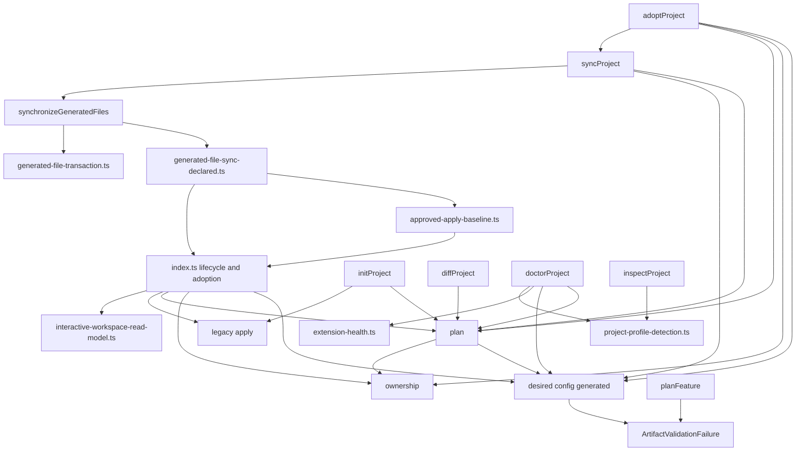
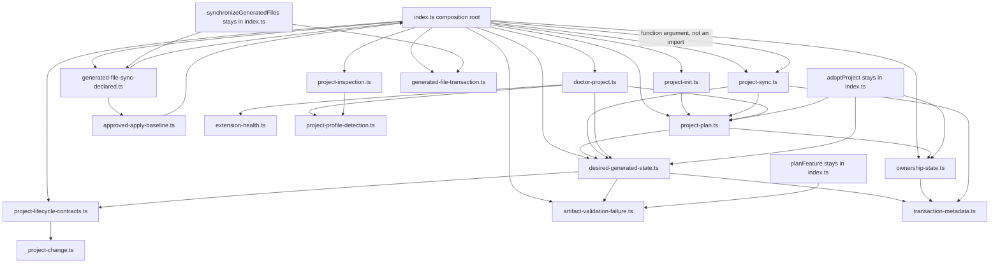
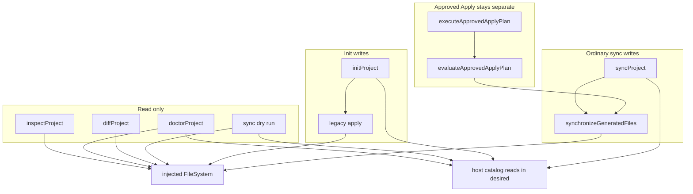
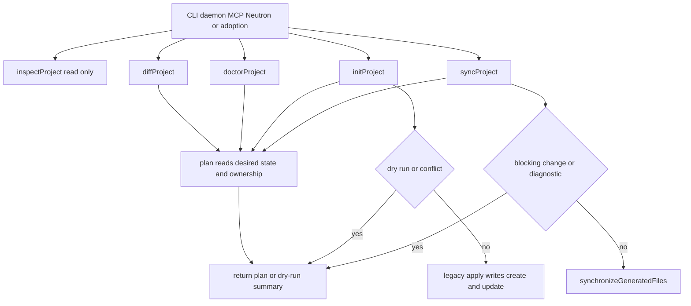
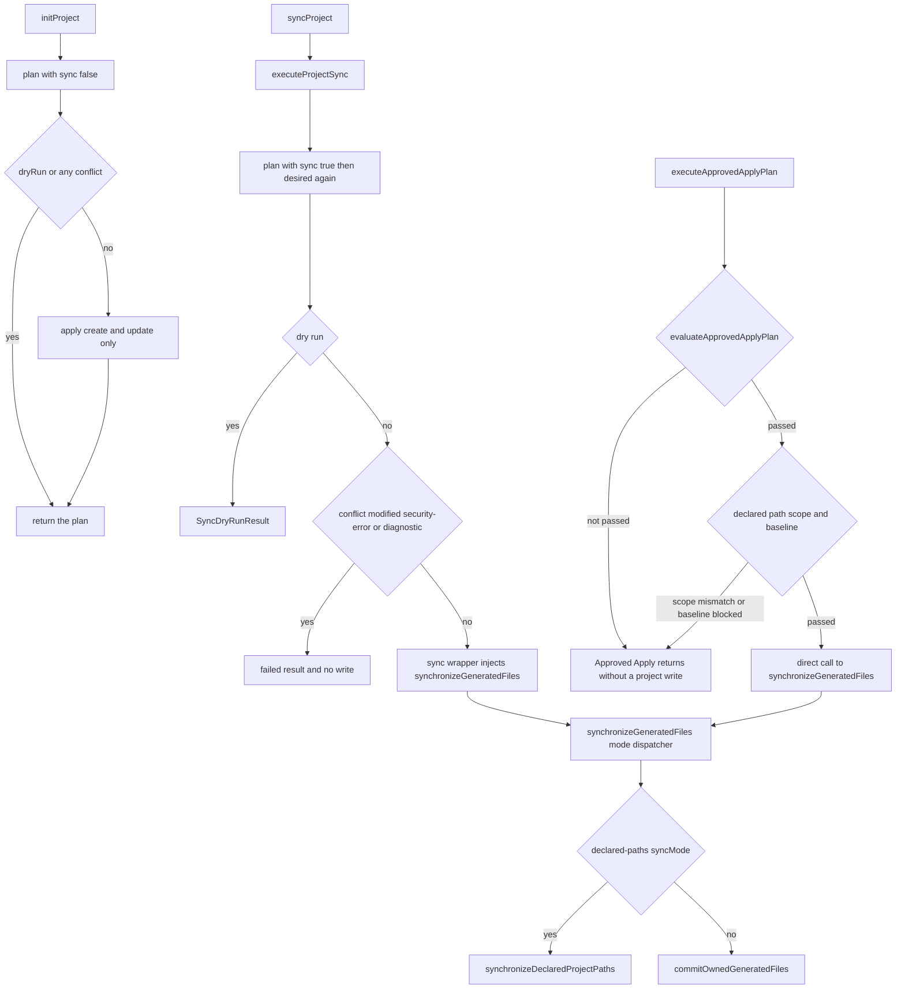
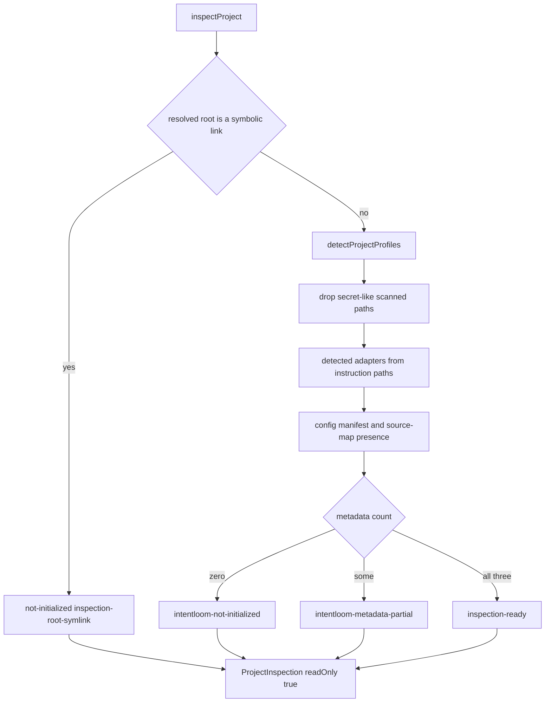
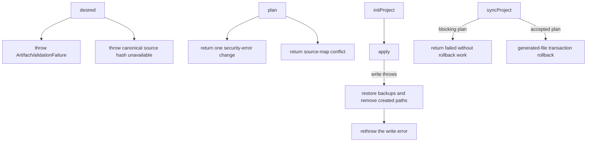
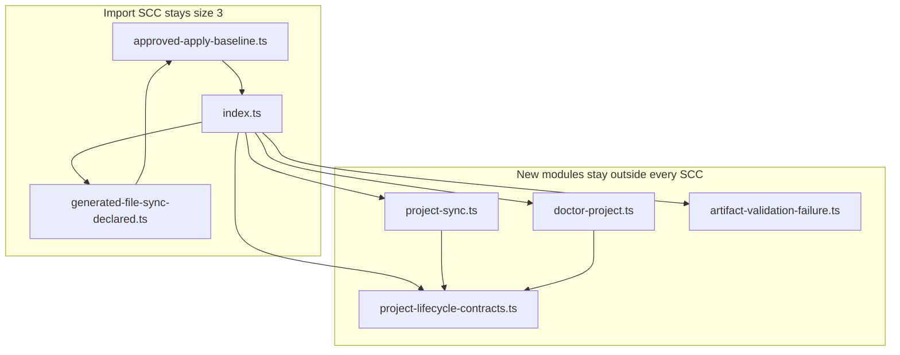
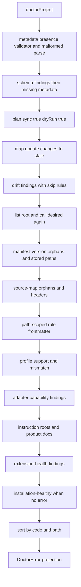

# P1I.2 Project Lifecycle extraction

Status: **proposed** (PR #617). This document is the Design First review
artifact for P1I.2. It does not implement the extraction. A maintainer
must approve it before any production move. A green CI result is not
approval.

Feasibility verdict: **B+C. Leaf-owned lifecycle contracts and operations,
with one composition-root binding for `synchronizeGeneratedFiles`.** Direct
extraction is not safe. The locked cycle membership stays unchanged.

## 1. Context and verified baseline

Baseline: `origin/main` at `b9201e9d480b34e453d08e1803f94e734d1e3f1f`.
That commit is the merge of PR #616. Local `main` was fast-forwarded from
`8bc9e07c74beb701adaae9e30dacb6aec252b58f` to that SHA before this branch
was created. The working tree was clean. No earlier P1I.2 design exists
under `docs/designs/`.

Verified before this design:

- PR #615, the P1I.1 System Design, is merged at
  `8bc9e07c74beb701adaae9e30dacb6aec252b58f`.
- PR #616, the P1I.1 implementation, is merged at the baseline SHA.
- P1I.1 is complete. `synchronizeGeneratedFiles` remains the mode
  dispatcher on `packages/application/src/index.ts`. The generated-files
  commit lives under `packages/application/src/generated-file/`.
  `Plan`, `Change`, and `ChangeKind` live in
  `packages/application/src/project-change.ts`.
- P1I.2 is the next roadmap milestone in
  `docs/architecture/PACKAGES_STABILIZATION_PLAN.md`.
- Open pull requests at the start were Dependabot updates. None edit
  project lifecycle operations. No overlapping P1I.2 pull request exists.
- P1I.3, P1J, Undo U4, and Desktop Undo U5 have not started.

Measured with `measureProductionSource` on this baseline,
`packages/application/src/index.ts` is 3,760 effective lines and 3,956
physical lines. The same graph rules as
`tests/application-source-cycles.ts` still produce import-only components
of sizes 3 and 3, and re-export-inclusive components of sizes 4, 29, and 3. Eighty-nine application files can reach `index.ts` by import edges,
including `import type`.

Canonical guidance used for this design:

- `docs/architecture/ARCHITECTURE.md`. Clients call
  `@intentloom/application`. Application code does not import the CLI,
  daemon, MCP server, or Desktop.
- `docs/architecture/PACKAGES_STABILIZATION_PLAN.md`, section P1I. This
  slice moves `initProject`, `syncProject`, `diffProject`,
  `doctorProject`, and `inspectProject`. The following slice moves
  adoption and retargets the Approved Apply import that keeps `index.ts`
  in cycle 1.
- `docs/decisions/ADR-0007-private-application-operation-boundary.md`.
  The application package owns project operations and their contracts.
- `docs/decisions/ADR-0011-project-inspection-access-contract.md`.
  `inspectProject` is read-only, capability `project.files.read`, and
  rejects a symbolic-link root.
- `docs/decisions/ADR-0053-approved-apply-transaction-engine.md`.
  Approved Apply is a separate gate. Ordinary init and sync do not pass
  through it.
- The approved P1I.1 design and the approved P1H.7 design. P1H.7 is the
  precedent for passing a barrel-owned function into a leaf. P1I.1 is
  the precedent for keeping `synchronizeGeneratedFiles` on the barrel.
- `docs/governance/DESIGN_FIRST_POLICY.md`,
  `docs/governance/AI_AGENT_WORKFLOW.md`,
  `docs/governance/ENGINEERING_PRINCIPLES.md`,
  `docs/governance/CODE_QUALITY_STANDARDS.md`, and
  `docs/governance/DOMAIN_MODELING.md`.
- `docs/governance/quality-exceptions.json`. This design does not edit
  it. The grandfathered `index.ts` ceiling stays 6,764 effective lines
  and 7,151 physical lines.

Task triage for this design-only change: blast radius 2, ambiguity 2,
risk 2, verification 2, unknowns 2, total 10. The recommended role is
frontier with highest effort. Harness: Cursor. This session cannot
change its model. No subagents were used. The route from
`aif-task-router` is `plan`. Risk 2 names the trust-boundary section
below. It does not authorize a behavior change.

Ambiguity is 2 because direct extraction, leaf-owned operations,
composition-root dispatch, and a factory seam are different
architectures. This document is that decision record. Maintainer review
of this pull request is the approval gate. Implementation is forbidden
until that approval.

Stop condition: one design pull request, no production edit, no merge,
and no start of the P1I.2 implementation, P1I.3, P1J, U4, or U5.

## 2. Problem statement

`packages/application/src/index.ts` still implements the five public
project lifecycle operations and the private planning helpers they share
with adoption:

- `inspectProject` is 119 effective lines.
- `desired` is 133 effective lines.
- `plan` is 83 effective lines.
- `doctorProject` is 589 effective lines.
- `initProject`, `syncProject`, and `diffProject` are smaller, and they
  call those helpers.

`doctorProject` and `desired` are already over the 80-line function
budget. `plan` is over it by three lines. Moving any of them unchanged
into a new file would create a new function over that budget. The move
has to decompose them.

The same helpers are called by `adoptProject`, which stays in `index.ts`
until P1I.3. `planFeature`, which also stays, throws
`ArtifactValidationFailure`. A new lifecycle module cannot import
`index.ts` to reach those callers, and those callers cannot be required
to import the package root from inside a leaf.

`syncProject` calls `synchronizeGeneratedFiles`. That dispatcher stays on
`index.ts` because its declared-paths branch imports
`generated-file-sync-declared.ts`, which imports `index.ts`. A lifecycle
module that imports the dispatcher, or that imports the declared-paths
module, joins the locked size-3 import component.

## 3. Goals and non-goals

Goals:

- Give Project Lifecycle a feature directory inside
  `@intentloom/application`.
- Move the five public operations and the helpers whose consumers can
  share a leaf.
- Decompose `doctorProject`, `desired`, `plan`, and `inspectProject` so
  every new function is at or below 80 effective lines, preferably 40,
  and every new file is at or below 250 effective lines.
- Keep every current package-root export name and signature.
- Keep import-only components at sizes 3 and 3, with the same members.
- Keep re-export components at sizes 4, 29, and 3, with the same members.
- Preserve init, sync, diff, doctor, and inspect behavior, including
  the legacy init apply path.

Non-goals:

- No production TypeScript edit in this pull request.
- No behavioral test edit in this pull request.
- No move of `adoptProject`, `planProjectAdoption`, or
  `applyProjectAdoption`.
- No retarget of existing `from "./index.js"` imports. That retarget is
  P1I.3, and doing it here can drop a file from the locked 29-file
  component.
- No replacement of legacy `apply` with the generated-file transaction.
- No change to Approved Apply, Protocol, or Validator schemas.
- No new package, no package export-map key, and no
  `project-lifecycle/index.ts`.
- No `utils.ts`, `helpers.ts`, `manager.ts`, or service framework.
- No new Entity, Aggregate, Repository, or Domain Event.
- No new quality-exception rule.
- No P1J, Undo U4, or Desktop Undo U5 work.

## 4. Domain ownership and ubiquitous language

`docs/governance/DOMAIN_MODELING.md` already names Project Adoption,
Synchronization, and Project Inspection and Evidence. This slice uses
those words. It does not add a tactical DDD layer.

| Term                       | Owner                            | Meaning on this baseline                                                                  |
| -------------------------- | -------------------------------- | ----------------------------------------------------------------------------------------- |
| Project Lifecycle          | `project-lifecycle/`             | Init, sync, diff, doctor, and inspect for one explicit root                               |
| Desired generated state    | `desired-generated-state.ts`     | The `GeneratedFile[]` `desired` builds from the catalog, adapters, and config             |
| Ownership state            | `ownership-state.ts`             | The source-map records `ownership` reads, or null when that file is malformed             |
| Change plan                | `project-plan.ts`                | The private `plan` result: create, update, missing, conflict, modified, or security-error |
| Legacy apply               | `project-init.ts`                | The private `apply` used only by `initProject`                                            |
| Project diff               | `project-plan.ts`                | `diffProject`, which returns `plan` and does not write                                    |
| Project inspection         | `project-inspection.ts`          | `inspectProject` under ADR-0011                                                           |
| Doctor diagnostics         | the `doctor-*.ts` modules        | Read-only findings, then the `DoctorPlan` projection                                      |
| Generated-file transaction | `generated-file/`                | `commitOwnedGeneratedFiles` and the declared-paths module                                 |
| Shared change vocabulary   | `project-change.ts`              | `Change`, `ChangeKind`, and `Plan`                                                        |
| Shared validation error    | `artifact-validation-failure.ts` | `ArtifactValidationFailure`, thrown by desired state and by `planFeature`                 |
| Approved Apply             | existing Approved Apply modules  | Unchanged. Ordinary lifecycle calls do not enter it                                       |

`ProjectMapping` moves with `InitOptions` because the options type names
it. Adoption proposal types stay in `index.ts`. They already depend on
`Plan` from `project-change.ts`.

## 5. Current declaration inventory

Lines are inclusive and were measured with `measureProductionSource` on
`packages/application/src/index.ts`. Effective and physical counts match
except where a comment is recorded. Navigation hints in the task brief
were close. The measured ranges below are the inventory.

| Declaration                 |                     Lines | Effective / physical | Visibility   | Direct project imports and calls                                                          | Callers                                                | I/O                 | Proposed owner                | Move        |
| --------------------------- | ------------------------: | -------------------: | ------------ | ----------------------------------------------------------------------------------------- | ------------------------------------------------------ | ------------------- | ----------------------------- | ----------- |
| `DoctorPlan`                |                   296–299 |                4 / 4 | public       | `Plan`                                                                                    | doctor return, `doctorExitCode`                        | none                | lifecycle contracts           | Move        |
| `DoctorSeverity`            |                       301 |                1 / 1 | public       | none                                                                                      | `DoctorFinding`                                        | none                | lifecycle contracts           | Move        |
| `DoctorCategory`            |                   302–312 |              11 / 11 | public       | none                                                                                      | `DoctorFinding`                                        | none                | lifecycle contracts           | Move        |
| `DoctorFinding`             |                   314–324 |              11 / 11 | public       | `AdapterName`                                                                             | doctor, extension-health shape                         | none                | lifecycle contracts           | Move        |
| `DoctorError`               |                   326–334 |                9 / 9 | public       | `DoctorFinding`                                                                           | doctor return                                          | none                | lifecycle contracts           | Move        |
| `doctorExitCode`            |                   336–339 |                4 / 4 | public       | `DoctorPlan`                                                                              | CLI doctor command, doctor tests                       | none                | lifecycle contracts           | Move        |
| `InitOptions`               |                   351–364 |              14 / 14 | public       | catalog, validator, `ProjectMapping`                                                      | init, sync, diff, doctor, adopt                        | none                | lifecycle contracts           | Move        |
| `ProjectMapping`            |                   427–430 |                4 / 4 | public       | none                                                                                      | `InitOptions`, adoption modules via the barrel         | none                | lifecycle contracts           | Move        |
| Inspection types            | 445–448, 450–461, 463–479 |              33 / 33 | public       | profile detection types                                                                   | `inspectProject`                                       | none                | lifecycle contracts           | Move        |
| `SyncOptions`               |                   534–536 |                3 / 3 | public       | `InitOptions`                                                                             | `syncProject`                                          | none                | lifecycle contracts           | Move        |
| `SyncDryRunResult`          |                   537–543 |                7 / 7 | public       | `Plan`                                                                                    | `syncProject` dry run                                  | none                | lifecycle contracts           | Move        |
| `emptyCatalog`              |                   545–550 |                6 / 6 | private      | `Catalog`                                                                                 | `desired`                                              | none                | desired state                 | Move        |
| `configPath`                |                       551 |                1 / 1 | private      | none                                                                                      | inspect, desired, doctor, adopt                        | none                | lifecycle contracts           | Move        |
| `inspectionAdapterNames`    |                   552–557 |                6 / 6 | private      | `AdapterName`                                                                             | `inspectProject`                                       | none                | inspection                    | Move        |
| `inspectionMetadataPaths`   |                       558 |                1 / 1 | private      | `configPath`, lock, source map                                                            | `inspectProject`                                       | none                | inspection                    | Move        |
| `inspectProject`            |                   560–678 |            119 / 119 | public       | profile detection, exclusions, taxonomy, `secretLikePath`                                 | barrel consumers below                                 | read                | inspection                    | Move, split |
| `TransactionMetadata`       |                   693–696 |                4 / 4 | private      | none                                                                                      | dispatcher                                             | none                | stay with dispatcher          | Stay        |
| `synchronizeGeneratedFiles` |                   698–709 |              12 / 12 | public       | declared-paths module and commit leaf                                                     | `syncProject`, Approved Apply, harness sample          | write               | `index.ts`                    | Stay        |
| `sortedMappings`            |                   711–717 |                7 / 7 | private      | none                                                                                      | `config`                                               | none                | desired state                 | Move        |
| `config`                    |                   719–737 |              19 / 19 | private      | `yaml` `stringify`                                                                        | `desired`                                              | none                | desired state                 | Move        |
| `generated`                 |                   738–744 |                7 / 7 | private      | `generateAdapters`                                                                        | `desired`                                              | none                | desired state                 | Move        |
| `desired`                   |                   746–878 |            133 / 133 | private      | host `readFile`/`readdir`, validator, metadata builder                                    | `plan`, `syncProject`, `doctorProject`, `adoptProject` | host catalog read   | desired state                 | Move, split |
| `ArtifactValidationFailure` |                   880–884 |                5 / 5 | public class | validator result type                                                                     | `desired`, `planFeature`, CLI `instanceof`             | none                | shared error module           | Move        |
| `OwnershipRecord`           |                   886–890 |                5 / 5 | private      | none                                                                                      | `ownership`                                            | none                | ownership state               | Move        |
| `ownership`                 |                   892–926 |              35 / 35 | private      | `inside`, `normalizeOutputPath`, source-map path                                          | `plan`, `adoptProject`                                 | read                | ownership state               | Move        |
| `plan`                      |                  928–1010 |              83 / 83 | private      | `desired`, `ownership`, `safeDestination`, `collisionPlan`, `planExistingGeneratedChange` | init, sync, diff, doctor, adopt                        | read                | project plan                  | Move, split |
| `apply`                     |                 1012–1037 |              25 / 26 | private      | `inside`, `safeDestination`, `dirname`                                                    | `initProject`                                          | write and rollback  | project init                  | Move        |
| `initProject`               |                 1039–1049 |              11 / 11 | public       | `plan`, `apply`                                                                           | CLI and tests                                          | write when applied  | project init                  | Move        |
| `syncProject`               |                 1051–1103 |              53 / 53 | public       | `plan`, `desired`, `transactionSummary`, dispatcher                                       | CLI, adoption, adopt                                   | write when accepted | sync leaf plus barrel wrapper | Move body   |
| `diffProject`               |                 1104–1109 |                6 / 6 | public       | `plan`                                                                                    | CLI, daemon, Neutron tools, adoption health            | read                | project plan                  | Move        |
| `portableGlob`              |                 1110–1118 |                9 / 9 | private      | none                                                                                      | doctor path-scoped rules                               | none                | doctor adapter output         | Move        |
| `doctorProject`             |                 1120–1708 |            589 / 589 | public       | `plan`, `desired`, profiles, adapter contract, extension health                           | barrel consumers below                                 | read                | doctor modules                | Move, split |
| `unsupportedPath`           |                 1709–1711 |                3 / 3 | private      | none                                                                                      | `adoptProject` only                                    | none                | `index.ts`                    | Stay        |
| `normalizeMappingPath`      |                 1713–1720 |                8 / 8 | private      | `normalizeOutputPath`                                                                     | `adoptProject` only                                    | none                | `index.ts`                    | Stay        |
| `adoptProject`              |                 1722–2025 |            304 / 304 | public       | desired, ownership, plan, sync, taxonomy                                                  | P1I.3                                                  | read, then sync     | `index.ts`                    | Stay        |

`apply` has one comment line, so its physical count is 26. The comment
about revalidating immediately before replacement stays with the
function.

`createHash` stays in `index.ts`. It is used by task checkpoints at
line 2681. `readFile` and `readdir` are used only by `desired`, so those
imports move with it. `yaml` `parse` and `stringify` are used only by
doctor and `config`, so that import moves with them. The implementation
must recheck remaining uses before deleting an import.

### 5.1 Direct and transitive callers

Inside `index.ts` today:

- `desired` is called by `plan`, `syncProject`, `doctorProject`, and
  `adoptProject`. `plan` therefore makes init, diff, sync, doctor, and
  adopt transitive callers.
- `ownership` is called by `plan` and `adoptProject`.
- `plan` is called by `initProject`, `syncProject`, `diffProject`,
  `doctorProject`, and `adoptProject`.
- `apply` is called only by `initProject`.
- `portableGlob` is called only by `doctorProject`.
- `unsupportedPath` and `normalizeMappingPath` are called only by
  `adoptProject`.
- `ArtifactValidationFailure` is thrown by `desired` and by
  `planFeature`.

`syncProject` calls `plan` and then calls `desired` again. `plan` has
already called `desired`. `doctorProject` does the same: one `desired`
inside `plan`, and a later `desired` for the destination set. Both
second calls stay. Collapsing them would change catalog read timing and
exception timing.

Package-root consumers, all through `@intentloom/application` or a
relative import of `index.ts`:

- CLI: `init-command.ts`, `sync-command.ts`, `diff-command.ts`,
  `doctor-command.ts`, `inspect-command.ts`, `formatters.ts`, and
  `command.ts` (`instanceof ArtifactValidationFailure`).
- Daemon: `bin.ts` calls `inspectProject`.
  `project-health-handlers.ts` calls `doctorProject` and `diffProject`.
- MCP server: `packages/mcp-server/src/index.ts` calls `inspectProject`
  and `doctorProject`.
- Desktop does not import `@intentloom/application`.
  `desktop-client.ts` calls daemon methods named `inspectProject` and
  `doctorProject`. Those client methods stay.
- Workspace read model: `getInteractiveWorkspaceState` passes
  `inspectProject`, `doctorProject`, and `diffProject` into
  `assembleInteractiveWorkspaceState`. `syncLocalWorkspaceState` passes
  `inspectProject` and `doctorProject`. The read-model module already
  receives them as arguments and does not import `index.ts`.
- Adoption modules that stay put:
  `existing-project-adoption-apply-gates.ts`,
  `existing-project-adoption-apply-health.ts`,
  `existing-project-adoption-apply.ts`,
  `existing-project-adoption-plan.ts`, and
  `existing-project-workspace.ts`. They keep importing the public
  functions from `index.ts`.
- Neutron read-only tools: `neutron-tool-dispatch.ts` calls
  `doctorProject` and `diffProject`. `neutron-session-graph.ts`,
  `neutron-session-turn.ts`, `neutron-session-fingerprint.ts`, and
  `neutron-node-run.ts` call `inspectProject`. They keep importing
  those names from `index.ts`.
- `resolve-project-doctor-init.ts` imports `InitOptions` and
  `ProjectMapping` from `index.ts`. It is one of the 89 import
  reachers and is not a member of either locked cycle. It keeps that
  import. The barrel re-exports the moved types, so the file still
  typechecks. Retargeting it is not part of this slice.

No production file deep-imports these operations from a path other than
the package root or `index.ts`. The twelve `package.json` export-map
keys stay. No new key is added.

## 6. Consumer and dependency analysis

Safe leaves, measured on this baseline, do not reach `index.ts`:

- `host-file-system.ts`, `project-path.ts`, `project-change.ts`
- `project-profile-detection.ts`, `project-profile-evidence.ts`,
  `project-scan-exclusions.ts`
- `instruction-file-taxonomy.ts`, `document-concepts.ts`
- `generated-metadata-compare.ts`, `destination-collisions.ts`,
  `canonical-json.ts`
- every file under `generated-file/` except the sibling
  `generated-file-sync-declared.ts`, which is not in that directory
- `extension-inspection/extension-health.ts` and its evaluator and
  runtime
- `propose-and-apply-extension-adoption.ts`
- `engineering-quality/specialized-pack-external-health.ts` and the
  lock, local, and findings modules it reaches
- `extension-lock-path.ts`
- `workspace/interactive-workspace-read-model.ts`

Unsafe dependencies for a new lifecycle module:

- `index.ts`
- `generated-file-sync-declared.ts`
- `approved-apply-baseline.ts`
- `approved-apply-engine.ts`
- the other 86 import reachers, including adoption modules,
  `resolve-project-doctor-init.ts`, and the Neutron modules that import
  the barrel

`collectExtensionHealthDoctorFindings` is safe to import. Its
`FileSystem` type comes from `propose-and-apply-extension-adoption.ts`,
not from `index.ts`. Doctor can call it directly. It does not need an
injected seam.

`generated-file-sync-declared.ts` imports `FileSystem`, `Plan`, and the
transaction types from `index.ts`, and it imports
`approved-apply-baseline.ts`. `approved-apply-baseline.ts` imports
`FileSystem` from `index.ts`. Those two edges close the size-3 import
component. P1I.2 does not retarget them.

## 7. Current architecture

The five operations and their helpers are closures in `index.ts`. The
barrel is both the implementation and the public export surface.



Editable source: [`current-dependencies.mmd`](current-dependencies.mmd).

`initProject` calls `plan` and, unless `dryRun` is set or any change
kind is `conflict`, calls `apply`. A `security-error` kind does not by
itself skip `apply`. `plan` returns on the first security error with
that single change, and `apply` writes only `create` and `update`
changes, so the current security path writes nothing. That control flow
stays. Replacing it with an explicit security skip would be a behavior
change.

`syncProject` is not Approved Apply. After planning it either returns a
dry run, returns a failed result with `rollbackAttempted: false` and
`rollbackCompleted: true`, or calls `synchronizeGeneratedFiles` with the
prevalidated manifest and source-map bytes. The failed result's
`rollbackCompleted: true` is the current shape and stays, including
when no rollback ran.

`diffProject` returns `plan(options, fs)` with the default sync flag
`false`. It does not write.

`inspectProject` returns before any scan when the resolved root is a
symbolic link. Otherwise it uses `detectProjectProfiles`, drops
secret-like paths, and reports readiness from the three metadata paths.

`doctorProject` is one function. Section 18 records its order.

## 8. Proposed architecture

New modules live in `packages/application/src/project-lifecycle/`.
There is no folder barrel. `ArtifactValidationFailure` lives beside
`project-change.ts` because `planFeature` throws it and `planFeature`
is not a lifecycle operation.

| Module                           | Responsibility                                                    |
| -------------------------------- | ----------------------------------------------------------------- |
| `artifact-validation-failure.ts` | The exported error class                                          |
| `project-lifecycle-contracts.ts` | Public lifecycle types, `doctorExitCode`, and `configPath`        |
| `desired-generated-state.ts`     | `desired`, config rendering, adapter generation                   |
| `ownership-state.ts`             | Source-map ownership read                                         |
| `project-plan.ts`                | `plan` and `diffProject`                                          |
| `project-init.ts`                | `initProject` and private `apply`                                 |
| `project-sync.ts`                | `executeProjectSync`                                              |
| `project-inspection.ts`          | `inspectProject`                                                  |
| `doctor-metadata.ts`             | Presence, validator results, malformed documents, missing files   |
| `doctor-drift.ts`                | Plan-change findings and adapter path mapping                     |
| `doctor-ownership.ts`            | Manifest and source-map diagnostics, headers                      |
| `doctor-adapter-output.ts`       | `portableGlob` and path-scoped rule findings                      |
| `doctor-profile.ts`              | Profile, capability, instruction-root, and documentation findings |
| `doctor-project.ts`              | `doctorProject` orchestration and final projection                |

`index.ts` keeps local bindings for the symbols it still calls:

```ts
import { executeProjectSync } from "./project-lifecycle/project-sync.js";
import { desired } from "./project-lifecycle/desired-generated-state.js";
import { ownership } from "./project-lifecycle/ownership-state.js";
import { diffProject, plan } from "./project-lifecycle/project-plan.js";
import { initProject } from "./project-lifecycle/project-init.js";
import { inspectProject } from "./project-lifecycle/project-inspection.js";
import { doctorProject } from "./project-lifecycle/doctor-project.js";
import { ArtifactValidationFailure } from "./artifact-validation-failure.js";

export {
  ArtifactValidationFailure,
  diffProject,
  doctorProject,
  initProject,
  inspectProject,
};
export type {} from /* lifecycle contracts */ "./project-lifecycle/project-lifecycle-contracts.js";

export async function syncProject(options, fs, transactionOptions = {}) {
  return executeProjectSync(
    options,
    fs,
    transactionOptions,
    synchronizeGeneratedFiles,
  );
}
```

`export { name } from "./leaf.js"` does not create a local binding.
`adoptProject` and the workspace assemblers need local bindings, so the
implementation uses import-and-export, not export-from, for those
values. The public names and signatures stay.

`executeProjectSync` is not a package-root export. Its fourth parameter
is the dispatcher function. The public `syncProject` still has three
parameters. The leaf does not import `index.ts` and does not branch on
sync mode. The dispatcher it receives already does.

Adoption continues to work because `adoptProject` stays in `index.ts`
and imports `desired`, `ownership`, `plan`, and `configPath` from the
leaves. It calls the local `syncProject` wrapper. The leaves do not
import `adoptProject`. `unsupportedPath` and `normalizeMappingPath`
stay beside `adoptProject` because nothing else calls them.

`planFeature` imports `ArtifactValidationFailure` from
`artifact-validation-failure.ts`. The class is re-exported from the
barrel. CLI `instanceof` checks the same constructor.



Editable source:
[`proposed-dependencies.mmd`](proposed-dependencies.mmd).

The edge into `project-sync.ts` labeled as a function argument is the
value `synchronizeGeneratedFiles`. It is not an import edge. The import
edges run from `index.ts` to the leaves, and from the leaves to safe
modules. No new edge runs back to `index.ts`.

Doctor files import one another only downward: `doctor-project.ts`
imports the phase modules, and those modules do not import
`doctor-project.ts`. `adapterForDoctorPath` lives in `doctor-drift.ts`
and is imported by `doctor-adapter-output.ts`. That edge does not cycle.

## 9. Alternative comparison

Type-only imports are edges. A new file joins an existing component
when `index.ts` reaches it and it has any path back to `index.ts`.

### A. Direct extraction

Move the five functions into feature modules and import the callees
they use today.

`project-sync.ts` would import `synchronizeGeneratedFiles` from
`index.ts`, or it would import `synchronizeDeclaredProjectPaths` from
`generated-file-sync-declared.ts`. In the first case the import
component becomes `approved-apply-baseline.ts`,
`generated-file-sync-declared.ts`, `index.ts`, and `project-sync.ts`.
Size 4. The re-export component grows from 29 to 30 because `index.ts`
re-exports the new file and the new file imports `index.ts`. In the
second case the same size-3 component gains `project-sync.ts` through
the declared-paths module. Locked cycle tests fail.

Leaving `InitOptions` in `index.ts` has the same effect. Every leaf
that type-imports it joins the component.

**Rejected.** It enlarges both locked components that contain
`index.ts`.

### B. Leaf-owned contracts and operations

Move shared contracts, desired state, ownership, planning, init, diff,
inspect, and doctor into modules that import only safe leaves.
`index.ts` re-exports the public names. `adoptProject` imports the
shared operations from those leaves.

This removes the cycle that alternative A creates for types, `plan`,
and `desired`. It does not, by itself, give `syncProject` a legal call
to `synchronizeGeneratedFiles`. If the sync body stays entirely in
`index.ts`, the 53-line function is not extracted. If the sync body
moves and imports the dispatcher, the result is alternative A.

**Required, and not sufficient for sync.**

### C. Composition-root dispatch

Keep a public wrapper in `index.ts` and pass barrel-owned operations
into the leaf. P1H.7 does this for `inspectProject`, `doctorProject`,
`diffProject`, and `timelineProject` because those bodies still lived
in the barrel. P1I.1 does this for the sync-mode branch because the
declared-paths module still imports the barrel.

For P1I.2 the same seam is needed for exactly one function:
`synchronizeGeneratedFiles`. `plan`, `desired`, `ownership`, and
`collectExtensionHealthDoctorFindings` do not need it. They can move,
or they are already safe imports. Injecting all of them and leaving
their bodies in `index.ts` would keep the 589-line doctor function and
the 133-line `desired` function in the barrel.

A public fourth parameter on `syncProject` would widen the exported
signature. The wrapper keeps the three-parameter signature. The fourth
parameter exists only on `executeProjectSync`.

**Required for the dispatcher. Not used as the general extraction
mechanism.**

### D. Bound factory

`createSyncProject(synchronizeGeneratedFiles)` or a module setter would
hide the dispatcher behind mutable registration. The packages rules
reject that registry. The explicit argument in alternative C is the
same binding without the factory.

**Rejected.**

No option is blocked. B plus the single C binding preserves the locked
cycle structure and extracts the five operations. A does not. C alone
does not extract `doctorProject` or `desired`. The maintainer decision
is whether to accept B+C. Rejecting it blocks P1I.2 until the locked
cycle is allowed to change, which this plan assigns to P1I.3.

## 10. Selected verdict

**B+C. Leaf-owned lifecycle contracts and operations, with one
composition-root binding for `synchronizeGeneratedFiles`.**

Consequences:

- Import-only membership stays the two components of size 3.
- Re-export membership stays the components of sizes 4, 29, and 3.
- New files are absent from every component.
- Public export names and signatures stay.
- `adoptProject` imports shared leaves and calls the local sync
  wrapper.
- P1I.3 can move `adoptProject` later by importing the same leaves and
  using the same dispatcher argument. It also retargets
  `approved-apply-baseline.ts`. That retarget is what removes `index.ts`
  from cycle 1. P1I.2 leaves the cycle in place on purpose.

## 11. Module ownership matrix

| Declaration                                                        | Owner                            | Package export                       | Notes                                 |
| ------------------------------------------------------------------ | -------------------------------- | ------------------------------------ | ------------------------------------- |
| Lifecycle public types, `doctorExitCode`, `configPath`             | `project-lifecycle-contracts.ts` | re-export types and `doctorExitCode` | `configPath` is not a new public name |
| `ArtifactValidationFailure`                                        | `artifact-validation-failure.ts` | re-export the class                  | same constructor                      |
| `desired`, `config`, `generated`, `sortedMappings`, `emptyCatalog` | `desired-generated-state.ts`     | no                                   | split `desired`                       |
| `ownership`, `OwnershipRecord`                                     | `ownership-state.ts`             | no                                   | `OwnershipRecord` stays unexported    |
| `plan`, `diffProject`                                              | `project-plan.ts`                | `diffProject` only                   | split `plan`                          |
| `initProject`, `apply`                                             | `project-init.ts`                | `initProject` only                   | `apply` stays private                 |
| `executeProjectSync`                                               | `project-sync.ts`                | no                                   | public wrapper stays in `index.ts`    |
| `syncProject`                                                      | `index.ts`                       | yes, same signature                  | calls `executeProjectSync`            |
| `inspectProject` and its two constants                             | `project-inspection.ts`          | `inspectProject`                     | split the function                    |
| Doctor phases and `doctorProject`                                  | `doctor-*.ts`                    | `doctorProject`                      | section 18                            |
| `synchronizeGeneratedFiles` and local `TransactionMetadata`        | `index.ts`                       | yes                                  | P1I.1 dispatcher                      |
| `unsupportedPath`, `normalizeMappingPath`, `adoptProject`          | `index.ts`                       | `adoptProject` only                  | P1I.3                                 |
| `planFeature`                                                      | `index.ts`                       | yes                                  | imports the moved error class         |
| `Plan`, `Change`, `ChangeKind`                                     | `project-change.ts`              | already re-exported                  | unchanged                             |
| Transaction contracts                                              | `generated-file/`                | already re-exported                  | unchanged                             |

New modules import `FileSystem` from `host-file-system.ts` and `Plan`
from `project-change.ts`. They do not import those types from
`index.ts`.

`project-lifecycle-contracts.ts` type-imports `ProfileDetectionResult`
from `project-profile-detection.ts` so `ProjectInspection` keeps its
current field type. That module does not reach `index.ts`.

## 12. Public TypeScript contracts

These names stay exported from `@intentloom/application` with the same
fields:

- `InitOptions`
- `SyncOptions`
- `SyncDryRunResult`
- `DoctorPlan`
- `DoctorSeverity`
- `DoctorCategory`
- `DoctorFinding`
- `DoctorError`
- `doctorExitCode`
- `ProjectMapping`
- `ProjectInspectionCapability`
- `InspectionReadiness`
- `InspectionFindingSeverity`
- `ProjectInspectionFinding`
- `ProjectInspection`
- `ArtifactValidationFailure`
- `initProject`
- `syncProject`
- `diffProject`
- `doctorProject`
- `inspectProject`

`InitOptions.profile` stays `string`. It is not narrowed to
`EngineeringProfile`. `SyncOptions` still adds only optional `force`.
`doctorProject` still defaults `validationResults` to `[]`.
`syncProject` still defaults `transactionOptions` to `{}`.

`ArtifactValidationFailure` still extends `Error`, still sets the
message `project artifact validation failed`, and still exposes
`results`. The CLI class `CliProjectValidationError` is a different
constructor and stays in the CLI. The implementation re-exports the
application class. It does not wrap it.

`TransactionMetadata` stays unexported. `executeProjectSync` accepts
the same two-field shape that `transaction-metadata.ts` already names.
The root does not gain a new exported type.

The twelve export-map keys stay:

`.` , `./model-adapter`, `./ollama-model-adapter`, `./neutron-runtime`,
`./neutron-n2`, `./neutron-context-assembly`, `./neutron-n4`,
`./neutron-scheduler`, `./neutron-graph-mutation`, `./neutron-session`,
`./engineering-assessment`, `./engineering-quality`.

## 13. Read and write trust boundaries



Editable source: [`trust-boundaries.mmd`](trust-boundaries.mmd).

Five boundaries:

1. **Inspection and doctor** read through the injected `FileSystem`.
   `inspectProject` checks `isSymbolicLink` on `resolve(root)` before
   scanning. It does not write. `doctorProject` reads metadata, lists
   the root, and reads generated files. It does not write the project.
2. **Diff and sync dry run** call `plan`. `plan` uses `safeDestination`,
   `exists`, and `read`. It does not write. `diffProject` returns that
   plan. A sync dry run adds `transactionSummary` fields and sorted
   conflict paths, then returns.
3. **`initProject` writes** go through private `apply` when dry run is
   off and no change kind is `conflict`. `apply` revalidates each
   destination, writes `create` and `update` content, and on a thrown
   write restores backups and removes created paths. This is not the
   generated-file transaction and it is not Approved Apply.
4. **`syncProject` writes** reach `synchronizeGeneratedFiles` only after
   the blocking-change check. The dispatcher then selects declared-paths
   mode or `commitOwnedGeneratedFiles`. Transaction options, including
   `syncMode`, are forwarded unchanged. The fifth argument is still the
   manifest and source-map text taken from the second `desired` result.
5. **Approved Apply** remains `executeApprovedApplyPlan` calling
   `evaluateApprovedApplyPlan`, then the declared-path scope check and
   the baseline check, before a direct call to
   `synchronizeGeneratedFiles`. It does not call `executeProjectSync`
   and it does not use the ordinary sync injection parameter. Ordinary
   init and sync do not call that gate. The harness benchmark sample
   still calls the dispatcher directly. P1I.2 does not retarget that
   sample.

`desired` reads the catalog with `node:fs/promises` `readFile` and
`readdir` when `catalogRoot` or pinned hashes require it. Those reads
ignore the injected `FileSystem`. That is the current behavior for
init, sync, diff, doctor, and adopt. This extraction does not route
catalog reads through the port and does not claim that doctor is free
of host filesystem reads.

Project-root and stored-path checks stay where they are:
`safeDestination`, `inside`, `normalizeOutputPath`, and
`normalizeStoredPath`. Doctor still reports `stored-path-incompatible`
and `path-security-violation`. Inspection still skips secret-like paths
and still uses `inspectionExclusions`. Metadata ownership is still the
source-map parse in `ownership`, which fails closed by returning null.
`plan` turns that null into one conflict on the source-map path and the
diagnostic `invalid source-map`.

The symlink comment in `apply` stays true: the revalidation narrows a
substitution race and does not remove it. `exists`, `read`, and `write`
remain separate port calls. This design does not claim a stronger
TOCTOU guarantee.

## 14. Data flows

### Init, diff, and sync



Editable source:
[`lifecycle-operation-flow.mmd`](lifecycle-operation-flow.mmd).



Editable source: [`init-sync-write-flow.mmd`](init-sync-write-flow.mmd).

Ordinary sync and Approved Apply meet only at the mode dispatcher.
`syncProject` calls `executeProjectSync`. That function runs `plan`,
the second `desired` pass, and the dry-run and blocking checks. Only a
plan that passes those checks receives the injected
`synchronizeGeneratedFiles` value. `executeApprovedApplyPlan` does not
call `executeProjectSync` and does not use that injection parameter.
After `evaluateApprovedApplyPlan` passes, it still applies the
declared-path scope check and, when a baseline was supplied,
`assertApprovedApplyBaselineCurrent`. A failed gate returns without a
project write. A path-scope mismatch returns without a project write.
A stale baseline throws `ApplyBlockedBeforeWrite` before the
transaction. Only after those checks does the engine call
`synchronizeGeneratedFiles` directly, as it does today in
`approved-apply-engine.ts`. The dispatcher then selects declared-paths
mode or `commitOwnedGeneratedFiles`.

Sync blocking kinds stay `conflict`, `modified`, and `security-error`,
plus any non-empty `proposal.diagnostics`. `missing` is not a sync
blocker. Doctor treats `missing` as a finding. Those two decisions stay
different.

`plan` is called with sync `false` by init, diff, and adopt. It is
called with sync `true` by sync and doctor. Doctor also sets
`dryRun: true` on the options it passes to `plan`. The dry-run flag
does not change `plan` today. The call still passes it.

### Inspection



Editable source: [`inspection-read-flow.mmd`](inspection-read-flow.mmd).

The symbolic-link result keeps `operationVersion: 1`,
`capabilities: ["project.files.read"]`, `readOnly: true`, the fallback
generic profile, empty adapter and instruction lists, all three
metadata paths marked absent, readiness `not-initialized`, and the
single `inspection-root-symlink` finding. The success result still
omits `scannedPaths` from `profileDetection`. Supported adapter order
stays claude, codex, cursor, copilot. Detected adapters stay in that
same order. Instruction paths keep the filtered scan order.

## 15. Error, failure, and rollback



Editable source: [`error-rollback-flow.mmd`](error-rollback-flow.mmd).

Preserved behavior:

- Invalid catalog skills or invalid generated config, manifest, or
  source map throw `ArtifactValidationFailure`. Callers do not catch it
  inside init, sync, diff, doctor, or adopt.
- A missing or non-sha256 canonical source hash throws `Error` with the
  current message `canonical source hash unavailable: ${id}`.
- `ownership` returns an empty map when the source map is absent, and
  null when JSON, schema, a record, a path, or a duplicate is invalid.
  `plan` maps null to one `conflict` change and the diagnostic
  `invalid source-map`.
- `safeDestination` failures become one `security-error` change and the
  diagnostic `security-error`. `plan` returns immediately.
- `apply` catches a thrown write, writes backup contents back, removes
  paths it created, and rethrows. It does not convert that error into a
  `Plan`.
- Sync's pre-transaction failure returns the current failed object:
  `status: "failed"`, `rollbackAttempted: false`,
  `rollbackCompleted: true`, empty `rollbackFailures`,
  `manifestUpdated: false`, `sourceMapUpdated: false`,
  `consistencyValidated: false`, `cleanupCompleted: false`, and
  diagnostics `sync-conflict` when the plan diagnostics are empty.
- After the dispatcher is called, rollback behavior is the existing
  generated-file transaction or the existing declared-paths
  transaction. This slice does not merge those two rollback
  implementations.
- Doctor and inspect do not add a try/catch around `desired`, `plan`,
  or profile detection. Exceptions still propagate. Malformed JSON or
  YAML in the no-validator doctor branch is caught and becomes
  `json-malformed` or `yaml-malformed`. `readJson` still returns null
  on failure.

## 16. SCC membership

Recomputed on this baseline with the same import and re-export split as
`tests/application-source-cycles.ts`.

Import-only components, sizes 3 and 3:

1. `approved-apply-baseline.ts`, `generated-file-sync-declared.ts`,
   `index.ts`
2. `neutron/mutation/apply/neutron-mutation-apply-durable-record.ts`,
   `neutron/mutation/apply/neutron-mutation-apply-store.ts`,
   `neutron/mutation/verification/neutron-mutation-verification-retry-eligibility.ts`

Re-export-inclusive components, sizes 4, 29, and 3:

1. `apply-extension-update.ts`,
   `discover-and-apply-extension-update.ts`,
   `extension-update-files.ts`,
   `propose-and-apply-extension-adoption.ts`
2. The 29 files locked in
   `tests/generated-file-transaction-p1i1-structure.test.ts`, including
   `index.ts`, `generated-file-sync-declared.ts`,
   `approved-apply-baseline.ts`, and `approved-apply-engine.ts`.
3. The same Neutron mutation trio as the second import component.



Editable source: [`scc-impact.mmd`](scc-impact.mmd).

Projected membership after implementation is the same lists. The new
files are absent. The proof the implementation must keep:

- No new file contains `from "../index.js"`, `from "./index.js"`, or
  another relative import of `index.ts`.
- No new file imports `generated-file-sync-declared.ts`,
  `approved-apply-baseline.ts`, or `approved-apply-engine.ts`.
- `project-sync.ts` does not mention `synchronizeDeclaredProjectPaths`.
- Existing files that import `index.ts` are not retargeted.
- `index.ts` imports the new files. Those edges do not close a cycle
  while the new files have no path back.

`extension-health.ts` is safe, so doctor may import it without joining
a component. That was checked by walking import edges to `index.ts`,
not only by reading its first import.

## 17. Source-size budget

Moved declaration bodies sum to 1,221 effective lines and 1,222
physical lines. `apply` contributes the extra physical line. The barrel
adds back a `syncProject` wrapper of about 12 lines, import lines, and
re-export lines. A planning allowance for that glue is about 40 to 60
lines.

The estimate for `index.ts` after the slice is about 2,580 effective
lines and about 2,780 physical lines, down from 3,760 and 3,956. That
is an estimate, not an implementation measurement. The implementation
prints `measureProductionSource` again. `index.ts` must shrink. It will
remain above the 400-line preference and under the grandfathered
ceiling. `quality-exceptions.json` stays unchanged.

No unrelated declaration is moved to make the reduction larger.
`adoptProject` accounts for 304 of the lines that stay.

Every new file is planned at or below 250 effective lines. If
`desired-generated-state.ts` measures over 250, move config rendering
to `project-config-document.ts`. If `doctor-ownership.ts` measures over
250, move the two header checks to `doctor-generated-headers.ts`. Do
not add those files unless the measurement requires them. Do not
compress statements to hit the number.

`plan` is 83 effective lines today, so the moved orchestrator must be
smaller than the current function. `desired` is 133. `inspectProject`
is 119. `doctorProject` is 589. Each is split in the next section or
in the function table below. New functions are `function` declarations,
not arrows, so the structure test can slice them the way the P1I.1
test slices functions.

| New function                            | Module          | Budget                  |
| --------------------------------------- | --------------- | ----------------------- |
| `rejectInvalidCatalogSkills`            | desired state   | ≤40                     |
| `assembleDesiredPayload`                | desired state   | ≤40                     |
| `pinCanonicalSourceHashes`              | desired state   | ≤30                     |
| `rejectInvalidDesiredMetadata`          | desired state   | ≤40                     |
| `desired`                               | desired state   | ≤40                     |
| `config`, `generated`, `sortedMappings` | desired state   | current 19, 7, and 7    |
| `ownership`                             | ownership state | current 35              |
| `rejectUnsafeMetadataDestinations`      | project plan    | ≤30                     |
| `planGeneratedDestination`              | project plan    | ≤40                     |
| `plan`                                  | project plan    | ≤40                     |
| `diffProject`                           | project plan    | current 6               |
| `apply`                                 | project init    | current 25              |
| `initProject`                           | project init    | current 11              |
| `syncDryRunResult`                      | project sync    | ≤25                     |
| `rejectedSyncResult`                    | project sync    | ≤30                     |
| `executeProjectSync`                    | project sync    | ≤40                     |
| `symlinkRootInspection`                 | inspection      | ≤45                     |
| `inspectionFindings`                    | inspection      | ≤40                     |
| `inspectProject`                        | inspection      | ≤40                     |
| Doctor functions                        | section 18      | ≤40 preferred, ≤80 hard |

`syncProject` in `index.ts` is the wrapper, about 12 lines.

## 18. Doctor decomposition

Current `doctorProject` runs in this order. The split keeps the order.
Phase helpers return findings in push order and do not sort. Only
`projectDoctorPlan` sorts, and it sorts the concatenated array with the
current comparator `` `${code}:${path}` ``. `Array.prototype.sort` is
stable, so equal keys keep the concatenation order.

1. Read presence of config, manifest, and source map.
2. When `options.validator` is set, validate each present metadata file
   that is not already in `validationResults`, and append invalid
   results. The input array is copied before any append.
3. Map structural and semantic errors to schema findings.
4. When `options.validator` is absent, parse present metadata that is
   not already in the result list. JSON failures use `json-malformed`.
   YAML failures use `yaml-malformed`.
5. Append missing-metadata findings for absent paths. Config uses
   category `config` and code `aif-config-missing`. The manifest and
   source map use category `ownership` and codes `manifest-lock-missing`
   and `source-map-missing`.
6. Call `plan({ ...options, dryRun: true }, fs, true)`.
7. Copy changes without `content`. Change an `update` kind to `stale`
   and set its reason to `generated state is stale`.
8. Append drift findings for `conflict`, `modified`, `missing`,
   `stale`, and `security-error`, skipping non-security changes when
   any metadata path is absent, and skipping non-security changes whose
   path is config, manifest, or source map. Codes stay
   `generated-checksum-drift`, `generated-file-missing`,
   `adapter-output-stale`, `path-security-violation`, and
   `unowned-generated-destination`.
9. List the root through `projectRelativePaths` and call `desired`
   again. The destination set excludes the manifest and source map.
10. Read the manifest and source map with the current null-on-failure
    parser.
11. Manifest version, stored-path, orphan, and adapter-selection
    findings, in that order.
12. Source-map stored-path findings, then per-record orphan and
    missing-header findings, then header-without-ownership findings
    for desired paths.
13. Path-scoped rule findings for present `.cursor/rules/*.mdc` and
    `.github/instructions/*.instructions.md` files.
14. `adapter-profile-unsupported` when the profile is outside the
    current six-name set.
15. `detectProjectProfiles`, then `profile-mismatch` when confirmation
    is not required, the detected profile is not `generic`, and it
    differs from `options.profile`.
16. Experimental and unsupported adapter capability findings, only when
    config is present, in selected-adapter order.
17. `instruction-files-conflicting` when more than one unowned
    instruction root is present.
18. `product-documentation-missing` when no scanned path matches the
    current readme, roadmap, or product-state expression.
19. Append `collectExtensionHealthDoctorFindings`.
20. Append `installation-healthy` when no finding has severity `error`.
21. Sort, project `DoctorError` values, and return the `DoctorPlan`.
    Diagnostics become `${path}: ${message}` for errors only. The
    spread of the plan result stays, with `changes`, `diagnostics`,
    `findings`, and `errors` overridden.

| Function                             | Module                     | What it keeps                                                   |
| ------------------------------------ | -------------------------- | --------------------------------------------------------------- |
| `readMetadataPresence`               | `doctor-metadata.ts`       | The three `exists` calls                                        |
| `collectValidatorMetadataResults`    | `doctor-metadata.ts`       | Validator loop and the copied results array                     |
| `schemaFindings`                     | `doctor-metadata.ts`       | Structural and semantic error mapping                           |
| `malformedMetadataFindings`          | `doctor-metadata.ts`       | The no-validator parse branch                                   |
| `missingMetadataFindings`            | `doctor-metadata.ts`       | The three missing codes                                         |
| `mapDoctorChanges`                   | `doctor-project.ts`        | Strip `content`, rename `update` to `stale`                     |
| `adapterForDoctorPath`               | `doctor-drift.ts`          | The current path-to-adapter rules                               |
| `driftCodeForChange`                 | `doctor-drift.ts`          | The five code, category, and remediation triples                |
| `driftFindings`                      | `doctor-drift.ts`          | The two skip conditions and the push loop                       |
| `readMetadataObject`                 | `doctor-ownership.ts`      | `readJson`                                                      |
| `storedPathFindings`                 | `doctor-ownership.ts`      | `stored-path-incompatible`                                      |
| `manifestVersionFindings`            | `doctor-ownership.ts`      | Framework, adapter output, and schema versions                  |
| `orphanedManifestFindings`           | `doctor-ownership.ts`      | `manifest-entry-orphaned`                                       |
| `adapterSelectionFindings`           | `doctor-ownership.ts`      | `adapter-selection-conflict`                                    |
| `sourceMapOrphanFindings`            | `doctor-ownership.ts`      | `source-map-record-orphaned`                                    |
| `missingGeneratedHeaderFindings`     | `doctor-ownership.ts`      | `generated-header-missing`                                      |
| `headerWithoutOwnershipFindings`     | `doctor-ownership.ts`      | `generated-header-without-ownership` and `shared-file-conflict` |
| `portableGlob`                       | `doctor-adapter-output.ts` | The current pattern rules                                       |
| `invalidPathScopedRuleFindings`      | `doctor-adapter-output.ts` | `path-scoped-rule-invalid`                                      |
| `unsupportedProfileFinding`          | `doctor-profile.ts`        | The six-profile set and `adapter-profile-unsupported`           |
| `profileMismatchFinding`             | `doctor-profile.ts`        | Calls `detectProjectProfiles`                                   |
| `adapterCapabilityFindings`          | `doctor-profile.ts`        | `getAdapterContract` warnings and info findings                 |
| `conflictingInstructionRootsFinding` | `doctor-profile.ts`        | `instruction-files-conflicting`                                 |
| `missingProductDocumentationFinding` | `doctor-profile.ts`        | `product-documentation-missing`                                 |
| `doctorProject`                      | `doctor-project.ts`        | Calls the phases in the order above                             |
| `projectDoctorPlan`                  | `doctor-project.ts`        | Healthy finding, sort, error projection, return                 |

`doctorProject` performs the shared `fs.list` and the second `desired`
call once, then passes the scanned set and desired path set into the
ownership and path-scoped phases. Those phases must not list or call
`desired` again. `profileMismatchFinding` still calls
`detectProjectProfiles`, which performs its own scan. That second scan
is the current behavior.

Extension health stays a call to the existing function. Its finding
shape is already a doctor finding. Doctor does not reimplement lockfile
checks.

No diagnostic code, severity, category, message, or remediation is
removed to make a function smaller. If a helper would exceed 80
effective lines, split it on the next finding family inside the same
phase. Do not sort inside the helper.



Editable source:
[`doctor-diagnostic-pipeline.mmd`](doctor-diagnostic-pipeline.mmd).

## 19. Regression-test matrix

This pull request does not modify tests. The implementation runs the
existing suites and adds
`tests/project-lifecycle-p1i2-structure.test.ts`. It does not loosen
behavior assertions.

These files exist and cover the operations:

| Invariant                                                   | Existing proof                                                                                                |
| ----------------------------------------------------------- | ------------------------------------------------------------------------------------------------------------- |
| Inspection determinism, symlink root, exclusions, readiness | `tests/project-inspection.test.ts`, `tests/cli-inspect.test.ts`                                               |
| Doctor codes, severities, sorting, exit code                | `tests/doctor-diagnostics.test.ts`, `tests/doctor-security.test.ts`, `tests/cli-doctor.test.ts`               |
| Adapter and profile doctor findings                         | `tests/adapter-diagnostics.test.ts`, `tests/instruction-file-taxonomy.test.ts`, `tests/multi-adapter.test.ts` |
| Extension-health findings inside doctor                     | `tests/extension-health.test.ts` and the specialized-pack doctor tests                                        |
| Diff result shape and metadata comparison                   | `tests/cli-diff.test.ts`, `tests/generated-metadata-diff.test.ts`                                             |
| Init writes, dry run, conflicts, symlink rejection          | `tests/cli.test.ts`, `tests/cli-init.test.ts`, `tests/filesystem-security.test.ts`                            |
| Sync dry run, conflicts, process exit                       | `tests/cli-sync.test.ts`, `tests/cli-sync-process.test.ts`                                                    |
| Adoption still calling sync, doctor, diff, and inspect      | `tests/adoption-fixtures.test.ts`, `tests/cli-adopt.test.ts`, existing-project tests                          |
| Workspace injection of the three read operations            | `tests/workspace-read-model-p1h7.test.ts`                                                                     |
| Package-root equivalence                                    | `tests/v1-client-surface-equivalence.test.ts`                                                                 |
| Locked cycles                                               | `tests/application-source-cycles.ts`, P1I.1, P1H.7, and P1H.6 structure tests                                 |

Coverage gaps the implementation must not paper over:

- No current test counts the two `desired` calls inside `syncProject`
  or `doctorProject`. Result-shape tests can pass if those calls are
  merged and still return the same bytes. The implementation keeps both
  calls. It may add a regression that counts catalog reads. It does not
  replace an existing assertion with a weaker one.
- `instanceof ArtifactValidationFailure` is enforced by
  `packages/cli/src/command.ts`. CLI tests also assert the distinct CLI
  string `Intentloom project artifact validation failed`. The
  implementation may add a package-root test for the class message and
  `instanceof`. It does not merge the CLI error class with the
  application class.
- `tests/security-audit-structure-p1h6.test.ts`,
  `tests/workspace-read-model-p1h7-structure.test.ts`, and
  `tests/generated-file-transaction-p1i1-structure.test.ts` pin
  `index.ts` at exactly 3,760 effective lines and 3,956 physical lines.
  The implementation updates those three expectations to the new
  smaller measurement. It does not raise them. SCC membership arrays in
  those tests stay identical. That size update is required for the
  suite to compile against the move. It is not a loosened behavior
  assertion. This design pull request does not edit those tests.

The new structure test asserts:

- The module paths in section 8 exist.
- Each new file is at or below 250 effective lines.
- Each new `function` is at or below 80 effective lines.
- Public re-exports resolve on the package root.
- `executeProjectSync` is not a package-root export.
- `syncProject` still has the public three-parameter signature.
- Full import and re-export SCC membership equals the locked lists.
- No new lifecycle file imports `index.ts`.
- The twelve export-map keys are unchanged.
- `quality-exceptions.json` is unchanged.
- `index.ts` is smaller than 3,760 effective lines.

## 20. Implementation order

After approval, one implementation pull request. Suggested commits, each
left typechecking:

1. Add the contracts module and `artifact-validation-failure.ts`.
   Re-export them. Switch `planFeature` to the new class import.
2. Move desired state and point `index.ts` at it.
3. Move ownership state.
4. Split and move `plan`, and move `diffProject`.
5. Move `initProject` and `apply`.
6. Split and move `inspectProject`.
7. Split and move `doctorProject`.
8. Move the sync body, leave the public wrapper, and pass the
   dispatcher.
9. Add the P1I.2 structure test and update the three exact `index.ts`
   size pins to the measured smaller values.

`adoptProject` starts importing the moved helpers at the commit that
moves each helper. The public sync wrapper remains in `index.ts` for
the whole sequence, so adoption's call to `syncProject` never imports a
leaf that imports the barrel.

## 21. Migration and rollback

There is no data migration. The public import path stays
`@intentloom/application`. Relative `index.ts` imports in adoption,
Neutron, and `resolve-project-doctor-init.ts` stay.

Rollback of the implementation is reverting that pull request. No
source file outside `index.ts` gains a dependency that would have to be
unwound by hand. The design pull request itself contains no production
code, so reverting it restores only the documents.

## 22. Risks, open questions, and acceptance

Risks:

- A new file that imports any of the 89 reachers joins a locked
  component. The structure test is the guard.
- Updating the three size pins incorrectly, or retargeting an existing
  `index.ts` import, can change locked membership or hide a failed
  extraction. The implementation updates only the measured `index.ts`
  size and the new structure test.
- Splitting doctor can change stable-sort ties if a helper sorts early
  or concatenates findings out of order. Section 18 is the order.
- Merging the two `desired` calls would be a behavior change even when
  the returned bytes match.
- Treating init's non-conflict security path as a new skip, or sending
  init through `synchronizeGeneratedFiles`, would be a behavior change.

Open questions for the maintainer:

- Accept verdict B+C. Rejecting it blocks implementation until P1I.3 is
  allowed to change the locked cycle, or until this design is replaced.
- The optional extra files in section 17 are contingencies. They are
  not a request to create them up front.

Acceptance:

- This pull request is documentation only.
- A maintainer approves this design in review.
- The later implementation matches sections 8, 10, 16, and 18.
- `pnpm verify` passes on that implementation.
- SCC sizes and membership stay at the locked baseline.
- No quality-exception rule is added.
- P1I.3, P1J, U4, and U5 remain unstarted.

## 23. Diagram index

| File                                                               | What it shows                                        |
| ------------------------------------------------------------------ | ---------------------------------------------------- |
| [`current-dependencies.mmd`](current-dependencies.mmd)             | Lifecycle inside `index.ts` and the existing cycle   |
| [`proposed-dependencies.mmd`](proposed-dependencies.mmd)           | Leaf direction and the dispatcher argument           |
| [`lifecycle-operation-flow.mmd`](lifecycle-operation-flow.mmd)     | The five operations and their plan or write choice   |
| [`init-sync-write-flow.mmd`](init-sync-write-flow.mmd)             | Legacy init apply, ordinary sync, and Approved Apply |
| [`doctor-diagnostic-pipeline.mmd`](doctor-diagnostic-pipeline.mmd) | Doctor order                                         |
| [`inspection-read-flow.mmd`](inspection-read-flow.mmd)             | Read-only inspection                                 |
| [`error-rollback-flow.mmd`](error-rollback-flow.mmd)               | Thrown errors, plan failures, and rollback           |
| [`trust-boundaries.mmd`](trust-boundaries.mmd)                     | Read, init write, sync write, and Approved Apply     |
| [`scc-impact.mmd`](scc-impact.mmd)                                 | Locked component and the files that stay outside it  |

Mermaid is enough for these dependency, sequence, and boundary graphs.
Excalidraw and draw.io would repeat the same edges, so they are not
added.

The embedded fences and the `.mmd` files are the same diagrams.
