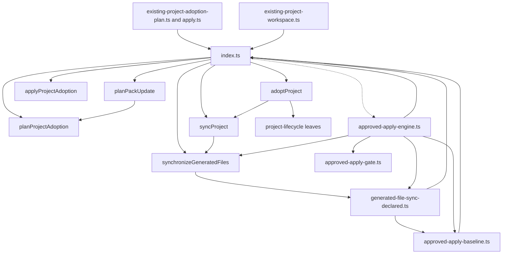
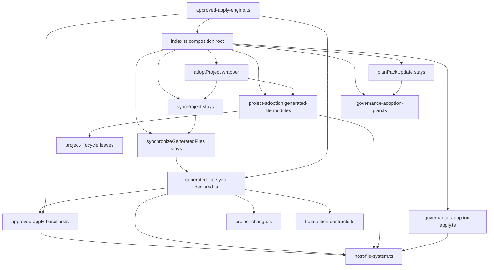
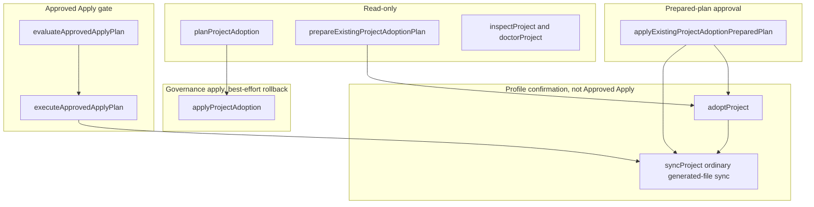
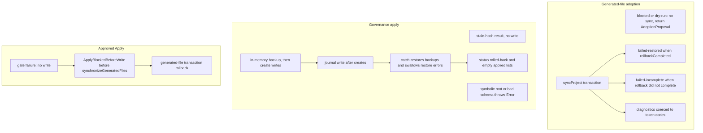
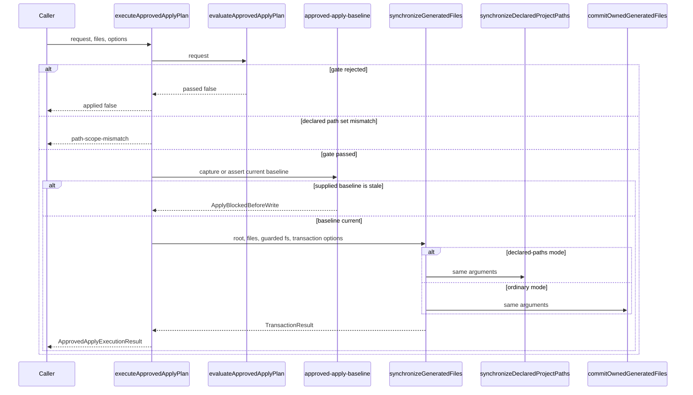
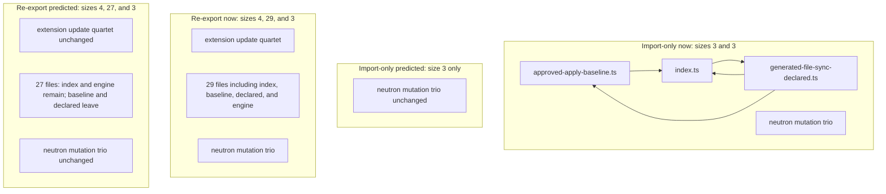
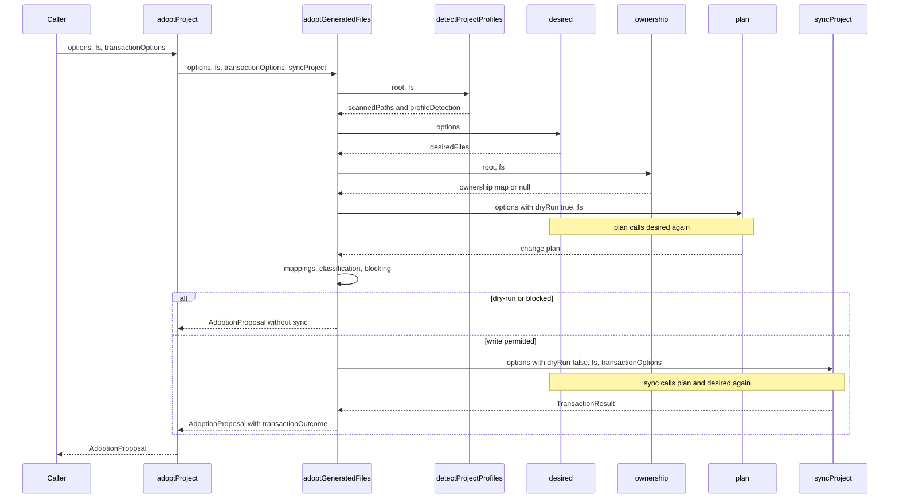
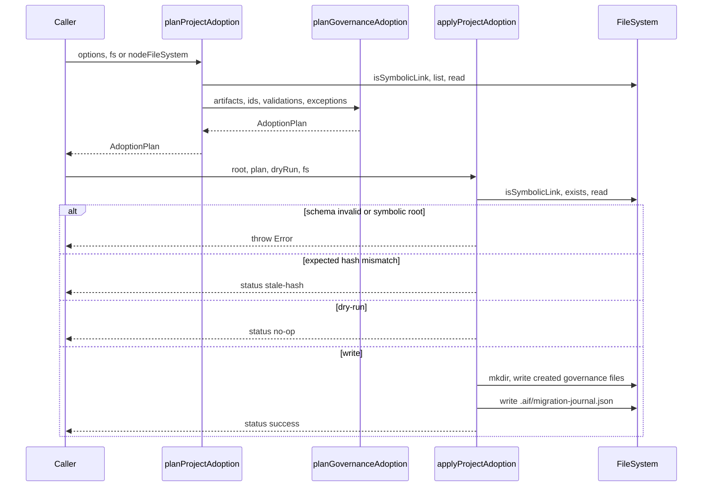

# P1I.3 Existing Project Adoption extraction

Status: **proposed**. This document is the Design First review artifact
for P1I.3. It does not implement the extraction or the import retarget.
A maintainer must approve it before any production move. A green CI
result is not approval.

Feasibility verdict: **B. Leaf-owned adoption workflows, with one
composition-root binding that passes `syncProject` into generated-file
adoption.** The Approved Apply import-only cycle is removed by
retargeting two type imports. The Approved Apply engine keeps its value
import of `synchronizeGeneratedFiles`.

## 1. Verified baseline

`origin/main` is `da8d28e4ce33f24154fa69e1067a28fd54e5d04e`. That commit
is the merge of PR #619, a documentation record of the P1I.2
implementation. The production tree for this design is the parent,
`1d8d55cbfd89792272d4d4c00512aa09465ed23d`, which is the merge of PR
#618. `git diff --stat` from that parent to `origin/main` touches only
`DUTY_WATCH.md`, `PROJECT_STATE.md`, `docs/README.md`, and
`docs/architecture/PACKAGES_STABILIZATION_PLAN.md`.
`packages/application/src/index.ts` is unchanged between those commits.

The expected SHA in the task brief was the P1I.2 implementation merge.
The actual `origin/main` is one documentation commit later. This branch
was created from the actual `origin/main`. No earlier P1I.3 design
exists under `docs/designs/`. No open pull request edits adoption
extraction. Open pull requests at the start were Dependabot updates.

Verified before this design:

- PR #615, the P1I.1 System Design, is merged at
  `8bc9e07c74beb701adaae9e30dacb6aec252b58f`.
- PR #616, the P1I.1 implementation, is merged at
  `b9201e9d480b34e453d08e1803f94e734d1e3f1f`.
- PR #617, the P1I.2 System Design, is merged at
  `e3585e8eb5f4b58bb42482e249430654375dee5b`.
- PR #618, the P1I.2 implementation, is merged at
  `1d8d55cbfd89792272d4d4c00512aa09465ed23d`.
- PR #619 records that merge and does not change application source.
- P1I.1 and P1I.2 are complete. P1I.3 implementation has not started.
- P1J, Undo U4, and Desktop Undo U5 have not started.

Measured with `measureProductionSource` on this tree,
`packages/application/src/index.ts` is 2,561 effective lines and 2,736
physical lines. `applicationCycles` from
`tests/application-source-cycles.ts` returns import-only components of
sizes 3 and 3, and re-export-inclusive components of sizes 4, 29, and 3.
The membership arrays match the arrays locked in
`tests/project-lifecycle-p1i2-structure.test.ts`.

Canonical guidance used for this design:

- `docs/architecture/ARCHITECTURE.md`. Clients call
  `@intentloom/application`. Application code does not import the CLI,
  daemon, MCP server, or Desktop.
- `docs/architecture/PACKAGES_STABILIZATION_PLAN.md`, section P1I. This
  slice moves `adoptProject`, `planProjectAdoption`, and
  `applyProjectAdoption`, and retargets the Approved Apply type imports
  that keep `index.ts` in import cycle 1.
- `docs/decisions/ADR-0003-non-destructive-project-adoption.md`. Planning
  stays separate from applying. Project-owned files are not silently
  replaced.
- `docs/decisions/ADR-0007-private-application-operation-boundary.md`.
  The application package owns these operations.
- `docs/decisions/ADR-0053-approved-apply-transaction-engine.md`.
  Approved Apply is a separate gate. Ordinary adoption sync does not
  enter it.
- The approved P1I.1 and P1I.2 designs. P1I.1 keeps
  `synchronizeGeneratedFiles` on the barrel. P1I.2 keeps `syncProject`
  on the barrel and passes that dispatcher into `executeProjectSync`.
- `docs/governance/DESIGN_FIRST_POLICY.md`,
  `docs/governance/AI_AGENT_WORKFLOW.md`,
  `docs/governance/ENGINEERING_PRINCIPLES.md`,
  `docs/governance/CODE_QUALITY_STANDARDS.md`, and
  `docs/governance/DOMAIN_MODELING.md`.
- `docs/governance/quality-exceptions.json`. This design does not edit
  it. The grandfathered `index.ts` ceiling stays 6,764 effective lines
  and 7,151 physical lines.

Task triage for this design-only change: blast radius 2, ambiguity 2,
risk 2, verification 2, unknowns 2, total 10. The recommended role is
frontier with highest effort. Harness: Cursor. This session cannot
change its model. No subagents were used. The route from
`aif-task-router` is `plan`. Risk 2 names the trust-boundary and
rollback sections below. It does not authorize a behavior change.
Ambiguity is 2 because direct extraction, composition-root binding, and
leaf orchestration through `index.ts` are different architectures. This
document is that decision record. Maintainer review of this pull request
is the approval gate.

Stop condition: one design pull request, no production edit, no merge,
and no start of the P1I.3 implementation, P1J, U4, or U5.

## 2. Problem statement

`packages/application/src/index.ts` still implements two different
adoption workflows:

- `adoptProject` is 304 effective lines. It classifies an existing tree
  and may call ordinary `syncProject`.
- `planProjectAdoption` is 159 effective lines. It builds a core
  `AdoptionPlan`.
- `applyProjectAdoption` is 132 effective lines. It writes governance
  documents and a migration journal with best-effort rollback.

All three are over the 80-line function budget. Moving any of them
unchanged into a new file would create a new function over that budget.
The move has to decompose them. Their write paths, result types, and
rollback mechanisms are not interchangeable.

The same barrel is still in the size-3 import cycle with
`approved-apply-baseline.ts` and `generated-file-sync-declared.ts`.
`adoptProject` calls `syncProject`, which stays on the barrel because
it closes over `synchronizeGeneratedFiles`. A new adoption module that
imports `index.ts` to reach that wrapper joins a cycle.

## 3. Goals and non-goals

Goals:

- Move both adoption workflows out of `index.ts` without combining
  their write paths, result contracts, or rollback implementations.
- Decompose each moved function so every new function is at or below 80
  effective lines, preferably 40, and every new file is at or below 250
  effective lines.
- Keep the public signatures and the package-root entry point.
- Remove `index.ts` from the import-only Approved Apply component by
  retargeting type imports only.
- Keep the Neutron mutation component unchanged.
- Preserve ordinary sync from P1I.2 and the generated-file transaction
  from P1I.1.
- Preserve Approved Apply gating, baseline checks, and the engine's
  call to `synchronizeGeneratedFiles`.

Non-goals:

- No production TypeScript edit in this pull request.
- No behavioral test edit in this pull request.
- No new adoption capability, metadata migration, or security behavior
  change.
- No Approved Apply engine rewrite.
- No move of `planPackUpdate`, `planFeature`, or the workspace
  proposal helpers.
- No move of the existing `existing-project-*` prepared-plan files into
  a new directory.
- No `project-adoption/index.ts`, no new package, and no new
  `package.json` export-map key.
- No `utils.ts`, `helpers.ts`, `manager.ts`, or service locator.
- No new Entity, Aggregate, Repository, or Domain Event.
- No new quality-exception rule and no change to the grandfathered
  ceiling.
- No P1J, Undo U4, or Desktop Undo U5 work.
- No claim that the projected SCC membership has already been measured
  on an implementation.

## 4. Domain responsibility map

`docs/governance/DOMAIN_MODELING.md` already names Project Adoption as a
context and `AdoptionProposal` and `AdoptionPlan` as different terms.
This slice uses those words. It does not add a tactical DDD layer.

| Term                              | Owner                                                                              | Meaning on this baseline                                                                                                                |
| --------------------------------- | ---------------------------------------------------------------------------------- | --------------------------------------------------------------------------------------------------------------------------------------- |
| Generated-file project onboarding | `project-adoption/` generated-file modules                                         | `adoptProject`: profile detection, desired state, ownership, classification, then ordinary sync when the current guards allow it        |
| Adoption proposal                 | `generated-file-adoption-contracts.ts`                                             | `AdoptionProposal`, the result of onboarding. It extends `Plan`                                                                         |
| Governance adoption planning      | `governance-adoption-plan.ts`                                                      | `planProjectAdoption`: artifact scan and `planGovernanceAdoption`                                                                       |
| Governance adoption apply         | `governance-adoption-apply.ts`                                                     | `applyProjectAdoption`: hash check, governance document writes, journal, best-effort rollback                                           |
| Adoption plan                     | `@intentloom/core/adoption`                                                        | `AdoptionPlan`, the governance result. It is not an `AdoptionProposal`                                                                  |
| Prepared-plan pipeline            | existing `existing-project-adoption-*` files                                       | Preview, decisions, approval, and `applyExistingProjectAdoptionPreparedPlan`. It calls `adoptProject`. It is not `applyProjectAdoption` |
| Pack update planning              | `index.ts`                                                                         | `planPackUpdate` stays. It calls `planProjectAdoption` and then rewrites `packVersion`                                                  |
| Project lifecycle                 | `project-lifecycle/`                                                               | `desired`, `ownership`, `plan`, and `executeProjectSync`. Unchanged                                                                     |
| Generated-file transaction        | `generated-file/`                                                                  | `commitOwnedGeneratedFiles` and declared-path sync. Unchanged                                                                           |
| Approved Apply                    | `approved-apply-gate.ts`, `approved-apply-engine.ts`, `approved-apply-baseline.ts` | Gate, baseline, and engine. The engine still calls the barrel dispatcher                                                                |

Generated-file onboarding and governance adoption belong in one feature
directory because both are Project Adoption application responsibilities.
They belong in distinct modules because their contracts and write paths
differ. The prepared-plan files stay where they are. Moving them would
churn paths inside the re-export component without removing `index.ts`
from it.

## 5. Declaration and size inventory

Lines and effective counts are `measureProductionSource` on the slices
in `packages/application/src/index.ts`. Physical line numbers are the
current file.

| Declaration                   | Lines     | Effective / physical           | Visibility  | Decision                              | Reason                                                                                                                          |
| ----------------------------- | --------- | ------------------------------ | ----------- | ------------------------------------- | ------------------------------------------------------------------------------------------------------------------------------- |
| `AdoptionAction`              | 392–400   | part of the 51 / 53 type block | public type | Move, re-export                       | Used only by the proposal types and by callers of the package root                                                              |
| `AdoptionProposalItem`        | 402–421   | same block                     | public type | Move, re-export                       | Result item of generated-file onboarding                                                                                        |
| `AdoptionProposal`            | 423–435   | same block                     | public type | Move, re-export, local type import    | Workspace proposal helpers in `index.ts` still name this type                                                                   |
| `AdoptionTransactionOutcome`  | 436–444   | same block                     | public type | Move, re-export                       | Nested in `AdoptionProposal`                                                                                                    |
| `unsupportedPath`             | 489–491   | 3 / 3                          | private     | Move                                  | Only `adoptProject` calls it                                                                                                    |
| `normalizeMappingPath`        | 493–500   | 8 / 8                          | private     | Move                                  | Only `adoptProject` calls it                                                                                                    |
| `adoptProject`                | 502–805   | 304 / 304                      | public      | Stay as a thin wrapper; move the body | The body calls `syncProject`. The wrapper keeps the three-parameter signature and passes `syncProject` in                       |
| `PlanProjectAdoptionOptions`  | 873–880   | inside 873–1201, 313 / 329     | public type | Move, re-export                       | Governance planning input. No other barrel function names it                                                                    |
| `planProjectAdoption`         | 882–1046  | 159 / 165                      | public      | Move, local value import, re-export   | `planPackUpdate` calls it                                                                                                       |
| `ApplyProjectAdoptionOptions` | 1048–1052 | inside the governance block    | public type | Move, re-export                       | Governance apply input                                                                                                          |
| `AdoptionApplyResult`         | 1054–1062 | inside the governance block    | public type | Move, re-export                       | Governance apply result. Not an `AdoptionProposal`                                                                              |
| `applyProjectAdoption`        | 1064–1201 | 132 / 138                      | public      | Move, re-export                       | No other declaration in `index.ts` calls it                                                                                     |
| `PlanPackUpdateOptions`       | 1203–1208 | inside 1203–1250, 44 / 48      | public type | Stay                                  | Pack update is not this slice                                                                                                   |
| `planPackUpdate`              | 1210–1250 | 38 / 41                        | public      | Stay                                  | It calls `planProjectAdoption` and then returns a version-adjusted `AdoptionPlan`. Moving it is not required to break the cycle |

Shared declarations stay with their current owners. Adoption modules
import those owners. They do not import `index.ts`.

| Shared declaration                                               | Owner                                              | Adoption use                                                                    |
| ---------------------------------------------------------------- | -------------------------------------------------- | ------------------------------------------------------------------------------- |
| `FileSystem`, `nodeFileSystem`                                   | `host-file-system.ts`                              | Both workflows                                                                  |
| `InitOptions`, `configPath`                                      | `project-lifecycle/project-lifecycle-contracts.ts` | `adoptProject`                                                                  |
| `desired`                                                        | `project-lifecycle/desired-generated-state.ts`     | Called once by onboarding, and again inside `plan` and `syncProject`            |
| `ownership`                                                      | `project-lifecycle/ownership-state.ts`             | Onboarding                                                                      |
| `plan`                                                           | `project-lifecycle/project-plan.ts`                | Onboarding calls it with `dryRun: true` and the default `sync` argument `false` |
| `executeProjectSync`                                             | `project-lifecycle/project-sync.ts`                | Not called by the new leaf. `syncProject` calls it                              |
| `Plan`                                                           | `project-change.ts`                                | `AdoptionProposal` extends it                                                   |
| `TransactionOptions`, `TransactionResult`, `TransactionStage`    | `generated-file/transaction-contracts.ts`          | Onboarding outcome                                                              |
| `ProfileDetectionResult` and `detectProjectProfiles`             | `project-profile-detection.ts`                     | Onboarding                                                                      |
| `documentConcept`                                                | `document-concepts.ts`                             | Onboarding classification                                                       |
| `instructionPath`, `adapterForKnownInstructionPath`              | `instruction-file-taxonomy.ts`                     | Onboarding classification                                                       |
| `inside`, `projectRelativePaths`, `secretLikePath`               | `project-path.ts`                                  | Governance scan and path containment                                            |
| `lockPath`, `sourceMapPath`                                      | `generated-file/transaction-metadata.ts`           | Onboarding metadata completeness                                                |
| `checksum`, `normalizeOutputPath`                                | `@intentloom/core`                                 | Hashes and mapping paths                                                        |
| `deterministicId`, `planGovernanceAdoption`, core adoption types | `@intentloom/core/adoption`                        | Governance plan and journal                                                     |

`planFeature`, `synchronizeGeneratedFiles`, `syncProject`, and the
workspace proposal functions stay in `index.ts`.

## 6. Complete call graph

### Generated-file onboarding

`adoptProject` calls, in this order:

1. `detectProjectProfiles(options.root, fs)`.
2. `desired(options)` once.
3. `ownership(options.root, fs)`.
4. `fs.exists` for `configPath`, `lockPath`, and `sourceMapPath`, through
   `Promise.all`.
5. `plan({ ...options, dryRun: true }, fs)`. The third argument stays
   at its default `false`, so missing owned files are classified
   `create`, not `missing`.
6. `normalizeMappingPath` for project-owned mappings, then for
   documentation mappings. `documentConcept` runs on documentation
   sources.
7. A second `documentConcept` pass over `scannedPaths` for duplicate
   concepts.
8. For each desired file: `fs.exists` when the path was not in the scan,
   then `adapterForKnownInstructionPath`.
9. For each scanned path that is not a desired path: `unsupportedPath`,
   `documentConcept`, and `instructionPath`.
10. Sort items by `` `${path}:${action}` `` with `localeCompare`.
11. Read `options.existingValidationResults`.
12. Maybe `syncProject({ ...options, dryRun: false }, fs, transactionOptions)`.

`plan` calls `desired` again. On the write path, `syncProject` calls
`executeProjectSync`, which calls `plan` and `desired` again. A dry run
therefore evaluates `desired` twice. A write evaluates it four times.
This design does not merge those calls.

`syncProject` calls `executeProjectSync` with
`synchronizeGeneratedFiles`. That dispatcher calls
`synchronizeDeclaredProjectPaths` only when
`isDeclaredPathsOnlySyncMode` is true, and otherwise
`commitOwnedGeneratedFiles`. Onboarding does not call the dispatcher
itself.

### Governance adoption

`planProjectAdoption` calls `resolve`, `fs.isSymbolicLink`, `fs.list`,
`projectRelativePaths`, `secretLikePath`, `inside`, `fs.read`,
`checksum`, and `planGovernanceAdoption`.

`applyProjectAdoption` calls `resolve`, `fs.isSymbolicLink`, `inside`,
`fs.exists`, `fs.read`, `checksum`, `fs.mkdir`, `fs.write`, `fs.remove`,
`deterministicId`, `JSON.parse`, `JSON.stringify`, and
`new Date().toISOString()`. It does not call `planGovernanceAdoption`,
`syncProject`, or `synchronizeGeneratedFiles`.

`planPackUpdate` calls `planProjectAdoption` and then either returns
that plan or copies it with `packVersion` set to
`options.targetPackVersion ?? "1.1.0"`. The operation map returns every
operation unchanged. That function stays in `index.ts`.

### Callers that must keep compiling

| Caller                                                                                        | What it imports from the package root or `index.ts`                               |
| --------------------------------------------------------------------------------------------- | --------------------------------------------------------------------------------- |
| `packages/cli/src/adopt-command.ts`                                                           | `adoptProject`, `planProjectAdoption`, `applyProjectAdoption`, `AdoptionProposal` |
| `packages/cli/src/update-command.ts`                                                          | `planPackUpdate`, `applyProjectAdoption`                                          |
| `packages/cli/src/formatters.ts`                                                              | `AdoptionProposal`                                                                |
| `existing-project-adoption-plan.ts`                                                           | `adoptProject`, `inspectProject`, `ProjectMapping`                                |
| `existing-project-adoption-apply.ts`                                                          | `adoptProject`, `syncProject`, `TransactionOptions`                               |
| `existing-project-workspace.ts`                                                               | `planProjectAdoption`, `doctorProject`, `inspectProject`                          |
| `promoteWorkspaceConversationToProposal`, `reviewWorkspaceProposal`, `applyWorkspaceProposal` | local `adoptProject` and `AdoptionProposal`                                       |
| `packages/daemon/src/existing-project-handlers.ts`                                            | `prepareExistingProjectAdoptionPlan`                                              |
| `packages/daemon/src/existing-project-apply-handlers.ts`                                      | `applyExistingProjectAdoptionPreparedPlan`                                        |

No MCP server file imports the three operations. Neutron read-only
operations do not call them. Daemon and Desktop reach generated-file
onboarding through the prepared-plan pipeline, which keeps importing
`adoptProject` from `index.ts`. Those existing imports stay. Retargeting
them is not required for the cycle proof, and this slice does not move
those files.

## 7. Current architecture



Editable source: [`current-dependencies.mmd`](current-dependencies.mmd).
The dotted edge is `export * from "./approved-apply-engine.js"`. It is
not a value import. The import-only cycle is the solid triangle
`index.ts` to `generated-file-sync-declared.ts` to
`approved-apply-baseline.ts` and back to `index.ts`.

`approved-apply-baseline.ts` imports `type { FileSystem } from "./index.js"`.
`generated-file-sync-declared.ts` imports `FileSystem`, `Plan`,
`PostWriteValidationResult`, `TransactionOptions`, `TransactionResult`,
and `TransactionStage` from `./index.js`. The canonical owners already
exist: `host-file-system.ts`, `project-change.ts`, and
`generated-file/transaction-contracts.ts`.

`approved-apply-engine.ts` value-imports `synchronizeGeneratedFiles` and
`nodeFileSystem`, plus the `FileSystem` and `TransactionOptions` types,
from `./index.js`. That edge is outside the import-only component
because `index.ts` does not value-import the engine. It is inside the
re-export component because the barrel re-exports the engine.

## 8. Proposed architecture



Editable source:
[`proposed-dependencies.mmd`](proposed-dependencies.mmd).

New modules live under `packages/application/src/project-adoption/`.
There is no `project-adoption/index.ts`. Generated-file modules do not
import governance modules. Governance modules do not import
generated-file modules. Neither family imports `index.ts`,
`approved-apply-engine.ts`, `approved-apply-baseline.ts`, or
`generated-file-sync-declared.ts`.

The public wrapper stays in `index.ts`:

```ts
export async function adoptProject(
  options: InitOptions,
  fs: FileSystem,
  transactionOptions: TransactionOptions = {},
): Promise<AdoptionProposal> {
  return adoptGeneratedFiles(options, fs, transactionOptions, syncProject);
}
```

`adoptGeneratedFiles` is the internal orchestrator. It is not a package
root export. Its fourth parameter is the current `syncProject` function.
The public function still owns the default `transactionOptions`. Callers
that omit the third argument still receive `{}`.

`index.ts` value-imports `planProjectAdoption` because `planPackUpdate`
calls it, and re-exports it. `applyProjectAdoption` is a direct
re-export. `AdoptionProposal` is a local type import because the
workspace helpers still annotate it. The other moved public types are
re-exported without a local binding.

## 9. Alternative comparison

### A. Direct import of `syncProject`

Move `adoptProject` and import `syncProject` from `index.ts`.

The barrel must import the new module to re-export `adoptProject`. The
new module would import the barrel. On the current graph, with the two
type retargets applied, that pair is a new import-only component of size
2: `index.ts` and the adoption module. The re-export component grows by
that module. The task forbids a new SCC. This alternative is rejected.

### B. Composition-root binding

Keep the public three-parameter `adoptProject` in `index.ts`. Pass the
existing `syncProject` function into `adoptGeneratedFiles`.

The leaf does not import `index.ts`. The public signature does not gain
a parameter. The call inside the leaf stays
`syncProject({ ...options, dryRun: false }, fs, transactionOptions)`.
Evaluation count, transaction options, and error propagation stay on
the function callers already use. The fourth internal parameter matches
the existing `executeProjectSync` shape and stays within the preference
of four positional parameters. This is the selected binding.

### C. Leaf calls `executeProjectSync`

The leaf could call `executeProjectSync` with `synchronizeGeneratedFiles`.

If it imports that dispatcher from `index.ts`, the cycle is the same as
alternative A. If the wrapper injects the dispatcher instead, today's
behavior matches because `syncProject` only forwards to
`executeProjectSync`. That forwarding is the whole wrapper. Calling the
leaf one level lower would duplicate it and would diverge if `syncProject`
later gained a check. It also skips the named function onboarding calls
today. This alternative is rejected in favor of B.

Calling `commitOwnedGeneratedFiles` directly would skip the declared-path
branch of `synchronizeGeneratedFiles`. That changes behavior when
`transactionOptions.syncMode` selects declared paths. It is rejected.

### D. Inject the dispatcher into the Approved Apply engine

The engine could receive `synchronizeGeneratedFiles` from the barrel and
stop importing `index.ts`. Together with the type retarget, that could
remove `index.ts` from the re-export component as well as the import
component.

That edit rewires the Approved Apply engine to delete an import edge.
This milestone does not rewrite the engine. The required cycle result is
the import-only component. Alternative D stays out of P1I.3. It is not
required for this verdict.

## 10. Selected verdict

**B.** Generated-file onboarding and governance adoption move into
`project-adoption/` as separate module families. `adoptProject` remains
the public wrapper and passes `syncProject` into `adoptGeneratedFiles`.
`planProjectAdoption` and `applyProjectAdoption` move outright.
`planPackUpdate` stays and calls the imported planner.

The import retarget is a second, smaller change. It is not an adoption
behavior change. Section 21 splits it into its own implementation pull
request so a cycle edit is not mixed into the move.

Direct extraction is not safe. The projected import-only graph has one
component, the existing Neutron trio. No adoption leaf imports
`index.ts`.

## 11. Module ownership matrix

| Module                                      | Owns                                                                                                                                   | Must not own                                |
| ------------------------------------------- | -------------------------------------------------------------------------------------------------------------------------------------- | ------------------------------------------- |
| `generated-file-adoption-contracts.ts`      | `AdoptionAction`, `AdoptionProposalItem`, `AdoptionProposal`, `AdoptionTransactionOutcome`                                             | Filesystem access, sync, governance types   |
| `generated-file-adoption-mappings.ts`       | `normalizeMappingPath`, project-owned mapping diagnostics, documentation mapping diagnostics, duplicate-concept counts                 | Item classification, sync                   |
| `generated-file-adoption-classification.ts` | `unsupportedPath`, desired-destination items, scanned-file items, deterministic item sort                                              | Mapping diagnostics, transaction outcome    |
| `generated-file-adoption-outcome.ts`        | Diagnostic token coercion, rollback-path normalization, `AdoptionTransactionOutcome`, status `failed-restored` and `failed-incomplete` | The decision to call sync                   |
| `generated-file-adoption.ts`                | `adoptGeneratedFiles` and the read/blocking helpers it needs to stay under 40 lines                                                    | `synchronizeGeneratedFiles`, Approved Apply |
| `governance-adoption-contracts.ts`          | `PlanProjectAdoptionOptions`, `ApplyProjectAdoptionOptions`, `AdoptionApplyResult`                                                     | Scan or write logic                         |
| `governance-adoption-artifacts.ts`          | Ownership class and role-candidate detection, concatenated in today's order                                                            | Journal writes                              |
| `governance-adoption-plan.ts`               | `planProjectAdoption`                                                                                                                  | Apply, sync, `AdoptionProposal`             |
| `governance-adoption-apply.ts`              | `applyProjectAdoption`, hash verification, create writes, journal append, best-effort rollback                                         | The generated-file transaction engine       |
| `index.ts`                                  | Public `adoptProject` wrapper, `planPackUpdate`, `syncProject`, `synchronizeGeneratedFiles`, re-exports                                | The moved rule bodies                       |

Contingency: if `governance-adoption-apply.ts` measures above 250
effective lines, move journal append and rollback into
`governance-adoption-journal.ts`. Do not start that file above the
preference, and do not put both workflows in it.

Do not add `existing-project-adoption-apply.ts` beside the existing
file of that name. The public function is `applyProjectAdoption`. The
existing function `applyExistingProjectAdoptionPreparedPlan` stays in
`existing-project-adoption-apply.ts`.

## 12. Public contracts

The package root remains `packages/application/src/index.ts`. The twelve
`package.json` export-map keys stay:

`.`
`./model-adapter`
`./ollama-model-adapter`
`./neutron-runtime`
`./neutron-n2`
`./neutron-context-assembly`
`./neutron-n4`
`./neutron-scheduler`
`./neutron-graph-mutation`
`./neutron-session`
`./engineering-assessment`
`./engineering-quality`

No deep import of `project-adoption/` is added.

Signatures that must remain source-identical:

```ts
export async function adoptProject(
  options: InitOptions,
  fs: FileSystem,
  transactionOptions: TransactionOptions = {},
): Promise<AdoptionProposal>;

export async function planProjectAdoption(
  options: PlanProjectAdoptionOptions,
  fs: FileSystem = nodeFileSystem,
): Promise<AdoptionPlan>;

export async function applyProjectAdoption(
  options: ApplyProjectAdoptionOptions,
  fs: FileSystem = nodeFileSystem,
): Promise<AdoptionApplyResult>;
```

`planPackUpdate(options: PlanPackUpdateOptions, fs?: FileSystem)` stays
as it is, including the default `nodeFileSystem` and the return type
`AdoptionPlan`.

`AdoptionAction`, `AdoptionProposalItem`, `AdoptionProposal`,
`AdoptionTransactionOutcome`, `PlanProjectAdoptionOptions`,
`ApplyProjectAdoptionOptions`, and `AdoptionApplyResult` stay exported
from the package root. Their members stay as written in section 5's
source lines. `AdoptionProposal` still extends `Plan`.

`ApplyBlockedBeforeWrite` stays constructed in
`approved-apply-baseline.ts`. This slice does not introduce an error
class. Governance failures that throw today throw `Error`. Onboarding
failures that return a proposal today still return a proposal. Callees
that throw, including `inside` on path traversal and `desired` on
validation failure, still throw.

`adoptGeneratedFiles` must not appear on the package root namespace.
That is the same rule P1I.2 used for `executeProjectSync`.

## 13. Adoption workflow separation

Generated-file onboarding and governance adoption are both Project
Adoption. They are not one workflow.

| Question                         | Generated-file onboarding                                                                            | Governance adoption                                                                                |
| -------------------------------- | ---------------------------------------------------------------------------------------------------- | -------------------------------------------------------------------------------------------------- |
| Public operations                | `adoptProject`                                                                                       | `planProjectAdoption`, `applyProjectAdoption`                                                      |
| Result                           | `AdoptionProposal`                                                                                   | `AdoptionPlan`, then `AdoptionApplyResult`                                                         |
| Planner                          | application `plan`, after `desired`                                                                  | core `planGovernanceAdoption`                                                                      |
| Confirmation                     | `profileConfirmed` and manual-decision items                                                         | The caller supplies an `AdoptionPlan`                                                              |
| Approved Apply                   | Not entered                                                                                          | Not entered                                                                                        |
| Write                            | `syncProject`, which uses the generated-file transaction                                             | Direct `FileSystem` writes of governance documents and the journal                                 |
| Rollback                         | Transaction rollback from P1I.1                                                                      | In-memory backup and best-effort restore. Not atomic                                               |
| Overwrite of project-owned files | Classified and not selected by `writeEligible`. The sync engine still applies its own conflict rules | A `create` operation writes `op.path` even when a file is already there, after an in-memory backup |

`writeEligible` does not filter the sync payload. When onboarding is not
blocked, it calls `syncProject` for the project. It does not apply
proposal items one by one.

`planPackUpdate` is governance planning plus a pack version assignment.
It stays next to the barrel because its only barrel dependency is the
planner, and the barrel can import that planner without a cycle. It does
not pass `projectId`, `packId`, or `packVersion`, so the planner's
defaults `project`, `duty-watch`, and `1.0.0` still apply before the
version rewrite.

## 14. Approval and authorization boundaries



Editable source: [`trust-boundaries.mmd`](trust-boundaries.mmd).

These are different authorization flows.

- `planProjectAdoption` is read-only aside from throwing when the root
  is a symbolic link. It does not require approval.
- `adoptProject` writes only by calling `syncProject` after the blocking
  rules in section 16. Profile confirmation is `options.profileConfirmed`.
  It does not call `evaluateApprovedApplyPlan`.
- `applyExistingProjectAdoptionPreparedPlan` has its own gates, digest,
  and approval record. It calls `adoptProject` and `syncProject`. This
  slice does not change that file.
- `applyProjectAdoption` writes when the plan schema is 1, the root is
  not a symbolic link, hashes match, and `dryRun` is false. It has no
  Approved Apply request and no profile confirmation flag.
- Approved Apply still evaluates the gate, checks declared-path scope,
  captures or rechecks the baseline, and then calls
  `synchronizeGeneratedFiles`. Onboarding does not enter that path.
  The engine does not start calling onboarding.

Ownership metadata proves generated-file ownership through `ownership`
and the source map. Governance planning assigns an ownership class from
the path prefix. Those classifiers are not the same rule. Governance
apply does not read the source map.

Stale checks differ. Onboarding uses the generated-file transaction and,
on the prepared-plan path, that path's own revalidation. Governance
apply compares `checksum(content)` with `op.expectedCurrentHash`.
Approved Apply compares the captured baseline before
`synchronizeGeneratedFiles`. Retargeting a type import does not change
any of those checks.

## 15. Filesystem reads and writes

### Generated-file onboarding

Reads: profile scan inside `detectProjectProfiles`, `desired` catalog
reads, ownership and source-map reads, three metadata `exists` checks,
`plan` reads, and `exists` for desired paths missing from the scan.
Writes: none in the classifier. The only write is the `syncProject`
call when section 16 says to make it. Dry-run sets `dryRun: true` on
the planning `plan` call and does not call `syncProject`.

`completeMetadata` is true only when all three metadata paths exist and
the ownership map is non-empty. A null ownership result is an empty map
for lookups and `invalidOwnershipMetadata` for the source-map item.
Malformed source-map behavior stays that split. It is not a throw in
`adoptProject`. `plan` may still return its invalid source-map plan,
and the source-map item becomes `conflict`.

Mapping paths that `normalizeOutputPath` rejects or rewrites, mappings
whose source and destination differ, destinations missing from the
scan, documentation paths with no concept, and duplicate concepts
without an explicit mapping stay diagnostic strings. They block apply.

### Governance planning

The root is `resolve(options.root)`. A symbolic link throws
`Error("adoption planning requires a non-symbolic explicit project root")`.
`fs` defaults to `nodeFileSystem`. `fs.list` runs once. Paths then pass
through `projectRelativePaths` in that list order. There is no extra
sort.

For each relative path, `secretLikePath` skips the file before a read.
A read that throws is skipped. A successful read is hashed with
`checksum`. The ownership class is `intentloom-managed` for `.aif/` and
`catalog/`, `provider-derivative` for `.claude/`, `CLAUDE.md`,
`.cursor/`, `.cursorrules`, and any path containing
`copilot-instructions.md`, and `project-owned` otherwise.

Role candidates are pushed in this order, and a path may receive more
than one:

1. `docs/product/CURRENT_STATE.md` or `CURRENT_STATE.md`:
   `operational-project-state` at confidence 1.
2. `PROJECT_STATE.md`: `operational-project-state` at confidence 1.
3. `AGENT_START_HERE.md`: `agent-entrypoint` at confidence 1.
4. `DUTY_WATCH.md`: `duty-watch-log` at confidence 1.
5. `AGENTS.md`: `working-agreement` at confidence 0.9.
6. `ROADMAP.md`: `roadmap` at confidence 1.
7. `CHANGELOG.md`: `changelog` at confidence 1.
8. `SECURITY.md`: `security-policy` at confidence 1.
9. `docs/governance/ENGINEERING_PRINCIPLES.md` or a path ending in
   `ENGINEERING_PRINCIPLES.md`: `validation-policy` at confidence 0.9.
10. A path starting with `.claude`, or `CLAUDE.md`:
    `provider-instructions:claude` at confidence 1.
11. A path starting with `.cursor`, or `.cursorrules`:
    `provider-instructions:cursor` at confidence 1.
12. A path containing `copilot-instructions.md`:
    `provider-instructions:copilot` at confidence 1.
13. `docs/decisions/`: `durable-project-context` at confidence 0.8.
14. `docs/specs/`: `durable-project-context` at confidence 0.8.

Evidence strings stay the current filename, provider, and directory
text. Defaults passed to `planGovernanceAdoption` stay `project`,
`duty-watch`, and `1.0.0` when the options omit them. `validations` and
`exceptions` are forwarded only when the option is present.

### Governance apply

The root check throws
`Error("adoption apply requires a non-symbolic explicit project root")`.
`schemaVersion !== 1` throws
`Error("unsupported adoption plan schema version")`.

Before dry-run and before writes, every operation with both `path` and
`expectedCurrentHash` is read when the file exists. A read error returns
`stale-hash` with
`Unable to read target file for hash verification: ${op.path}`. A
checksum mismatch returns `stale-hash` with
`Stale content hash for ${op.path}`. A missing file is not a hash
failure. `appliedOperations`, `createdFiles`, and `updatedFiles` are
empty on both stale results.

Dry-run then returns `no-op`, with `appliedOperations` set to every
operation id, and empty created and updated lists. It does not write.

A `create` operation with a path reads the existing file into an
in-memory backup map when that path is not already backed up, creates
the parent directory, and writes one of two bodies. The
`agent-entrypoint` body is exactly:

```text
# Agent Entrypoint

Start here for repository instructions and workflows.
```

Every other create body is
`` `# Intentloom Governance ${op.role ?? op.path}\n` ``.
A missing file is recorded in `createdFiles`. An existing file is
recorded in `updatedFiles`. The operation id is appended to
`appliedOperations`. Any other operation kind appends the id and does
not touch the filesystem.

The journal path is `.aif/migration-journal.json`. An existing file is
parsed as `MigrationJournalEntry[]`. Parse failure uses an empty array.
The entry id is `deterministicId("journal", { planId, timestamp })`
where `timestamp` is `appliedOperations.join(",")`, not the clock. The
entry's own `timestamp` is `new Date().toISOString()`. The entry status
is `applied`. The file is written with `JSON.stringify(entries, null, 2)`.
Success returns `success`, the three arrays, and `journalEntryId`.

`inside` still throws `path traversal` for a path that escapes the root.
That throw is unchanged.

## 16. Error and rollback flows



Editable source:
[`failure-rollback-comparison.mmd`](failure-rollback-comparison.mmd).

Onboarding blocking is exactly:

```ts
const profileConfirmationRequired =
  profileDetection.manualConfirmationRequired && !options.profileConfirmed;
const blocked =
  profileConfirmationRequired ||
  mappingDiagnostics.length > 0 ||
  validationDiagnostics.length > 0 ||
  items.some(
    (item) =>
      item.manualDecisionRequired ||
      (item.action === "conflict" && options.profileConfirmed !== true),
  );
```

`manualDecisionRequired` is `projectOwned || metadataConflict` for a
desired destination, and
`duplicate && mappedDocument === undefined` for a scanned file. A
conflict that is not a manual decision blocks only when
`profileConfirmed` is not strictly `true`.

`applicationStatus` starts as `not-requested` when `options.dryRun` is
true, `blocked` when blocked, and `applied` otherwise. Sync runs only
when `options.dryRun` is false and `blocked` is false. When the sync
result has no `dryRun` property and `status` is `success`, `applied`
becomes true. Otherwise `applicationStatus` becomes `failed-restored`
when `rollbackCompleted` is true and `failed-incomplete` when it is not.
A result that still has `dryRun` leaves `applied` false and leaves the
status at its initial value. The implementation must not "correct" that
branch.

Transaction diagnostics are coerced. A diagnostic matching
`/^[a-z0-9][a-z0-9:-]*$/u` is kept. Any other diagnostic becomes
`transaction-failed`. The set is sorted. `errorCode` is null on success.
On failure it is the post-write validation code when that validation is
`invalid`, otherwise the first safe diagnostic that is not
`transaction-rollback-incomplete`, otherwise `transaction-failed`.
Rollback failure paths pass through `normalizeOutputPath`. A path that
throws is dropped. The remaining paths are sorted.

Proposal diagnostics are the profile confirmation string, mapping
diagnostics, validation codes, and
`` `${path}: manual decision required` ``, then sorted. Items are sorted
before that diagnostic list is built.

Governance apply has no transaction object. On a thrown write error it
walks the backup map. `null` means `fs.remove`. A string means
`fs.write` of the original content. A restore error is swallowed. The
returned status is `rolled-back`, with `error` set to the caught
message, and the three arrays empty. The journal is not in the backup
map unless an operation path happened to be the journal path. A journal
failure after creates therefore restores the created files and does not
claim to restore a partially written journal. This is best-effort. It
is not the generated-file transaction, and it does not have atomicity.

Recorded risks, not changes:

- Governance `create` overwrites an existing file without reading
  ownership metadata.
- Non-create operations are marked applied even though nothing was
  written, and a later rollback still returns empty `appliedOperations`.
- Malformed journal JSON is replaced by a new one-entry array when the
  write succeeds.
- The journal id input named `timestamp` is the joined operation ids.
  The entry clock is a separate `new Date().toISOString()`.
- Restore errors are discarded.
- Secret-like filtering applies to planning, not to apply.
- Unreadable files are skipped during planning and returned as
  `stale-hash` during apply.

The extraction must keep each of those behaviors.

## 17. Approved Apply cycle-retarget analysis

Import edges were read from source and checked with
`applicationCycles(false)` and `applicationCycles(true)`.

| Module                            | Current edges that matter                                                                                                                     | Reaches `index.ts` today  | `index.ts` reaches it today                                     |
| --------------------------------- | --------------------------------------------------------------------------------------------------------------------------------------------- | ------------------------- | --------------------------------------------------------------- |
| `approved-apply-baseline.ts`      | type `FileSystem` from `index.ts` only, inside the application graph                                                                          | import yes, re-export yes | import yes, through declared; re-export yes, through the engine |
| `generated-file-sync-declared.ts` | value `ApplyBlockedBeforeWrite` from baseline; type imports from `index.ts`; `destination-collisions.ts`; `generated-file/sync-mode.ts`       | import yes, re-export yes | import yes, re-export yes                                       |
| `approved-apply-engine.ts`        | value `synchronizeGeneratedFiles` and `nodeFileSystem`, plus `FileSystem` and `TransactionOptions`, from `index.ts`; baseline; gate; declared | import yes, re-export yes | import no; re-export yes, because of `export *`                 |
| `approved-apply-gate.ts`          | protocol and validator only                                                                                                                   | no                        | import no; re-export yes, through `export *`                    |
| `index.ts`                        | value-imports `synchronizeDeclaredProjectPaths`; re-exports the engine                                                                        | the component             | the component                                                   |

`destination-collisions.ts` imports only `@intentloom/core`.
`generated-file/sync-mode.ts` has no imports.
`approved-apply-gate.ts` does not import the application barrel.

Retarget only the baseline `FileSystem` import to `host-file-system.ts`.
Declared still imports `index.ts`, and `index.ts` still imports declared.
The import-only component shrinks to `{ generated-file-sync-declared.ts,
index.ts }` and the Neutron trio. `index.ts` remains in an SCC. This is
not sufficient.

Retarget only the declared type imports. The baseline still imports
`index.ts`. `index.ts` still imports declared, and declared still imports
the baseline. The import-only component stays
`{ approved-apply-baseline.ts, generated-file-sync-declared.ts, index.ts }`.
The re-export component stays 29 files. This is not sufficient.

Retarget both:

- `approved-apply-baseline.ts` imports `FileSystem` from
  `./host-file-system.js`.
- `generated-file-sync-declared.ts` imports `FileSystem` from
  `./host-file-system.js`, `Plan` from `./project-change.js`, and
  `PostWriteValidationResult`, `TransactionOptions`, `TransactionResult`,
  and `TransactionStage` from
  `./generated-file/transaction-contracts.js`.

After both edits, neither file has a path back to `index.ts`. `index.ts`
still imports declared, and declared still imports baseline. Those edges
are one-way. The engine still imports `index.ts`. That remaining edge is
a value dependency on `synchronizeGeneratedFiles`. It is not the
type-only cycle. The engine file is not edited.

Approved Apply behavior that must stay on the current engine path:

- `evaluateApprovedApplyPlan` still runs first.
- A failed gate still returns `applied: false` and does not write.
- Declared-path mode still rejects a path-set mismatch with
  `path-scope-mismatch` before baseline capture.
- `captureApprovedApplyBaseline` and `assertApprovedApplyBaselineCurrent`
  stay in `approved-apply-baseline.ts`.
- A supplied baseline still uses `filesystemGuardingBaseline`.
- `ApplyBlockedBeforeWrite` keeps its class, `name`, and `failureCode`
  values `project-stale` and `restoration-snapshot-failed`.
- The engine still calls `synchronizeGeneratedFiles` from `index.ts`,
  which still branches to declared-path sync or
  `commitOwnedGeneratedFiles`.
- Transaction options, post-write validation, rollback fields, and
  execution-result diagnostics stay on that result.



Editable source:
[`approved-apply-sequence.mmd`](approved-apply-sequence.mmd).

## 18. Current and projected SCC memberships

Current import-only components, confirmed with `applicationCycles(false)`:

1. `approved-apply-baseline.ts`, `generated-file-sync-declared.ts`,
   `index.ts`
2. `neutron/mutation/apply/neutron-mutation-apply-durable-record.ts`,
   `neutron/mutation/apply/neutron-mutation-apply-store.ts`,
   `neutron/mutation/verification/neutron-mutation-verification-retry-eligibility.ts`

Current re-export-inclusive components, confirmed with
`applicationCycles(true)`:

1. `apply-extension-update.ts`,
   `discover-and-apply-extension-update.ts`,
   `extension-update-files.ts`,
   `propose-and-apply-extension-adoption.ts`
2. The 29 files locked in
   `tests/project-lifecycle-p1i2-structure.test.ts`:
   `approved-apply-baseline.ts`, `approved-apply-engine.ts`,
   `bounded-execution-apply.ts`, `bounded-execution-w11.ts`,
   `bounded-execution-workspace-cli.ts`, `bounded-execution-workspace.ts`,
   `engineering-quality-entry.ts`,
   `engineering-quality/cli-specialized-packs-external.ts`,
   `engineering-quality/index.ts`,
   `engineering-quality/specialized-pack-external-apply.ts`,
   `engineering-quality/specialized-pack-external-viewmodel.ts`,
   `existing-project-adoption-apply-gates.ts`,
   `existing-project-adoption-apply-health.ts`,
   `existing-project-adoption-apply.ts`,
   `existing-project-adoption-approval.ts`,
   `existing-project-adoption-decisions.ts`,
   `existing-project-adoption-plan.ts`,
   `existing-project-adoption-prepared-plan-revalidate.ts`,
   `existing-project-adoption-prepared-plan.ts`,
   `existing-project-w9.ts`, `existing-project-workspace-cli.ts`,
   `existing-project-workspace.ts`, `foundation-flow.ts`,
   `generated-file-sync-declared.ts`,
   `harness/harness-benchmark-sample.ts`, `harness/harness-benchmark.ts`,
   `harness/harness.ts`, `inception-flow.ts`, `index.ts`
3. The same Neutron mutation trio.

The projection uses the same import and re-export split as
`tests/application-source-cycles.ts`. The current components produced by
that projection matched the locked arrays before any edge was removed.
The predicted graph deletes only the two `index.ts` type edges named in
section 17 and adds one-way imports from `index.ts` to the new
`project-adoption/` modules. Those modules do not import `index.ts`.
This is a prediction. The implementation test is the measurement.

Predicted import-only components after both the extraction and the
retarget:

1. The Neutron mutation trio, unchanged.

`index.ts` is in no import-only component. The baseline and declared
modules are in no import-only component. No new component appears.

Predicted re-export-inclusive components:

1. The extension-update quartet, unchanged.
2. The previous 29 files without `approved-apply-baseline.ts` and
   without `generated-file-sync-declared.ts`. Size 27. `index.ts` and
   `approved-apply-engine.ts` remain. The other 25 members of that
   previous list remain.
3. The Neutron mutation trio, unchanged.

The size-27 component remains because the barrel re-exports
`approved-apply-engine.ts` and the engine imports
`synchronizeGeneratedFiles` from the barrel. Eliminating the size-3
import component does not eliminate that re-export component. The new
adoption modules are absent from every component. Adding an import from
any of them back to `index.ts` creates a new size-2 import component.
That is why alternative A is rejected.



Editable source: [`scc-impact.mmd`](scc-impact.mmd).

Between the two implementation pull requests, after extraction and
before the retarget, the prediction is the current membership: import
sizes 3 and 3, re-export sizes 4, 29, and 3. The new files are outside
every component. The retarget pull request is what changes 3 and 3 into
one Neutron component, and 29 into 27.

## 19. Source-size and function budgets

Moved regions measure:

| Region                                                        | Effective | Physical |
| ------------------------------------------------------------- | --------: | -------: |
| Proposal types, lines 392–444                                 |        51 |       53 |
| `unsupportedPath`, `normalizeMappingPath`, and `adoptProject` |       315 |      317 |
| Governance options, planner, and apply, lines 873–1201        |       313 |      329 |
| Total leaving the barrel before glue                          |       679 |      699 |

The barrel adds back the `adoptProject` wrapper, the `planProjectAdoption`
import, and the re-export lines. A planning allowance for that glue is
about 30 to 40 effective lines. The estimate for `index.ts` after the
extraction is about 1,910 effective lines and about 2,080 physical
lines, down from 2,561 and 2,736. That is an estimate, not an
implementation measurement. The implementation prints
`measureProductionSource` again and pins that measurement. The file must
be smaller than the baseline on both counts. It will remain above the
400-line preference and under the grandfathered ceiling. This design
does not add an exception and does not change 6,764 / 7,151.

New files, planning targets, not measurements:

| File                                        | Expected content                                  | Target                          |
| ------------------------------------------- | ------------------------------------------------- | ------------------------------- |
| `generated-file-adoption-contracts.ts`      | the 51-line type block plus imports               | under 80                        |
| `generated-file-adoption-mappings.ts`       | path normalization and both mapping loops         | under 120                       |
| `generated-file-adoption-classification.ts` | the two item builders, split into predicates      | under 220                       |
| `generated-file-adoption-outcome.ts`        | token coercion and outcome mapping                | under 80                        |
| `generated-file-adoption.ts`                | context read, blocking, and `adoptGeneratedFiles` | under 160                       |
| `governance-adoption-contracts.ts`          | three public types                                | under 80                        |
| `governance-adoption-artifacts.ts`          | ownership class and the 14 role checks, split     | under 180                       |
| `governance-adoption-plan.ts`               | scan loop and `planGovernanceAdoption` call       | under 120                       |
| `governance-adoption-apply.ts`              | hash check, creates, journal, rollback            | under 250, or split the journal |

Every new production file must measure at or below 250 effective lines
and 700 physical lines, and must not exceed 400 effective lines. Every
new function must measure at or below 80 effective lines. The
orchestrators and the role-candidate combiner should be at or below 40.
`adoptGeneratedFiles` has four positional parameters and must not gain a
fifth. The public wrappers keep the signatures in section 12.

`adoptProject` at 304, `planProjectAdoption` at 159, and
`applyProjectAdoption` at 132 must not be moved as single functions.
The desired-destination item literal is about 58 physical lines and the
scanned-file item literal is about 56. Each must be split into named
predicates so the function that assembles the item stays at or below 80.
The role-candidate chain is about 105 physical lines and must be split
into ordered groups whose concatenation preserves the order in section 15.

No function body is copied into a file that already exceeds 400
effective lines. `generated-file-sync-declared.ts` is 302 effective
lines and 314 physical lines. This slice changes its imports only. It
must not gain a new rule. `approved-apply-baseline.ts` is 184 / 210 and
`approved-apply-engine.ts` is 146 / 160. The engine is not edited. The
baseline file changes one import line.

## 20. Regression-test matrix

This pull request does not modify tests. The implementation must keep
every behavioral assertion below and may change only the structure
assertions named here.

| Behavior                                             | Existing test files                                                                                                                                                                                                                                                                                                                                                                                                                                                                                                  |
| ---------------------------------------------------- | -------------------------------------------------------------------------------------------------------------------------------------------------------------------------------------------------------------------------------------------------------------------------------------------------------------------------------------------------------------------------------------------------------------------------------------------------------------------------------------------------------------------- |
| Generated-file adoption proposal and apply           | `tests/adoption-proposal.test.ts`, `tests/adoption-apply.test.ts`, `tests/adoption-fixtures.test.ts`, `tests/adoption-profile.test.ts`, `tests/adoption-contracts.test.ts`                                                                                                                                                                                                                                                                                                                                           |
| Documentation concepts and Nx profile fixtures       | `tests/existing-project-documentation-concepts.test.ts`, `tests/existing-project-nx-dogfood.test.ts`, `tests/instruction-file-taxonomy.test.ts`                                                                                                                                                                                                                                                                                                                                                                      |
| Prepared plan, decisions, approval, health, rollback | `tests/existing-project-adoption-plan.test.ts`, `tests/existing-project-adoption-decisions.test.ts`, `tests/existing-project-adoption-approval.test.ts`, `tests/existing-project-adoption-prepared-plan.test.ts`, `tests/existing-project-adoption-apply.test.ts`, `tests/existing-project-adoption-apply-rollback.test.ts`, `tests/existing-project-adoption-apply-immediate-stale.test.ts`, `tests/existing-project-adoption-apply-lock.test.ts`, `tests/existing-project-adoption-post-apply-consistency.test.ts` |
| CLI adopt and update                                 | `tests/cli-adopt.test.ts`, `tests/cli-adopt-plan.test.ts`, `tests/cli-adopt-apply.test.ts`, `tests/cli-update.test.ts`, `tests/cli-pack-update.test.ts`                                                                                                                                                                                                                                                                                                                                                              |
| Daemon and Desktop prepared-plan surfaces            | `tests/daemon-adoption-plan.test.ts`, `tests/daemon-adoption-apply.test.ts`, `tests/daemon-existing-project.test.ts`, `tests/desktop-adoption-preview.test.ts`, `tests/desktop-adoption-apply.test.ts`, and the other `tests/desktop-adoption-*` and `tests/daemon-adoption-*` files                                                                                                                                                                                                                                 |
| Governance success, dry-run, stale hash, journal     | `tests/cli-adopt-apply.test.ts`, `tests/cli-pack-update.test.ts`                                                                                                                                                                                                                                                                                                                                                                                                                                                     |
| Approved Apply gate and engine                       | `tests/approved-apply-gate.test.ts`, `tests/approved-apply-engine.test.ts`, `tests/desktop-legacy-approved-apply-isolation.test.ts`                                                                                                                                                                                                                                                                                                                                                                                  |
| Declared paths, symlink safety, stored paths         | `tests/generated-file-transaction-p1i1-structure.test.ts`, `tests/generated-file-symlink-safety.test.ts`, `tests/generated-file-ownership-classification.test.ts`, `tests/stored-path.test.ts`, `tests/application-project-path.test.ts`                                                                                                                                                                                                                                                                             |
| SCC membership and barrel size                       | The structure tests listed below                                                                                                                                                                                                                                                                                                                                                                                                                                                                                     |

`tests/cli-adopt-apply.test.ts` locks governance success, dry-run
`no-op`, stale-hash, and the migration journal through the CLI. No
current test was found that calls `applyProjectAdoption` directly for
the symbolic-root throw, the schema-version throw, or the swallowed
rollback error. The extraction must not change those paths. The
implementation may add a regression that locks the current catch
behavior, including an empty result after a swallowed restore error. It
must not replace that catch with the generated-file transaction.

Structure assertions that pin the current barrel size, 2,561 effective
and 2,736 physical, and therefore change when the extraction lands:

- `tests/generated-file-transaction-p1i1-structure.test.ts`
- `tests/project-lifecycle-p1i2-structure.test.ts`
- `tests/security-audit-structure-p1h6.test.ts`
- `tests/workspace-read-model-p1h7-structure.test.ts`

They should pin the new measured size. They should not be widened to a
ceiling that allows the barrel to grow.

Assertions that pin import sizes `[3, 3]`, re-export sizes `[4, 29, 3]`,
or the three-file import membership change only in the retarget pull
request:

- `tests/generated-file-transaction-p1i1-structure.test.ts`
- `tests/project-lifecycle-p1i2-structure.test.ts`
- `tests/application-foundation-scaffold-cycle.test.ts`
- `tests/application-inception-cycle.test.ts`
- `tests/security-audit-structure-p1h6.test.ts`
- `tests/workspace-read-model-p1h7-structure.test.ts`
- `tests/sarif-security-import-p1h4b.test.ts`
- `tests/security-finding-store-p1h4a.test.ts`
- `tests/security-policy-baseline-p1h5a.test.ts`
- `tests/security-sandbox-evaluation-p1h5b.test.ts`
- `tests/skill-catalog-read-p1h3a.test.ts`
- `tests/skill-procedural-memory-p1h3c.test.ts`
- `tests/skill-proposal-evaluation-p1h3b.test.ts`

The new expected import membership is the Neutron trio only. The new
expected re-export index component is the 27 files in section 18. The
extension quartet and the Neutron trio stay. Behavioral assertions in
those files stay.

The extraction pull request adds
`tests/project-adoption-p1i3-structure.test.ts`. It asserts:

- The nine module paths exist, and `project-adoption/index.ts` does not.
- No file under `project-adoption/` contains a relative import of
  `index.ts`.
- `adoptGeneratedFiles` is not a package-root export, and `adoptProject`,
  `planProjectAdoption`, and `applyProjectAdoption` are.
- The public `adoptProject` source still shows the three-parameter
  signature, the default `{}`, and the call that passes `syncProject`.
- `planPackUpdate` remains in `index.ts` and calls `planProjectAdoption`.
- The twelve export-map keys are unchanged.
- `quality-exceptions.json` still contains the grandfathered 6,764 and
  7,151 ceilings and does not name `project-adoption`.
- New files are at or below 250 effective lines unless the contingency
  journal split was used, in which case both files are still at or below 250. New functions are at or below 80.
- Before the retarget, SCC membership is unchanged and the new files are
  absent from every component.
- The retarget commit updates this test, and the baseline and declared
  modules, so their `FileSystem`, `Plan`, and transaction types are
  imported from the canonical leaves. The engine still imports
  `synchronizeGeneratedFiles` from `index.ts`.

Do not loosen an assertion that checks a proposal item, a hash, a
journal body, a rollback status, or an Approved Apply failure code.

## 21. Implementation order

Two implementation pull requests follow maintainer approval of this
design. They are not started here.

### Pull request A, extraction

1. Add the contract modules and re-export the public types.
2. Extract generated-file mapping, classification, outcome, and
   `adoptGeneratedFiles`. Bind `adoptProject` in `index.ts`.
3. Extract governance artifact detection and `planProjectAdoption`.
   Import it in `index.ts` for `planPackUpdate`.
4. Extract `applyProjectAdoption` and re-export it.
5. Add the P1I.3 structure test with the current SCC arrays.
6. Run the adoption, Approved Apply, CLI, daemon, and structure suites.
   Update only the barrel-size pins.

Intermediate SCC expectation: import components stay the current two of
size 3. Re-export components stay sizes 4, 29, and 3. New files are
outside every component. `index.ts` is smaller. Approved Apply imports
are still the old `index.ts` type imports.

### Pull request B, type-import retarget

1. Retarget `approved-apply-baseline.ts`.
2. Retarget `generated-file-sync-declared.ts`.
3. Update the structure tests listed in section 20 to the predicted
   membership.
4. Run `applicationCycles` and the Approved Apply suites. Do not edit
   the engine.

Intermediate SCC expectation after this pull request: one import
component, the Neutron trio. Re-export components of sizes 4, 27, and 3.
No new component. If the measured membership differs from section 18,
stop and update this design before widening a test.

A single implementation pull request would reach the same final graph.
It is not the selected sequence, because the move is behavior-sensitive
and the retarget is graph-sensitive. Each pull request needs its own
maintainer review. Neither pull request starts P1J, U4, or U5.

## 22. Migration and rollback

There is no data migration. The public import path stays
`@intentloom/application`. Callers do not change imports.

Rollback of pull request A is reverting that pull request. The barrel
returns to the measured 2,561 / 2,736 body, and the SCC arrays in the
structure tests return with it. Rollback of pull request B is reverting
the two import edits and the SCC assertion updates. Neither revert
depends on a journal or a schema change.

Do not ship the retarget inside a commit that also changes an adoption
rule. Do not change `quality-exceptions.json` in either pull request.
The review trigger that mentions extracting `adoptProject` can be
rewritten only in a later documentation change that a maintainer
authorizes. This design leaves that sentence in place.

## 23. Risks and unresolved decisions

Risks:

- The barrel-size estimate can miss formatting. The structure test pins
  the measured value, not the estimate.
- Splitting the item literals can change field order or the
  `profileConfirmed !== true` check. The orchestrator tests are the
  guard. The source order in sections 6 and 16 is the specification.
- Four `desired` evaluations on the write path are easy to "clean up".
  That cleanup is forbidden here.
- Governance apply's overwrite and swallowed rollback look like defects.
  They are recorded above so the move does not silently fix them.
- The size-27 prediction is a graph prediction. Section 21 says to stop
  if the measured component differs.
- `generated-file-sync-declared.ts` is already over the 250 preference.
  An import-only edit must not add lines of logic.

Unresolved, and not a blocker for this verdict:

- Whether a later milestone injects `synchronizeGeneratedFiles` into the
  Approved Apply engine so `index.ts` can leave the re-export component.
  Alternative D is out of P1I.3.
- Whether the prepared-plan files should eventually move into
  `project-adoption/` after the barrel no longer needs them on the
  re-export cycle. Not this slice.

No new ADR is required. ADR-0003 and ADR-0053 already separate
non-destructive adoption from Approved Apply. This design does not
change either decision.

## 24. Acceptance criteria

- This pull request contains the design, the eight Mermaid sources, and
  the minimal project-state updates. It contains no production TypeScript
  change, no test change, no lockfile change, and no
  `quality-exceptions.json` change.
- A maintainer approves this document before implementation.
- Pull request A preserves the signatures in section 12, the operation
  order in sections 6 and 16, and the two workflow boundaries.
- No new adoption file imports `index.ts`. No new function exceeds 80
  effective lines. No new file exceeds 250 effective lines without the
  named journal split, and none exceeds 400.
- `index.ts` measures smaller than 2,561 effective and 2,736 physical.
- Pull request B retargets only the two type imports in section 17.
  The engine still imports `synchronizeGeneratedFiles` from `index.ts`.
- The measured import-only components are the Neutron trio only. The
  measured re-export components are sizes 4, 27, and 3, with the members
  in section 18. The Neutron trio is unchanged. No new component exists.
- `ApplyBlockedBeforeWrite` identity, Approved Apply failure codes, and
  ordinary sync behavior are unchanged.
- P1J, Undo U4, and Desktop Undo U5 remain unstarted.
- The SCC numbers in the project-state files stay labeled as predictions
  until the implementation measures them.

## 25. Diagram index

| Diagram                 | Source                                                                         | What it shows                                         |
| ----------------------- | ------------------------------------------------------------------------------ | ----------------------------------------------------- |
| Current dependencies    | [`current-dependencies.mmd`](current-dependencies.mmd)                         | Barrel-owned operations and the import triangle       |
| Proposed dependencies   | [`proposed-dependencies.mmd`](proposed-dependencies.mmd)                       | Leaf workflows and the one-way sync binding           |
| SCC impact              | [`scc-impact.mmd`](scc-impact.mmd)                                             | Current and predicted import and re-export components |
| Generated-file sequence | [`generated-file-adoption-sequence.mmd`](generated-file-adoption-sequence.mmd) | Onboarding order, including repeated `desired`        |
| Governance sequence     | [`governance-adoption-sequence.mmd`](governance-adoption-sequence.mmd)         | Plan, hash check, dry-run, and journal write          |
| Approved Apply sequence | [`approved-apply-sequence.mmd`](approved-apply-sequence.mmd)                   | Gate, baseline, and the existing dispatcher           |
| Trust boundaries        | [`trust-boundaries.mmd`](trust-boundaries.mmd)                                 | Separate authorization flows                          |
| Failure and rollback    | [`failure-rollback-comparison.mmd`](failure-rollback-comparison.mmd)           | Transaction rollback versus best-effort restore       |



Editable source:
[`generated-file-adoption-sequence.mmd`](generated-file-adoption-sequence.mmd).



Editable source:
[`governance-adoption-sequence.mmd`](governance-adoption-sequence.mmd).
