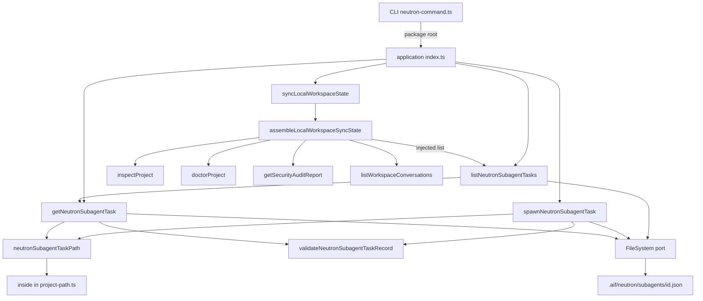
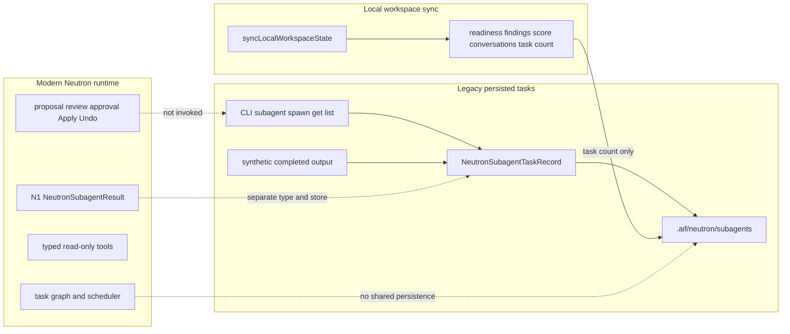
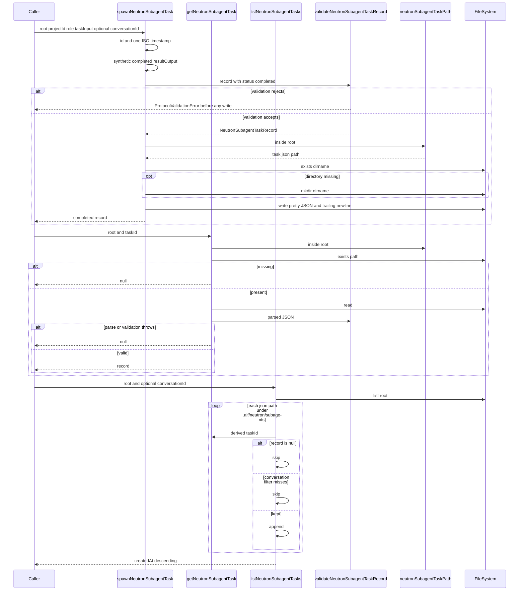
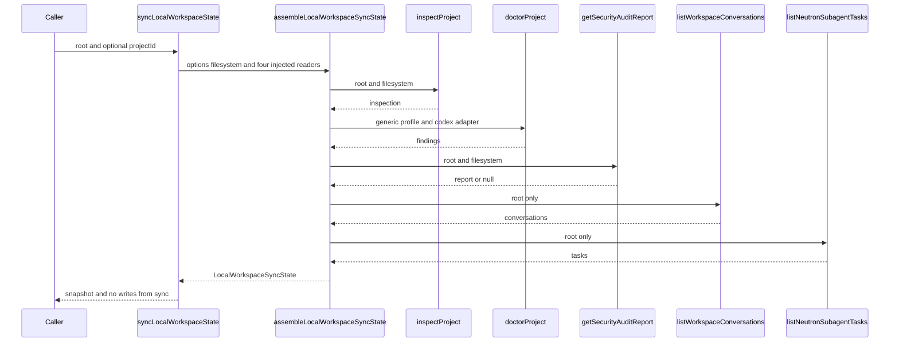
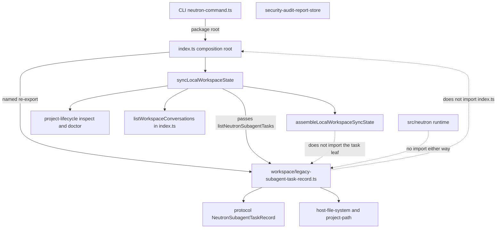
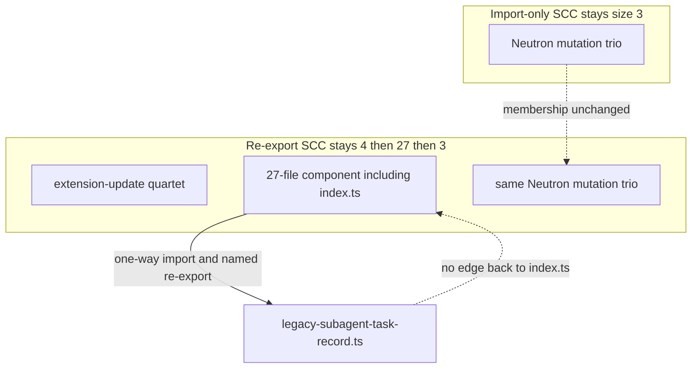
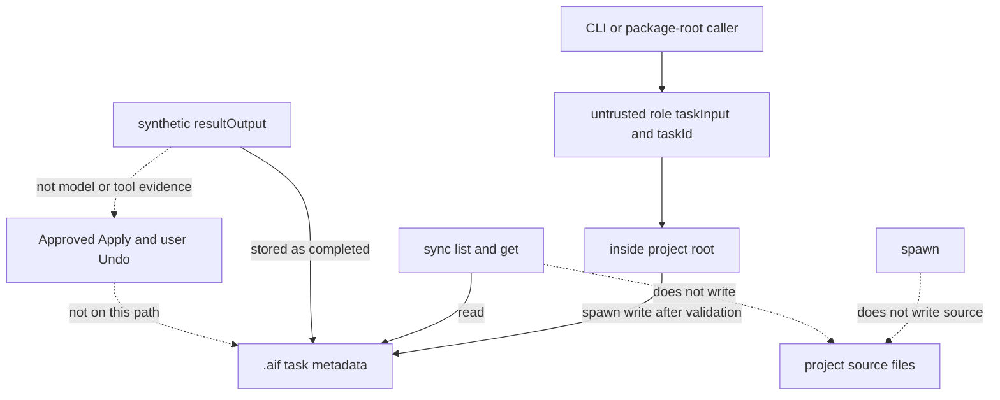
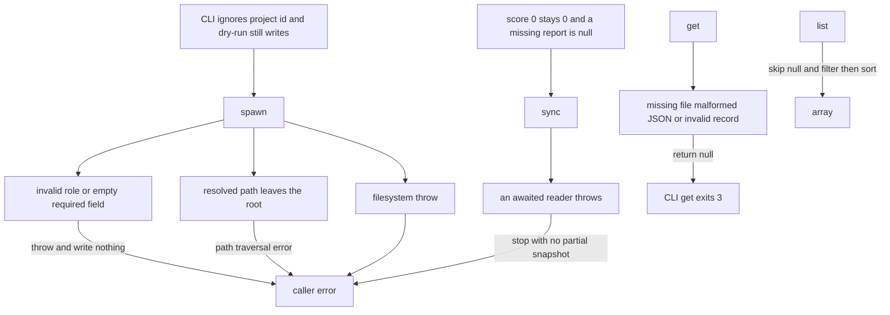

# P1J legacy Neutron helper ownership

Status: **proposal, awaiting maintainer approval**. This document does not
implement the move. It does not approve itself.

Selected recommendation: **Option C**. Move the legacy task-record
operations to a leaf outside `packages/application/src/neutron/`, and
keep `syncLocalWorkspaceState` on `packages/application/src/index.ts`
as the composition-root wrapper. The public names, persistence format,
and synthetic completed-task behavior stay.

## 1. Executive summary

`spawnNeutronSubagentTask`, `getNeutronSubagentTask`,
`listNeutronSubagentTasks`, and the private `neutronSubagentTaskPath`
are an Agent Workspace persistence leaf that still lives in the
application barrel. `syncLocalWorkspaceState` is a different operation:
an eleven-line wrapper that asks the already extracted workspace read
model to combine inspection, doctor, the security audit, conversations,
and those task records.

Spawn does not run a model, a tool, or the Neutron scheduler. It
validates a `NeutronSubagentTaskRecord`, writes it under
`.aif/neutron/subagents/{taskId}.json`, and stores `status: "completed"`
with a synthetic `resultOutput`. That record is not a
`NeutronSubagentResult`, and it is not evidence of graph execution.

The stabilization plan already says these helpers must not be folded
into `src/neutron/`. Putting all four public functions in one new
module would make that module import `index.ts` for
`listWorkspaceConversations`, which creates a new import cycle. Leaving
the task store on the barrel keeps two domains in one oversized file.
Removing the CLI surface would break an accepted ADR and the v1
compatibility window. Option C is the move that preserves behavior and
adds no cycle.

P1J does not finish P1. After the predicted extraction, `index.ts` is
still about 1,804 effective lines. The completion gate is 400 effective
lines, or a later maintainer exception. Undo U4 and Desktop Undo U5
stay unstarted.

Task triage: blast radius 2, ambiguity 2, risk 1, verification 2,
unknowns 1, total 8. Harness: Cursor. Recommended role: frontier.
Effort: high. Subagents: none. Budget: large. The route from
`aif-task-router` is `plan`. Ambiguity is 2 because keeping, moving,
and removing the surface are different architectures. This document is
the decision record. Maintainer review of the design pull request is
the approval gate. Risk is 1 because this pull request changes no
runtime behavior; the security section records existing risks and does
not authorize a fix.

Stop condition: one design pull request, no production edit, no merge,
and no start of the P1J implementation, Undo U4, or Desktop Undo U5.

## 2. Verified current baseline

`origin/main` and local `HEAD` at the start of this design are
`d6b7d4955f2e58780c1ea2afe134f3217ad3fe86`.

| Claim                                           | Evidence                                                               |
| ----------------------------------------------- | ---------------------------------------------------------------------- |
| P1I.3 design PR #620 is merged                  | Merge commit `e93f6b9efdba11d1dd1cd98ed7072a801595320b`                |
| P1I.3a implementation PR #621 is merged         | Merge commit `527ab7f14fc199bc77d21c7e823b4cc2d5c3d926`                |
| P1I.3b implementation PR #622 is merged         | Merge commit `d6b7d4955f2e58780c1ea2afe134f3217ad3fe86`                |
| P1J is not implemented                          | The five declarations are still in `packages/application/src/index.ts` |
| No overlapping P1J design pull request was open | GitHub search for an open P1J or legacy-Neutron design returned none   |

The local checkout was one commit behind `origin/main` and was
fast-forwarded before this audit. The measurements below are from that
fast-forwarded tree.

`measureProductionSource` reports `packages/application/src/index.ts`
at **1,878 effective lines** and **2,034 physical lines** (155 blank
lines, 1 comment line). The previously recorded 1,878 / 2,034 baseline
matches this HEAD. It was remeasured rather than copied forward.

`applicationCycles(false)` returns one component, size `[3]`:

1. `neutron/mutation/apply/neutron-mutation-apply-durable-record.ts`
2. `neutron/mutation/apply/neutron-mutation-apply-store.ts`
3. `neutron/mutation/verification/neutron-mutation-verification-retry-eligibility.ts`

`applicationCycles(true)` returns sizes `[4, 27, 3]`.

1. `apply-extension-update.ts`, `discover-and-apply-extension-update.ts`,
   `extension-update-files.ts`, `propose-and-apply-extension-adoption.ts`
2. The 27-file component that still contains `index.ts` and
   `approved-apply-engine.ts`, and no longer contains
   `approved-apply-baseline.ts` or `generated-file-sync-declared.ts`
3. The same Neutron mutation trio

`index.ts` is outside the import-only component. The grandfathered
ceiling in `docs/governance/quality-exceptions.json` remains 6,764
effective lines and 7,151 physical lines. This design does not change
that file.

Canonical guidance used for the recommendation:

- `docs/architecture/ARCHITECTURE.md` for the frozen Neutron layout
- `docs/architecture/PACKAGES_STABILIZATION_PLAN.md` for the P1J boundary
- `docs/governance/DESIGN_FIRST_POLICY.md`
- `docs/governance/DOMAIN_MODELING.md` for Agent Workspace versus
  Neutron Execution
- `docs/governance/CODE_QUALITY_STANDARDS.md` for the 250 / 40 line
  preferences and the 400 / 80 hard limits
- ADR-0036, ADR-0043, and ADR-0053
- The approved P1H.7 design and the N5 executable-task-graph brief
- R4A–R4D as merged topology, recorded in `ARCHITECTURE.md` and the
  Neutron topology test, not as a new ADR

## 3. Existing architecture

Application use cases stay behind `packages/application/src/index.ts`.
Clients, including the CLI, import the package root. The twelve
`package.json` export-map keys do not name these helpers. Desktop does
not import `@intentloom/application`. Daemon and MCP do not call these
four functions.

Modern Neutron code lives under `packages/application/src/neutron/` in
the R4A directories `session`, `context`, `graph`, `scheduler`,
`tools`, and `mutation`. `tests/application-neutron-topology.test.ts`
locks that root file list, those directory names, and the single
mutation file cycle. P1 does not edit that test to widen the layout.

P1H.7 already moved interactive and local-sync assembly to
`packages/application/src/workspace/interactive-workspace-read-model.ts`.
`syncLocalWorkspaceState` stayed on the barrel and passes
`inspectProject`, `doctorProject`, `listWorkspaceConversations`, and
`listNeutronSubagentTasks` into `assembleLocalWorkspaceSyncState`. The
read model calls `getSecurityAuditReport` itself. It does not import
`index.ts`.

ADR-0036 accepted the legacy task records, the `.aif/neutron/subagents/`
directory, the sync snapshot, and the CLI commands
`intentloom neutron subagent <spawn|get|list>` and
`intentloom neutron sync`. The N5 brief keeps
`NeutronSubagentTaskRecord` separate from `NeutronSubagentResult`.



## 4. Problem statement

The application barrel still owns two unrelated responsibilities at
lines 1917–2018:

- a writable store of flat legacy task records
- a read-only composition wrapper for local workspace sync

The store is named Neutron, and the files live under `.aif/neutron/`,
but the implementation is the Agent Workspace pattern already used by
conversations: one JSON file per id, `inside` for containment, and a
full-tree `FileSystem.list` scan. It does not call the provider-neutral
runtime, the scheduler, or mutation.

`index.ts` is 1,878 effective lines. The P1 completion gate requires a
re-export barrel at or below 400 effective lines and 700 physical
lines, or a maintainer-accepted exception for whatever remains. These
helpers are a real leaf, and they are also too small to satisfy that
gate by themselves.

A move that imports `index.ts` to reach `listWorkspaceConversations`
would put `index.ts` back into an import-only component. That is a new
cycle. The post-P1I.3b graph has only the Neutron mutation trio.

## 5. Goals and non-goals

Goals:

- Name the owner of the legacy task records and of local workspace sync.
- Keep the public function names, signatures, and package-root exports.
- Keep the CLI commands and their current defaults.
- Keep the JSON schema, path, and synthetic completed-task behavior.
- Keep `syncLocalWorkspaceState` sequential and free of writes.
- Add no import-only or re-export cycle.
- Leave `src/neutron/` and the Neutron topology test unchanged.
- State the barrel declarations that remain after this slice.

Non-goals:

- Implementing the move in this pull request.
- Replacing the synthetic result with model, tool, or scheduler
  execution.
- Editing protocol types, the validator, or the persistence schema.
- Unifying `NeutronSubagentTaskRecord` with `NeutronSubagentResult`.
- Moving workspace conversations, proposals, or memory operations.
- Changing symlink behavior, scan limits, or validation strictness.
- Adding a package export-map key or a `neutron/index.ts` barrel.
- Starting Undo U4, Desktop Undo U5, or another stabilization phase.
- Declaring P1 complete.
- Changing `quality-exceptions.json`.

## 6. Declaration and source-size inventory

Measured with `measureProductionSource` on
`d6b7d4955f2e58780c1ea2afe134f3217ad3fe86`. Line numbers are 1-based and
include the signature. Effective lines exclude blanks and comments.

| Declaration                                             |     Lines | Effective | Physical | Exported |
| ------------------------------------------------------- | --------: | --------: | -------: | -------- |
| `neutronSubagentTaskPath`                               | 1917–1919 |         3 |        3 | no       |
| `spawnNeutronSubagentTask`                              | 1921–1955 |        32 |       35 | yes      |
| `getNeutronSubagentTask`                                | 1957–1969 |        13 |       13 | yes      |
| `listNeutronSubagentTasks`                              | 1971–2007 |        36 |       37 | yes      |
| Task-record region, including blanks between those four | 1917–2007 |        84 |       91 | —        |
| `syncLocalWorkspaceState`                               | 2008–2018 |        11 |       11 | yes      |
| All five, including the blanks between them             | 1917–2018 |        95 |      102 | —        |
| `packages/application/src/index.ts`                     |    1–2034 |     1,878 |    2,034 | barrel   |

No function in this region exceeds 40 effective lines. `index.ts`
remains far above the 400-line hard ceiling and is covered by the
existing grandfathered baseline. This slice must not raise that
baseline and must not make the file larger.

### Spawn

`spawnNeutronSubagentTask(options, fs = nodeFileSystem)` returns
`Promise<NeutronSubagentTaskRecord>`.

- `options.root`, `options.projectId`, `options.role`, and
  `options.taskInput` are required. `options.conversationId` is optional.
- The id is `` `task-${Date.now()}-${Math.random().toString(36).slice(2, 8)}` ``.
- `createdAt` and `completedAt` are the same `new Date().toISOString()`.
- `conversationId` is `options.conversationId ?? null`.
- `status` is the literal `"completed"`. There is no `pending` or
  `running` write.
- `resultOutput` is exactly
  `` `Neutron subagent (${options.role}) completed research task: "${options.taskInput}"` ``.
  The words "completed research task" are present for every role.
- `validateNeutronSubagentTaskRecord` runs before any filesystem call.
  `stringValue` rejects an empty `projectId`, `role`, `taskInput`, `id`,
  or timestamp. An unknown role or status throws
  `ProtocolValidationError`. A throw writes nothing.
- The path is `inside(root, `.aif/neutron/subagents/${id}.json`)`.
- The directory is created only when `fs.exists(dirname(path))` is
  false. The write is `JSON.stringify(record, null, 2)` plus a trailing
  newline. The serialized object is the validator's field order.
- The default filesystem is `nodeFileSystem`.

### Get

`getNeutronSubagentTask({ root, taskId }, fs = nodeFileSystem)` returns
`Promise<NeutronSubagentTaskRecord | null>`.

- A missing file returns `null`.
- `JSON.parse` failures and validator failures return `null`.
- The `try` starts after `exists`. An `exists` rejection propagates.
- A `read` rejection is inside the `try` and becomes `null`.
- The validator coerces a non-string `conversationId` to `null`, and a
  non-string `resultOutput` or `completedAt` to `null`. Empty required
  strings throw, which this function turns into `null`.

### List

`listNeutronSubagentTasks({ root, conversationId? }, fs = nodeFileSystem)`
returns `Promise<readonly NeutronSubagentTaskRecord[]>`.

- It scans `fs.list(root)`, not the subagent directory alone.
- A path that starts with `root` is made relative. Any other path is
  used as returned. Backslashes become slashes.
- A candidate must start with `.aif/neutron/subagents/` and end with
  `.json`.
- The task id is that relative path with the prefix and the `.json`
  suffix removed. A nested relative path remains part of the id.
- Each candidate goes through `getNeutronSubagentTask`. `null` drops the
  entry.
- The conversation filter runs only when `options.conversationId` is
  truthy. `undefined` and `""` both list every valid record. A supplied
  id uses strict equality with `record.conversationId`.
- The result is sorted by `new Date(createdAt).getTime()` descending.
- `fs.list` rejection propagates. A `path traversal` throw from `inside`
  during `get` also propagates, because path construction sits outside
  `get`'s `try`.

### Sync

`syncLocalWorkspaceState({ root, projectId? }, fs = nodeFileSystem)`
returns `Promise<LocalWorkspaceSyncState>`.

The body calls `assembleLocalWorkspaceSyncState` with `inspectProject`,
`doctorProject`, `listWorkspaceConversations`, and
`listNeutronSubagentTasks`. It does not pass `projectId` into those
readers. The assembler then, in order and without `Promise.all`:

1. `inspectProject(root, fs)`, with no catch
2. `doctorProject({ root, profile: "generic", adapters: ["codex"] }, fs)`
3. `getSecurityAuditReport({ root }, fs)`
4. `listWorkspaceConversations({ root }, fs)`
5. `listNeutronSubagentTasks({ root }, fs)`

The snapshot uses `options.projectId ?? "project-local"`,
`inspection.readiness`, `doctor.findings.length`,
`auditReport ? auditReport.healthScore : null`, the two array lengths,
and `new Date().toISOString()` as `syncedAt`. A stored health score of
`0` stays `0`. A missing or invalid audit report becomes `null`. An
`exists` failure on the audit file propagates. A first reader rejection
prevents the later reads. Sync itself writes nothing.

### Filesystem defaults that the move must keep

`nodeFileSystem.list` walks the tree, skips symbolic links, skips the
ignored scan directories, skips binary extensions, and stops at depth
32 or 10,000 files. A walk error returns `[]`. `createMemoryFileSystem`
returns every stored key with the directory prefix and does not apply
that cap. `exists` uses `stat` and therefore follows links. `read` and
`write` follow links. `mkdir` is recursive on the node adapter and a
no-op on the memory adapter.

## 7. Complete caller and dependency inventory

### Direct runtime consumers

| Caller                                | Symbols                                                                                                                        | Kind                                        |
| ------------------------------------- | ------------------------------------------------------------------------------------------------------------------------------ | ------------------------------------------- |
| `packages/application/src/index.ts`   | all five                                                                                                                       | definition and, for sync, the call          |
| `packages/cli/src/neutron-command.ts` | the four public functions, plus `nodeFileSystem` and `NeutronSubagentRole`                                                     | value import from `@intentloom/application` |
| `spawnNeutronSubagentTask`            | `neutronSubagentTaskPath`, `validateNeutronSubagentTaskRecord`, `dirname`, `inside`, `FileSystem`                              | internal                                    |
| `getNeutronSubagentTask`              | `neutronSubagentTaskPath`, `validateNeutronSubagentTaskRecord`                                                                 | internal                                    |
| `listNeutronSubagentTasks`            | `getNeutronSubagentTask`, `relative`, `FileSystem.list`                                                                        | internal                                    |
| `syncLocalWorkspaceState`             | `assembleLocalWorkspaceSyncState`, `inspectProject`, `doctorProject`, `listWorkspaceConversations`, `listNeutronSubagentTasks` | internal                                    |

The CLI sync command passes `{ root }` and the filesystem. It does not
pass `projectId`, so the snapshot id is `project-local`. Spawn from the
CLI uses `projectId: "project-local"`, role `--role` or `"research"`,
task text `--input` or `--content` or `"General research task"`, and
`--conversation-id` only when that flag is present. `--project-id` is
accepted by the parser and ignored. `--dry-run` does not suppress the
write. Get uses `--task-id` or else `--id`, and an empty id when both
are absent. A null get prints to stderr and returns exit code 3.

### Package-root re-exports

`packages/application/src/index.ts` re-exports `NeutronSubagentRole`,
`NeutronSubagentStatus`, `NeutronSubagentTaskRecord`, and
`validateNeutronSubagentTaskRecord` from `@intentloom/protocol`. Those
re-exports stay. The validator implementation stays in
`packages/protocol/src/index.ts`. It was not moved by R4B, and this
design does not move it.

`packages/cli/src/index.ts` is `export * from "@intentloom/application"`.
That is an indirect re-export of the public functions, not another
implementation.

### Indirect consumers

| Caller                                                                   | Relationship                                                                  |
| ------------------------------------------------------------------------ | ----------------------------------------------------------------------------- |
| `assembleLocalWorkspaceSyncState`                                        | Calls the injected `listNeutronSubagentTasks`. It does not import the barrel. |
| `packages/application/src/workspace/interactive-workspace-read-model.ts` | Declares that dependency. `getInteractiveWorkspaceState` does not list tasks. |
| `tests/workspace-read-model-p1h7-fixtures.ts`                            | Supplies a fake `listNeutronSubagentTasks`.                                   |
| `tests/workspace-read-model-p1h7.test.ts`                                | Calls the public sync function and the assembler with a fake list.            |
| `tests/security-audit-behavior-p1h6.test.ts`                             | Calls public sync to read `securityScore`.                                    |

### Not consumers

Searches of `packages/daemon`, `packages/mcp-server`, and `apps/` found
no references to these four functions. Desktop has no application
import. The modern scheduler builds `NeutronSubagentResult` in
`packages/application/src/neutron/scheduler/node/neutron-node-result.ts`
and does not read `.aif/neutron/subagents/`.

### Tests that already lock behavior

- `tests/neutron-orchestration.test.ts`
- `tests/cli-neutron.test.ts`
- `tests/workspace-read-model-p1h7.test.ts`
- `tests/workspace-read-model-p1h7-structure.test.ts`
- `tests/security-audit-behavior-p1h6.test.ts`

Five structure tests pin `index.ts` at 1,878 effective lines and 2,034
physical lines. An implementation has to update those pins to the
measured post-format size. That is a size lock, not a behavior
assertion. The implementation must not edit the behavioral expectations
in the tests above.

## 8. Domain responsibility map

`DOMAIN_MODELING.md` lists Agent Workspace and Neutron Execution as
separate context candidates. A context is a vocabulary boundary, not a
folder name.

| Concept                  | Owner today                                                         | Vocabulary                                         |
| ------------------------ | ------------------------------------------------------------------- | -------------------------------------------------- |
| Legacy task record       | application barrel                                                  | `NeutronSubagentTaskRecord`, roles, flat JSON file |
| Legacy task path         | private barrel helper                                               | `.aif/neutron/subagents/{taskId}.json`             |
| Local workspace snapshot | barrel wrapper plus `workspace/interactive-workspace-read-model.ts` | `LocalWorkspaceSyncState`                          |
| Workspace conversations  | application barrel                                                  | `WorkspaceConversationRecord`                      |
| Security score input     | `security/security-audit-report-store.ts`                           | `ContinuousSecurityAuditReport.healthScore`        |
| Inspection and doctor    | `project-lifecycle/`                                                | readiness and findings                             |
| N1 execution result      | `packages/protocol/src/neutron/runtime/neutron-runtime.ts`          | `NeutronSubagentResult`                            |
| Graph execution          | `src/neutron/scheduler/`                                            | node state, attempts, cancellation                 |
| Mutation authority       | `src/neutron/mutation/`                                             | proposal, review, approval, Apply, Undo            |

The legacy store matches Agent Workspace persistence. The directory
name `.aif/neutron/` is historical and is not a reason to place the
code under `src/neutron/`.

## 9. Legacy versus modern Neutron boundary



### A. Legacy persisted subagent tasks

`NeutronSubagentTaskRecord` has `schemaVersion: "1"`, `id`,
`projectId`, `conversationId`, a closed role union, a closed status
union (`pending`, `running`, `completed`, `failed`), `taskInput`,
`resultOutput`, `createdAt`, and `completedAt`. Records are flat. There
is no parent, session, graph node, lease, or tool envelope. Spawn
always persists `completed`. The CLI is
`intentloom neutron subagent spawn|get|list`.

### B. Modern Neutron runtime

The runtime is provider-neutral. N1 publishes `NeutronSubagentResult`
with `taskId`, `sessionId`, `root`, status `completed | failed |
cancelled`, an output digest, and `mutationAttempted: false`. N2 is the
read-only loop. N3 assembles context. N4 routes typed read-only tools.
N5 schedules an executable task graph, runs nodes, and can cancel work.
Mutation stays behind proposal, review, approval, Approved Apply, and
user Undo. Those stages have their own durable files. They do not read
or write `.aif/neutron/subagents/`.

R4A froze the application tree. R4B left the legacy record and its
validator in `packages/protocol/src/index.ts` instead of
`packages/protocol/src/neutron/`. R4C and R4D did not attach this store
to the validator Neutron tree or the daemon Neutron tree. This design
does not reopen those layouts.

### C. Local workspace synchronization

`syncLocalWorkspaceState` and `assembleLocalWorkspaceSyncState` build
one read-only snapshot: readiness, finding count, security score,
conversation count, legacy task count, and `syncedAt`. The task count
is `tasks.length` after an unfiltered list. It is not a count of
running graph nodes.

### Where they meet, and where they stay apart

Sync meets the legacy store only as a count. It does not meet
`NeutronSubagentResult`. The N5 brief says a later slice may link a
graph node to a legacy `taskId`. That link is not this slice, and this
slice must not create it. A pure extraction copies the synthetic
completion. It does not turn the stub into execution.

## 10. Current filesystem and data flows





Spawn is the only writer among the five declarations. It creates
`.aif/neutron/subagents/` when the directory is absent and writes one
task file. Get, list, and sync do not write. Sync's callees, as
currently injected, are reads: inspection, doctor, the audit report,
conversations, and the task list. The P1H.7 tests lock that sync makes
no `write`, `mkdir`, or `remove` of its own.

`inside` resolves `root` and the relative path and throws
`path traversal: ...` when the resolved path is outside the root.
Spawn's generated id has no slash or `..`, so a normal spawn stays
inside the root. A caller-supplied `taskId` of the form that resolves
outside the root throws before the read.

## 11. Public contracts

These signatures stay, including parameter order and the default
filesystem:

```ts
spawnNeutronSubagentTask(
  options: {
    root: string;
    projectId: string;
    conversationId?: string;
    role: NeutronSubagentRole;
    taskInput: string;
  },
  fs?: FileSystem,
): Promise<NeutronSubagentTaskRecord>;

getNeutronSubagentTask(
  options: { root: string; taskId: string },
  fs?: FileSystem,
): Promise<NeutronSubagentTaskRecord | null>;

listNeutronSubagentTasks(
  options: { root: string; conversationId?: string },
  fs?: FileSystem,
): Promise<readonly NeutronSubagentTaskRecord[]>;

syncLocalWorkspaceState(
  options: { root: string; projectId?: string },
  fs?: FileSystem,
): Promise<LocalWorkspaceSyncState>;
```

`neutronSubagentTaskPath` stays unexported. `LocalWorkspaceSyncState`
stays owned by the read-model module and re-exported by `index.ts`.
The protocol record, role, status, and validator stay where they are.
The twelve application export-map keys stay. CLI text, JSON, and exit
codes stay, including exit 3 for a missing get and exit 2 for an
invalid role.

`LocalWorkspaceSyncDependencies.listNeutronSubagentTasks` stays an
injected function. The read model must not start importing the task
leaf. P1H.7 approved that seam so the assembler can be tested without
the store and without `index.ts`.

## 12. Comparison of architecture alternatives

Scores are 5 when the option is strongest on that concern and 1 when it
is weakest. Compatibility scores of 5 mean observable behavior stays.

| Concern                    | A. Leave in `index.ts` | B. One module for tasks and sync | C. Tasks move, sync stays | D. Deprecate or remove | Fold into `src/neutron/` |
| -------------------------- | ---------------------: | -------------------------------: | ------------------------: | ---------------------: | -----------------------: |
| Cohesion and DDD ownership |                      2 |                                3 |                         5 |                      2 |                        1 |
| Import direction           |                      5 |                                1 |                         5 |                      4 |                        2 |
| SCC impact                 |                      5 |                                1 |                         5 |                      5 |                        2 |
| Runtime compatibility      |                      5 |                                4 |                         5 |                      1 |                        3 |
| CLI compatibility          |                      5 |                                5 |                         5 |                      1 |                        5 |
| Public API stability       |                      5 |                                4 |                         5 |                      1 |                        4 |
| Persistence format         |                      5 |                                5 |                         5 |                      2 |                        4 |
| Security and containment   |                      3 |                                3 |                         3 |                      3 |                        2 |
| Testability                |                      3 |                                4 |                         5 |                      2 |                        2 |
| Migration cost             |                      5 |                                2 |                         4 |                      1 |                        2 |
| Future Neutron integration |                      2 |                                3 |                         4 |                      2 |                        1 |
| Implementation complexity  |                      5 |                                2 |                         4 |                      3 |                        2 |
| Semantic-drift risk        |                      5 |                                3 |                         5 |                      1 |                        1 |

### Option A — keep the helpers in `index.ts`

This is the plan's current default until a maintainer decides. It has
perfect compatibility and no cycle risk. It is still the wrong owner.
The task store does not use any other barrel-only binding except types
and helpers that already live in leaves (`FileSystem`, `inside`, and
the protocol validator). Sync is the function that must see other
barrel functions. Leaving both in the barrel preserves a mix that P1
is trying to remove, and it does not move the 1,878-line file toward
the completion gate. Option A remains acceptable only if the maintainer
wants no further extraction in this area.

### Option B — one module owns the task store and sync

The task operations can move. Sync cannot move with them unless it can
see `listWorkspaceConversations`. That function is still implemented in
`index.ts`. A new module that imports it from `index.ts`, while
`index.ts` imports or re-exports the new module, is a new import-only
component of at least `{index.ts, new module}`. The design rule for
this program is that no new cycle is acceptable.

Moving conversations in the same pull request would avoid that cycle
and would also exceed this milestone. Conversations, redaction,
promotion, and proposal review are a separate workspace slice. Option
B is not viable inside P1J.

### Option C — task leaf, sync wrapper stays

The task region has no import of `index.ts`. Its dependencies are
`node:path`, `@intentloom/protocol`, `host-file-system.ts`, and
`project-path.ts`. None of those import the barrel.
`syncLocalWorkspaceState` stays in `index.ts`, imports
`listNeutronSubagentTasks` from the leaf, and passes it into the read
model together with the readers that are still on the barrel. That is
the same composition-root shape P1H.7, P1I.1, and P1I.2 already use.

The public signatures stay. The CLI keeps importing the package root.
The read model keeps its injected port. Predicted SCC membership is
unchanged. This is the recommended option.

### Option D — deprecate or remove the surface

Removal is not authorized, and the evidence does not support it.

- ADR-0036 is accepted and still specifies these commands and files.
- ADR-0043 requires a deprecation warning for at least two minor
  releases before a CLI command or flag can go away, and it forbids
  silent behavior removal. No deprecation warning exists today.
- `packages/cli/src/neutron-command.ts` and
  `tests/cli-neutron.test.ts` are live consumers.
- The N5 brief keeps the legacy record as the CLI persistence shape
  until a separate migration is justified.
- Orphaned `.aif/neutron/subagents/*.json` files would remain on disk
  with no reader.

Daemon and Desktop do not call the functions. That absence is not a
removal license. The CLI and the application package root do call them.

### Why `src/neutron/` is not a viable destination

The stabilization plan says the legacy helpers are Agent Workspace era
storage and must not be merged into the Neutron runtime. The topology
test would reject the placement without an allowlist edit:

- a new file in the Neutron root fails the locked `ROOT_FILES` list
- a new directory fails the locked `TOP_DIRECTORIES` list
- `neutron/index.ts` is both forbidden by the architecture and rejected
  as a dumping-ground name
- P1's ratchet says the Neutron topology test stays unchanged

Placing the stub next to `buildNeutronSubagentResult` would make a
synthetic completed record look like execution evidence. The modern
tree also must not take a dependency on `listWorkspaceConversations`
or on `index.ts`. Folding is rejected even if a later maintainer
unfreezes R4A for a real execution migration. That migration is a
different design.

## 13. Selected recommendation and rationale

**Verdict C, proposed, not approved.**

Move `neutronSubagentTaskPath`, `spawnNeutronSubagentTask`,
`getNeutronSubagentTask`, and `listNeutronSubagentTasks` unchanged into
one leaf. Keep `syncLocalWorkspaceState` on `index.ts`. Re-export the
three public functions from `index.ts` with named exports. Do not
change protocol, CLI, persistence, or the synthetic result.

This is the only option that improves ownership, keeps the P1H.7
injection seam, and adds no cycle. The maintainer can still choose
Option A. Option B and Option D, and a move into `src/neutron/`, are
not recommended.

## 14. Proposed module ownership

Proposed file:

`packages/application/src/workspace/legacy-subagent-task-record.ts`

The `workspace/` directory already holds the local workspace read
model. The task records are the metadata that sync counts. The file
name says `legacy` so the store is not mistaken for the read model or
for the Neutron runtime. The read model does not import this file.

Rejected locations inside the same option:

- `packages/application/src/neutron/**`. Frozen, and the wrong context.
- A new `agent-workspace/` directory for one file. The existing
  workspace directory already names the context. A second directory
  needs a demonstrated second module.
- The read-model file itself. That file is 205 effective lines. Adding
  the 84-line store crosses the 250-line preference and mixes a writer
  into a read model.
- `packages/application/src/legacy-subagent-task-record.ts` at the
  package root. It would also be acyclic. It isolates the word Neutron
  from `workspace/`, and it adds another root file while P1 is moving
  root files into directories. Prefer the existing directory unless the
  maintainer wants the root file instead. That path change is still
  verdict C.

The leaf exports only the three public functions. The path helper stays
private. The leaf imports `nodeFileSystem` for the default parameter
and does not re-export it.

`index.ts` keeps `dirname`, `relative`, and `inside`. Conversations and
proposals still use them. `index.ts` keeps the protocol type re-exports
and the validator re-export.

Illustrative barrel binding, not an implementation:

```ts
import {
  getNeutronSubagentTask,
  listNeutronSubagentTasks,
  spawnNeutronSubagentTask,
} from "./workspace/legacy-subagent-task-record.js";

export {
  getNeutronSubagentTask,
  listNeutronSubagentTasks,
  spawnNeutronSubagentTask,
};
```

`syncLocalWorkspaceState` continues to pass the imported
`listNeutronSubagentTasks` into `assembleLocalWorkspaceSyncState`.
Use named exports. Do not add `export *` from the leaf.



## 15. Import and SCC predictions

These are predictions. The implementation must measure
`applicationCycles` and record the member lists. A prediction is not a
result.

| Question                                       | Prediction for verdict C                                                                                                                        |
| ---------------------------------------------- | ----------------------------------------------------------------------------------------------------------------------------------------------- |
| Does the new module import `index.ts`?         | No                                                                                                                                              |
| Does `index.ts` import or re-export it?        | Yes. A value import, plus a named re-export of the three functions                                                                              |
| Does the workspace read model import the leaf? | No. It keeps the injected port                                                                                                                  |
| Does a new import-only SCC appear?             | No. The only import-only component remains the Neutron trio, size 3                                                                             |
| Do re-export component sizes change?           | No. Sizes stay 4, 27, and 3. The new file is outside every component because nothing in those components imports it and it imports none of them |
| Does Neutron topology change?                  | No. No file under `src/neutron/` changes                                                                                                        |

`export { name } from "./workspace/legacy-subagent-task-record.js"` is
also a one-way re-export edge. Either export style is acyclic. The
local import is required so `syncLocalWorkspaceState` can pass the
function. Do not satisfy that use by importing the function from
`index.ts` inside the leaf.

Option B's prediction is a new import-only component containing at
least `index.ts` and the new module. That prediction is why Option B is
rejected. Creating the file does not remove a cycle, and importing the
barrel from the file adds one.



## 16. Security and authorization



Existing behavior, recorded as risks. A fix is a separate authorized
slice. The extraction copies the behavior.

| Boundary                         | Current behavior                                                                                            | Risk if misread                                                                                                                         |
| -------------------------------- | ----------------------------------------------------------------------------------------------------------- | --------------------------------------------------------------------------------------------------------------------------------------- |
| Project-root containment         | `inside` throws when the resolved path leaves the root                                                      | Spawn ids are safe. Caller-supplied ids can throw, and list does not catch that throw                                                   |
| Task-id path shape               | The id is interpolated into one relative path                                                               | A nested id stays under the subagent directory when it does not escape the root. The extraction must not add a second path rule         |
| Symbolic links                   | `list` skips link entries. `stat`, `read`, and `write` follow links                                         | A link at the task path can be read or written by get and spawn while list never walks it. The path string can still be inside the root |
| Malformed records                | Parse and validation failures become `null` and disappear from list                                         | Corruption is hidden instead of reported. Preserve that until a separate slice                                                          |
| Untrusted input                  | `taskInput` and `role` are stored and copied into `resultOutput`                                            | `JSON.stringify` escapes the file. The text is still untrusted if a later reader treats it as evidence                                  |
| Synthetic results                | Status is `completed` immediately                                                                           | This is not model output, tool output, or an output digest. Do not present it as execution evidence                                     |
| Read-only boundary               | Get, list, and sync do not write. Spawn writes one metadata file                                            | ADR-0036's source-tree read-only rule still holds for project source. The `.aif` task file is an intentional metadata write             |
| Source-tree mutation             | Spawn does not write source files. Sync does not write                                                      | Do not add a source write during the move                                                                                               |
| Authorization                    | None. Any caller with a root and a `FileSystem` can spawn                                                   | The record is not an approval token and not an Apply grant                                                                              |
| Cancellation and execution state | The schema allows `pending`, `running`, and `failed`. Spawn never writes them. There is no cancel operation | Do not invent those transitions in an extraction                                                                                        |
| Approved Apply and user Undo     | Not called                                                                                                  | A task file is not an Apply record and not an Undo snapshot                                                                             |

No provider call, tool execution, shell, network, or background worker
is added. `nodeFileSystem.list` can also omit task files after 10,000
entries or inside an ignored directory, and it returns `[]` when the
walk throws. The memory filesystem does not. Both behaviors stay.

## 17. Error handling and backward compatibility



Preserve these results exactly:

| Situation                                                 | Result                                      |
| --------------------------------------------------------- | ------------------------------------------- |
| Invalid role or empty required spawn field                | `ProtocolValidationError`, no file          |
| Filesystem failure on spawn `exists`, `mkdir`, or `write` | rejection, after validation                 |
| Missing task                                              | `null`. CLI get exits 3 and writes stderr   |
| Malformed JSON or invalid record                          | `null`, then list skips it                  |
| `exists` throws on get                                    | rejection                                   |
| `read` throws on get                                      | `null`                                      |
| Falsy `conversationId`, including `""`                    | list does not filter                        |
| Truthy `conversationId`                                   | strict equality                             |
| Sort                                                      | `createdAt` descending through `Date.parse` |
| CLI `--role` omitted                                      | `research`                                  |
| CLI input omitted                                         | `"General research task"`                   |
| CLI `--content`                                           | used when `--input` is absent               |
| CLI `--project-id`                                        | ignored. Stored id is `project-local`       |
| CLI `--dry-run`                                           | spawn still writes                          |
| CLI get without an id                                     | looks up `""` and exits 3                   |
| Sync `projectId` omitted                                  | snapshot uses `project-local`               |
| Sync task and conversation reads                          | root only, no conversation filter           |
| Audit report missing, invalid, or unreadable as a report  | `securityScore: null`                       |
| Audit `healthScore` is `0`                                | `securityScore: 0`                          |
| Audit `exists` throws                                     | sync rejects                                |
| Any earlier sync reader throws                            | later readers are not called                |
| Doctor arguments                                          | `profile: "generic"`, `adapters: ["codex"]` |

The implementation must not "correct" the synthetic sentence, the
ignored `--project-id`, the persisting `--dry-run`, the null-on-corrupt
read, or the full-tree scan. Those are compatibility behavior. A later
pull request can propose a change with its own tests.

## 18. Persistence and migration considerations

No migration. The path, schema version, and JSON formatting stay. Files
written before the move remain readable, because `get` still validates
the same protocol object. Files written after the move use the same
serializer. There is no new field, no status backfill, and no rewrite
of existing files.

Rollback of the implementation is a git revert. It does not need a data
migration. Orphan cleanup is out of scope because the store stays.

ADR-0043's non-destructive `.aif` rule is already met: spawn creates
only the task file and its directory. The move must not start rewriting
other `.aif` files.

## 19. Function and file size budgets

| Artifact                                               | Effective | Physical | Budget                                            |
| ------------------------------------------------------ | --------: | -------: | ------------------------------------------------- |
| Current task-record region removed from `index.ts`     |        84 |       91 | —                                                 |
| Replacement import and named re-export                 |        10 |       10 | glue                                              |
| Predicted `index.ts`                                   |     1,804 |    1,953 | still over 400 / 700. Grandfathered ceiling stays |
| `syncLocalWorkspaceState` after the move               |        11 |       11 | stays on the barrel                               |
| New module header imports                              |         8 |        8 | —                                                 |
| New module, header plus the moved region and one blank |        92 |      100 | under the 250 preference                          |
| `neutronSubagentTaskPath`                              |         3 |        3 | under 40                                          |
| `spawnNeutronSubagentTask`                             |        32 |       35 | under 40                                          |
| `getNeutronSubagentTask`                               |        13 |       13 | under 40                                          |
| `listNeutronSubagentTasks`                             |        36 |       37 | under 40                                          |

The 1,804 and 1,953 figures assume the 10-line glue replaces lines
1917–2007 and Prettier adds no extra blank. The implementation
remeasures after formatting and locks those measured numbers. It does
not lock this prediction. The new module must stay at or below 250
effective lines. No function may grow past 40 effective lines in the
move. Do not split a function that is already under 40 just to change
its shape.

`quality-exceptions.json` stays byte-for-byte. The grandfathered
`index.ts` ceiling is not lowered in this slice. Lowering it is a gate
change, which the stabilization plan leaves to a separate decision.

### What remains in `index.ts`

P1 is not complete after P1J. These implementations are still in the
barrel on this baseline. Sizes are effective lines for the measured
regions, not a promise that each region is one future pull request.

| Remaining region                                              | Effective lines | Notes                                                                                       |
| ------------------------------------------------------------- | --------------: | ------------------------------------------------------------------------------------------- |
| Import and re-export header above the first local declaration |       about 309 | Shrinks only as implementations leave                                                       |
| Root check and `timelineProject`                              |              78 | `timelineProject` is 55                                                                     |
| `synchronizeGeneratedFiles`, `syncProject`, `adoptProject`    |              31 | Approved composition wrappers. They stay until their callees can be reached without a cycle |
| `planFeature` and `planPackUpdate`                            |       about 117 | `planFeature` is 79                                                                         |
| Task and session summaries                                    |             179 | —                                                                                           |
| Checkpoints and task control                                  |             179 | —                                                                                           |
| Semantic ranking                                              |             117 | `rankProceduralMemory` is 80                                                                |
| Profiles and delegation                                       |             124 | `delegateTaskRole` is 65                                                                    |
| `getBoundedProjectContext`                                    |             153 | Over the 80-line hard limit. A later slice must decompose it, not move it whole             |
| `correlateSecurityFindings` and `runLocalSecurityAdapters`    |             213 | `runLocalSecurityAdapters` is 213 and over the hard limit                                   |
| Interactive workspace wrapper and its state type              |              42 | Wrapper stays. The assembler is already a leaf                                              |
| Conversations                                                 |             120 | The binding that keeps sync on the barrel                                                   |
| Proposals, review, and apply                                  |             105 | Includes `adoptProject` calls                                                               |
| `syncLocalWorkspaceState`                                     |              11 | Stays under verdict C                                                                       |
| Trailing `export *` block                                     |              16 | —                                                                                           |

Further approved slices are required before the 400-line gate. This
design does not choose the next slice. Likely candidates are the
security-adapter runners, the memory and checkpoint family, and the
workspace conversation family. Each one needs its own design if more
than one ownership is honest. `getBoundedProjectContext` and
`runLocalSecurityAdapters` cannot move unchanged without a
function-size exception.

The re-export component of 27 files also remains, because
`approved-apply-engine.ts` still value-imports `synchronizeGeneratedFiles`
from the barrel. Removing that edge is outside P1J.

## 20. Regression-test matrix

The implementation pull request preserves the current tests and adds
one structure test. It does not add behavior tests that would force a
"fix". It updates only the `index.ts` size pins.

| Concern                                                   | Existing test to preserve                                          | Implementation addition                                                                                                             |
| --------------------------------------------------------- | ------------------------------------------------------------------ | ----------------------------------------------------------------------------------------------------------------------------------- |
| Protocol record and validator                             | current spawn and get tests, protocol topology test                | no protocol edit                                                                                                                    |
| CLI spawn, get, list, and sync                            | `tests/cli-neutron.test.ts`, `tests/neutron-orchestration.test.ts` | none                                                                                                                                |
| `--project-id` ignored and `--dry-run` still writes       | `tests/cli-neutron.test.ts`                                        | none                                                                                                                                |
| Conversation filter                                       | `tests/cli-neutron.test.ts`                                        | none                                                                                                                                |
| Synthetic completed output                                | `tests/neutron-orchestration.test.ts`                              | none                                                                                                                                |
| Sync does not mutate the file set                         | `tests/neutron-orchestration.test.ts`                              | none                                                                                                                                |
| Sequential sync, score `0`, null report, reader rejection | `tests/workspace-read-model-p1h7.test.ts`                          | none                                                                                                                                |
| Security score through public sync                        | `tests/security-audit-behavior-p1h6.test.ts`                       | none                                                                                                                                |
| Read model does not import `index.ts`                     | `tests/workspace-read-model-p1h7-structure.test.ts`                | keep that assertion                                                                                                                 |
| Public package root                                       | CLI imports and the workspace export test                          | structure test asserts the three names stay exported from `index.ts`                                                                |
| Package subpaths                                          | workspace structure test's twelve keys                             | assert the key list is unchanged                                                                                                    |
| File and function budgets                                 | five structure tests pin 1,878 / 2,034                             | update those five pins to the measured size. New test pins the leaf under 250 and each moved function at its current effective size |
| SCC membership                                            | structure tests lock sizes and the 27 members                      | assert the same members. Assert the new file is in none of them                                                                     |
| Neutron topology                                          | `tests/application-neutron-topology.test.ts`                       | do not edit it                                                                                                                      |
| Quality exception bytes                                   | adoption structure test                                            | assert the exception file is unchanged                                                                                              |

Malformed JSON, traversal, and symlink behavior are current behavior
and are not all locked by a direct assertion. Do not add those
assertions in the extraction pull request. A characterization pull
request can lock them later without changing production code. A
behavior-changing security fix is a third pull request, and only after
its own approval.

## 21. Implementation PR breakdown

One implementation pull request, after this design is approved.

In that pull request:

- Add `packages/application/src/workspace/legacy-subagent-task-record.ts`
  with the four declarations moved verbatim.
- Bind and re-export them from `index.ts` as in section 14.
- Leave `syncLocalWorkspaceState` on `index.ts`.
- Add `tests/legacy-subagent-task-record-p1j-structure.test.ts`.
- Update the five `index.ts` size pins to the measured result.
- Update `PROJECT_STATE.md`, `DUTY_WATCH.md`, `docs/README.md`, and
  `docs/architecture/PACKAGES_STABILIZATION_PLAN.md` to say the
  implementation is open, not merged.
- Run `applicationCycles` and `measureProductionSource`, and paste the
  measured members and sizes into the handoff.

Not in that pull request:

- behavior changes, including security tightenings
- protocol, CLI, validator, or schema edits
- edits under `src/neutron/`
- new export-map keys
- `quality-exceptions.json`
- conversation extraction, memory extraction, or the Approved Apply
  engine import
- Undo U4 and Desktop Undo U5
- a claim that P1 is complete

If the measured SCC gains a component, stop. Do not weaken the cycle
test to land the move.

No second implementation pull request is needed for verdict C. A
maintainer choice of Option A means no implementation pull request. A
request to change behavior is a new design.

## 22. Rollback strategy

This design pull request rolls back by reverting the documentation
commit. No production behavior changes.

The later implementation rolls back by reverting that pull request.
Old and new task files use the same schema, so revert does not migrate
or delete `.aif/neutron/subagents/`. Public import paths never change,
so CLI and test imports do not need a compatibility shim.

## 23. Unresolved decisions requiring maintainer approval

1. Approve verdict C, or explicitly keep Option A. Option B, Option D,
   and a move into `src/neutron/` are not recommended.
2. Confirm the leaf path
   `packages/application/src/workspace/legacy-subagent-task-record.ts`,
   or choose the package-root file named in section 14. Both are
   verdict C.
3. Confirm that the extraction preserves the synthetic completion, the
   ignored CLI `--project-id`, the persisting `--dry-run`, and the
   null-on-corrupt get. Those are not defects to fix in the move.
4. Confirm that symlink-following and hidden malformed records stay
   recorded risks, not part of P1J.
5. Confirm that P1 stays incomplete after this slice, and that the next
   barrel slice is chosen later. This design does not select it.
6. Confirm that `NeutronSubagentTaskRecord` stays in the protocol
   barrel. Moving it is an R4B change and is out of scope.

Until those decisions are recorded by a maintainer, no implementation
starts. Approval of this pull request is the record. A comment that
changes the path or forbids the move is a different decision, and the
implementation must follow that decision rather than this
recommendation.

## 24. Acceptance criteria

This design pull request is ready for review when:

- The baseline SHA is `d6b7d4955f2e58780c1ea2afe134f3217ad3fe86`, or a
  newer `main` is identified before review and the measurements are
  repeated.
- P1I.3, P1I.3a, and P1I.3b are recorded as merged, and P1J
  implementation is recorded as not started.
- The five declarations, their sizes, callers, and the synthetic
  completion behavior are documented from the source.
- Options A, B, C, and D, plus folding into `src/neutron/`, are
  compared, and verdict C is labeled a proposal.
- Predicted SCC membership is `[3]` import-only and `[4, 27, 3]`
  re-export-inclusive, with the new file outside every component.
- The security risks and the compatibility quirks are explicit.
- The remaining barrel inventory shows why P1 is not complete.
- The eight Mermaid sources match the embedded diagrams.
- No production TypeScript, test assertion, lockfile, or quality
  exception changes.
- Undo U4 and Desktop Undo U5 are unstarted.
- The pull request stays open.

The later implementation is acceptable only when the measured source
metrics and SCC member lists match section 15 and section 19, or when
the handoff shows a reviewed reason they differ, and when `pnpm verify`
passes without a behavior change.

## 25. Diagram index

| Diagram                                  | Source                          |
| ---------------------------------------- | ------------------------------- |
| Current component and dependency diagram | `current-dependencies.mmd`      |
| Proposed architecture                    | `proposed-architecture.mmd`     |
| Legacy versus modern Neutron boundary    | `legacy-modern-boundary.mmd`    |
| Spawn, get, and list persistence         | `task-persistence-sequence.mmd` |
| Local workspace sync                     | `workspace-sync-sequence.mmd`   |
| Trust boundary and data flow             | `trust-boundaries.mmd`          |
| SCC impact                               | `scc-impact.mmd`                |
| Failure and compatibility flow           | `failure-compatibility.mmd`     |

The fenced diagrams in this file are the same bytes as those sources.
Mermaid is enough. Excalidraw and draw.io would redraw the same
dependency and sequence structure without adding a boundary the text
does not already name.

Observed behavior is sections 6 through 11. Proposed behavior is
sections 13 through 15. The proposal does not change the sequences in
section 10. It changes only which file holds the task-record functions.
