# Remaining application barrel completion

Status: **proposal, awaiting maintainer approval**. This document does not
implement a move. It does not approve itself. **P1K is a working label for
this planning slice, not an approved roadmap milestone.** The packages plan
already uses P1A through P1J. A maintainer may keep P1K, rename it, or reject
the sequence. No slice below is approved for implementation.

Selected recommendation for the Approved Apply barrel edge: **Option B
only**. Move `synchronizeGeneratedFiles` unchanged onto
`packages/application/src/generated-file/synchronize-generated-files.ts`.
Retarget every `index.ts` import in `approved-apply-engine.ts` onto canonical
leaf owners. Preserve the exact existing `ApprovedApplyEngineOptions` public
contract. Do not add an optional dispatcher override or any new public callback.
Do not replace the dispatcher with direct transaction calls.

## 1. Executive summary

P1J implementation is merged. `packages/application/src/index.ts` is still an
implementation module: **1,804 effective lines and 1,953 physical lines**,
measured with `measureProductionSource`. The P1 gate is 400 effective lines
and 700 physical lines, with the Approved Apply re-export component no longer
containing `index.ts`. Neither gate is met. This design does not weaken either
gate and does not request an exception.

The file still owns forty-two functions and seven local types or classes.
Most of them are persistence or composition, not the public barrel. The
re-export hub is a separate problem: `index.ts` re-exports modules that import
it back, so one 27-file re-export component still contains both `index.ts` and
`approved-apply-engine.ts`.

The safe sequence is seventeen small pull requests. The first is the profile
store. Security-adapter execution and bounded project context are decomposed
inside their own slices before the large functions move. The Approved Apply edge is a later slice (P1K.14). It keeps the current
dispatcher and execution order: gate evaluation, declared-path scope check,
baseline capture or validation, then the unchanged dispatcher call with
existing transaction stages, rollback, and diagnostics. Option C, an optional
public dispatcher injection on `ApprovedApplyEngineOptions`, is explicitly
rejected as unnecessary for SCC removal and as a new transaction-control
surface.

After the last slice, the central size forecast is about **381 effective
lines and about 465 physical lines**. That meets both limits. The upper band
can miss 400 effective lines if forwarding wrappers are left on the barrel.
Completion is a later measurement, not a claim this document can make. Undo
U4, Desktop Undo U5, Neutron topology, and P2 through P6 stay untouched.

## 2. Verified baseline

Verified `origin/main` and local `HEAD` before this design:

`5efc30a0ae21525312425e69ef82ccd30e138c8a`

That commit is the merge of P1J implementation PR #626,
`refactor(application): extract legacy subagent task records (P1J)`, merged
at 2026-11-14 19:32 Europe/Berlin. No later `main` commit was present when
this design was written. The table below is that snapshot only.

| Fact                                                                   | Evidence                                                                                                                                                   |
| ---------------------------------------------------------------------- | ---------------------------------------------------------------------------------------------------------------------------------------------------------- |
| P1I.3 design, adoption extraction, and type-import retarget are merged | PR #620 `e93f6b9efdba11d1dd1cd98ed7072a801595320b`, PR #621 `527ab7f14fc199bc77d21c7e823b4cc2d5c3d926`, PR #622 `d6b7d4955f2e58780c1ea2afe134f3217ad3fe86` |
| P1J design is merged                                                   | PR #623 `8a44e342f4001bbdc7d7196f66200269af0689b7`                                                                                                         |
| P1J implementation is merged                                           | PR #626 `5efc30a0ae21525312425e69ef82ccd30e138c8a`                                                                                                         |
| Legacy task-record leaf exists                                         | `packages/application/src/workspace/legacy-subagent-task-record.ts`                                                                                        |
| No open pull request plans the remaining barrel                        | Open pull requests on 2026-11-14 are dependency bumps only                                                                                                 |
| Undo U4 and Desktop Undo U5 have not started                           | `PROJECT_STATE.md` and `DUTY_WATCH.md`; no implementation slice exists                                                                                     |
| `index.ts`                                                             | 1,804 effective, 1,953 physical, 148 blank, 1 comment-only                                                                                                 |
| Import-only SCC sizes                                                  | `[3]`                                                                                                                                                      |
| Re-export-inclusive SCC sizes                                          | `[4, 27, 3]`                                                                                                                                               |

Before this change, `PROJECT_STATE.md`, the Duty Watch status, `docs/README.md`,
and the packages plan said PR #626 was still open. Those current-state
passages now record the merge. Historical Duty Watch entries that described
the open review stay as history.

### P1K.7 review baseline

The P1K.7 Design First review uses a later commit. It does not replace the
snapshot above.

Reviewed on 2026-11-24 against `origin/main`
`dbea5baf79af002a203e62ba9609c8a67c87662c`, the merge of P1K.6 implementation
PR #636. P1K.1 through P1K.6 are merged. P1K.7 implementation has not started.

`measureProductionSource` on `packages/application/src/index.ts` at that
commit: **1,180 effective lines, 1,250 physical lines, 69 blank, 1
comment-only**. Import-only SCC sizes stay `[3]`. Re-export-inclusive SCC
sizes stay `[4, 27, 3]`. Section 3.8 line spans are from this commit.
Sections 3.1 through 3.7 and 3.9 through 3.11 keep the P1J inventory spans
from the snapshot above.

Section 14 of the packages plan remains the completion gate:

1. `index.ts` is a compatibility barrel of at most 400 effective and 700
   physical lines, unless the maintainer later accepts a named exception.
2. No new source dependency cycles.
3. The Approved Apply re-export component no longer includes `index.ts`.
4. Neutron topology stays unchanged.
5. CLI, daemon, and MCP imports of the package root stay compatible.
6. `pnpm verify` passes for each implementation slice.
7. No structural extraction changes behavior.
8. Undo U4 and Desktop Undo U5 stay outside P1.

P1A section 5 still describes an older four-file Approved Apply cycle. The
measured components in section 16 of this document are the current baseline.
Later slices must not grow those components.

Canonical constraints used here, without restating them:

- `docs/architecture/ARCHITECTURE.md` and `docs/architecture/PACKAGES_STABILIZATION_PLAN.md`
- `docs/governance/DESIGN_FIRST_POLICY.md`
- `docs/governance/CODE_QUALITY_STANDARDS.md`: 250 preferred file lines, 400
  hard file lines, 40 preferred function lines, 80 hard function lines
- `docs/governance/DOMAIN_MODELING.md`: Agent Memory, Agent Workspace,
  Synchronization, and Mutation Governance are existing context candidates
- ADR-0053 for the Approved Apply gate and transactional rollback
- P1H.1 through P1H.7, P1I.1 through P1I.3, and P1J designs for seams that
  already exist
- R4A through R4D for the frozen Neutron topology

Function spans use the same brace slice as
`tests/legacy-subagent-task-record-p1j-structure.test.ts`, then
`measureProductionSource` on each slice. A function at 80 effective lines
sits on the hard ceiling. A function above 80 must be split before it is
treated as extracted.

## 3. Current declaration inventory

Local declarations are the functions, types, interfaces, and class defined in
`index.ts`. Re-export clauses are compatibility surface. They are not
implementation to move. The forty-two functions measure **1,304 effective
lines**. The other **500 effective lines** are imports, re-exports, and the
local types below.

`index.ts` also re-exports protocol types, validators, lifecycle operations,
skill and memory leaves, security leaves, and the star exports at the bottom
of the file. Those stay public. Implementation slices re-export moved names
from their new modules so CLI, daemon, and MCP keep importing
`@intentloom/application`.

### 3.1 Local types and class

| Name                            | Lines     | Eff | Phys | Exported | Proposed owner                                   | Stays in the final barrel as    |
| ------------------------------- | --------- | --: | ---: | -------- | ------------------------------------------------ | ------------------------------- |
| `ProjectTimelineOptions`        | 294–301   |   8 |    8 | yes      | `project-lifecycle/project-root.ts`              | re-export                       |
| `ProjectTimeline`               | 303–306   |   4 |    4 | yes      | same                                             | re-export                       |
| `ProjectRootError`              | 308–316   |   9 |    9 | yes      | same                                             | re-export                       |
| `TransactionMetadata`           | 387–390   |   4 |    4 | private  | `generated-file/synchronize-generated-files.ts`  | no; it is an internal parameter |
| `PlanPackUpdateOptions`         | 501–506   |   6 |    6 | yes      | `project-adoption/plan-pack-update.ts`           | re-export                       |
| `InteractiveWorkspaceState`     | 1635–1653 |  19 |   19 | yes      | `workspace/interactive-workspace-composition.ts` | re-export                       |
| `WorkspaceProposalReviewResult` | 1852–1859 |   8 |    8 | yes      | `workspace/workspace-proposal-lifecycle.ts`      | re-export                       |

### 3.2 Project root, timeline, and generated-file composition

| Name                         | Lines   | Eff | Phys | Export | Seam required | Final barrel |
| ---------------------------- | ------- | --: | ---: | ------ | ------------- | ------------ |
| `assertCanonicalProjectRoot` | 318–331 |  14 |   14 | yes    | no            | re-export    |
| `timelineProject`            | 333–353 |  21 |   21 | yes    | no            | re-export    |
| `synchronizeGeneratedFiles`  | 392–403 |  12 |   12 | yes    | no            | re-export    |
| `syncProject`                | 405–416 |  12 |   12 | yes    | no            | re-export    |
| `adoptProject`               | 418–424 |   7 |    7 | yes    | no            | re-export    |

`assertCanonicalProjectRoot` resolves the root, rejects a missing directory
with `ProjectRootError("invalid_root")`, and rejects a symbolic-link root
with `ProjectRootError("stale_root")`. Runtime dependencies: `node:path`
`resolve`, `FileSystem`, `nodeFileSystem`. Callers: `timelineProject`,
`engineering-quality/specialized-pack-external-apply.ts`, and the daemon
specialized-pack and engineering-quality handlers through the package root.
Filesystem reads are `exists` and `isSymbolicLink` on the root only.

`timelineProject` calls `assertCanonicalProjectRoot`, then
`collectGitEvidence` and `createReleaseTimeline` from
`@intentloom/evidence-git`. Daemon `bin.ts` and
`neutron/tools/neutron-tool-dispatch.ts` call it through the barrel. No
project write.

`synchronizeGeneratedFiles` is the dispatcher. If
`isDeclaredPathsOnlySyncMode(options.syncMode)` it calls
`synchronizeDeclaredProjectPaths`. Otherwise it calls
`commitOwnedGeneratedFiles` and forwards `validatedMetadata`. Direct callers:
`syncProject`, `approved-apply-engine.ts`, and
`harness/harness-benchmark-sample.ts`. Indirect callers: `adoptProject`,
existing-project adoption, workspace proposal operations, bounded execution,
and Neutron mutation apply, all through the engine or `syncProject`. This
function writes only by calling those two existing transactions. It belongs
on a generated-file leaf, then on the barrel only as a re-export.

`syncProject` passes that dispatcher into `executeProjectSync`.
`adoptProject` passes `syncProject` into `adoptGeneratedFiles`. Both are
composition bindings. They must not move into a leaf that imports `index.ts`.
They can move once the dispatcher is a leaf that does not import the barrel.
CLI `sync-command.ts` and `adopt-command.ts` call them through the package
root. Existing-project adoption calls them from `index.ts` today, which is a
cycle edge.

### 3.3 Planning wrappers

| Name             | Lines   | Eff | Phys | Export | Seam | Final barrel |
| ---------------- | ------- | --: | ---: | ------ | ---- | ------------ |
| `planFeature`    | 426–491 |  66 |   66 | yes    | no   | re-export    |
| `planPackUpdate` | 508–548 |  38 |   41 | yes    | no   | re-export    |

`planFeature` builds a fixed draft feature brief and context pack, optionally
validates both with the injected `ArtifactValidator`, and returns pretty
JSON. It does not read or write the project. Over the preferred 40-line
function budget and under the 80-line hard limit. It is a stub. Extraction
must not turn it into planning. Callers: `cli/plan-command.ts` and
`cli/update-command.ts`. Tests: `tests/cli-plan.test.ts`.

`planPackUpdate` rejects a symbolic-link root, calls `planProjectAdoption`,
and returns that plan with `packVersion` set to `targetPackVersion` or
`"1.1.0"`. The operation map returns every operation unchanged, including
both branches. Preserve that no-op map. Callers: `cli/update-command.ts`.
Tests: `tests/cli-pack-update.test.ts` and `tests/cli-update.test.ts`.

### 3.4 Task and session summaries

| Name                   | Lines   | Eff | Phys | Export | Seam | Final barrel |
| ---------------------- | ------- | --: | ---: | ------ | ---- | ------------ |
| `recordTaskSummary`    | 550–588 |  36 |   39 | yes    | no   | re-export    |
| `listTaskSummaries`    | 590–636 |  43 |   47 | yes    | no   | re-export    |
| `getTaskSummary`       | 638–652 |  15 |   15 | yes    | no   | re-export    |
| `recordSessionSummary` | 654–684 |  29 |   31 | yes    | no   | re-export    |
| `listSessionSummaries` | 686–718 |  29 |   33 | yes    | no   | re-export    |

One Agent Memory persistence style and two record types. Task summaries drop
`affectedPaths` entries for which `secretLikePath` is true before
validation. Session summaries do not run that filter and do not redact
`summaryNotes`. Listing scans `fs.list(root)`, keeps
`.aif/memory/tasks/*.json` or `.aif/memory/sessions/*.json`, ignores
unreadable and invalid JSON, and sorts `createdAt` descending. Task listing
also filters `trustClass` and `retentionState` when those options are set.
Bytes are `JSON.stringify(value, null, 2)` plus a trailing newline. Paths go
through `inside`.

Runtime dependencies: `FileSystem`, `nodeFileSystem`, `inside`,
`secretLikePath` for tasks only, `dirname`, `relative`, protocol validators.
No import of `index.ts` is required. Neutron
`neutron-context-state-collectors.ts` calls `getTaskSummary` through the
barrel. Leave that import on the barrel. CLI `summary-command.ts` covers
task summaries. Tests: `tests/controlled-learning-l1.test.ts` and
`tests/memory-security-m4.test.ts`.

`listTaskSummaries` is 43 effective lines, three over the preferred function
size and under the hard limit. It is one scan, filter, and sort. Splitting
it would hide that sequence. Move it intact.

These are not one store with one schema. They are one cohesive boundary with
two directories and two validators. One module under 250 effective lines can
own both. A second module is not required.

### 3.5 Task checkpoints and control

| Name                   | Lines   | Eff | Phys | Export | Seam | Final barrel |
| ---------------------- | ------- | --: | ---: | ------ | ---- | ------------ |
| `createTaskCheckpoint` | 748–782 |  33 |   35 | yes    | no   | re-export    |
| `getTaskCheckpoint`    | 784–797 |  14 |   14 | yes    | no   | re-export    |
| `listTaskCheckpoints`  | 799–831 |  29 |   33 | yes    | no   | re-export    |
| `pauseTask`            | 833–853 |  19 |   21 | yes    | no   | re-export    |
| `cancelTask`           | 855–875 |  19 |   21 | yes    | no   | re-export    |
| `redirectTask`         | 877–905 |  26 |   29 | yes    | no   | re-export    |
| `resumeTask`           | 907–938 |  28 |   32 | yes    | no   | re-export    |
| `deleteTaskCheckpoint` | 940–949 |  10 |   10 | yes    | no   | re-export    |

This store is `.aif/memory/checkpoints/{id}.json`. It is not a Neutron task
graph, not a mutation checkpoint, and not Undo. Create sets `state` to
`active`, uses `chk-${taskId}-${Date.now()}` as the id, and hashes
`` `${id}:${taskId}:${options.root}:${Date.now()}` ``. Those are separate
clock reads. Preserve both. Pause, cancel, and redirect load the checkpoint,
set `paused`, `cancelled`, or `redirected`, and write it. They do not reject
a prior state. Redirect appends `` `Redirected: ${newIntent}` `` to
`unresolvedWork` and `plan-invalidated-${Date.now()}` to `invalidatedPlans`.
The `reason` option is accepted and unused. Resume rejects only `cancelled`,
with `` `Cannot resume cancelled task checkpoint: ${checkpointId}` ``, writes
`resumed`, and returns a `TaskResumeResult` whose `invalidatedCount` is the
count from before the write. `verifiedRoot` is the caller root string.
Delete returns false when the file is absent. List sorts `updatedAt`
descending and can filter `taskId`. Corrupt files are ignored by get and
list.

Callers: `cli/checkpoint-command.ts`, and
`neutron-context-state-collectors.ts` for `listTaskCheckpoints` through the
barrel. Tests: `tests/controlled-learning-l6.test.ts` and
`tests/cli-checkpoint.test.ts`. No new seam. The leaf imports
`host-file-system.ts`, `project-path.ts`, and protocol validators.

### 3.6 Semantic ranking, profiles, and delegation

| Name                          | Lines     | Eff | Phys | Export | Seam | Final barrel |
| ----------------------------- | --------- | --: | ---: | ------ | ---- | ------------ |
| `getSemanticRankingConfig`    | 951–973   |  23 |   23 | yes    | no   | re-export    |
| `updateSemanticRankingConfig` | 975–988   |  14 |   14 | yes    | no   | re-export    |
| `rankProceduralMemory`        | 990–1076  |  80 |   87 | yes    | no   | re-export    |
| `createProfile`               | 1078–1094 |  17 |   17 | yes    | no   | re-export    |
| `getProfile`                  | 1096–1109 |  14 |   14 | yes    | no   | re-export    |
| `listProfiles`                | 1111–1141 |  27 |   31 | yes    | no   | re-export    |
| `delegateTaskRole`            | 1143–1216 |  65 |   74 | yes    | no   | re-export    |

These are two bounded contexts inside Agent Memory.

Semantic ranking owns `.aif/memory/semantic_config.json` and a read-only
score over skill proposals and evaluations. A missing or invalid config
returns `enabled: false` and `provider: "local-tf-idf"`. Ranking still
scores when `enabled` is false. It records that flag on the result and does
not return early. Proposal terms add 0.5, capped at 1. Evaluation terms add
0.4, capped at 1. Sort is score descending. `maxResults` defaults to 10.
`rankingLatencyMs` is `Date.now()` after scoring minus `Date.now()` before.
The ranker calls `listSkillProposals` and `listSkillEvaluations`, which
already live on skill leaves imported by the barrel. A ranking module can
import those leaves directly. `rankProceduralMemory` is 80 effective lines,
the hard ceiling. The extraction splits proposal scoring, evaluation
scoring, and orchestration. It does not move the 80-line function intact.

Profiles own `.aif/memory/profiles/{name}.json`. List sorts `name`
ascending and ignores invalid files. Delegation reads one profile, rejects a
missing profile or a role outside `activeRoles`, clamps capabilities, and
writes `.aif/memory/delegations/{id}.json`. Read-only roles are
`context-scout` and `reviewer`. Network and budget clamps are profile
ceilings. Delegation is not ranking and is not Approved Apply. It depends on
`getProfile`, so the profile leaf comes first. `delegateTaskRole` is 65
effective lines. The slice splits the pure clamp from the write so policy
and storage can change separately. Results stay the same.

Callers: `cli/rank-command.ts`, `cli/profile-command.ts`,
`cli/delegate-command.ts`, and `getProfile` from Neutron state collectors
through the barrel. Tests: `tests/controlled-learning-l7.test.ts`,
`tests/controlled-learning-l8.test.ts`, `tests/cli-rank.test.ts`.

### 3.7 Bounded project context

| Name                       | Lines     | Eff | Phys | Export | Seam | Final barrel |
| -------------------------- | --------- | --: | ---: | ------ | ---- | ------------ |
| `getBoundedProjectContext` | 1218–1333 | 101 |  116 | yes    | no   | re-export    |

This exceeds the hard function limit. Extraction starts by splitting it:

1. Path exclusion for the current secret and skip patterns.
2. Classification of `docs/specs/`, `docs/decisions/`, other `docs/`,
   `PROJECT_STATE.md`, `DUTY_WATCH.md`, and `.aif/memory/` into the current
   source type and trust class.
3. Candidate collection in `fs.list` order, including the query test, the
   150-character summary, and `Math.ceil(content.length / 4)` tokens.
4. Budget selection. The first item is kept even when it exceeds
   `maxTokens`. Later items stop when the next token total would exceed the
   budget or `maxItems` is reached.
5. A thin function that validates `ContextRetrievalResult`.

Defaults stay `maxTokens` 4000 and `maxItems` 20. Omitted request input
becomes `{ schemaVersion: "1" }`. Unreadable files are skipped and are not
counted in `excludedPathsCount`. Exclusion is by path pattern, not by
rewriting file bytes. The patterns are not `secretLikePath`. Do not merge
them in this program.

The only in-repo production caller is
`neutron/context/neutron-context-collectors.ts`, which imports the barrel.
That Neutron file stays. CLI `context-command.ts` uses the package root.
Tests: `tests/memory-security-m1.test.ts`. No new dependency seam. The leaf
must not import `index.ts` or `src/neutron/`.

### 3.8 Security adapter execution

| Name                        | Lines   | Eff | Phys | Export | Seam | Final barrel |
| --------------------------- | ------- | --: | ---: | ------ | ---- | ------------ |
| `correlateSecurityFindings` | 688–712 |  25 |   25 | yes    | no   | re-export    |
| `runLocalSecurityAdapters`  | 714–912 | 188 |  199 | yes    | no   | re-export    |

Line spans below are the P1K.7 review baseline in section 2
(`dbea5baf79af002a203e62ba9609c8a67c87662c`). The six-file decomposition in
section 22 is unchanged. Section 22 is the Design First acceptance record
for P1K.7 implementation. Section 23 is the diagram index.

**Verified current behavior** (production `packages/application/src/index.ts`,
not the proposed layout):

Correlation keys `ruleId` plus the first evidence path, or `"unknown"`.
Equal keys keep the earlier finding unless the new severity rank is
strictly higher; equal severity keeps the earlier finding. Severity rank
is critical 5, high 4, medium 3, low 2, info 1. The result is sorted
lexicographically by `id`. Correlation runs once per category on that
category's raw findings only.

The runner is over both the preferred and hard function limits. Moving it
unchanged into `security/` would shrink `index.ts` and leave an illegal
function. The slice decomposes it first.

**Category ordering:** default order is `dependency`, `secret`, `config`,
`source`, `extension`, `mcp`, `hook`, `agentic`. When
`options.categories?.length` is truthy, that array replaces the default
order exactly (preserving duplicates; no deduplication). A zero-length
`categories` array is falsy for `.length`, so all eight defaults run.

**Finding IDs:** `findingCounter` starts at `1` once per runner
invocation and is shared across all categories. Prefixes stay `sec-dep-`,
`sec-secret-`, `sec-cfg-`, and `sec-mcp-` for findings those scanners emit.
Each category, including `source`, `extension`, `hook`, and `agentic`,
still produces exactly one `SecurityAdapterResult` with zero findings today.
P1K.7 does not implement scanners for those four categories.

Per-category scanner behavior to preserve (verified):

- **Dependency:** reads `inside(root, "package.json")` when present; merges
  `dependencies` and `devDependencies`; flags string versions `"*"`,
  `"latest"`, or any value starting with `>=` as `dep/unpinned-wildcard`
  at medium severity. Caret (`^`) and other ranges are not flagged.
  `fs.exists` is outside the try and propagates. `fs.read`, `JSON.parse`,
  and `validateSecurityFinding` share one try around the whole manifest.
  A caught failure keeps findings already pushed, keeps every
  `findingCounter` increment already evaluated (the id expression runs
  before validation, so a validation throw consumes an id that is not
  stored), stops the rest of that manifest, and does not throw. Correlation
  and persistence still run for the partial list. Later categories still
  run.
- **Secret:** `fs.list(root)`; skips relative paths containing
  `node_modules`, starting with `.git`, or ending in `.png` or `.jpg`; flags
  paths where `secretLikePath(rel)` is true (`.env` segment, `.env.*`
  segment, or segment ending in `.key`, `.pem`, `.p12`, `.pfx`). No file
  bytes are read. Evidence path is always `"[REDACTED]"` when the finding is
  emitted. Description still interpolates the relative path (existing
  behavior; possible future hardening, not changed in P1K.7).
  `validateSecurityFinding` is outside any try. A validation throw aborts
  the runner before this category is correlated or persisted. Findings
  already pushed for this category are not written. Earlier categories
  stay on disk. The shared counter is not rewound: the throwing call has
  already incremented it. `fs.list` failure propagates before this
  category is correlated or persisted.
- **Config:** `fs.list(root)`; when some listed path contains `.aif/` and
  none contains `.aif/policy`, emits `config/missing-security-policy` at
  low severity with evidence path `.aif`. Validation is outside any try and
  propagates the same way as the secret scanner. Listing failure propagates
  before any config finding is built.
- **MCP:** `fs.list(root)` is outside any try and propagates. For each
  normalized path that includes `.aif/mcp/` and ends in `.json`, one try
  covers `fs.read`, `JSON.parse`, and `validateSecurityFinding`. A caught
  failure skips the rest of that file only. Findings already pushed from
  earlier files stay in `rawFindings`. A validation throw consumes the next
  id and does not push that finding. Later matching files still run, and
  the category still correlates and persists the partial list. When
  `allowGenericShell === true`, the finding is
  `mcp/unrestricted-shell-permission` at critical severity with the relative
  config path as evidence.

**Persistence:** after per-category correlation, each finding is written to
`securityFindingPath(root, id)` → `.aif/security/findings/{id}.json` via
`JSON.stringify(finding, null, 2)` plus trailing newline. Parent directory
is created with `fs.mkdir` only when absent. Writes are sequential. There
is no transaction, rollback, or retry. Persistence, directory checks, and
`mkdir` are outside every scanner try. `fs.exists` on the parent,
`fs.mkdir`, and `fs.write` propagate. A failure there leaves findings
already written in this run on disk, including earlier findings in the same
category, and skips the rest of the runner. `validateSecurityAdapterMetadata`
and `validateSecurityAdapterResult` run after that category's writes. If
either throws, those finding files are already stored and later categories
do not run.

**Adapter metadata:** each result uses `validateSecurityAdapterMetadata`
with `readOnly: true`, `networkAccess: false`, `version: "1.0.0"`, and
name `built-in:{category}-adapter`. One `executedAt` ISO timestamp is
captured before the category loop and reused for every finding timestamp
and every adapter result. Metadata describes adapter capability; the
runner still persists finding records regardless.

**Proposed files** (structural only; behavior identical), under
`packages/application/src/security/`:

| Module                            | Ownership                                                                            |
| --------------------------------- | ------------------------------------------------------------------------------------ |
| `security-adapter-correlation.ts` | duplicate-key handling, severity precedence, sort by `id`                            |
| `security-adapter-dependency.ts`  | dependency scanner logic                                                             |
| `security-adapter-secret.ts`      | secret scanner logic                                                                 |
| `security-adapter-config.ts`      | config scanner logic                                                                 |
| `security-adapter-mcp.ts`         | MCP scanner logic                                                                    |
| `security-adapter-run.ts`         | category order, shared counter, correlation invocation, persistence, result assembly |

No new security scanners or public APIs. No file or function may exceed
hard budgets (250 / 400 file, 40 / 80 function). The runner imports
`securityFindingPath` from `security-finding-store.ts`. No extracted leaf
imports `index.ts`. Callers stay on the package root:
`packages/cli/src/security-operations-command.ts`. Tests:
`tests/memory-security-s2.test.ts`, `tests/security-finding-store-p1h4a.test.ts`,
and CLI security scan coverage. Known filesystem weaknesses in section 12
and section 22 are not patched in this slice.

### 3.9 Interactive workspace conversations

| Name                           | Lines     | Eff | Phys | Export  | Seam   | Final barrel |
| ------------------------------ | --------- | --: | ---: | ------- | ------ | ------------ |
| `getInteractiveWorkspaceState` | 1655–1676 |  22 |   22 | yes     | exists | re-export    |
| `workspaceConversationPath`    | 1678–1683 |   6 |    6 | private | no     | no           |
| `startWorkspaceConversation`   | 1685–1712 |  26 |   28 | yes     | no     | re-export    |
| `getWorkspaceConversation`     | 1714–1726 |  13 |   13 | yes     | no     | re-export    |
| `redactWorkspaceSecrets`       | 1728–1742 |  15 |   15 | private | no     | no           |
| `appendWorkspaceMessage`       | 1744–1778 |  31 |   35 | yes     | no     | re-export    |
| `listWorkspaceConversations`   | 1780–1809 |  29 |   30 | yes     | no     | re-export    |
| `syncLocalWorkspaceState`      | 1927–1937 |  11 |   11 | yes     | exists | re-export    |

P1H.7 already injected ports into
`assembleInteractiveWorkspaceState` and `assembleLocalWorkspaceSyncState`.
`getInteractiveWorkspaceState` passes `inspectProject`, `doctorProject`,
`diffProject`, and `timelineProject`. `syncLocalWorkspaceState` passes
`inspectProject`, `doctorProject`, `listWorkspaceConversations`, and
`listNeutronSubagentTasks`. The read model calls `getSecurityAuditReport`
itself and does not import the barrel.

Conversation records live at
`.aif/workspace/conversations/{id}.json`. Ids and message ids use
`Date.now()` and `Math.random().toString(36).slice(2, 8)`. Append redacts,
then validates, then writes. Redaction patterns are the current GitHub
token shapes, `sk-` tokens, assignment-style key or password text, and PEM
private keys. List sorts by `updatedAt` descending using `Date` parsing.
Invalid records are omitted. Get returns null on a missing or invalid file.

Extracting the conversation store lets `syncLocalWorkspaceState` move later
into `workspace/local-workspace-sync.ts`, which imports the conversation
leaf, the lifecycle leaves, and the legacy task-record leaf. That module
does not import `index.ts`. The same is true for interactive state after
`timelineProject` has a leaf. Neither move is part of the conversation
slice. Callers: `cli/workspace-command.ts`, `cli/ui-command.ts`, and
`cli/neutron-command.ts`. Tests: `tests/workspace-agent.test.ts`,
`tests/cli-workspace.test.ts`, and the P1H.7 read-model tests.

### 3.10 Workspace proposal lifecycle

| Name                                     | Lines     | Eff | Phys | Export  | Seam | Final barrel |
| ---------------------------------------- | --------- | --: | ---: | ------- | ---- | ------------ |
| `workspaceProposalPath`                  | 1811–1813 |   3 |    3 | private | yes  | no           |
| `promoteWorkspaceConversationToProposal` | 1815–1850 |  33 |   36 | yes     | yes  | re-export    |
| `reviewWorkspaceProposal`                | 1861–1900 |  38 |   40 | yes     | yes  | re-export    |
| `applyWorkspaceProposal`                 | 1902–1925 |  23 |   24 | yes     | yes  | re-export    |

These operations are not the conversation store. Promote checks that the
conversation exists, calls `adoptProject` with `profile: "generic"`,
`adapters: ["codex"]`, and `dryRun: true`, and writes that proposal under
`.aif/proposals/{id}.json`. It does not write the conversation body. Review
reads that file when present and otherwise calls the same dry-run
`adoptProject`. It then calls `evaluateProposalAgainstSandbox` and sets
`readyToApply` from `sandboxEval.allowed`. Apply does not read
`readyToApply`, does not read the proposal file, and does not call
`executeApprovedApplyPlan`. It rejects a missing or blank `approvedBy` with
`"human approval required (--approved-by USER)"`, then calls `adoptProject`
with `dryRun` defaulting to false.

Creating a proposal is not authorization. A non-empty `approvedBy` string is
not the Approved Apply gate. The extraction preserves that separation. It
does not "correct" apply by sending it through ADR-0053.

The seam is required because a leaf that imports `adoptProject` from
`index.ts` would cycle once the barrel re-exports the leaf. The slice passes
`adoptProject` in as a port, matching P1H.7 and P1I.2. Public signatures on
the barrel stay. When `adoptProject` later lives on a binding module that
does not import the barrel, the port can become a direct import and the
barrel wrappers become re-exports. Callers: `cli/workspace-command.ts`.
Tests: `tests/workspace-apply.test.ts` and `tests/cli-workspace.test.ts`.

### 3.11 What remains a package-root concern

The final `index.ts` is a compatibility barrel. It re-exports the names
above and the names already re-exported today. It does not own filesystem
logic.

These bindings are package-root composition until their dependencies are
leaves, and then they move to binding modules that the barrel re-exports:

- `synchronizeGeneratedFiles`, after it is the generated-file leaf
- `syncProject` and `adoptProject`
- `getInteractiveWorkspaceState`
- `syncLocalWorkspaceState`

They must not be pushed into a leaf that needs to import `index.ts` to call
them. That is the cycle this program is removing.

## 4. Current dependency graph

```mermaid
flowchart TB
  subgraph barrel ["index.ts local surface"]
    dispatcher["synchronizeGeneratedFiles"]
    sync["syncProject"]
    adopt["adoptProject"]
    rootFn["assertCanonicalProjectRoot"]
    timeline["timelineProject"]
    summaries["task and session summaries"]
    checkpoints["task checkpoints"]
    ranking["semantic ranking"]
    profiles["profiles and delegation"]
    context["getBoundedProjectContext"]
    adapters["security adapter runner"]
    conversations["workspace conversations"]
    proposals["workspace proposals"]
    interactive["getInteractiveWorkspaceState"]
    localSync["syncLocalWorkspaceState"]
    planFeature["planFeature"]
    packUpdate["planPackUpdate"]
  end

  cli["CLI daemon and MCP package root"]
  engine["approved-apply-engine.ts"]
  harness["harness-benchmark-sample.ts"]
  quality["specialized-pack-external-apply.ts"]
  adoption["existing-project adoption modules"]
  declared["synchronizeDeclaredProjectPaths"]
  commit["commitOwnedGeneratedFiles"]
  readModel["interactive-workspace-read-model.ts"]
  neutronCtx["neutron context collectors"]
  skills["skill proposal and evaluation leaves"]
  sandbox["evaluateProposalAgainstSandbox"]

  cli --> barrel
  engine -->|"value and type import"| dispatcher
  engine -->|"nodeFileSystem and types"| barrel
  harness -->|"value import"| dispatcher
  quality -->|"value import"| rootFn
  adoption -->|"adopt sync inspect doctor diff"| barrel
  dispatcher --> declared
  dispatcher --> commit
  sync --> dispatcher
  adopt --> sync
  proposals --> adopt
  proposals --> sandbox
  interactive --> timeline
  interactive --> readModel
  localSync --> conversations
  localSync --> readModel
  ranking --> skills
  neutronCtx --> context
  neutronCtx --> profiles
  neutronCtx --> summaries
  neutronCtx --> checkpoints
```

Source: `current-barrel-dependencies.mmd`.

Runtime edges from local functions to existing leaves are one-way:
`project-path.ts`, `host-file-system.ts`, lifecycle modules,
`generated-file-sync-declared.ts`, `generated-file/generated-file-transaction.ts`,
skill leaves, `security/security-finding-store.ts`,
`security/sandbox-proposal-evaluation.ts`, and
`workspace/interactive-workspace-read-model.ts`. None of those leaves import
`index.ts` except the four back-edges in section 8.

Neutron imports of `getBoundedProjectContext`, `getProfile`,
`getTaskSummary`, `listTaskCheckpoints`, `timelineProject`, and `FileSystem`
are one-way. `index.ts` does not import `src/neutron/`. Leaving those
imports aimed at the barrel does not create a cycle and does not require a
Neutron edit.

## 5. Bounded-context ownership

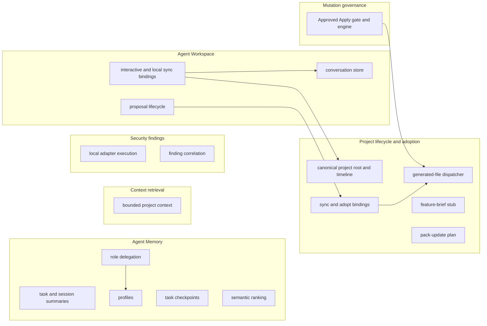

Source: `bounded-context-ownership.mmd`.

Ownership follows invariants, not filename prefixes.

- Task summaries, session summaries, checkpoints, ranking config, profiles,
  and delegations share `.aif/memory/` and the validate-then-write pattern.
  Ranking and delegation still differ: ranking reads skill records and does
  not authorize a write; delegation clamps a role and writes a grant record.
- Bounded context is a read model over docs, decisions, duty files, and
  memory paths. It is not the summary store and not the Neutron context
  assembler. The assembler may call it.
- Security adapter execution writes finding records. It is not the Approved
  Apply gate and not sandbox evaluation. Sandbox evaluation is already a
  leaf used by proposal review.
- Conversations and proposals share the workspace CLI and must not share a
  module. Proposals call adoption. Conversations do not.
- `synchronizeGeneratedFiles` is Synchronization. The Approved Apply engine
  is Mutation Governance. The engine may call the dispatcher. The dispatcher
  does not evaluate approval.

No new bounded context is declared. The directories `memory/`, `security/`,
`workspace/`, `project-lifecycle/`, `project-adoption/`, `feature-intent/`,
and `generated-file/` already match these owners. This plan adds files
there. It does not add a package, a barrel under those directories, or a
package export-map key.

## 6. Candidate extraction families

Section 3 is the family audit. The extraction consequences are:

| Family                        | Move intact             | Decomposition first                | New seam                           |
| ----------------------------- | ----------------------- | ---------------------------------- | ---------------------------------- |
| Profiles                      | yes                     | no                                 | no                                 |
| Role delegation               | no                      | split clamp from persistence       | no, after profiles exist           |
| Task and session summaries    | yes                     | no; keep the 43-line list function | no                                 |
| Task checkpoints              | yes                     | no                                 | no                                 |
| Semantic ranking              | no                      | split the 80-line ranker           | no; import skill leaves directly   |
| Bounded project context       | no                      | split the 101-line function        | no                                 |
| Security adapters             | no                      | split the 188-line runner          | no                                 |
| Conversations                 | yes                     | no                                 | no                                 |
| Proposal lifecycle            | behavior yes, module no | no function is over 80             | inject `adoptProject`              |
| Root and timeline             | yes                     | no                                 | no                                 |
| `planFeature` and pack update | yes                     | no                                 | no                                 |
| Interactive and local sync    | yes                     | no                                 | seams already exist                |
| Dispatcher                    | yes                     | no; do not inline the transactions | no; engine calls the leaf directly |

Families that are not extracted: protocol re-exports, validator re-exports,
lifecycle leaves already moved in P1I.2, adoption leaves already moved in
P1I.3, skill and memory leaves from P1H, the legacy subagent store from P1J,
and the Neutron mutation trio.

## 7. Architecture alternatives

Three shapes were compared for the whole barrel.

**Keep the remaining functions on `index.ts` and document an exception.**
This misses the 400-line gate unless the maintainer names every leftover
declaration. The measured remainder after deleting only the easy families
would still include the 188-line runner, the 101-line context function, and
the Approved Apply hub. An exception written into this design would not be
approval. This shape is rejected as the plan.

**One implementation pull request that moves every declaration.** This can
describe the end state and cannot review behavior preservation. The runner,
the context function, proposal apply, and the dispatcher would change
modules together. This shape is rejected.

**Seventeen dependency-ordered structural slices.** Each slice has one
owner, existing tests, and a predicted SCC effect. Oversized functions are
split inside the slice that moves them, with characterization tests, and
without a product change. This is the recommended shape. Slices do not
start until this design is approved. A slice that would change a public
signature, an error string, or ADR-0053 behavior stops and comes back for
design review.

The target module layout, after every slice:

```mermaid
flowchart TB
  barrel["index.ts re-export barrel"]

  barrel --> profiles["memory/profile-store.ts"]
  barrel --> roles["memory/role-delegation.ts"]
  barrel --> summaries["memory/task-session-summary-store.ts"]
  barrel --> checkpoints["memory/task-checkpoint-store.ts"]
  barrel --> ranking["memory/semantic-ranking.ts"]
  barrel --> bounded["memory/bounded-project-context.ts"]
  barrel --> adapters["security/security-adapter-run.ts"]
  barrel --> conversations["workspace/workspace-conversation-store.ts"]
  barrel --> proposals["workspace/workspace-proposal-lifecycle.ts"]
  barrel --> interactive["workspace/interactive-workspace-composition.ts"]
  barrel --> localSync["workspace/local-workspace-sync.ts"]
  barrel --> root["project-lifecycle/project-root.ts"]
  barrel --> feature["feature-intent/plan-feature.ts"]
  barrel --> pack["project-adoption/plan-pack-update.ts"]
  barrel --> syncBind["project-lifecycle/project-sync-binding.ts"]
  barrel --> adoptBind["project-adoption/generated-file-adoption-binding.ts"]
  barrel --> dispatcher["generated-file/synchronize-generated-files.ts"]

  adapters --> correlation["security/security-adapter-correlation.ts"]
  adapters --> dependency["security/security-adapter-dependency.ts"]
  adapters --> secret["security/security-adapter-secret.ts"]
  adapters --> config["security/security-adapter-config.ts"]
  adapters --> mcp["security/security-adapter-mcp.ts"]
  ranking --> skills["skills proposal and evaluation leaves"]
  proposals --> adoptBind
  syncBind --> dispatcher
  adoptBind --> syncBind
  interactive --> root
  localSync --> conversations
```

Source: `future-module-layout.mmd`. This is the end state. P1K.9 may inject
`adoptProject` before `generated-file-adoption-binding.ts` exists. P1K.16
removes that injection once the binding module is the owner.

## 8. Approved Apply SCC analysis

Measured with `applicationCycles` from `tests/application-source-cycles.ts`
on `5efc30a0ae21525312425e69ef82ccd30e138c8a`. The detector treats `import`,
`import type`, and `export ... from` as edges. A type-only import from
`index.ts` is enough to keep a file in the component.

### 8.1 Current membership

Import-only, size 3:

- `neutron/mutation/apply/neutron-mutation-apply-durable-record.ts`
- `neutron/mutation/apply/neutron-mutation-apply-store.ts`
- `neutron/mutation/verification/neutron-mutation-verification-retry-eligibility.ts`

Re-export-inclusive, size 4:

- `apply-extension-update.ts`
- `discover-and-apply-extension-update.ts`
- `extension-update-files.ts`
- `propose-and-apply-extension-adoption.ts`

Re-export-inclusive, size 27:

- `approved-apply-engine.ts`
- `bounded-execution-apply.ts`
- `bounded-execution-w11.ts`
- `bounded-execution-workspace-cli.ts`
- `bounded-execution-workspace.ts`
- `engineering-quality-entry.ts`
- `engineering-quality/cli-specialized-packs-external.ts`
- `engineering-quality/index.ts`
- `engineering-quality/specialized-pack-external-apply.ts`
- `engineering-quality/specialized-pack-external-viewmodel.ts`
- `existing-project-adoption-apply-gates.ts`
- `existing-project-adoption-apply-health.ts`
- `existing-project-adoption-apply.ts`
- `existing-project-adoption-approval.ts`
- `existing-project-adoption-decisions.ts`
- `existing-project-adoption-plan.ts`
- `existing-project-adoption-prepared-plan-revalidate.ts`
- `existing-project-adoption-prepared-plan.ts`
- `existing-project-w9.ts`
- `existing-project-workspace-cli.ts`
- `existing-project-workspace.ts`
- `foundation-flow.ts`
- `harness/harness-benchmark-sample.ts`
- `harness/harness-benchmark.ts`
- `harness/harness.ts`
- `inception-flow.ts`
- `index.ts`

Re-export-inclusive, size 3: the same Neutron mutation trio. No other
component exists. `approved-apply-baseline.ts` and
`generated-file-sync-declared.ts` are outside every component.

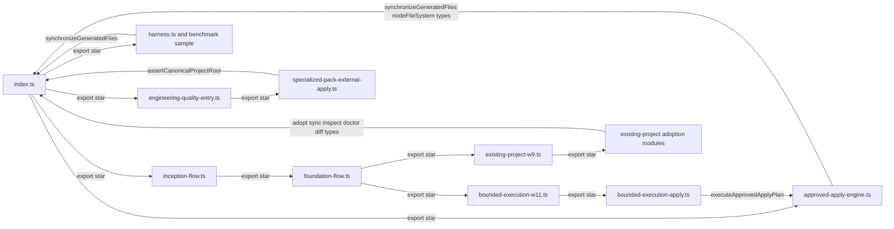

Source: `approved-apply-cycle.mmd`.

`index.ts` is the hub. It reaches the engine, harness, quality, and
adoption families by `export *`. Those families reach `index.ts` again
through four back-edges:

1. `approved-apply-engine.ts` value-imports `synchronizeGeneratedFiles` and
   `nodeFileSystem`, and type-imports `FileSystem` and `TransactionOptions`.
2. `harness/harness-benchmark-sample.ts` value-imports
   `synchronizeGeneratedFiles`. The file comment already records the cycle.
   The call is inside a function, not at module evaluation.
3. `engineering-quality/specialized-pack-external-apply.ts` value-imports
   `assertCanonicalProjectRoot` and `ProjectRootError`.
4. Existing-project modules value-import `adoptProject`, `syncProject`,
   `inspectProject`, `doctorProject`, `diffProject`, or `planProjectAdoption`,
   and type-import `ProjectMapping`, `InitOptions`, or `TransactionOptions`.

`bounded-execution-apply.ts` value-imports `executeApprovedApplyPlan` from
the engine, not from the barrel. It stays in the component because the
engine imports the barrel and the barrel re-exports the foundation flow that
re-exports bounded execution.

P1I.3b removed the baseline and declared-sync imports of the barrel and
deliberately left the engine import. This design closes that edge without
editing Neutron.

### 8.2 How `index.ts` leaves the Approved Apply component

The engine leaves the component when it has no import from `index.ts` at
all, including types, and no other path from the engine back to the barrel.
The gate, baseline, declared-path sync, owned-file transaction, and
host filesystem modules do not import the barrel today. A dispatcher leaf
that imports only those modules does not recreate the edge.

Detaching the engine also drops bounded execution out of the component,
because its only path back to the barrel is engine to barrel. It does not
drop the barrel out of the remaining component. Harness, quality, and
adoption still import the barrel. The literal gate, "the Approved Apply
component no longer includes `index.ts`", is met when the engine is gone.
The architectural end state, a barrel that implementation modules do not
import, needs the other three back-edges removed as well. This plan does
both. It does not call P1 complete at the engine-only step.

The Neutron trio is not on these paths. No slice rewrites it.

### 8.3 Options

```mermaid
flowchart TB
  subgraph optionA ["Option A keep dispatcher on the barrel"]
    aEngine["engine imports index.ts"]
    aBarrel["synchronizeGeneratedFiles stays in index.ts"]
    aEngine --> aBarrel
  end

  subgraph optionB ["Option B leaf dispatcher recommended"]
    bEngine["engine imports the leaf"]
    bLeaf["generated-file/synchronize-generated-files.ts"]
    bDeclared["declared-path sync"]
    bCommit["owned generated-file commit"]
    bEngine --> bLeaf
    bLeaf --> bDeclared
    bLeaf --> bCommit
  end

  subgraph optionC ["Option C optional injection rejected"]
    cRejected["rejected for P1K"]
    cOverride["would add options.synchronizeGeneratedFiles"]
    cRisk["could report applied true without a real write"]
    cRejected --> cOverride
    cOverride --> cRisk
  end

  subgraph optionD ["Option D composition module viable not necessary"]
    dIndex["index re-exports composition"]
    dComp["approved-apply-composition.ts"]
    dEngine["engine without an index import"]
    dLeaf["leaf dispatcher"]
    dIndex --> dComp
    dComp --> dEngine
    dComp --> dLeaf
  end
```

Source: `approved-apply-alternatives.mmd`.

**Option A. Keep the dispatcher on the barrel.** Edges stay
engine to `index.ts` for the function, `nodeFileSystem`, `FileSystem`, and
`TransactionOptions`. The 27-file component continues to contain both files.
Public signatures stay. Authorization, before-write failure, stages,
diagnostics, and rollback stay because nothing moves. Tests stay as they
are. Migration cost is zero. The P1 gate cannot be met. Option A is the
honest description of today's code, not a completion plan.

**Option B. Leaf-owned dispatcher.** New module
`generated-file/synchronize-generated-files.ts` contains the current
function body and the private `TransactionMetadata` type. Runtime edges:
`isDeclaredPathsOnlySyncMode`, `synchronizeDeclaredProjectPaths`,
`commitOwnedGeneratedFiles`. Type edges: `GeneratedFile`, `FileSystem`,
`TransactionOptions`, `TransactionResult`, `Plan` is not required if the
metadata type moves with the function. No edge to `index.ts`. The engine
retargets `synchronizeGeneratedFiles` to the leaf, `nodeFileSystem` and
`FileSystem` to `host-file-system.ts`, and `TransactionOptions` to
`generated-file/transaction-contracts.ts`. The barrel re-exports the
dispatcher, a one-way edge. SCC: the engine and bounded execution leave the
index component. Harness leaves only if its import is retargeted in the
same slice. Quality and adoption stay until their slices. Public
`executeApprovedApplyPlan(request, files, options)` stays. Authorization
stays in `evaluateApprovedApplyPlan`, still before the dispatcher. Failure
diagnostics and rollback stay because the same function is called with the
same arguments. Tests: `tests/approved-apply-engine.test.ts`, declared-path
and generated-file transaction tests, and the harness benchmark test.
Migration cost is one small module and import edits. Risk: a retarget that
still imports a type from the barrel leaves the SCC edge in place. The
slice is done only when the engine source has no `index.js` specifier.

**Option C. Optional dispatcher injection on the engine.** This would add
`ApprovedApplyEngineOptions.synchronizeGeneratedFiles`, allowing a caller to
substitute the synchronization function. A substitute could return
`status: "success"` without executing the real transaction, yielding
`applied: true` without a successful write. That is a new public
transaction-control surface. SCC removal does not require it: Option B alone
removes the engine's `index.ts` import and breaks the Approved Apply edge from
the 27-file component. Existing injected `FileSystem`, `failAt`, and
`rollbackFailPaths` are sufficient for current transaction test scenarios.
Option C is **explicitly rejected** for P1K.14. No new dependency-injection
framework is introduced.

**Option D. Composition module.** `approved-apply-composition.ts` would
import the engine and the leaf and export the wired function. The barrel
would re-export the composition module instead of owning the wiring. This
matches `syncProject` calling `executeProjectSync`, and it avoids an options
field. It also moves the public function's home. Every current importer of
`executeApprovedApplyPlan` from the engine file, including
`bounded-execution-apply.ts`, would have to follow the move or keep a
re-export from the engine file. That re-export is safe only if the engine
file does not import the composition module. SCC impact can match Option B.
Authorization and rollback can match today. Migration cost is higher than Option B because the public function changes
modules even when the signature does not. The extra module does not remove a
cycle that Option B already removes. Option D is a viable alternative but
not necessary for P1 completion.

**Recommendation: Option B only.** The dispatcher stays one function with the
current branch inside the extracted leaf. The engine stops importing the
barrel and calls the real leaf dispatcher directly. Public function signatures
stay unchanged. The Approved Apply authorization boundary, transaction stages,
rollback, and diagnostics stay unchanged. No new public option is added.
Option A is rejected for P1 completion because it preserves the barrel
dependency. Option C is rejected as unnecessary for SCC removal and as an
unsafe injection point. Option D remains acceptable but optional. No option may
inline `commitOwnedGeneratedFiles` or `synchronizeDeclaredProjectPaths` inside
the engine unless a later design proves the diagnostics, stages, and rollback
match the dispatcher exactly. This design does not make that proof and does not
recommend the inline.

Harness retarget belongs in the same slice as the leaf, because it is the
second value importer of the same function. It is not an Apply behavior
change.

## 9. Recommended sequencing

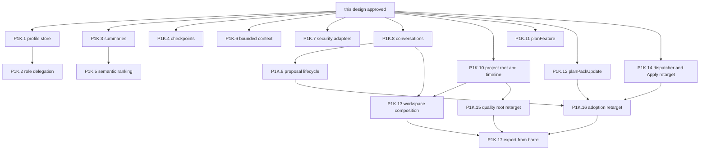

Source: `phased-implementation.mmd`.

Prioritization uses cohesion, security and transaction sensitivity,
regression risk, independent tests, current coverage, effective lines
removed, file and function budgets, SCC impact, dependence on earlier
slices, and implementation complexity. Low sensitivity and no seam outrank
larger line removal. That is why the security runner and the Apply
dispatcher are not first.

**The smallest safe next implementation slice is P1K.1, the profile store.**
It is one directory, three functions, 58 effective lines, existing CLI and
L8 tests, no redaction policy, no transaction, no `index.ts` import from the
leaf, and no SCC change.

Working ids are proposals. They are not permission to open implementation
pull requests.

## 10. Per-slice implementation boundaries

Every slice: no behavior change, no Neutron file edit, no package export-map
change, no `quality-exceptions.json` change, no new directory barrel, public
names re-exported from `index.ts`, and `pnpm verify` before the pull request
is opened.

### Design First gates for implementation

This document is an architectural roadmap and a proposed implementation
sequence. It does **not** automatically authorize unlimited architectural
changes across all seventeen future pull requests.

- **Mechanical extractions** fully described in this design may proceed after
  explicit maintainer approval, **one implementation pull request at a time**.
  Each slice keeps the boundaries in this section.
- **Significant deviations** from the described move, module owner, public
  surface, or behavior require renewed design review before implementation.
- **Security-sensitive, transaction-sensitive, public-contract, and
  cross-boundary slices** require explicit confirmation that this approved
  design covers all relevant interfaces, errors, security rules, and testing
  requirements. When coverage is insufficient, open a focused Design First pull
  request before implementation. This correction does not open those follow-on
  design pull requests.

Pay particular attention before implementation:

- **P1K.7** — security adapter decomposition (section 22 Design First gate;
  documentation pull request required before implementation).
- **P1K.9** — workspace proposal lifecycle and adoption binding.
- **P1K.14** — Approved Apply dispatcher extraction (Option B only; no public
  dispatcher override).
- **P1K.16** — adoption bindings and final SCC hub removal.

P1K.7 and P1K.14 also require the maintainer to accept the decomposition and
the Option B recommendation in sections 6 and 8.

### P1K.1 Profile store

- Responsibility: profile create, get, and list.
- Declarations: `createProfile`, `getProfile`, `listProfiles`.
- Target: `packages/application/src/memory/profile-store.ts`.
- Files: that module, barrel re-exports, characterization or existing tests.
- Preserve: `tests/controlled-learning-l8.test.ts`, profile CLI tests.
- Lines removed: 58 effective. Glue added: about 4. Net about 54.
- SCC: unchanged.
- Prerequisites: this design approved.
- Non-goals: delegation, ranking, Neutron import retarget.
- Acceptance: leaf does not import `index.ts`; functions stay at 17, 14, and
  27 effective lines; list order stays name ascending; invalid files stay
  ignored.

### P1K.2 Role delegation

- Responsibility: role grant clamp and delegation record.
- Declarations: `delegateTaskRole`, split into clamp and persist.
- Target: `packages/application/src/memory/role-delegation.ts`.
- Files: that module. It imports `getProfile` from the profile leaf.
- Preserve: L8 delegation cases and `cli/delegate-command.ts` behavior.
- Lines removed: 65 effective. Glue about 3. Net about 62.
- SCC: unchanged.
- Prerequisites: P1K.1.
- Non-goals: changing which roles are read-only, network policy, or id
  format `del-${role}-${Date.now()}`.
- Acceptance: both new functions are at or below 40 effective lines; missing
  profile and disallowed role errors stay byte-for-byte.

### P1K.3 Task and session summaries

- Responsibility: both summary stores.
- Declarations: the five summary functions in section 3.4.
- Target: `packages/application/src/memory/task-session-summary-store.ts`.
- Preserve: `tests/controlled-learning-l1.test.ts`,
  `tests/memory-security-m4.test.ts`, summary CLI.
- Lines removed: 152 effective. Glue about 6. Net about 146.
- SCC: unchanged.
- Prerequisites: this design approved. Independent of P1K.1.
- Non-goals: redacting session notes, sorting by another field, Neutron
  retarget of `getTaskSummary`.
- Acceptance: task path filtering still uses `secretLikePath` only; session
  writes do not gain that filter; corrupt files stay ignored.

### P1K.4 Task checkpoints

- Responsibility: checkpoint store and state writes.
- Declarations: the eight checkpoint functions in section 3.5.
- Target: `packages/application/src/memory/task-checkpoint-store.ts`.
- Preserve: `tests/controlled-learning-l6.test.ts`,
  `tests/cli-checkpoint.test.ts`.
- Lines removed: 178 effective. Glue about 8. Net about 170.
- SCC: unchanged.
- Prerequisites: this design approved.
- Non-goals: a stricter state machine, Neutron graph checkpoints, Undo.
- Acceptance: resume error string stays; `reason` stays unused; checksum
  still reads `Date.now` separately from the id.

### P1K.5 Semantic ranking

- Responsibility: ranking config and procedural ranking.
- Declarations: `getSemanticRankingConfig`, `updateSemanticRankingConfig`,
  `rankProceduralMemory`.
- Target: `packages/application/src/memory/semantic-ranking.ts`, with
  proposal scoring and evaluation scoring extracted.
- The module imports skill leaves, not the barrel.
- Preserve: `tests/controlled-learning-l7.test.ts`, `tests/cli-rank.test.ts`.
- Lines removed: 117 effective. Glue about 5. Net about 112.
- SCC: unchanged.
- Prerequisites: sequenced after P1K.3 so two slices do not edit `memory/`
  at once. Ranking does not call the summary store.
- Non-goals: a real embedding provider, skipping work when `enabled` is
  false, changing weights 0.5 and 0.4.
- Acceptance: no function exceeds 40 effective lines; disabled config still
  returns scored items.

### P1K.6 Bounded project context

- Responsibility: bounded context read model.
- Declaration: `getBoundedProjectContext`, split as section 3.7.
- Target: `packages/application/src/memory/bounded-project-context.ts`.
- Preserve: `tests/memory-security-m1.test.ts`, context CLI.
- Lines removed: 101 effective. Glue about 3. Net about 98.
- SCC: unchanged. Neutron collector keeps importing the barrel.
- Prerequisites: this design approved.
- Non-goals: aligning exclusion patterns with `secretLikePath`, sorting
  candidates, changing the first-item budget exception.
- Acceptance: no function exceeds 80 effective lines; the module stays at or
  below 250; inclusion order matches `fs.list` order.

### P1K.7 Security adapter execution

- Responsibility: correlation and the local adapter runner.
- Declarations: `correlateSecurityFindings`, `runLocalSecurityAdapters`.
- Targets: the six `security/security-adapter-*.ts` files in section 3.8.
- **Design First gate:** section 22. Implementation does not start until
  that section is explicitly approved after this documentation pull request.
- Preserve: `tests/memory-security-s2.test.ts`,
  `tests/security-finding-store-p1h4a.test.ts`, and security CLI coverage.
  Add characterization tests listed in section 22 before moving code.
- Lines removed: 213 effective (remeasured after P1K.6). Glue about 4. Net
  about 209.
- SCC: unchanged — import-only `[3]`, re-export-inclusive `[4, 27, 3]`; new
  leaves stay outside every component.
- Prerequisites: merged P1K design (PR #627), P1K.6 merged, and maintainer
  approval of section 22.
- Non-goals: new scanners, symlink hardening, secret description redaction,
  transactions, caching, concurrency, protocol or export-map changes.
- Acceptance: section 22 implementation acceptance matrix; no function above
  80 effective lines in new modules; barrel re-exports only.

### P1K.8 Workspace conversations

- Responsibility: conversation persistence and redaction.
- Declarations: path helper, start, get, redact, append, list.
- Target: `packages/application/src/workspace/workspace-conversation-store.ts`.
- `syncLocalWorkspaceState` stays on the barrel and imports `list` from the
  leaf, as P1J did for task records.
- Preserve: `tests/workspace-agent.test.ts`, workspace CLI tests.
- Lines removed: 120 effective. Glue about 6. Net about 114.
- SCC: unchanged.
- Prerequisites: this design approved.
- Non-goals: proposal promote, review, apply, or moving local sync.
- Acceptance: redaction patterns stay; list order stays `updatedAt`
  descending.

### P1K.9 Workspace proposal lifecycle

- Responsibility: promote, review, and apply of workspace proposals.
- Declarations: path helper, the three operations, and
  `WorkspaceProposalReviewResult`.
- Target: `packages/application/src/workspace/workspace-proposal-lifecycle.ts`.
- The leaf receives `adoptProject` as a port. Barrel wrappers keep today's
  signatures and pass the local `adoptProject`.
- Preserve: `tests/workspace-apply.test.ts`, workspace CLI tests.
- Lines removed: about 70 effective while wrappers remain. The wrappers
  leave in P1K.16.
- SCC: unchanged, because the leaf does not import the barrel.
- Prerequisites: P1K.8, so conversation reads come from the conversation
  leaf rather than from the barrel.
- Non-goals: routing apply through `executeApprovedApplyPlan`, honoring
  `readyToApply`, or treating `approvedBy` as an ADR-0053 capability.
- Acceptance: promote and the review fallback stay `dryRun: true`; apply
  default stays `dryRun: false`; the approval error string stays.
- Design First gate: section 24. Implementation is not authorized until a
  maintainer approves that section.

### P1K.10 Project root and timeline

- Responsibility: canonical root check and release timeline.
- Declarations: `ProjectRootError`, `assertCanonicalProjectRoot`,
  `ProjectTimelineOptions`, `ProjectTimeline`, `timelineProject`.
- Target: `packages/application/src/project-lifecycle/project-root.ts`.
- Preserve: daemon timeline and root callers through the package root.
  Quality still imports the barrel until P1K.15.
- Lines removed: about 56 effective. Glue about 5. Net about 51.
- SCC: unchanged until P1K.15 retargets quality.
- Prerequisites: this design approved.
- Non-goals: realpath hardening beyond the current symbolic-link root check.
- Acceptance: error codes stay `invalid_root` and `stale_root`.

### P1K.11 Feature planning stub

- Responsibility: `planFeature` only.
- Target: `packages/application/src/feature-intent/plan-feature.ts`.
- Preserve: `tests/cli-plan.test.ts`.
- Lines removed: 66 effective. Glue about 3. Net about 63.
- SCC: unchanged.
- Prerequisites: this design approved.
- Non-goals: reading the repository or producing a real brief.
- Acceptance: the JSON document shape and validator failure type stay.

### P1K.12 Pack update planning

- Responsibility: `planPackUpdate` and `PlanPackUpdateOptions`.
- Target: `packages/application/src/project-adoption/plan-pack-update.ts`.
- It imports `planProjectAdoption` from the existing adoption leaf.
- Preserve: pack update CLI tests.
- Lines removed: 44 effective including the options interface. Glue about 4.
  Net about 40.
- SCC: unchanged. Adoption modules that import the barrel stay as they are.
- Prerequisites: this design approved.
- Non-goals: making the operation map rewrite `map-existing` or `create`.
- Acceptance: default target version stays `"1.1.0"`; symlink roots still
  throw the current error.

### P1K.13 Workspace composition bindings

- Responsibility: move the two read-model bindings off the barrel.
- Declarations: `InteractiveWorkspaceState`,
  `getInteractiveWorkspaceState`, `syncLocalWorkspaceState`.
- Targets: `workspace/interactive-workspace-composition.ts` and
  `workspace/local-workspace-sync.ts`.
- Preserve: P1H.7 tests, UI CLI, Neutron sync CLI, and the P1J structure
  assertion that local sync passes the four ports. That assertion will name
  the new module instead of the barrel body. That is a test-path update, not
  a behavior change, and it belongs to the implementation slice.
- Lines removed: 52 effective. Glue about 6. Net about 46.
- SCC: unchanged.
- Prerequisites: P1K.8 and P1K.10.
- Non-goals: changing the read model or security audit call.
- Acceptance: the port object keys and call arguments stay identical.

### P1K.14 Dispatcher and Approved Apply retarget

- Responsibility: **Option B only** from section 8.3.
- Move `synchronizeGeneratedFiles` and the private `TransactionMetadata`
  contract unchanged into
  `packages/application/src/generated-file/synchronize-generated-files.ts`.
- Retarget all imports in `approved-apply-engine.ts` to canonical leaf owners
  (`nodeFileSystem` and `FileSystem` from `host-file-system.ts`,
  `TransactionOptions` from `generated-file/transaction-contracts.ts`, the
  dispatcher from the new leaf).
- Retarget `harness/harness-benchmark-sample.ts` to import the dispatcher from
  the leaf. Do not edit files under `src/neutron/`.
- Preserve: evaluate the Approved Apply gate; validate declared-path scope;
  capture or validate baseline; call the **existing** dispatcher unchanged;
  preserve transaction stages, rollback, and diagnostics; return the existing
  validated result shape.
- Preserve: existing `ApprovedApplyEngineOptions` fields (`fs`, `failAt`,
  `rollbackFailPaths`, and any others today). **No** public callback or
  dispatcher override.
- Preserve: `tests/approved-apply-engine.test.ts`, generated-file transaction
  tests, harness benchmark tests. Use existing filesystem fault injection and
  transaction options for regression tests.
- Lines removed from the barrel: 12 effective. Re-export glue about 3.
- SCC: engine and bounded execution leave the 27-file component. Harness
  leaves with its retarget. Predicted index component size: 19. Membership
  is section 16. No new component. Re-measured membership must match the
  approved prediction; this design makes no guarantee beyond the forecast.
- Prerequisites: this design's **Option B** choice. Not dependent on the memory
  slices.
- Non-goals: changing gate checks, path-scope checks, baseline behavior,
  stage names, rollback, or adding `ApprovedApplyEngineOptions` fields.
- Acceptance:
  - No import of `index.ts` from `approved-apply-engine.ts`, including
    type-only imports (no `index.js` specifier in engine source).
  - No new public dispatcher override on `ApprovedApplyEngineOptions`.
  - No behavioral change to Apply, transactions, or rollback.
  - Measured SCC membership after the slice matches the section 16 prediction
    for this slice.
  - Existing Approved Apply, transaction, and rollback tests pass.
  - Declared-path mode still does not receive `validatedMetadata`.

### P1K.15 Engineering-quality root retarget

- Responsibility: point specialized-pack external apply at the project-root
  leaf.
- No barrel body remains for this symbol after P1K.10.
- SCC: the five engineering-quality files leave the index component.
  Predicted size: 14.
- Prerequisites: P1K.10.
- Non-goals: lockfile or activation behavior.
- Acceptance: quality module has no `index.js` import; daemon handlers still
  import `assertCanonicalProjectRoot` from the package root.

### P1K.16 Adoption import retarget

- Responsibility: move `syncProject` and `adoptProject` to
  `project-lifecycle/project-sync-binding.ts` and
  `project-adoption/generated-file-adoption-binding.ts`. Retarget
  existing-project imports of lifecycle functions, adoption bindings,
  `ProjectMapping`, `InitOptions`, and `TransactionOptions` onto their
  leaves. Replace P1K.9 barrel wrappers with re-exports once the proposal
  leaf can import the adoption binding.
- SCC: the remaining index component dissolves. `index.ts` is in no
  component. Extension quartet and Neutron trio stay.
- Prerequisites: P1K.12, P1K.14, and P1K.9.
- Non-goals: adoption approval rules or health checks.
- Acceptance: no file that `index.ts` re-exports imports `index.ts`.

### P1K.17 Export-from barrel

- Responsibility: delete residual value imports and express the public
  surface as `export ... from` only. Remeasure `index.ts`.
- Prerequisites: P1K.13, P1K.15, and P1K.16.
- SCC: unchanged from P1K.16.
- Non-goals: removing a public name, splitting the package, or adding a
  subpath.
- Acceptance: measured effective lines are at most 400 and physical lines
  at most 700, or the pull request stops and names the declarations that
  still prevent it. This design does not pre-approve an exception.

## 11. Public compatibility strategy

CLI, daemon, and MCP import `@intentloom/application`, and the CLI barrel
star-re-exports it. Every moved name stays exported from `index.ts`. No
signature gains a required parameter. `executeApprovedApplyPlan` keeps
`(request, filesToApply, options?)`. `ApprovedApplyEngineOptions` keeps its
current fields only; P1K.14 does not add a dispatcher override.

Internal relative imports of `index.ts` are retargeted only in P1K.14,
P1K.15, and P1K.16, and only for the symbols those slices own. Neutron files
keep their current barrel imports. That preserves topology allowlists in
`tests/application-neutron-topology.test.ts`.

JSON bytes, CLI flags, error strings listed in section 14, and the ignored
fields already documented for P1J stay. `planFeature` remains a stub.
Security categories that return no findings remain empty.

## 12. Security and trust boundaries

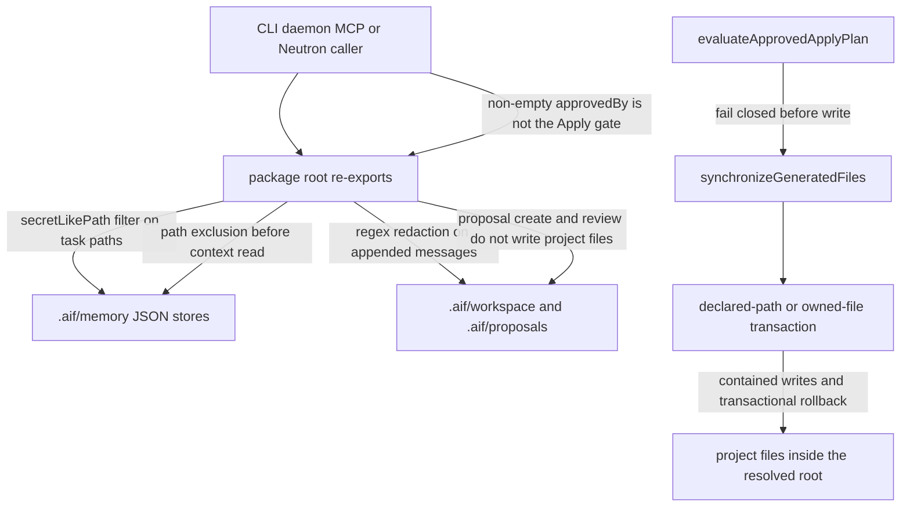

Source: `security-trust-boundaries.mmd`.

Boundaries that pure extraction must not change:

- Project writes stay inside the root checks each current function already
  performs. `inside` remains the path join for memory, conversations, and
  proposals. `assertCanonicalProjectRoot` still rejects a missing root and a
  symbolic-link root.
- `nodeFileSystem` still follows symlinks on write. P1J recorded that the
  legacy task store does not revalidate the destination realpath, and that a
  caller-supplied task id can stay inside the project root while leaving
  `.aif/neutron/subagents/`. Those gaps stay assigned to separately approved
  hardening. They are not fixed inside a move.
- Workspace append redaction stays the current three replacements.
- Bounded-context exclusion stays the current nine patterns.
- Task-summary path filtering stays `secretLikePath` on `affectedPaths`
  only.
- Persisted JSON stays schema version `"1"`, two-space indent, and a
  trailing newline. Checkpoint state names stay the current strings.
- Security adapter order, rule ids, severities, and empty categories stay.
- Transaction stages stay the `TransactionStage` union: `generated-stage`,
  `generated-commit`, `manifest-stage`, `manifest-finalize`,
  `source-map-stage`, `source-map-finalize`, `post-write-consistency`, and
  `success-cleanup`.
- The Approved Apply gate still runs before baseline capture and before the
  dispatcher. Path-scope mismatch still returns before any write.
- Proposal creation and `readyToApply` do not authorize Apply. Workspace
  `approvedBy` does not grant `atomic-commit-approval`.
- Transaction rollback stays inside the existing sync implementations.
  P1K.14 does not expose a public dispatcher substitution seam. User Undo
  stays U4 and U5 and does not start.
- Public error strings in section 14 stay.
- CLI output stays whatever the current commands print from these return
  values.
- Neutron execution stays provider-neutral. No slice calls a model, starts
  a background job, or turns a stub adapter into a scanner.

## 13. Data and filesystem flows

Memory writes are validate, `mkdir` when the parent is absent, then `write`
of pretty JSON. Reads are `exists` plus `read`, or a full `fs.list` followed
by a prefix filter. That list walks the project. Extraction does not replace
it with a directory listing unless a test proves the same paths, order, and
error ignoring.

Conversation and proposal flows are the same pattern under
`.aif/workspace/conversations/` and `.aif/proposals/`. Proposal file bytes
are the `AdoptionProposal` returned by dry-run `adoptProject`, not the
conversation transcript.

Generated-file flow is unchanged: the dispatcher chooses declared-path sync
or owned-file commit. Declared-path collision and noncanonical paths fail
with `rollbackAttempted: false` before writes. Later declared-path failures
carry `failedStage` and may restore backups. Owned-file commit keeps its
current stage machine. The engine maps a non-success result to diagnostics
and does not start a second write.

Interactive and local sync do not write. They call the read model with the
current ports.

## 14. Error and rollback behavior

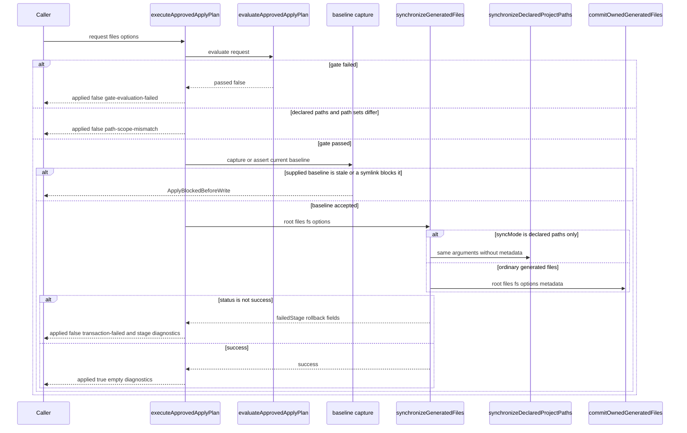

Source: `approved-apply-sync-sequence.mmd`.

Before-write Apply failures:

- Gate failure returns `applied: false` and diagnostics beginning with
  `gate-evaluation-failed`, then the gate diagnostics. No baseline read and
  no dispatcher call.
- Declared-path mode with unequal path sets returns `path-scope-mismatch`
  before baseline and before the dispatcher.
- `assertApprovedApplyBaselineCurrent` throws `ApplyBlockedBeforeWrite`
  with `project-stale` / `restoration-baseline-changed` when a supplied
  baseline path has a symlink ancestor or the bytes changed. The engine does
  not catch that throw. Preserve the throw.

After the dispatcher returns `status !== "success"`, diagnostics are, in
order: `transaction-failed:${status}`, `failed-stage:${failedStage}` when
present, `rollback-attempted` when `rollbackAttempted` is true, and
`rollback-failures:` plus the joined paths when rollback failures are
non-empty. `applied` stays false. Rollback evidence carries the captured
baseline. Success returns `applied: true` and `diagnostics: []`, and still
attaches rollback evidence for the baseline that was not restored.

That rollback is the transaction restore inside declared-path sync or
owned-file commit. It is not user Undo.

Other error strings to preserve:

- `project root does not exist`
- `project root is a symbolic link and is not stable`
- `task identifier is required`
- `pack update planning requires a non-symbolic explicit project root`
- `Task checkpoint not found: ${id}`
- `Cannot resume cancelled task checkpoint: ${id}`
- `Profile not found: ${name}`
- `Role [${role}] is not allowed by profile [${name}]`
- `Conversation ${id} not found`
- `Workspace conversation ${id} not found`
- `human approval required (--approved-by USER)`

Corrupt memory, checkpoint, profile, conversation, and ranking-config reads
stay soft: null, default config, or a skipped list entry. They do not throw.

## 15. Source-size forecasts

Start: **1,804 effective, 1,953 physical**.

Function bodies: 1,304 effective and 1,396 physical. Non-function remainder:
500 effective. Lines 1–147, the import preamble, are 146 effective lines that
the final export-from barrel deletes. Local type and class bodies are 58
effective lines, replaced by about 15 re-export lines. Moved functions add
about 70 named re-export lines.

Central forecast after P1K.17:

`500 - 146 - 58 + 15 + 70 = 381` effective lines.

Physical forecast:

`1953 - 1396 - 147 - 60 + 85 + 30 = 465` physical lines.

| After slice | Estimated effective | What changed                      |
| ----------- | ------------------: | --------------------------------- |
| P1K.1       |                1750 | profiles                          |
| P1K.2       |                1688 | delegation                        |
| P1K.3       |                1542 | summaries                         |
| P1K.4       |                1372 | checkpoints                       |
| P1K.5       |                1260 | ranking                           |
| P1K.6       |                1162 | bounded context                   |
| P1K.7       |                 953 | security adapters                 |
| P1K.8       |                 839 | conversations                     |
| P1K.9       |                 769 | proposals, wrappers still present |
| P1K.10      |                 718 | root and timeline                 |
| P1K.11      |                 655 | planFeature                       |
| P1K.12      |                 615 | pack update                       |
| P1K.13      |                 569 | workspace composition             |
| P1K.14      |                 560 | dispatcher re-export              |
| P1K.16      |           about 520 | bindings and proposal wrappers    |
| P1K.17      |                 381 | bottom-up identity below          |

P1K.15 does not change the barrel size. Rows P1K.1 through P1K.16 are rounded
running estimates of function-body removal. They still contain the import
preamble. P1K.17 is not "the previous row minus 146". The completion number
is the bottom-up identity, 381. Each implementation pull request remeasures.
Glue that runs long by about 40 lines, or type re-exports that stay verbose,
produces an upper band near **420 effective lines**, which misses 400.

The plan reaches the target in the central estimate without an exception.
It does not reach the target in the upper band. The unresolved block in that
band is leftover forwarding wrappers plus the protocol type and validator
re-export lists, which are about 74 and 23 lines of public compatibility
surface. Those lists are not an approved exception. P1K.17 measures the file.
If the result is over 400, that pull request stops and names the lines. It
does not declare P1 complete.

Physical lines stay under 700 in both the central estimate and a band of
about 80 extra blank or wrapping lines.

Composition that must still exist somewhere, and must not remain as bodies
on the final barrel, is `syncProject`, `adoptProject`, the two workspace
bindings, and the dispatcher. Their bodies are about 64 effective lines. The
forecast assumes they live in the binding modules in section 7.

## 16. Full SCC membership forecasts

Current membership is section 8.1. Predictions:

| Slice    | Import-only            | Re-export component containing `index.ts`               | Engine component              |
| -------- | ---------------------- | ------------------------------------------------------- | ----------------------------- |
| P1K.1–13 | still the Neutron trio | still the same 27 files                                 | engine remains inside that 27 |
| P1K.14   | unchanged              | 19 files, engine and harness and bounded execution gone | engine is in no component     |
| P1K.15   | unchanged              | 14 files, quality chain gone                            | engine stays out              |
| P1K.16   | unchanged              | none                                                    | engine stays out              |
| P1K.17   | unchanged              | none                                                    | engine stays out              |

P1K.1 through P1K.13 add modules that must stay outside every component.
They do not retarget existing edges, so membership is unchanged. They do not
create a component.

P1K.14 removes these eight files from the index component:
`approved-apply-engine.ts`, `bounded-execution-apply.ts`,
`bounded-execution-w11.ts`, `bounded-execution-workspace.ts`,
`bounded-execution-workspace-cli.ts`, `harness/harness.ts`,
`harness/harness-benchmark.ts`, and
`harness/harness-benchmark-sample.ts`. The remaining 19 are `index.ts`,
`inception-flow.ts`, `foundation-flow.ts`, the existing-project files listed
in section 8.1, and the five engineering-quality files listed there.

P1K.15 removes the five engineering-quality files. The remaining 14 are
`index.ts`, `inception-flow.ts`, `foundation-flow.ts`, and the eleven
existing-project files in section 8.1.

P1K.16 removes the adoption back-edges. That component disappears. The
extension quartet stays size 4 with the same four files. The Neutron trio
stays size 3 with the same three files, on both import-only and re-export
graphs. No new component is predicted. A new component in an implementation
slice is a failed acceptance check.

Type-only retargets matter because the cycle detector counts them. P1K.14
is not complete if `FileSystem` or `TransactionOptions` still come from
`index.ts`.

## 17. Regression testing strategy

Each implementation slice keeps the tests named in section 10 and adds a
structure test in the style of
`tests/legacy-subagent-task-record-p1j-structure.test.ts`: measured file and
function sizes, no `index.js` import from the new leaf, and
`applicationCycles` equal to the prediction for that slice.

Behavior tests to keep green across the program:

- `tests/controlled-learning-l1.test.ts` through `l8`
- `tests/memory-security-m1.test.ts`, `m4`, and `s2`
- `tests/cli-plan.test.ts`, pack update, checkpoint, rank, workspace
- `tests/workspace-agent.test.ts`, `tests/workspace-apply.test.ts`
- `tests/workspace-read-model-p1h7.test.ts`
- `tests/approved-apply-engine.test.ts`
- generated-file transaction, declared-path, and post-write tests
- harness benchmark tests
- `tests/application-neutron-topology.test.ts` without allowlist edits

P1K.6 and P1K.7 add characterization tests before the split: context
ordering, token budget, exclusion count, adapter category order, finding
ids, and empty categories. P1K.14 relies on existing Approved Apply and generated-file transaction tests
plus existing `failAt` and `rollbackFailPaths` fault injection. It does not
require a new public override seam or new production diagnostics.

No snapshot-only evidence for rollback or authorization. `pnpm verify` is
the implementation gate. This design pull request does not change tests.

## 18. ADR impacts

ADR-0053 stays accepted and unchanged. Option B does not change the gate, the
requirement for explicit approval, the digest check, or transactional
rollback. A new ADR is required only if a later decision replaces the
dispatcher, changes who may Apply, or merges workspace `approvedBy` with the
Approved Apply capability. This plan does not do those things.

No ADR is required to place profiles, summaries, checkpoints, or
conversations in existing directories. R4A through R4D stay in force because
no Neutron file is an extraction target. P1H.7 and P1I.2 seams are reused,
not reopened.

`docs/decisions/` is not modified by this design.

## 19. Risks and mitigations

| Risk                                                                 | Mitigation                                                      |
| -------------------------------------------------------------------- | --------------------------------------------------------------- |
| A large function moves unchanged                                     | P1K.5, P1K.6, and P1K.7 split before the new files are accepted |
| Type-only barrel import keeps the SCC edge                           | P1K.14 acceptance searches the engine for `index.js`            |
| Proposal leaf imports `adoptProject` from the barrel and cycles      | Port injection until P1K.16                                     |
| Wrapper lines push the barrel over 400                               | P1K.17 measures and stops; no exception is implied              |
| Extraction "fixes" empty adapters, stub planning, or workspace apply | Section 12 non-goals and characterization tests                 |
| Symlink or task-id containment gets patched silently                 | Hardening stays a separate approved change                      |
| Neutron topology test is edited to allow a new edge                  | Neutron files are out of scope; the test stays unmodified       |
| Implementation starts from this document before approval             | Status line and Duty Watch say the slices are not approved      |

Rollback of an implementation slice is reverting that pull request. Data
formats do not migrate, so revert does not need a storage migration.

## 20. P1 completion checklist

P1 is complete only when all of the following are true on `main`:

- [ ] This design is explicitly approved, or a successor design replaces it.
- [ ] P1K.1 through P1K.17 are merged, or a maintainer-approved subset still
      meets the measurements below.
- [ ] `measureProductionSource` reports `index.ts` at or below 400 effective
      lines and 700 physical lines, without an unapproved exception.
- [ ] `applicationCycles(false)` is only the Neutron trio.
- [ ] `applicationCycles(true)` is the extension quartet and the Neutron
      trio. `index.ts` is in neither. `approved-apply-engine.ts` is in
      neither.
- [ ] No new component exists.
- [ ] `tests/application-neutron-topology.test.ts` passes without allowlist
      edits.
- [ ] CLI, daemon, and MCP still typecheck against the root barrel.
- [ ] `pnpm verify` passes on the final implementation head.
- [ ] No slice changed behavior, error strings, or persisted bytes.
- [ ] Undo U4 and Desktop Undo U5 are still unstarted.
- [ ] P2 through P6 are still unstarted.

This checklist is not satisfied by merging the design.

## 21. Unresolved maintainer decisions

1. Whether the working label P1K is acceptable, and whether the seventeen
   ids stay.
2. Whether P1K.1, the profile store, is the first implementation slice.
3. Whether **Option B** (leaf dispatcher, no public override) is accepted, or
   Option D should be chosen instead. Option C (dispatcher injection) is
   rejected in this design. Option A does not complete P1.
4. Whether P1 is incomplete until `index.ts` leaves every SCC, which this
   plan does in P1K.16, or only until it leaves the engine's component,
   which happens in P1K.14. The written gate names the Approved Apply
   component. This plan treats the remaining hub as in scope because a
   barrel that implementation modules import is not the section 14 end
   state.
5. Whether `delegateTaskRole` must be split in P1K.2. This design says yes.
   The 65-line function is legal and still mixes policy with IO.
6. Whether the four empty security categories remain empty. This design says
   yes.
7. No line-budget exception is granted by this document. If P1K.17 measures
   above 400, the maintainer decides whether to name an exception or cut
   more re-export surface.

Project Sable and other future product ideas are unchanged and are not
decided here.

## 22. P1K.7 security adapter execution — Design First gate

Status: **proposed** (this documentation pull request). Parent design PR #627
remains the architectural roadmap. This section records verified current
behavior and implementation boundaries for slice P1K.7 only. It does not
approve implementation.

### 22.1 Problem and scope

P1K.7 extracts `correlateSecurityFindings` and `runLocalSecurityAdapters`
from `index.ts` into six modules under `packages/application/src/security/`
without changing scanning rules, persistence bytes, public signatures, or CLI
output. ADR-0028 and the existing security finding store contract stay in
force.

### 22.2 Public interfaces and compatibility

| Symbol                                   | Visibility                              | Compatibility                                                                                    |
| ---------------------------------------- | --------------------------------------- | ------------------------------------------------------------------------------------------------ |
| `correlateSecurityFindings(findings)`    | exported from `@intentloom/application` | same signature; pure function; no `FileSystem`                                                   |
| `runLocalSecurityAdapters(options, fs?)` | exported from `@intentloom/application` | same `options.root`, optional `categories`, optional `FileSystem` defaulting to `nodeFileSystem` |
| Scanner modules                          | package-internal                        | not exported from barrel or export map                                                           |
| Protocol types                           | `@intentloom/protocol`                  | unchanged in this slice                                                                          |

CLI `intentloom security scan` continues to call `runLocalSecurityAdapters`
through the package root with optional single `--category` (wraps as a
one-element `categories` array). JSON and text output shapes stay as today.

### 22.3 Proposed dependency direction

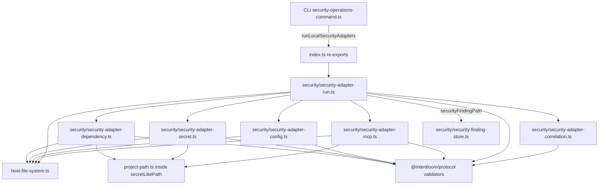

Source: `security-adapter-dependencies.mmd`. Section 7 `future-module-layout.mmd`
already shows the same leaf names; that diagram is still correct and is not
duplicated here.

Rules:

- Clients depend on the package barrel only; no new subpath exports.
- Extracted leaves import `host-file-system.ts`, `project-path.ts`, protocol
  validators, and sibling scanner modules only through the runner.
- No leaf imports `index.ts` or `src/neutron/**`.
- `security-finding-store.ts` does not import adapter modules.

### 22.4 DDD ownership

Bounded context: **Security findings** (section 5). Local adapter execution
produces normalized `SecurityFinding` records and adapter metadata; it is not
Approved Apply, not sandbox evaluation, not continuous audit orchestration.
Correlation is a domain helper for duplicate suppression within one category
batch.

### 22.5 Data flow

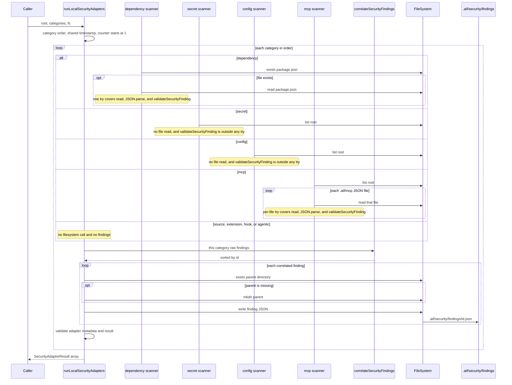

Source: `security-adapter-run-sequence.mmd`.

### 22.6 Failure propagation and error boundaries

| Boundary                                                             | Behavior today                                                                                                                                                                                                                             | P1K.7 change |
| -------------------------------------------------------------------- | ------------------------------------------------------------------------------------------------------------------------------------------------------------------------------------------------------------------------------------------ | ------------ |
| Dependency `package.json` missing                                    | `fs.exists` is false; no dependency findings; category still returns one adapter result                                                                                                                                                    | none         |
| Dependency `fs.exists` failure                                       | propagates before the try; this category is not persisted; earlier categories stay on disk                                                                                                                                                 | none         |
| Dependency `fs.read`, `JSON.parse`, or `validateSecurityFinding`     | one try around the whole manifest; catch keeps findings already pushed and counter increments already evaluated; remaining names in that manifest are skipped; no throw; correlation and persistence still run; later categories still run | none         |
| Secret or config `fs.list` failure                                   | propagates; this category is not correlated or persisted; earlier categories stay on disk                                                                                                                                                  | none         |
| Secret or config `validateSecurityFinding`                           | outside any try; propagates; findings already pushed for this category are not written; counter is not rewound; later categories do not run                                                                                                | none         |
| MCP `fs.list` failure                                                | propagates, same as secret and config listing                                                                                                                                                                                              | none         |
| MCP per-file `fs.read`, `JSON.parse`, or `validateSecurityFinding`   | one try per matching JSON file; that file stops; earlier files' findings stay; a validation throw consumes an id and does not push; later files still run; the partial list is correlated and persisted                                    | none         |
| Parent `fs.exists`, `fs.mkdir`, or `fs.write` during persistence     | outside every scanner try; propagates; findings already written in this run stay, including earlier findings in the same category; remaining writes and categories do not run                                                              | none         |
| `validateSecurityAdapterMetadata` or `validateSecurityAdapterResult` | after that category's writes; throw leaves those files on disk and skips later categories                                                                                                                                                  | none         |
| `inside()` path traversal                                            | throws; not caught by the dependency try when it happens before `fs.exists`                                                                                                                                                                | none         |

No new fail-open or fail-closed policy is introduced. Partial persistence on
write failure is an existing limitation, not fixed here.

### 22.7 Security and trust invariants

Documented in section 3.8 and section 12. Additional P1K.7 clarifications:

- Secret scanner: path-only; `secretLikePath` from `project-path.ts`; evidence
  redacted; description exposes relative path (future hardening candidate).
- Empty stub categories must remain zero-finding adapters with full metadata.
- Adapter `readOnly` / `networkAccess` metadata does not skip persistence.
- `nodeFileSystem` symlink follow behavior unchanged.

### 22.8 Code size and SCC constraints

| Constraint             | Requirement                                                                                                                   |
| ---------------------- | ----------------------------------------------------------------------------------------------------------------------------- |
| Production file budget | each new module ≤250 effective preferred, ≤400 hard                                                                           |
| Function budget        | each function ≤40 preferred, ≤80 hard; runner orchestration split so no 188-line function remains                             |
| SCC after slice        | import-only `[3]`; re-export-inclusive `[4, 27, 3]` unchanged                                                                 |
| Structure test         | same style as `tests/legacy-subagent-task-record-p1j-structure.test.ts`: no `index.js` import from new leaves, measured sizes |

Forecast: `index.ts` drops by ~209 effective lines toward the P1K.7 row in
section 15 (remeasure on implementation).

### 22.9 Test strategy

**Before extraction (characterization, new or extended tests):**

- Default eight categories in exact order; assert eight adapter results.
- Caller order `["mcp", "dependency"]` and duplicate
  `["dependency", "dependency"]`.
- Shared counter: dependency then secret ids `sec-dep-1`, `sec-secret-2` (etc.).
- Correlation: higher, equal, and lower severity on same rule/evidence key.
- Secret: `.env` match, skip `node_modules`, evidence `[REDACTED]`, description
  contains relative path.
- Dependency: `*` / `latest` / `>=`; `^` not flagged; malformed JSON silent.
- Config: `.aif/` without `.aif/policy`.
- MCP: `allowGenericShell === true`; malformed JSON silent.
- Empty categories `source`, `extension`, `hook`, `agentic`: zero findings,
  one result each.
- Persisted JSON bytes and path layout under `.aif/security/findings/`.
- Partial persistence: simulate write failure after first finding (injected FS).
- CLI JSON and text for `security scan`.

**After extraction:** existing tests above plus `pnpm verify`; structure test
for six modules; `applicationCycles` unchanged.

### 22.10 Design First acceptance matrix

| Area                                          | Covered                    |
| --------------------------------------------- | -------------------------- |
| Public interfaces and compatibility           | section 22.2               |
| Component ownership (six modules)             | sections 3.8, 22.3–22.4    |
| Data flow scanner → correlation → persistence | section 22.5               |
| Success path                                  | section 22.5 sequence      |
| Failure paths and propagation                 | section 22.6               |
| Validation boundaries                         | sections 22.6, 3.8         |
| Partial write / no rollback                   | sections 22.6, 3.8         |
| Category and finding ordering                 | section 3.8                |
| Redaction and description-path behavior       | sections 3.8, 22.7         |
| Test strategy including negatives             | section 22.9               |
| Non-goals                                     | sections 10 (P1K.7), 22.11 |
| SCC topology and size budgets                 | section 22.8               |
| Diagrams                                      | sections 22.3–22.5, 7, 12  |

Maintainer approval of this matrix and section 3.8 decomposition is required
before any P1K.7 implementation pull request.

### 22.11 Non-goals (P1K.7)

- Implementing scanners for `source`, `extension`, `hook`, or `agentic`.
- Changing rule IDs, severities, scanners strings, or trust classes.
- Symlink hardening, transactional persistence, retries, or caching.
- Protocol schema or package export-map edits.
- Neutron, Approved Apply, Undo, or P1K.8+ slices.

### 22.12 Future work (not P1K.7)

- Redact or generalize secret-finding descriptions that include paths.
- Real scanners for stub categories (separate Design First).
- Stronger containment for `fs.list` traversal and symlink writes (section 12).

### 22.13 Implementation acceptance matrix (for the future implementation PR)

The implementation PR must satisfy all of the following (characterization
tests first, then move code):

1. All eight categories in exact default order when `categories` omitted.
2. Caller-supplied category order preserved; duplicate categories not deduped.
3. Shared `findingCounter` across categories in one invocation.
4. Finding ID prefixes `sec-dep-`, `sec-secret-`, `sec-cfg-`, `sec-mcp-` and
   deterministic lexicographic order after correlation.
5. Correlation: higher severity replaces lower; equal keeps first; lower does
   not replace higher.
6. Secret path exclusions and evidence `[REDACTED]`.
7. Description still interpolates relative path for secret findings.
8. Malformed dependency JSON is caught with read and
   `validateSecurityFinding` for the whole manifest: no throw, findings
   already accepted in that manifest stay, the counter is not rewound, and
   later dependency names in that file are skipped. Malformed MCP JSON is
   caught per file with that file's read and `validateSecurityFinding`: no
   throw, other MCP files continue, and a consumed id is not reused.
9. Dependency version matching: `*`, `latest`, `>=` only.
10. Config missing-policy when `.aif/` present without `.aif/policy`.
11. MCP `allowGenericShell === true` detection.
12. Empty scanner categories still return adapter results with `totalCount: 0`.
13. Persisted finding JSON: two-space indent, trailing newline, paths via
    `securityFindingPath`.
14. Directory creation when the parent is missing. Listing failures, parent
    `exists` / `mkdir` / `write` failures, and secret or config validation
    failures propagate. Dependency and MCP read, parse, and validation
    failures stay inside their existing catch boundaries.
15. Partial persistence when a write fails after earlier writes succeeded.
16. CLI JSON and text output unchanged for `security scan`.
17. No protocol or public export changes beyond re-export wiring.
18. No new SCC; structure tests and `applicationCycles` match section 22.8.
19. Six modules exist; `runLocalSecurityAdapters` body not a single 188-line
    function in any file.
20. Barrel re-exports `correlateSecurityFindings` and `runLocalSecurityAdapters`
    only; scanners stay internal.

### 22.14 Remaining risks

| Risk                                                  | Mitigation                                 |
| ----------------------------------------------------- | ------------------------------------------ |
| Behavior drift during mechanical move                 | characterization tests before edit         |
| Accidental scanner implementation for stub categories | explicit non-goals and tests               |
| Leaf imports barrel and recreates SCC                 | structure test forbids `index.js` import   |
| Oversized runner after split                          | measure each function in CI structure test |
| Silent "fix" of description-path leak                 | documented as future work only             |

## 23. Diagram index

| Diagram                                 | Source file                           | Section |
| --------------------------------------- | ------------------------------------- | ------- |
| Current application barrel dependencies | `current-barrel-dependencies.mmd`     | 4       |
| Bounded-context ownership               | `bounded-context-ownership.mmd`       | 5       |
| Future target module layout             | `future-module-layout.mmd`            | 7       |
| Approved Apply cycle                    | `approved-apply-cycle.mmd`            | 8       |
| Alternatives for breaking that cycle    | `approved-apply-alternatives.mmd`     | 8       |
| Phased implementation dependencies      | `phased-implementation.mmd`           | 9       |
| Security trust boundaries               | `security-trust-boundaries.mmd`       | 12      |
| Approved Apply synchronization sequence | `approved-apply-sync-sequence.mmd`    | 14      |
| P1K.7 security adapter dependencies     | `security-adapter-dependencies.mmd`   | 22      |
| P1K.7 adapter run sequence              | `security-adapter-run-sequence.mmd`   | 22      |
| P1K.9 proposal lifecycle dependencies   | `workspace-proposal-dependencies.mmd` | 24      |
| P1K.9 promote, review, and apply        | `workspace-proposal-sequence.mmd`     | 24      |

## 24. P1K.9 workspace proposal lifecycle — Design First gate

Status: **proposed** (this documentation pull request). Parent design PR #627
remains the architectural roadmap. This section records behavior verified on
`main` at `d8c5f2c5c4c06e86bf6f04d4014bcf6e68f066db` (P1K.8, PR #639) and the
extraction contract for slice P1K.9 only. It does not approve implementation
and it does not change adoption, sandbox, or mutation behavior.

**Branch naming.** Pull request #640 uses
`design/p1k9-workspace-proposal-boundaries`. `AGENTS.md` allows only
`<type>/<short-kebab>` with change types such as `feat`, `fix`, `refactor`,
`docs`, `test`, `chore`, `build`, `ci`, `perf`, `security`, `release`, and
`revert`; `design/` is not in that list. Keep PR #640 and its remote branch as
is unless a maintainer explicitly authorizes a rename or a duplicate pull
request. Use an approved prefix (for example `docs/p1k9-workspace-proposal-boundaries`)
for future work on this slice.

### 24.1 Problem and scope

P1K.9 moves workspace proposal path resolution, promotion, review, and apply
orchestration out of `packages/application/src/index.ts` into
`packages/application/src/workspace/workspace-proposal-lifecycle.ts`.

Declarations:

| Name                                     | Today                 | After extraction                               |
| ---------------------------------------- | --------------------- | ---------------------------------------------- |
| `workspaceProposalPath`                  | private in `index.ts` | private in the leaf                            |
| `promoteWorkspaceConversationToProposal` | public                | public wrapper on the barrel; body on the leaf |
| `WorkspaceProposalReviewResult`          | public interface      | public type re-exported from the leaf          |
| `reviewWorkspaceProposal`                | public                | public wrapper; body on the leaf               |
| `applyWorkspaceProposal`                 | public                | public wrapper; body on the leaf               |

Conversation persistence stays in
`workspace/workspace-conversation-store.ts`. `syncLocalWorkspaceState` and
`getInteractiveWorkspaceState` stay on `index.ts`.

Measured on this baseline with `measureProductionSource`: `index.ts` is 857
effective lines and 903 physical lines. The parent forecast removes about 70
effective lines while the three public wrappers remain. Re-measure during the
implementation PR. Preferred file budget is 250 effective lines; hard limit is 400. Preferred function budget is 40 effective lines; hard limit is 80. Current
bodies are within the hard function limit (`promote` about 33 effective,
`review` about 38, `apply` about 23, path helper 3).

### 24.2 Verified current behavior

Verified by reading `packages/application/src/index.ts` and
`packages/cli/src/workspace-command.ts` on the baseline above.

**Promote**

- Loads the conversation with `getWorkspaceConversation` and the same
  `FileSystem` (implementation in `workspace-conversation-store.ts`).
- **Conversation path resolution.** `workspaceConversationPath` calls
  `inside(root, ...)` before any I/O. A conversation id that escapes the root
  throws `path traversal:` from path resolution. That error propagates; promote
  does not catch it.
- **Conversation presence and readability.** `fs.exists(path)` runs outside
  the read/parse/validate `try/catch`. An `exists` error propagates. When
  `exists` is false, `getWorkspaceConversation` returns `null`.
- **Conversation bytes and record shape.** `fs.read`, `JSON.parse`, and
  `validateWorkspaceConversationRecord` run inside a `try/catch` that returns
  `null` on any failure (unreadable file, invalid JSON, or invalid record).
  Those failures do not propagate as read or parse errors to promote's caller.
- Throws `Workspace conversation ${conversationId} not found` when the loaded
  record is `null`. Promote does not distinguish missing file, bad JSON, or
  invalid record. It does not copy conversation messages into the proposal.
- Proposal id is `options.proposalId` when supplied, otherwise
  `prop-${Date.now()}`.
- Calls `adoptProject` with `profile: "generic"`, `adapters: ["codex"]`, and
  `dryRun: true`. No `transactionOptions` argument is passed.
- Resolves `.aif/proposals/{id}.json` with `workspaceProposalPath` only after
  that dry-run adoption returns. A proposal id that escapes the root throws
  `path traversal:` at this point, after adoption and before `fs.exists`.
- Writes `JSON.stringify(proposal, null, 2)` plus a trailing newline to that
  path.
- Creates the parent directory only when `fs.exists(dirname(path))` is false.
- Returns the adoption proposal object, not a separate review record.
- Conversation `fs.read`, JSON parsing, and record validation failures are
  caught inside `getWorkspaceConversation`, which returns `null`. Promote then
  throws `Workspace conversation ${conversationId} not found`. Those failures
  do not propagate as read, parse, or validation errors.
- Conversation path resolution (`workspaceConversationPath` / `inside`) and
  conversation `fs.exists` failures outside that catch propagate unchanged.
- After a conversation record is loaded, adoption failures, proposal parent
  directory creation (`mkdir`), proposal-path `fs.exists`, and proposal write
  failures propagate as implemented today. There is no retry and no rollback
  of a partial write.

**Review**

- Resolves the proposal path with `workspaceProposalPath` before `fs.exists`.
  A proposal id that escapes the root throws `path traversal:` before the
  read and before the dry-run adoption fallback.
- When the file exists, assigns `JSON.parse(await fs.read(path))` with no
  schema validator and no `try/catch`.
- When the file does not exist, calls the same dry-run `adoptProject` as
  promote and does not write that result.
- `affectedPaths` is `proposalData.items.map((item) => item.path)`.
- Sandbox input is
  `{ changes: affectedPaths.map((path) => ({ type: "modify", path })) }` with
  `{ root, projectId: options.proposalId }` and the same filesystem.
- `readyToApply` is `sandboxEval.allowed`. `schemaVersion` on the review
  result is the literal `1`, not a field read from the proposal file.
- `options.policyPath` is part of the public options object. The function body
  does not read it and does not pass it to `evaluateProposalAgainstSandbox`.
  The CLI still forwards `--policy` into that field. Preserve this unused
  argument.

**Apply**

- Throws `human approval required (--approved-by USER)` when `approvedBy` is
  missing or `approvedBy.trim()` is empty.
- A non-empty trimmed string is the only check. It is not a capability token,
  plan digest, or ADR-0053 approval.
- Then calls `adoptProject` with `profile: "generic"`, `adapters: ["codex"]`,
  and `dryRun: options.dryRun ?? false`.
- `proposalId` and `planFile` are accepted on the options object and are not
  read. Apply does not call `workspaceProposalPath` or `inside()` for the
  proposal id, does not open the stored proposal, and does not read
  `readyToApply`. A proposal id that would fail path checks does not throw
  from this function.
- Apply does not call `executeApprovedApplyPlan` or
  `evaluateApprovedApplyPlan`.
- The CLI always passes `dryRun` from the presence of `--dry-run`, so the CLI
  path does not rely on the library default. Direct library callers that omit
  `dryRun` get `false`.

These are existing semantics. Extraction must not “correct” them.

### 24.3 Port and public wrappers

`adoptProject` still lives on `index.ts` and calls `adoptGeneratedFiles` with
`syncProject`. A leaf that imported `adoptProject` from `../index.js` would
cycle as soon as the barrel re-exported the leaf.

The leaf therefore takes a typed internal port. It is not a public option on
`promoteWorkspaceConversationToProposal`, `reviewWorkspaceProposal`, or
`applyWorkspaceProposal`.

```ts
type WorkspaceProposalAdoption = (
  options: InitOptions,
  fs: FileSystem,
  transactionOptions?: TransactionOptions,
) => Promise<AdoptionProposal>;
```

Leaf operations take `(options, fs, adoptProject)`. They do not default
`adoptProject`. Barrel wrappers keep today’s public signatures, including
`fs = nodeFileSystem`, and pass the local `adoptProject`:

```ts
export async function promoteWorkspaceConversationToProposal(
  options,
  fs = nodeFileSystem,
) {
  return promoteWorkspaceConversationToProposalOperation(
    options,
    fs,
    adoptProject,
  );
}
```

The same pattern applies to review and apply. `WorkspaceProposalReviewResult`
is defined on the leaf and re-exported from the barrel. `workspaceProposalPath`
stays unexported. There is no new package, `package.json` export, workspace
directory barrel, or public dependency-injection callback.

The port does not add an authorization bypass. Callers of
`@intentloom/application` still hit the wrappers, which always pass the
existing `adoptProject`. Tests may pass a substitute only by importing the
leaf module directly. That substitute cannot widen the public CLI or package
API.

When `adoptProject` later moves to a module that does not import the barrel
(P1K.16), the port can become a direct import and the wrappers can become
re-exports. That is not part of P1K.9.

### 24.4 Dependency direction

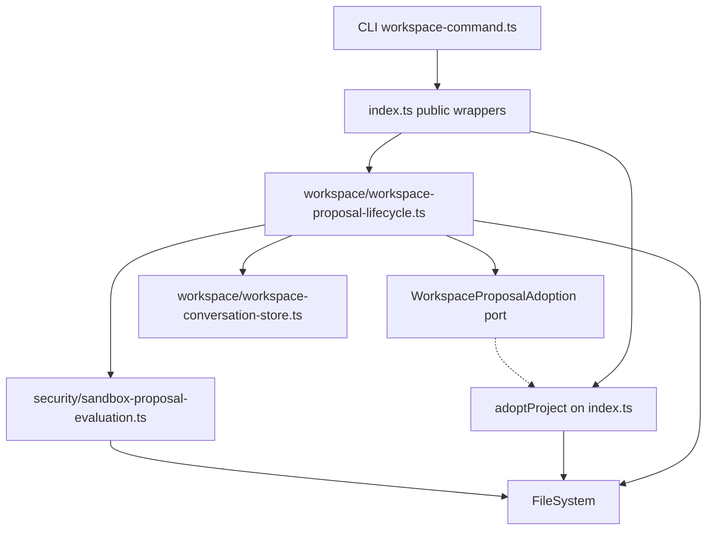

Source: `workspace-proposal-dependencies.mmd`.

The leaf may import `getWorkspaceConversation` from the conversation leaf and
`evaluateProposalAgainstSandbox` from
`security/sandbox-proposal-evaluation.ts`. It must not import `../index.js`,
`@intentloom/application`, Neutron modules, or Approved Apply modules.

Import-only SCC membership on this baseline is the Neutron mutation trio
(`[3]`). Re-export-inclusive membership is `[4, 27, 3]` with the same members
as P1K.8, including `index.ts` inside the 27-file component. The new leaf must
stay outside every component. Do not edit `quality-exceptions.json`.

### 24.5 Sequence

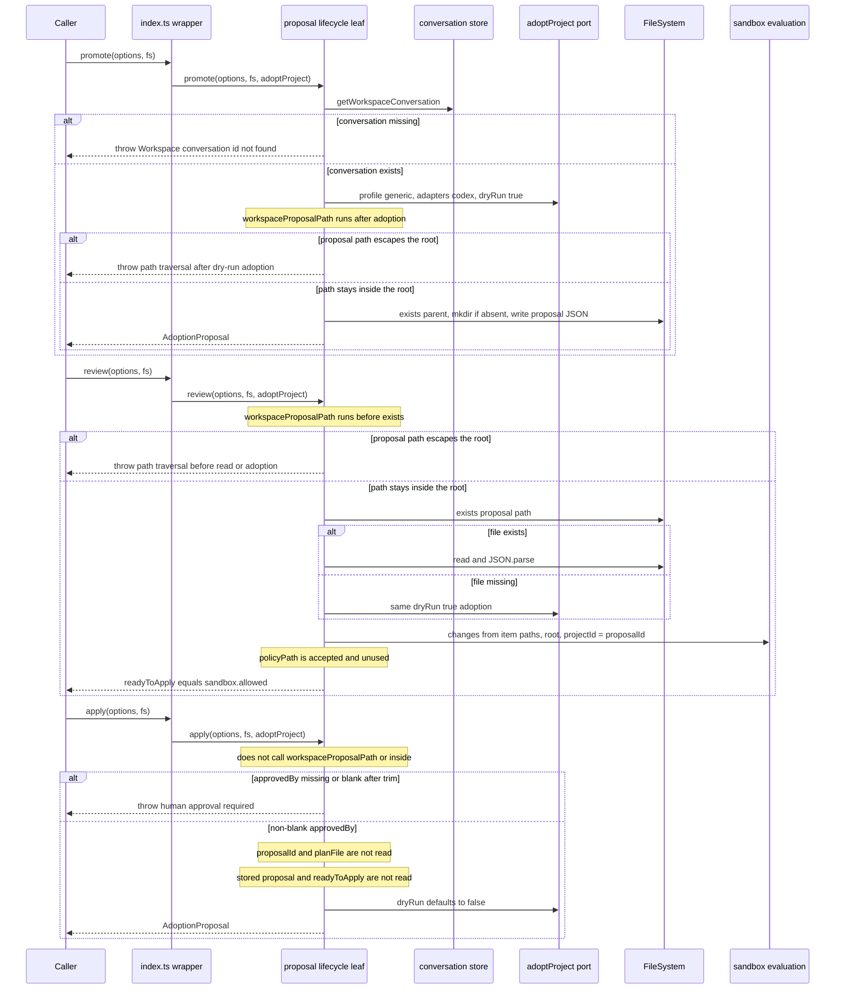

Source: `workspace-proposal-sequence.mmd`.

### 24.6 Security and trust

Three classes of statement are kept separate.

**Verified today**

- Promote proves only that a conversation record loaded. It then stores a
  dry-run adoption proposal. Creating that file is not permission to mutate
  the project.
- Review reports sandbox `allowed` as `readyToApply`. A denied review is a
  report. Apply does not consult it.
- Apply checks that `approvedBy` is non-blank after trim, then runs adoption
  with `dryRun` defaulting to false. The string is an operator label, not a
  cryptographic grant and not an ADR-0053 capability.
- ADR-0053 requires plan digest, expiry, project-state digest, and
  `evaluateApprovedApplyPlan` before mutation. This workspace API does not
  call that gate and does not provide atomic rollback, transaction binding, or
  fail-closed plan identity.

**Preserve in P1K.9**

- The three behaviors above, including the unused `policyPath`, `proposalId`,
  and `planFile` fields, and the fact that apply ignores `readyToApply`.

**Future Design First, not this slice**

- Binding apply to the stored proposal, honoring `readyToApply`, forwarding
  `policyPath`, or routing workspace apply through ADR-0053. Any of those
  changes behavior and needs its own design review.

No invariant in this extraction requires a behavior change. If implementation
cannot keep apply off the Approved Apply engine without a code change, stop
and report a blocker.

### 24.7 Error and persistence matrix

| Condition                                     | Operation       | Current result                                                                                                      | Persistence                                                                                    |
| --------------------------------------------- | --------------- | ------------------------------------------------------------------------------------------------------------------- | ---------------------------------------------------------------------------------------------- |
| Proposal id escapes the root (`inside`)       | promote         | throws `path traversal:` only after the conversation load and dry-run `adoptProject` return, and before `fs.exists` | no proposal write; dry-run adoption already ran                                                |
| Proposal id escapes the root (`inside`)       | review          | throws `path traversal:` when resolving the path, before `fs.exists`, read, or the adoption fallback                | no proposal write                                                                              |
| Proposal id that would escape the root        | apply           | not checked. Apply does not call `workspaceProposalPath` or `inside()`                                              | no proposal write from this function                                                           |
| Conversation id escapes root (`inside`)       | promote         | throws `path traversal:` during `workspaceConversationPath`, before `exists` or read                                | no proposal write                                                                              |
| Conversation file absent (`exists` false)     | promote         | `getWorkspaceConversation` returns `null`; promote throws `Workspace conversation ${id} not found`                  | no proposal write                                                                              |
| Conversation `fs.read` fails (caught)         | promote         | swallowed in `getWorkspaceConversation`; promote throws the not-found error                                         | no proposal write                                                                              |
| Conversation JSON parse fails (caught)        | promote         | same as read failure: `null`, then not-found error                                                                  | no proposal write                                                                              |
| Conversation record validation fails (caught) | promote         | same: `null`, then not-found error                                                                                  | no proposal write                                                                              |
| Conversation `fs.exists` throws               | promote         | propagates (outside the catch in `getWorkspaceConversation`)                                                        | no proposal write                                                                              |
| `fs.exists` throws on proposal path           | promote, review | propagates                                                                                                          | no new write from this function                                                                |
| `adoptProject` throws                         | promote         | propagates before write                                                                                             | no proposal file from this function                                                            |
| Parent `mkdir` throws                         | promote         | propagates after dry-run adoption                                                                                   | proposal file absent                                                                           |
| Proposal `write` throws                       | promote         | propagates                                                                                                          | partial file only if the filesystem wrote before failing; this function does not roll back     |
| Proposal JSON parse throws                    | review          | propagates                                                                                                          | no write                                                                                       |
| Stored JSON has no `items`                    | review          | throws when mapping paths                                                                                           | no write                                                                                       |
| Proposal file absent                          | review          | dry-run `adoptProject` fallback                                                                                     | fallback is not written                                                                        |
| Sandbox evaluation throws                     | review          | propagates                                                                                                          | no write                                                                                       |
| `approvedBy` missing or blank                 | apply           | throws the approval error before adoption                                                                           | no write in this function                                                                      |
| `adoptProject` throws                         | apply           | propagates                                                                                                          | mutation effects are whatever `adoptProject` already performed; this function adds no rollback |
| `dryRun: true`                                | apply           | adoption dry-run                                                                                                    | no project mutation beyond what dry-run adoption already does                                  |
| `dryRun` omitted                              | apply           | treated as `false`                                                                                                  | mutating adoption, still not ADR-0053                                                          |

No new retries, caches, swallowed errors, or transactions.

### 24.8 Alternatives

| Option                                                         | Result                                                                                           |
| -------------------------------------------------------------- | ------------------------------------------------------------------------------------------------ |
| Leave the three operations on `index.ts`                       | No cycle, but the barrel keeps proposal persistence and the P1K size gate stays missed.          |
| Leaf imports `adoptProject` from `index.ts`                    | Re-export cycle as soon as the barrel exports the leaf. Rejected.                                |
| Leaf takes `WorkspaceProposalAdoption` from the barrel wrapper | Preserves public signatures, avoids the cycle, and does not add a public injector. **Selected.** |
| Public dispatcher or `executeApprovedApplyPlan` inside apply   | Changes authorization and mutation. Rejected for P1K.9.                                          |

### 24.9 Implementation test plan

The implementation PR adds characterization tests **before** moving production
code, then structure and port tests **after** the leaf exists. Do not add those
tests in this design PR.

#### Stage A — Before extraction (baseline characterization)

Characterize the three public operations only through the current
`@intentloom/application` package API and existing filesystem or test seams
(memory filesystem, integration fixtures, CLI tests where applicable).

- Use observable behavior: public return values, thrown error messages and
  types, bytes on disk, and sandbox side effects.
- Do **not** introduce production dependency injection, optional callbacks, or
  other hooks solely to enable baseline characterization.
- Baseline characterization must pass on `main`-equivalent behavior before any
  proposal lifecycle bodies move out of `index.ts`.

Suggested file: `tests/workspace-proposal-p1k9-characterization.test.ts`.

Required Stage A cases:

- Promote succeeds and writes formatted JSON with a trailing newline.
- Conversation absent (`exists` false): promote throws the exact not-found
  error and writes nothing.
- Conversation file present but malformed JSON or invalid record: promote throws
  the same not-found error (not a parse or validation error at the promote
  boundary).
- Conversation `fs.read` failure: the file exists, `read` throws, and promote
  throws the exact `Workspace conversation ${conversationId} not found` error
  and writes nothing. Observe this through the public package API and an
  existing filesystem seam. Do not add a production test hook to force the
  failure.
- Conversation id path traversal: `path traversal:` propagates from promote
  (before not-found).
- Conversation `fs.exists` failure: propagates through promote.
- Supplied `proposalId` and generated `prop-${Date.now()}` ids.
- Observable adoption outcome on promote: persisted bytes are the formatted
  dry-run `AdoptionProposal`, not the conversation record. `AdoptionProposal`
  does not expose top-level `profile`, `adapters`, or `dryRun`; assert
  `applied: false`, `applicationStatus: "not-requested"`,
  `transactionOutcome: null`, and exact JSON with trailing newline. Exact
  internal `adoptProject` argument lists and invocation ordering belong in Stage
  B port tests when public seams cannot observe the call.
- Directory is created only when absent.
- Review of an existing file uses those bytes and does not call adoption.
- Review of a missing file calls dry-run adoption and does not write it.
- Sandbox `changes` are `{ type: "modify", path }` for each item path, and
  `projectId` is the proposal id.
- `readyToApply` follows `allowed` for both true and false.
- Passing `policyPath` does not change the sandbox call.
- Malformed proposal JSON and `exists` failures propagate.
- Blank and whitespace `approvedBy` throw the exact approval error.
- Apply with `dryRun: true` and with `dryRun` omitted (`false`).
- `proposalId` and `planFile` do not select a file or plan.
- Filesystem and adoption failures propagate.
- Promote path traversal throws only after conversation retrieval and dry-run
  adoption, and does not write the proposal file.
- Review path traversal throws before `exists`, read, and adoption.
- Apply does not throw a proposal-path traversal error. A traversal-shaped
  `proposalId` still reaches the approval check and `adoptProject`.
- CLI JSON and text output and exit codes stay as in
  `tests/cli-workspace.test.ts` (promote 0, review 0 or 3, apply approval
  failure).

Existing references: `tests/workspace-apply.test.ts`,
`tests/cli-workspace.test.ts`, `tests/workspace-agent.test.ts`.

#### Stage B — After extraction (leaf and adoption port)

Once `workspace-proposal-lifecycle.ts` exists, add tests that import the leaf
operations with a mock `WorkspaceProposalAdoption` port (not a new public API).
Do not require a production callback or other test hook before extraction.
Stage A stays on the public package API and existing filesystem seams.

When exact adoption arguments or invocation ordering cannot be asserted through
those baseline seams, Stage B port tests are the place that verifies them:

- Assert exact adoption arguments (`profile: "generic"`, `adapters: ["codex"]`,
  `dryRun: true` for promote and the review fallback; apply `dryRun` as
  passed), call count, and invocation ordering for promote, review fallback,
  and apply.
- Assert adoption errors propagate unchanged through wrappers.
- Assert public barrel wrappers preserve current signatures, default
  `nodeFileSystem`, and observable compatibility with Stage A baselines.
- Do **not** expose an additional public callback or production test hook.

Structure tests must show one implementation of each moved body, a private
path helper, no `workspace/index.ts`, no new export map, no leaf import of
`index.js`, unchanged SCC member sets, and unchanged
`quality-exceptions.json`.

Public wrappers are not the same function references as the leaf operations,
because each wrapper injects the existing `adoptProject`. Stage B structure and
compatibility assertions include:

- The public names `promoteWorkspaceConversationToProposal`,
  `reviewWorkspaceProposal`, and `applyWorkspaceProposal` stay exported from
  `@intentloom/application` with the current options and the default
  `FileSystem`.
- Each wrapper passes the caller options, the filesystem, and the existing
  `adoptProject` function into its leaf operation.
- Return values, error messages, and observable behavior stay compatible with
  Stage A.
- `WorkspaceProposalReviewResult` stays a public type.
- The internal adoption-port operations are not new package-level APIs.
- The extraction adds no import or re-export cycle. The leaf stays outside the
  existing SCC member sets.

### 24.10 Design First acceptance matrix

Implementation starts only after a maintainer checks every row. PR #643
implementation began on 2026-11-26 **before** this matrix was recorded in Git;
that was a Design First sequence deviation. Independent review accepted the
extraction architecture; explicit maintainer sign-off for every row below is
still required before merge and must be recorded in the pull request and
`DUTY_WATCH.md` — not backdated.

| #   | Maintainer confirms                                                 | Required |
| --- | ------------------------------------------------------------------- | -------- |
| 1   | Section 24 matches code on `d8c5f2c`                                | yes      |
| 2   | Public signatures and CLI error strings stay                        | yes      |
| 3   | `adoptProject` is an internal port, not a public option             | yes      |
| 4   | Apply stays off ADR-0053 and ignores `readyToApply`                 | yes      |
| 5   | Unused `policyPath`, `planFile`, and apply `proposalId` stay unused | yes      |
| 6   | Leaf stays outside SCC sets `[3]` and `[4, 27, 3]`                  | yes      |
| 7   | Characterization tests land before the move                         | yes      |
| 8   | No Neutron, Undo, or quality-exception edits                        | yes      |

### 24.11 Non-goals

P1K.10 and later slices, moving sync or interactive workspace state, Approved
Apply integration, sandbox rule changes, protocol changes, package export
maps, Undo U4, and Desktop Undo U5.

Each fenced diagram in this file is the same text as its `.mmd` source.
Mermaid is the only diagram format. Excalidraw and draw.io are not used
because these graphs are dependency and sequence records, not sketches that
need a freehand canvas.
